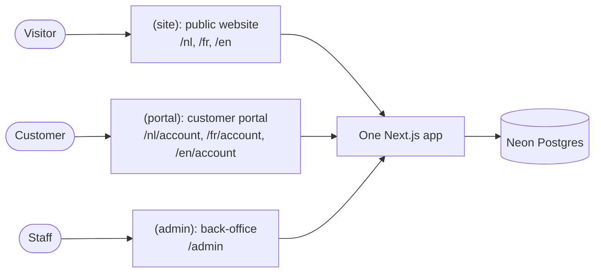
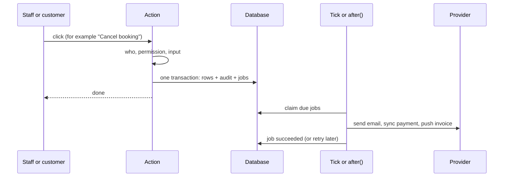

# Architecture

The BEAM platform is **one application with one database**. Every module reads and writes the
same customer record, so a booking, a purchase, a form answer and an email click all land on the
same person. This page explains how the pieces fit. The full technical design is in
[01-architecture.md](../plan/01-architecture.md).

## The building blocks

| Part | Technology | Where |
| --- | --- | --- |
| Application | Next.js 16 (React 19, TypeScript 5.9) | Vercel, region `fra1` (Frankfurt) |
| Database | PostgreSQL 18 on Neon, accessed through Drizzle ORM | Neon, region `aws-eu-central-1` (Frankfurt) |
| Background work | A `jobs` table and a one-minute tick | Same database and application |
| Email | Resend | EU sending region |
| Payments | Mollie (Stripe and Viva possible through the same interface) | Provider |
| Invoices to accounting | Billit (Peppol access point) | Provider |
| Monitoring | Sentry (EU), Better Stack, Slack `#beam-alerts` | Providers |

There is no separate queue service, no separate file store and no separate search engine. Files
(invoice PDFs, receipts, imports, exports) are stored in the database, in the `files` table.

## The code repository

The code is one repository with one deployable app and five shared packages.

| Folder | What it holds |
| --- | --- |
| `apps/web/app/` | The pages and API routes (see "The three parts of the site" below) |
| `apps/web/modules/<module>/` | Each module's actions, queries, jobs, schedules, events, permissions, menu entries, privacy handlers, settings and screens |
| `apps/web/lib/` | The shared runtime: the action wrapper, sign-in, jobs, settings, flags, files, logging, the AI gateway, sensitive-data access |
| `packages/db/` | Database tables (`src/schema/<module>.ts`), views, migrations, seeds and test helpers |
| `packages/core/` | Pure business logic without database access: pricing, VAT, credit allocation, the automation planner, form scoring, translations |
| `packages/email/` | Email templates and the block editor renderer |
| `packages/integrations/` | One client per outside service, each with a fake for tests |
| `packages/ui/` | Shared screen components (buttons, tables, forms, the three-language text input) |
| `docs/` | This handbook, the runbooks, the plan and the requirements |

## The twelve modules

Each module has the same name in every folder. A module may call another module only through that
module's `api.ts` file (or its pure functions in `@beam/core/<module>`). A lint rule enforces this,
so modules stay separate and can be changed one at a time.

| Module | What it owns | Release |
| --- | --- | --- |
| `platform` | Staff and customer accounts, roles, sign-in, jobs, tick, settings, feature flags, audit log, files, webhook inbox, integration log, AI gateway, System pages, support register | V1 |
| `crm` | Persons, duplicates and merge, sensitive fields, consent, suppressions (unsubscribes), the timeline, tags, segments, tasks, companies | V1 (inbox and B2B pipeline R3) |
| `booking` | Session templates, sessions, capacity, bookings, guests, cancellation, waitlist and claim links, check-in | V1 |
| `commerce` | Products, price versions, promotions, checkout, orders, payments, refunds, mandates, POS, vouchers | V1 |
| `credits` | Packages (credit grants), the credits ledger, sharing, expiry, memberships and renewals | V1 |
| `finance` | Invoices, credit notes, numbering, PDFs, Billit sync, finance screens | V1 |
| `forms` | Form builder, versions, logic, scoring, result pages, sensitive answers, embeds | V1 |
| `email` | Templates, block editor, campaigns, sending, bounces and complaints, link tokens | V1 |
| `automation` | Journeys: definitions, groups, enrolments, the evaluator and the run log | V1 |
| `ops` | Action and management dashboards, person statistics, imports, exports, privacy requests, retention | V1 |
| `site` | Public website pages, versions, Claude-assisted page proposals, SEO, legal pages | V1 |
| `webinar` | Webinars on YouTube Live, registrations, watch time, polls, CTAs, replay | R2 |

## The three parts of the site

| Part | Address | Who | Sign-in | Language |
| --- | --- | --- | --- | --- |
| Public website `(site)` | `/nl/...`, `/fr/...`, `/en/...` | Everyone | None | From the address |
| Customer portal `(portal)` | `/<locale>/account/...` | Customers | Magic link by email, optional password | From the address |
| Back-office `(admin)` | `/admin/...` | Staff | Email, password and an authenticator code (MFA) | From the staff user's profile |

The request filter (`apps/web/proxy.ts`) sends every `/admin` address through the staff check and
every `/account` address through the customer check. A bare address such as `/book` is redirected
to the best language. The portal can be installed on a phone as an app (a PWA); it does not work
offline for anything that changes data.

Next to the pages, `apps/web/app/api/` holds the API routes: `health`, `cron/tick`, the webhooks
from Mollie, Resend and Meta, and the public endpoints for forms, claim links, unsubscribe,
preferences, files and email tracking.

## How a click becomes a change: actions

Every change a person makes goes through one **action** (`apps/web/modules/<module>/actions.ts`).
The action wrapper always does the same things in the same order:

1. Find out who is asking (staff, customer, system job or webhook).
2. Check the permission (for example `bookings.write`). No permission, no change.
3. Check the input with a schema.
4. Open one database transaction and run the change.
5. Write an audit row for every staff change (who, what, old value, new value).
6. Commit, then start the jobs the change created, right away, so a confirmation email leaves within
   seconds.

## The outbox rule: a request never calls a provider

A web request only writes rows and **jobs** in the same transaction. Jobs do the talking to the
outside world. This is called the transactional outbox. It means a slow or broken provider never
breaks a page, and nothing is lost: if the email provider is down, the job waits and tries again.

There are three documented exceptions, which still run as logged jobs: creating a Mollie payment at
checkout, starting a terminal payment at the POS counter, and (Release 4) a staff member's live
question to Claude.

## Jobs

A job is a row in the `jobs` table with a kind (such as `email.send`), a payload, a status and a
unique **idempotency key** (such as `email:<message id>`). The same key can never be queued twice,
and every job can safely run twice: the second run changes nothing.

| Status | Meaning |
| --- | --- |
| `pending` | Waiting for its time (`run_at`) |
| `running` | Being worked on |
| `succeeded` | Done (kept 7 days) |
| `failed` | Failed, will retry after 1 min, 5 min, 15 min, 1 h, 6 h |
| `dead` | Gave up after the last attempt, or the error is permanent (kept 90 days) |

A dead job posts one line to Slack `#beam-alerts` and shows on `/admin/system/jobs` with a Retry
button. See [docs/runbooks/dead-jobs.md](../runbooks/dead-jobs.md).

Jobs run in two lanes: `fast` for things a person waits for (emails, payment updates) and `bulk`
for big batches (campaign chunks, imports, exports). Big work is cut into chunks of about 500 rows;
each chunk queues the next one.

## The one-minute tick

Vercel calls `/api/cron/tick` every minute (`vercel.json`, the only cron). The tick:

1. Queues every schedule due this minute (for example `credits.expire_grants` at 00:05).
2. For up to 50 seconds, claims and runs due jobs: up to 20 fast jobs, then up to 5 bulk jobs per
   round. Two ticks can overlap safely because each job is claimed with a database lock.
3. Releases jobs stuck in `running` for more than 10 minutes, writes the time of the last tick and
   pings Better Stack.

If the tick stops, `/api/health` turns red after 3 minutes and Better Stack calls the on-call
founder. The schedules are declared in each module's `schedules.ts`; the most important ones:

| Every | Jobs |
| --- | --- |
| Minute | `automation.evaluate`, `waitlist.expire_offers`, `payments.scan_expired`, `bookings.expire_reservations`, `email.dispatch_due_campaigns` |
| 5 to 15 minutes | `platform.check_alerts`, `checkouts.mark_abandoned`, `billit.sync_pending`, `bookings.send_reminders`, `bookings.mark_no_shows`, `ops.refresh_recent_stats` |
| Hour | `segments.refresh` |
| Night (Brussels time) | `credits.expire_grants` 00:05, `privacy.retention_sweep` 01:00, `files.purge_expired` 02:00, `sessions.materialise` 03:10, `jobs.prune` 03:30, `ops.refresh_person_stats` 04:00, `ledger.reconcile` 04:30, `memberships.scan_renewals` 06:10 |
| Morning | `ops.daily_digest` 08:00 (Slack summary) |
| Month | `platform.build_monthly_report` on the 1st at 07:10 |

## Events and the timeline

Every important fact is written once to `activity_events` on the person: `booking.confirmed`,
`order.paid`, `email.clicked`, `consent.withdrawn` and so on. This is the customer timeline that
staff see. The same rows drive the automations: `automation.evaluate` reads new events every
minute and starts or stops journeys (see [automations.md](automations.md)).

## Rules that hold everywhere

- **Money** is stored in whole cents, in euro, VAT included, with VAT per line.
- **Time** is stored in UTC and calculated in Brussels time (`Europe/Brussels`).
- **Append-only facts.** The tables `activity_events`, `consent_records`, `credit_entries`,
  `automation_runs`, `audit_log`, `email_events` and a few others reject any update or delete at
  database level. Balances and statuses are calculated from them in views.
- **Sensitive data** (health, sleep, stress, recovery, wellbeing, medical) lives in three places
  only, is encrypted, and is read through one function that writes an audit row. It never goes to
  logs, segments, exports for staff or AI. See [roles.md](roles.md#sensitive-data).
- **Languages.** `nl-BE` is the default; `fr-BE` and `en` are complete. There is no fallback
  language.

## Where to look next

- Tables and columns: [database.md](database.md) and [data-model.generated.md](data-model.generated.md).
- Outside services: [integrations.md](integrations.md).
- Step-by-step flows across modules: [core-workflows.md](core-workflows.md).
