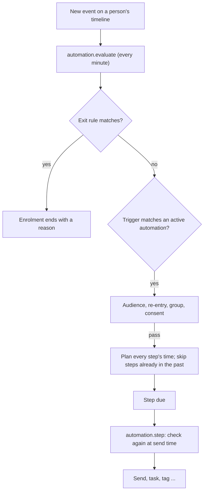

# Automations

An **automation** (also called a journey or sequence) sends emails, creates tasks or adds tags on
its own when something happens to a person: they sign up, book for the first time, run low on
credits, stop coming. This page explains how the engine decides, the seeded journeys, and how to
pause. The full rules are A-1 to A-46 in [automation.md](../plan/modules/automation.md); what to do
when an alert fires is in [docs/runbooks/automations.md](../runbooks/automations.md).

Marketing staff (`automations.write`, `automations.publish`) manage automations on
`/admin/automations`.

## How one automation is built

An automation is a published, versioned definition with:

- a **trigger**: an event such as `booking.attended`, optionally filtered (`where`), or "entered a
  segment", or "started by hand";
- an **audience**: which statuses, segments and languages may enter;
- an **anchor** (optional): a date to count from, such as the session start;
- a **re-entry** rule: `never`, `always`, or `after_days:N`;
- **exit_on**: events that end the journey early, such as `order.paid`;
- **steps**, each with a time: `email`, `wait`, `condition` (branch), `task`, `tag`, `untag`,
  `set_field`, `status_override`, `enrol`, `exit`, `notify_slack`, `webhook`.

Editing an active automation creates a **new version**. People already in the journey keep the
old version unless staff tick "migrate active enrolments" when publishing (A-6, A-40).
Publishing is refused when a referenced email template is missing a language of the audience
(A-3).

## How the engine runs

1. **Reading events.** `automation.evaluate` runs every minute and reads the new rows of
   `activity_events` in order (up to 1,000 per run). Sensitive events and events made by
   automations themselves are ignored (A-7, A-8).
2. **Exits first.** For each event, the engine first ends journeys that this event stops (built-in
   exits and `exit_on`), then looks for new triggers (A-9).
3. **Entry checks** run under a lock on the person: not erased or merged, audience, re-entry,
   group exclusivity and, for marketing journeys, whether the person may receive marketing for
   that purpose (A-11 to A-15).
4. **Planning.** Every step gets its due time from the enrolment time or the anchor (A-17).
5. **Send-time checks.** When a step is due, `automation.step` checks again, in this order:
   enrolment still active, automation not paused, person not erased, the step's `unless`
   condition, consent and suppressions for marketing, translation available. The first failing
   check is written in the run log and the step is skipped (A-26, A-31). Conditions always use
   fresh data, not data copied at entry (A-27).
6. **The log.** Every decision is one row in `automation_runs`: entered, scheduled, sent, skipped
   (with the reason), branched, exited, completed. Staff see it on the person's timeline and on
   `/admin/automations/[id]/runs` (A-41).

## Groups: one journey at a time

Automations belong to a **group**. In an exclusive group a person can be in only one journey at a
time; a journey with a lower priority number wins and the other one exits with `superseded`
(A-15). Groups that share a **lane** form one exclusivity domain.

| Group | Exclusive | Lane | Priority |
| --- | --- | --- | --- |
| `customer_journey` | yes | `sales_journey` | 10 |
| `webinar` | yes | `sales_journey` | 20 |
| `waitlist` | yes | `sales_journey` | 25 |
| `lead_nurture` | yes | `sales_journey` | 30 |
| `package`, `inactivity`, `membership`, `transactional`, `review`, `sales`, `checkout` | no | – | 100 |

So a lead nurture sequence, a customer sequence and a webinar sequence never run for the same
person at the same time, while package reminders and transactional reminders can run next to them.
Groups are edited on `/admin/automations/groups`.

## Late entry: why someone gets fewer emails

When a person enters late, steps whose time is already past are skipped and logged as
`skipped_late_entry`, unless the step is marked "send now on late entry" (A-18). Example: someone
registers on Friday for a Sunday event; the "7 days before" and "3 days before" reminders are
skipped, the "3 hours before" reminder is sent, and the log says why (scenario 1).

## Exits

- **Built-in exits** (every automation): the person is merged into another record, a suppression
  is added (unsubscribe, bounce, complaint) for marketing journeys, consent for the purpose is
  withdrawn, the person is erased (A-21).
- **`exit_on`** per automation, for example `order.paid` ends a lead journey and
  `membership.started` ends a newcomer journey (A-22).
- **Fast unsubscribe.** An unsubscribe ends running marketing journeys within seconds, not at the
  next tick: the suppression itself queues `automation.exit_for_suppression` and runs it right after
  the click (A-23, scenario 2).
- Transactional journeys (booking reminders, membership renewal notices) are not stopped by a
  marketing unsubscribe, but any marketing step inside them is still skipped (A-24).

## The seeded journeys

These are created by the seed, editable by marketing, and never overwritten by a later seed
(section 3.6 of the automation spec has every step and time). "T" is a transactional email (no
marketing consent needed), "M" a marketing email.

| Journey | Starts when | What it does | Stops when |
| --- | --- | --- | --- |
| `welcome-lead` | A new lead is created (not by import) | Welcome and education emails (M) over two weeks, a webinar and BEAM Experience invitation, tags `engaged` on a click | Purchase, first visit, membership |
| `lead-sales-follow-up` | A new lead is created | Call tasks for sales after 2 and 9 days, unless they booked | Purchase, booking |
| `assessment-follow-up` | An assessment result is ready | Result follow-up (M), Experience invite, sales task; supersedes `welcome-lead` | Purchase, booking, membership |
| `event-registration` | An event booking is confirmed | Reminders 7 days, 3 days and 3 hours before (T) | That booking cancelled (also late) |
| `after-first-booking` | A first day or night booking is confirmed | Preparation and intake reminders (T) before the visit | That booking cancelled (also late) |
| `after-first-visit` | First check-in | Follow-up and feedback (T), package offer (M), sales task | Membership starts |
| `package-usage` | 50, 75, 80, 90 % used or last unit | Usage notes (T), "almost done" and "last session" (M), task | A new package of the same kind bought, a membership, or the next threshold of the same package |
| `package-expiry` | 30 and 7 days before a package or voucher expires | Expiry reminder (T) | Package used up or extended |
| `package-finished` | A package is used up | Repurchase email (M), customer service task | A new package of the same kind bought, a membership |
| `inactivity` | No visit for 30, 60, 90 or 180 days | "We miss you" emails (M), a task at 90 days, tag `dormant` at 180 | A new booking or purchase |
| `member-welcome` | A membership starts | Welcome (T), first booking nudge (M), one-month check task | Membership ends |
| `membership-renewal` | 30 and 7 days before renewal | Renewal or "your membership ends" notice (T) | Renewed, cancelled, expired |
| `review-request` | Check-in | Review request (M) the next day, at most once per 30 days, never after a no-show | No-show |
| `waitlist-offer` | A waitlist place is offered | "Your offer expires soon" 30 minutes before expiry (T) | Claimed, expired, released |

Seeded as **draft** for later activation: `abandoned-checkout` (Release 2, behind the flag
`ff_commerce_checkout_recovery`), `waitlist-follow-up`, `event-follow-up` and the webinar
journeys (Release 2; the watch-time journeys stay draft until the DPIA for watch-time profiling is
approved, A-5a).

Automations can never create, change or cancel a booking, a credit, an order or a payment. They
only send, tag, create tasks and set a few profile fields (A-44).

## Pausing and resuming

- **One automation:** open it on `/admin/automations` and press Pause (`automations.publish`,
  audited `automation.pause`). While paused nobody enters and no step runs; exits still apply.
- **Resume:** email, Slack and webhook steps more than 24 hours overdue are skipped
  (`skipped_paused`) so nobody gets an old message; the rest is sent at once (A-28, A-29).
- **Stop all marketing quickly** (wrong template, deliverability problem): pause every active
  marketing automation, as described in [docs/runbooks/automations.md](../runbooks/automations.md#pausing-every-marketing-journey-during-an-incident).

## Staff controls on the person page

With `automations.move_person`, on the person's Automations tab:

| Control | What it does | Audit |
| --- | --- | --- |
| Exit | Ends one journey with reason `manual` | `automation.person_exit` |
| Enrol | Puts the person in any active automation, overriding re-entry and exclusivity | `automation.person_enrol` |
| Move | Exit one journey and enrol in another, in one step | `automation.person_move` |
| Preview | Shows the next steps with their times and the expected outcome, without changing anything | none |

## Monitoring

The automation module owns the "failed automations" check of the platform monitoring (A-45).
Slack gets a line when a journey is stuck more than 30 minutes past a step, when the evaluator is
more than 5 minutes behind, when more than 20 runs failed in an hour, and when a step job is dead.
What to do for each alert: [docs/runbooks/automations.md](../runbooks/automations.md).
