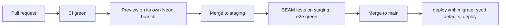

# Deployment

How a change travels from a developer to the live platform, how features are switched on, and how
to go back when something is wrong. The rules are PL-76 to PL-79 in
[platform.md](../plan/modules/platform.md) and section 9 of
[01-architecture.md](../plan/01-architecture.md).

## Environments

| Environment | Address | Code from | Database | Data | Providers |
| --- | --- | --- | --- | --- | --- |
| Local | `http://localhost:3000` (`pnpm dev`) | A developer's checkout | `beam_dev` or a personal Neon branch | Demo seed | Fakes or test keys; email goes to one test mailbox (`EMAIL_SINK`) |
| Preview | One Vercel URL per pull request | The pull request | Neon branch `preview/pr-<n>` | Demo seed | Test mode |
| Staging | Vercel environment `staging` | Git branch `staging` | Neon branch `staging` (before week 7: the `main` deployment on `beam_dev`) | Demo seed until go-live, then an anonymised copy refreshed monthly | Mollie test key, Billit sandbox, `EMAIL_SINK` |
| Production | `www.beam.be` | Git branch `main` | Neon branch `production`, database `neondb` | Real data, only after the go-live gate | Live keys only |

`APP_ENV` says which environment the code runs in (`local`, `preview`, `staging`, `production`).
Outside production, every email goes to the sink mailbox, payments run in test mode, Billit uses
its sandbox and AI is capped at 100 calls a day (PL-76). In production, `/api/health` fails when
any of these test settings is still present.

## The release flow



1. **Pull request.** Every change starts as a pull request. CI (`.github/workflows/ci.yml`) runs:
   generated indexes, typecheck, lint (with the module boundaries), translation check, all unit and
   database tests, migration checks, views and append-only checks, GDPR coverage, dependency audit
   and a secret scan. The pull request template asks whether tests, translations and the handbook
   were updated.
2. **Preview.** Vercel builds a preview for the pull request; `preview-branch.yml` gives it its own
   Neon branch with the demo data. The author tests there.
3. **Staging.** After review the change is merged into `staging`. BEAM's product owner tests on
   staging and the end-to-end tests (`e2e.yml`, Playwright) must be green.
4. **Production.** `staging` is merged into `main`. `deploy.yml` then runs `pnpm db:migrate` against
   production, runs the `defaults` seed, builds and deploys to Vercel.
5. **Guard.** `deploy.yml` refuses to deploy a commit that has not been on `staging` first. The only
   exception is a pull request labelled `hotfix`, which must be merged into `staging` within
   24 hours (PL-76a).

Releases are tagged by date (`v2026.11.14`); the changelog is the list of merged pull requests.
Dependency updates (Renovate, every Monday morning) follow the same path.

### Database changes in a release

A release only **adds** to the database (new tables, nullable columns, indexes, views). Removing or
renaming happens a release later, once no code uses the old shape. This is why a code rollback
never needs a database rollback. See [database.md](database.md#migrations).

## Feature flags

A user-visible feature reaches production behind a **flag** named `ff_<module>_<name>`, first for
testers only. BEAM switches it on for everyone after approving it (PL-76a).

| State | Who sees the feature |
| --- | --- |
| `off` | Nobody (also the state of a flag without a row) |
| `testers` | Only staff users and customers marked as testers (`is_tester`) |
| `on` | Everybody |

- Flags are switched on `/admin/settings/flags` (`flags.manage`). No deploy is needed; the change
  reaches every server within 60 seconds. Every change is audited (`flags.update`).
- Testers are marked on the staff user page and on the customer's person page.
- A flag is removed from the code within two sprints of reaching `on`.
- Current flags include `ff_booking_lead_priority`, `ff_booking_ticket_types`,
  `ff_commerce_checkout_recovery`, `ff_crm_inbox`, `ff_crm_pipeline`, `ff_forms_portal_results`,
  `ff_ops_marketing`, `ff_ops_retention`, `ff_ops_ai` and `ff_webinar_portal` (Release 2 and later
  features). The list is generated from each module's `config.ts`.

## Rollback

| Problem | What to do | Time |
| --- | --- | --- |
| A release breaks something | `vercel rollback` (or "Promote" the previous deployment in the Vercel dashboard). The database stays as it is | Under a minute |
| One feature misbehaves | Set its flag to `off` (or `testers`) on `/admin/settings/flags` | Under a minute |
| Wrong data was written | Repair forward with a correcting job or action; for large or unknown damage, restore from a Neon point-in-time branch ([backup.md](backup.md)) | Minutes to an hour |

The database is never rolled back to undo a release. Jobs queued by the bad release keep their
idempotency keys, so running them again later does no harm. Step by step:
[docs/runbooks/rollback.md](../runbooks/rollback.md).

## The go-live gate

Real customer data is loaded only when all 13 items of the go-live gate on `/admin/system/go-live`
are confirmed, each by an owner or technical_admin with a note (PL-77). Until then production
shows a red banner and imports other than dry runs are refused. The items, the monitors to create
and the production configuration check are in [docs/runbooks/go-live.md](../runbooks/go-live.md).

## Secrets

Secrets live only in the Vercel environment groups (one per environment) and in GitHub secrets for
the workflows. `.env.example` lists every name without a value. Keys are rotated yearly, or at once
after a suspected leak ([docs/runbooks/rotate-keys.md](../runbooks/rotate-keys.md)).

## Commands a developer uses

```bash
pnpm install --frozen-lockfile   # install
pnpm gen:indexes                 # regenerate the registries (jobs, permissions, menus, ...)
pnpm dev                         # run locally
pnpm typecheck && pnpm lint && pnpm test
pnpm db:generate                 # new migration after a schema change
pnpm db:migrate                  # apply migrations (uses DATABASE_URL_UNPOOLED)
pnpm db:seed --profile defaults  # required rows; --profile demo for demo data
pnpm docs:schema                 # regenerate docs/handbook/data-model.generated.md
```
