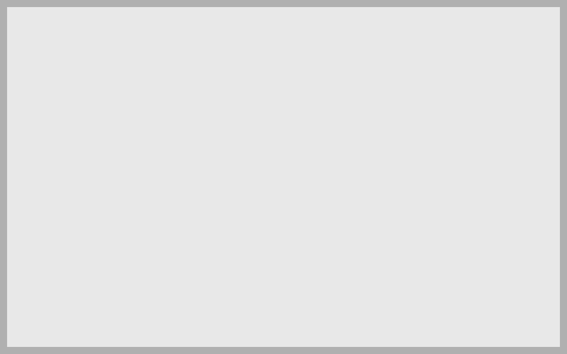

# Administration

For: owner (**Eigenaar**) and technical admin (**Technisch beheerder**). George follows this guide as
BEAM's technical point of reference.

This guide covers staff accounts, roles and permissions, the settings of each module, feature flags
and the go-live checklist. Everything here is recorded in the audit log
(see [Privacy and security](privacy-security.md)).

## How do I give a new colleague access?

1. Open **Instellingen** > **Medewerkers** (**Iedereen die zich aanmeldt in de back-office, met rol,
   MFA en status.**).
2. Under **Een collega uitnodigen**, enter the work email address, the name and the **Rol**, and click
   **Uitnodiging versturen**. The colleague receives an email to set a password and then sets up
   two-step verification (MFA); until then the list shows **Uitnodiging openstaand** and
   **Wacht op MFA**.
3. Invitation lost or expired? **Uitnodiging opnieuw versturen**.

Give each person the smallest role that fits the work (see the table in the [README](README.md)).
Use one account per person; never share an account.

## How do I change someone's role or remove their access?

1. Open the colleague on **Medewerkers**, change the **Rol** and click **Opslaan**. A role change signs
   the colleague out everywhere (**Een rolwijziging meldt de gebruiker overal af.**).
2. When someone leaves, click **Account uitschakelen**: they are signed out immediately and cannot sign
   in again. Accounts are never deleted, so their history stays readable. **Account inschakelen**
   restores access.

## How do I help a colleague who lost their authenticator?

1. Check who you are talking to (in person or by phone on a known number).
2. On **Medewerkers**, open the colleague and click **MFA resetten**, with a **Reden voor de MFA-reset**.
3. The colleague sets up MFA again at the next sign-in
   (**MFA is gereset. De gebruiker stelt het opnieuw in bij de volgende aanmelding.**). They receive an
   email about the change.

If no owner can sign in any more, the technical partner resets MFA from the command line
(`pnpm admin:reset-mfa`); that is also audited.

## How do I change what a role may do?

1. Open **Instellingen** > **Rollen**. The page lists the nine roles with their **Actieve gebruikers**
   and how many **Rechten** (permissions) each has.
2. Open a role, tick or untick the permissions and save. Changes apply from the user's next request.
3. **De eigenaarsrol heeft altijd alle rechten, ook die later worden toegevoegd.**: the owner role
   cannot be narrowed.

Be careful with the permissions that open sensitive data or exports: they are the ones the privacy
rules depend on.

## Where are the settings of each module?

**Instellingen** (**Accounts, rollen, feature flags en de instellingen van elke module.**) has one card
per area, among them **Medewerkers**, **Rollen**, **Feature flags**, **AI** and **Bedrijf** (legal
name, VAT number, address and contact details, used in invoices and the legal footer of every
email). Module settings such as the booking rules, opening hours and closing days (**Boekingsregels**,
**Sluitingsdagen**) and the invoicing settings (**Facturatie-instellingen**) are reached from their own
module's menu.

Change a setting, check the result on `beam_dev` or staging when you can, and note why in the change
request if the change is significant.

## How do I switch a feature on or off?

1. Open **Instellingen** > **Feature flags** (**Zet een functie uit, alleen aan voor testers of aan voor
   iedereen. Wijzigingen gelden binnen een minuut.**).
2. Set the **Status**: **Uit** (off), **Testers** (only staff and customers marked as tester) or on for
   everyone, and save. Each flag shows who changed it last and when.
3. To try a new feature as a customer, mark a customer as tester (**Klant als tester**) and switch the
   flag to **Testers** first.

## How do I complete the go-live checklist?

1. Open **Systeem** > **Go-live-checklist**. It shows **... van ... bevestigd**.
2. Each item is a check BEAM confirms before real customers and real data go on the platform, for
   example **Subverwerkers bevestigd**, **Hostingregio bevestigd (EU)**,
   **AI-provider traint niet op onze gegevens**, **Back-ups bevestigd** and
   **Hersteloefening geslaagd**.
3. Click **Bevestigen** for an item only when you checked it yourself; add a note on how. The item then
   shows **Door ... op ...**.

The data migration and the real-payment switch stay blocked until every item is confirmed.
