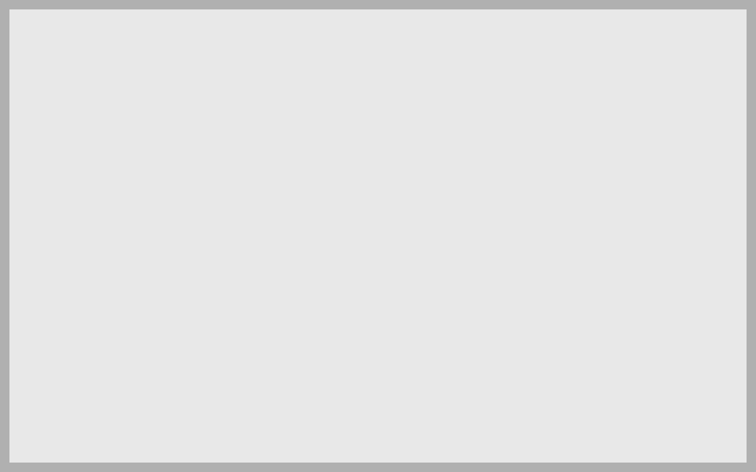

# Booking

For: reception (**Onthaal**) and customer service (**Klantendienst**).

This guide covers the session calendar, booking on behalf of a customer, cancelling and moving
bookings, waitlists and what the customer sees in the portal. Checking people in at the desk is in
[Daily use](daily-use.md).

## How do I see the sessions of a week?

1. Open **Sessies** in the menu. The calendar shows **Week van ...** with **Vorige week**,
   **Volgende week** and **Vandaag** to move around.
2. Filter on **Soort** (day sessions, night sessions, events). Each session shows
   **... van ...** (booked of capacity), how many seats are held for unpaid checkouts
   (**... gereserveerd**) and how many people are waiting (**... wachtend**).
3. Click a session to open it: **Capaciteit** shows **... geboekt van ...**, with the participants
   and the open waitlist offers (**Open aanbiedingen**).

Sessions come from the weekly schedule (**Planning**). Owners and technical admins change the
schedule, closing days (**Sluitingsdagen**) and the booking rules (**Boekingsregels**); reception
staff only read them.

## How do I book a session for a customer?

1. Open **Boekingen** and click **Nieuwe boeking**.
2. **Zoek een persoon**, or create one with **Nieuwe persoon** (first name, last name, email).
3. Pick the **Sessie**.
4. Choose the **Betaling**:
   - **Beurt uit pakket**: uses one session from the customer's package (the remaining balance shows
     as **Nog ... beurten**);
   - **Nu betalen aan de kassa**: creates an order to pay now at the desk;
   - **Betalen aan het onthaal bij aankomst**: the customer pays on arrival;
   - **Gratis**: only with a reason.
5. Add **Gasten** with **Gast toevoegen** if the customer brings people.
6. Leave **De bevestigingsmail versturen** on so the customer gets the confirmation with the check-in
   code, then click **Boeking aanmaken**.

A full session (**Volzet**) can only be booked over capacity with **Boeken boven de capaciteit** and a
**Reden**; it is logged. Use it only when the owner agreed.

## How do I find a booking?

1. Open **Boekingen** and type in **Zoek een persoon of sessie**.
2. Narrow down with **Status**, **Betaald met**, **Bron**, **Van** and **Tot**.
3. Open a booking to see the **Geschiedenis** (status history), the **Gebruikte beurten**, the linked
   **Bestelling** and the **Incheckcode**.

## How do I cancel or move a booking?

1. Open the booking. The cancellation policy is shown on top: **Gratis annuleren tot ...** (free until
   that moment), or **Nu annuleren houdt de sessie als gebruikt** (a late cancellation keeps the
   session as used).
2. To move it, click **Verplaatsen naar een andere sessie** and pick the new session.
3. To cancel, click **Boeking annuleren**. Tick **Ook de gasten annuleren** to cancel the guests too.
4. Only for exceptions, with a **Reden (verplicht)**: **Annuleren en de beurt teruggeven** (give the
   session back to the package) or **Annuleren en terugbetalen** (refund).

The free-cancellation window and the no-show rules are set on **Boekingsregels**
(**Gratis annuleren tot (uren voor de start)**, **Niet opgedaagd automatisch markeren**).

## How do I cancel a whole session?

1. Open the session and click **Sessie annuleren**.
2. Give a **Reden (zichtbaar voor medewerkers)** and keep **Elke deelnemer een e-mail sturen** on.
3. Confirm. Every booking is cancelled and released or refunded, and the participants get an email.

## How does the waitlist work?

When a session is full, customers can join its waitlist. When a seat frees up, BEAM offers it to the
first person in line by email; the offer expires after a while (**Aanbod verloopt**) and then moves
to the next person.

1. Open **Wachtlijsten** to see every queue.
2. **Plaats aanbieden** offers a free seat to someone right away; **Positie wijzigen** changes the
   order; **Naar een andere wachtrij** moves the person to another session.
3. **Persoon toevoegen** puts someone on the list by hand (for example after a phone call). A person
   without email shows **Geen e-mail: bel deze persoon over het aanbod.**: call them.
4. **Te controleren** shows entries flagged as possible duplicates (**Signalen van dubbels**); check
   and **Markering wissen**, or **Terugtrekken** the duplicate.

## What does the customer see?

In the customer portal (**Boeken**, `/nl/account/book`) the customer picks Day, Night or Events,
a day in the date strip and a session. A session shows the places left (the exact number only when
five or fewer), the price or "1 session from your package", and **Volzet** when full, with the option
to join the waitlist. Their bookings are under **Mijn boekingen**, where they can cancel within the
rules.
