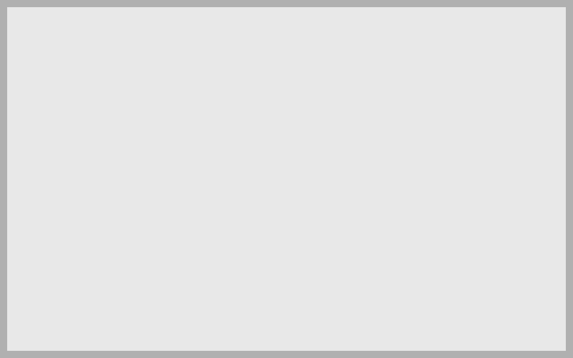

# Privacy and security

For: owner (**Eigenaar**) and technical admin (**Technisch beheerder**). Customer service reads the
first two sections too.

BEAM processes health-related information, so the platform is built so that the safe way is the
default. This guide covers privacy requests from customers, how sensitive data is handled, retention,
the security page and the audit log.

## How do I handle a privacy request?

A customer can ask to receive their data, to have it erased or corrected, to restrict its use or to
object to marketing. Most do it themselves on **Privacy** in the customer portal
(**Mijn gegevens downloaden**, **Mijn account verwijderen**, **Het gebruik van mijn gegevens beperken**,
**Bezwaar maken tegen marketing**). Requests by email, letter or phone you register yourself.

1. Open **Privacyverzoeken** and click **Nieuw verzoek**. Choose the kind: **Gegevensexport**,
   **Wissen**, **Verbetering**, **Beperking** or **Bezwaar tegen marketing**, and the person.
2. Check the identity of the requester before anything happens: click **Verifiëren** and describe in
   **Hoe werd de identiteit gecontroleerd?** how you checked it (for example: answered from the
   address known in BEAM). Never send data to an address that is not the person's own.
3. Each request has a legal deadline, shown as **Uiterlijk ...**; **Bijna over tijd** and the dashboard
   card **Privacyverzoeken bijna over tijd** warn you in time.
4. **Nu uitvoeren** runs the request:
   - an export creates a file the person downloads from the portal for 7 days;
   - an erasure starts after a 24-hour waiting period (**Wissen start op ...**) during which it can be
     cancelled; read the warnings and tick **Ik heb de waarschuwingen gelezen**. Invoices are kept for
     the legal period, and a fingerprint of the email address is kept so the person never receives
     marketing again;
   - a correction is done on the person, then **Als verbeterd markeren**;
   - a restriction stops marketing and analysis for the person until **Beperking opheffen** with a
     reason.
5. The request's **Verslag** (report) records what was done. **Manuele opvolging nodig** means a step
   outside BEAM is left (for example a copy in a mailbox).

## How is sensitive data protected?

- Health, sleep, stress, recovery and wellbeing data is stored encrypted, in separate fields, and only
  roles with the sensitive-data permission can open it. Every opening is recorded.
- It never appears in exports (including the full data export), segments, campaigns, AI tools or
  logs. Only the exit copy of the whole database (`pnpm exit:export`) contains it, still encrypted,
  with the key handed over separately.
- Staff record it only in the sensitive fields and **Gevoelige notitie** (see
  [Customer management](customer-management.md)), and mark inbox conversations **Gevoelig**.
- Processing it with AI is switched off and stays off unless an approved DPIA exists
  (**DPIA-register**; see [AI tools](ai-tools.md)).

## How long is data kept?

**Privacyverzoeken** > **Bewaartermijnen** lists, per kind of data, how long BEAM keeps it and what
happens after that (deleted or anonymised). A nightly sweep applies the terms. Change a term only after
checking it against the agreed retention policy; the change is audited. The **DPIA-register** records
the data protection impact assessments, with **Doel**, **Risico’s**, **Maatregelen** and the decision.

## How do I check the security status?

**Systeem** > **Beveiliging** (**Encryptiesleutels, MFA-dekking, geblokkeerde accounts, back-ups,
hersteloefeningen en ethische hackingtests.**) shows:

- MFA coverage of staff and accounts that are locked;
- **Laatste back-up** and **Laatste hersteloefening** (the last backup and the last restore drill; both
  run automatically and are recorded here);
- **Ethische hackingtest**: the last penetration test and the date the next one is due
  (**Volgende uiterlijk: ...**); register a new one with **Een ethische hackingtest registreren**;
- **Versies van de encryptiesleutel**: the key version in use. Replacing the key
  (**De encryptiesleutel vervangen**) is done together with the technical partner, who first adds the
  new key to the hosting environment.

Security incidents (a lost laptop, a suspicious login, data sent to the wrong person) are registered
on **Systeem** > **Incidenten** (**Een incident registreren**) and reported to the technical partner
straight away; a personal-data breach may have to be reported to the data protection authority within
72 hours.

## How do I find out who changed something?

**Systeem** > **Auditlog** (**Elke wijziging door medewerkers, taken en het systeem.**) lists every
change with who, when, from where and what changed. Filter on person, staff member, action or period.
Values of secret fields are hidden. The audit log cannot be edited or deleted, by anyone.

## Good habits

- Sign out on shared computers; never share your account or your authenticator.
- Do not download exports to personal devices; delete them when done.
- Do not forward customer data to private email or chat accounts.
- When in doubt about a request or a possible leak, ask before you act and report it.
