# BEAM data model and cross-module contract (authoritative)

This file is the single authoritative schema and contract for the BEAM platform. It sits under `00-decisions.md` and `01-architecture.md`: those two set the rules, this file gives every concrete name. Where a module spec (`docs/plan/modules/<m>.md`) and this file differ, this file wins and the spec is corrected. Every open point of `_apply-problems.md` is settled here (section 9, decisions DM-1 to DM-20), every decision of `_cross-module-decisions.md` (D1 to D69) holds, and section 10 lists every conflict resolved while writing it. Nothing in this file is open.

How to read it:

- Section 1 lists every table, grouped by owning module. Each module starts with an index (release, APPEND or IMMUTABLE flag, personal and sensitive columns, retention class and key, migration wave). The column definitions that follow are the owner's final definitions, consolidated from the module specs after the fixes of section 10.
- Section 2 lists every view, section 3 every enum, section 4 every activity event kind, section 5 the audit, job, permission, settings and flag catalogues, section 6 the exact `api.ts` signatures, section 7 the ER diagram, section 8 the migration plan.
- "Owner" is the module whose `packages/db/src/schema/<m>.ts` declares the table. Only the owner adds columns. Other modules use the owner's `api.ts` or views.

## 0. Global schema rules

These rules apply to every table unless the table says otherwise.

1. **Keys.** `id uuid primary key default gen_random_uuid()`. The one exception is `activity_events.id bigint generated always as identity` (the automation cursor reads it). Join tables with a natural key (`segment_members`, `rate_limits`, `ops_state`, `auth_accounts`, `auth_verification_tokens`) use that key as primary key.
2. **Timestamps.** `created_at timestamptz not null default now()` on every table. `updated_at timestamptz not null default now()` (Drizzle `$onUpdate`) on mutable tables only. APPEND and IMMUTABLE tables have no `updated_at`. All times are UTC; business dates (`*_on`) are Europe/Brussels calendar dates.
3. **Names.** Tables snake_case plural; foreign keys `<singular>_id`; enums `pgEnum('<table>_<column>')`, except the shared enum `locale`; booleans `is_*` or `has_*`; money `*_cents integer` in EUR, VAT included unless the column says `net`; VAT rate `vat_rate_pct numeric(4,2)` with check `in (0, 6, 12, 21)`; localised text `jsonb` typed `LocalizedText` (`{ "nl-BE"?, "fr-BE"?, "en"? }`).
4. **Email.** Stored trimmed and lower-cased; uniqueness is a unique index on `lower(email)`; no `citext` and no other extension. `email_hash` columns are the sha256 hex of the lower-cased address.
5. **Foreign keys and on-delete.** `persons` rows are never deleted (erasure anonymises them, `merged_into_person_id` keeps losers), so every FK to `persons.id` is `on delete restrict` unless a table says `cascade` or `set null`. FKs to `users.id` are `on delete restrict` (users are disabled, not deleted). FKs from a child row to its own parent inside one module (`order_lines -> orders`, `form_versions -> forms`, `page_versions -> pages`, `email_template_versions -> email_templates`, `automation_versions -> automations`) are `on delete restrict`: parents are archived, not deleted. Explicit `cascade` exists only where the spec says so (for example `capacity_holds -> sessions`, `import_rows -> imports`, `segment_members -> segments`, `person_sensitive_fields -> persons`). Cross-module FKs are declared with Drizzle's lazy form `references(() => table.id)` so mutual imports between schema files are safe.
6. **APPEND** tables reject `update` and `delete` through the trigger `reject_update_delete()` (section 8, custom migration `append_only`). The only bypass is `SET LOCAL beam.allow_rewrite = 'on'`, set by the erasure step transaction and by the retention sweep handlers. The full list is platform's `APPEND_ONLY_TABLES` (frozen after Wave 0): `activity_events`, `ai_requests`, `audit_log`, `automation_runs`, `automation_versions`, `consent_records`, `cookie_consents`, `credit_entries`, `email_events`, `imported_history`, `integration_calls`, `lightspeed_sales`, `membership_periods`, `order_lines`, `person_declarations`, `person_merges`, `price_versions`, `site_audit_reports`, `suppressions`, `terms_acceptances`, `watch_segments`, `webhook_events`, `webinar_interactions`, `webinar_moderation_actions`.
7. **IMMUTABLE** tables are versioned definitions: a row whose `published_at` is set is never edited; editing inserts `version + 1`. They are `automation_versions` and `order_lines` (also in `APPEND_ONLY_TABLES`), `form_versions`, `email_template_versions`, `page_versions`, `consent_wordings`, and `invoices` after issue (column-level, finance section 2.2). The published-row guard of `form_versions`, `email_template_versions`, `page_versions` and `consent_wordings` is enforced in the owner's service code and tested; it is not a trigger, because drafts of these tables are edited in place.
8. **Sensitive columns** (special-category data: health, sleep, stress, recovery, wellbeing, medical) exist in exactly three places and are declared with `sensitive()` so they land in `SENSITIVE_COLUMNS`: `person_sensitive_fields.value_enc`, `form_sensitive_answers.value_enc`, and `activity_events.data` of rows with `is_sensitive = true`. They are AES-256-GCM encrypted with `key_version`, read only through `readSensitive(ctx, personId, purpose, scope?)`, and never in AI context, segments, staff exports or logs. **Secret columns** (`users.totp_secret_enc`, `users.recovery_codes_enc`, hashed `users.password_hash`, `auth_verification_tokens.token`, every `*_token_hash`) are never exported or logged. **PII** marks other personal data covered by each module's `privacy.ts`.
9. **Retention classes.** Every table has one class. The policy key (`<m>.<name>`, seeded in `retention_policies`) names the owner whose `privacy.ts` `sweep[key]` runs it.

| Class | Meaning | Keys |
| --- | --- | --- |
| `legal_10y` | Belgian accounting horizon, 3653 days counted from 1 January after the fiscal year; no sweep touches a younger row; erasure before then reduces the row (`retained_legal`) | `finance.invoices` (anonymise), `commerce.orders` (anonymise), `commerce.lightspeed_sales`, `credits.ledger`, `credits.memberships`, `site.terms_acceptances` (delete) |
| `keep` | Documented, never swept | `crm.suppressions` (hash kept for ever), `crm.consent_records` (kept while the person exists, removed with the person) |
| `profile` | Whole-person anonymisation | `ops.marketing_profile` (1095 days without activity), `ops.marketing_contact` (leads, 730 days) |
| `y5` | 5 years | `platform.audit_log` (1826), `ops.privacy_requests` (1825) |
| `y3` | 3 years | `forms.form_submissions`, `forms.form_sensitive_answers`, `forms.form_views_daily`, `webinar.webinar_registrations`, `booking.bookings_free_text` (anonymise), `automation.automation_enrolments`, `crm.declarations_superseded`, `credits.referral_attributions`, `platform.support_requests` (all 1095) |
| `y2` | 2 years | `email.email_events`, `email.email_messages`, `email.campaign_recipients`, `webinar.watch_segments`, `webinar.webinar_interactions`, `automation.automation_runs`, `crm.tasks_closed`, `crm.inbox_resolved`, `credits.sharing_reviews`, `commerce.person_prices`, `finance.invoice_requests`, `ops.retention_lists`, `site.page_edit_requests` (all 730) |
| `y1` | about one year | `booking.waitlist_entries` (365), `crm.duplicate_candidates_closed` (365), `credits.reconciliation_runs` (365), `email.email_ai_drafts` (365), `finance.billit_reconcile_runs` (400), `commerce.checkouts` (395), `site.cookie_consents` (395) |
| `short` | 90 days or less | `platform.webhook_events` (90), `platform.integration_calls` (90), `commerce.payments_raw` (90, anonymise), `forms.form_import_events` (90), `finance.finance_exports` (90), `platform.files_rendered_email` (30), `platform.ai_requests` (30), `ops.import_rows` (30), `ops.nl_questions` (30), `ops.data_exports` (30), `forms.form_submissions_anonymous_abandoned` (30), `forms.form_sensitive_answers_unlinked` (30), `forms.form_submissions_ip_hash` (30, anonymise), `platform.files_export` (7), `platform.jobs` (succeeded 7, dead 90) |
| `person` | Lives as long as the person; the owner's `erase(tx, personId)` deletes or anonymises it | no policy key |
| `config` | Definitions and configuration without personal data, kept while in use; listed in `NO_PII_TABLES` | no policy key |

## 1. Tables by owning module

Wave column: `W0` = Wave 0 migration (`init`), `W1` = Wave 1 migration (`wave1`), `W2` = Wave 2 (`wave2`), `R2`, `R3`, `R4` = the release migrations (section 8). "Stub W0" means Wave 0 creates the table with its architecture columns on behalf of the owner and the owner adds columns in W1 (expand only).

### 1.1 Index

**platform** (`platform.ts`, frozen after Wave 0)

| Table | Rel | Flag | Personal / sensitive data | Retention | Wave |
| --- | --- | --- | --- | --- | --- |
| `users` | V1 | | PII `email`, `name`; secrets `password_hash`, `totp_secret_enc`, `recovery_codes_enc` | person (customer row follows the person; staff rows kept, disabled) | W0 |
| `auth_accounts` | V1 | | none in V1 | person | W0 |
| `auth_sessions` | V1 | | PII `ip`, `user_agent` | short (pruned at expiry by `platform.prune_ephemeral`) | W0 |
| `auth_verification_tokens` | V1 | | secret `token`, PII `identifier` | short (pruned at expiry) | W0 |
| `roles` | V1 | | none | config | W0 |
| `jobs` | V1 | | ids only in `payload` | short `platform.jobs` | W0 |
| `webhook_events` | V1 | APPEND | PII `payload` | short `platform.webhook_events` | W0 |
| `integration_calls` | V1 | APPEND | none (digests only) | short `platform.integration_calls` | W0 |
| `audit_log` | V1 | APPEND | PII `ip`, `old_value`, `new_value` (redacted on erasure) | y5 `platform.audit_log` | W0 |
| `settings` | V1 | | none | config | W0 |
| `feature_flags` | V1 | | ids in `user_ids`, `person_ids` | config | W0 |
| `files` | V1 | | PII `bytes`, `person_id` | `platform.files_export` (7), `platform.files_rendered_email` (30); other kinds follow the owning row | W0 |
| `ai_requests` | V1 | APPEND | PII `prompt`, `output` (never sensitive) | short `platform.ai_requests` | W0 |
| `rate_limits` | V1 | | hashed keys | short (pruned at expiry) | W0 |
| `security_incidents` | V1 | | none (free text must not name customers) | config | W0 |
| `support_requests` | V1 | | none (person id links only) | y3 `platform.support_requests` | W0 |
| `monthly_reports` | V1 | | none | config | W0 |

**crm** (`crm.ts`)

| Table | Rel | Flag | Personal / sensitive data | Retention | Wave |
| --- | --- | --- | --- | --- | --- |
| `persons` | V1 | | PII identity columns; `processing_restricted_at` is the one restriction flag | profile `ops.marketing_profile`, `ops.marketing_contact` | W0 (final columns of the architecture; crm adds the rest in W1) |
| `person_merges` | V1 | APPEND | PII `loser_snapshot` | person | W1 |
| `person_duplicate_candidates` | V1 | | ids | y1 `crm.duplicate_candidates_closed` | W1 |
| `person_sensitive_fields` | V1 | | **SENSITIVE** `value_enc` | person | W1 |
| `person_declarations` | V1 | APPEND | PII `ip` | y3 `crm.declarations_superseded` | W1 |
| `consent_records` | V1 | APPEND | PII `ip`, `user_agent` | keep `crm.consent_records` | W0 (crm adds columns in W1) |
| `consent_wordings` | V1 | IMMUTABLE | none | config | W1 |
| `suppressions` | V1 | APPEND | PII `email` (nulled on erasure), `email_hash` kept | keep `crm.suppressions` | W0 (crm adds columns in W1) |
| `activity_events` | V1 | APPEND | ids-only `data`; **SENSITIVE** `data` when `is_sensitive` | person (deleted by crm's erase) | W0 |
| `tags` | V1 | | none | config | W1 |
| `person_tags` | V1 | | link | person | W1 |
| `segments` | V1 | | none | config | W1 |
| `segment_members` | V1 | | link (cache) | person | W1 |
| `tasks` | V1 | | PII `notes`, `title` | y2 `crm.tasks_closed` | W1 |
| `companies` | V1 | | B2B contact data | config (company data, kept while active) | W1 |
| `company_contacts` | V1 | | link | person | W1 |
| `opportunities` | R3 | | B2B notes | config | R3 |
| `playbook_stages` | R3 | | none | config | R3 |
| `inbox_threads` | R3 | | PII `from_address`, `from_name`, `subject` | y2 `crm.inbox_resolved` | R3 |
| `inbox_messages` | R3 | | PII `body`, `ai_draft` | with the thread (cascade) | R3 |
| `inbox_reply_templates` | R3 | | none | config | R3 |
| `support_knowledge_articles` | R4 | | none (`NO_PII_TABLES`) | config | R4 |

**booking** (`booking.ts`; no APPEND, IMMUTABLE or sensitive columns)

| Table | Rel | Flag | Personal / sensitive data | Retention | Wave |
| --- | --- | --- | --- | --- | --- |
| `session_templates` | V1 | | none | config | W1 |
| `session_exceptions` | V1 | | none | config | W1 |
| `sessions` | V1 | | none (`notes` staff only) | config | Stub W0, W1 |
| `capacity_holds` | V1 | | `note` may name a speaker | config | W1 |
| `ticket_types` | V1 (used R2) | | none | config | W1 |
| `bookings` | V1 | | links; free text `notes`, `cancel_reason` | y3 `booking.bookings_free_text` (anonymise); rows kept while linked to orders and the ledger | Stub W0, W1 |
| `waitlist_entries` | V1 | | PII `email_normalised`, `join_ip_hash` | y1 `booking.waitlist_entries`; deleted on erasure | W1 |

**commerce** (`commerce.ts`; no sensitive columns)

| Table | Rel | Flag | Personal / sensitive data | Retention | Wave |
| --- | --- | --- | --- | --- | --- |
| `products` | V1 | | none | config | Stub W0, W1 |
| `price_versions` | V1 | APPEND | none | config | Stub W0, W1 |
| `person_prices` | V1 | | link | y2 `commerce.person_prices` | W1 |
| `promotions` | V1 | | none | config | W1 |
| `promotion_redemptions` | V1 | | link (nulled on erasure) | with the order | W1 |
| `checkouts` | V1 | | PII `email`, `utm` | y1 `commerce.checkouts` | W1 |
| `orders` | V1 | | link, `note` | legal_10y `commerce.orders` | Stub W0, W1 |
| `order_lines` | V1 | IMMUTABLE (and APPEND) | none | legal_10y (with the order) | Stub W0, W1 |
| `payments` | V1 | | PII `raw` | short `commerce.payments_raw` (anonymise `raw`); row legal_10y with the order | W1 |
| `refunds` | V1 | | none | legal_10y (with the order) | W1 |
| `mandates` | V1 | | PII `details_summary`, link | person (revoked and nulled on erasure) | W1 |
| `provider_customers` | V1 | | link | person | W1 |
| `vouchers` | V1 | | PII `recipient_name`, `recipient_email`, `message` | legal_10y (with the order line); PII nulled on erasure | W1 |
| `pos_day_closes` | V1 | | none (`NO_PII_TABLES`) | legal_10y | W1 |
| `lightspeed_imports` | R3 | | none | config | R3 |
| `lightspeed_sales` | R3 | APPEND | none (`NO_PII_TABLES`) | legal_10y `commerce.lightspeed_sales` | R3 |

**credits** (`credits.ts`; no sensitive columns; free-text columns are PII-risk)

| Table | Rel | Flag | Personal / sensitive data | Retention | Wave |
| --- | --- | --- | --- | --- | --- |
| `credit_grants` | V1 | | link, `note` | legal_10y `credits.ledger` | Stub W0, W1 |
| `credit_entries` | V1 | APPEND | link, `reason` | legal_10y `credits.ledger` | Stub W0, W1 |
| `package_shares` | V1 (used R2) | | link | person | W1 |
| `memberships` | V1 | | link, `notes` | legal_10y `credits.memberships` | W1 |
| `membership_plan_inclusions` | V1 | | none | config | W1 |
| `membership_plan_benefits` | V1 | | none (`NO_PII_TABLES`) | config | W1 |
| `credit_bulk_extensions` | V1 | | none (`NO_PII_TABLES`) | config | W1 |
| `membership_periods` | V1 | APPEND | link | legal_10y `credits.memberships` | W1 |
| `credit_sharing_reviews` | R2 (created V1) | | link, `note` | y2 `credits.sharing_reviews` | W1 |
| `credit_reconciliation_runs` | V1 | | ids (`NO_PII_TABLES`) | y1 `credits.reconciliation_runs` | W1 |
| `referral_codes` | R3 | | link | config | R3 |
| `referral_attributions` | R3 | | links | y3 `credits.referral_attributions` | R3 |
| `partner_commissions` | R3 | | `note` | legal_10y (with the order) | R3 |

**finance** (`finance.ts`; no sensitive columns)

| Table | Rel | Flag | Personal / sensitive data | Retention | Wave |
| --- | --- | --- | --- | --- | --- |
| `invoices` | V1 | IMMUTABLE after issue (column level) | PII `customer_snapshot`, link | legal_10y `finance.invoices` (anonymise) | Stub W0, W1 |
| `invoice_sequences` | V1 | | none | legal_10y | W1 |
| `order_billing_details` | V1 | | PII billing name, address, VAT, email | legal_10y (with the order) | W1 |
| `invoice_requests` | V1 | | PII billing details | y2 `finance.invoice_requests` | W1 |
| `billit_parties` | V1 | | Billit party id, snapshot hash | person (anonymised at Billit by `privacy.erase_external`) | W1 |
| `billit_reconcile_runs` | V1 | | ids | y1 `finance.billit_reconcile_runs` | W1 |
| `finance_exports` | V1 | | file link | short `finance.finance_exports` | W1 |

**forms** (`forms.ts`)

| Table | Rel | Flag | Personal / sensitive data | Retention | Wave |
| --- | --- | --- | --- | --- | --- |
| `forms` | V1 | | none (`NO_PII_TABLES`) | config | Stub W0, W1 |
| `form_versions` | V1 | IMMUTABLE once published | none (`NO_PII_TABLES`) | config | W1 |
| `form_submissions` | V1 | | PII `answers` (non-sensitive only), `utm`, `ip_hash` | y3 `forms.form_submissions`; short `forms.form_submissions_anonymous_abandoned`, `forms.form_submissions_ip_hash` | W1 |
| `form_sensitive_answers` | V1 | | **SENSITIVE** `value_enc` | y3 `forms.form_sensitive_answers`; short `forms.form_sensitive_answers_unlinked` | W1 |
| `form_links` | V1 | | link `referrer_person_id` (nulled on erasure) | config | W1 |
| `form_views_daily` | V1 | | none (`NO_PII_TABLES`) | y3 `forms.form_views_daily` | W1 |
| `form_import_sources` | V1 | | secret `token_hash` (`NO_PII_TABLES`) | config | W1 |
| `form_import_events` | V1 | | PII raw payload | short `forms.form_import_events` | W1 |

**email** (`email.ts`)

| Table | Rel | Flag | Personal / sensitive data | Retention | Wave |
| --- | --- | --- | --- | --- | --- |
| `email_templates` | V1 | | none | config | Stub W0, W1 |
| `email_template_versions` | V1 | IMMUTABLE once published | none | config | W1 |
| `campaigns` | V1 | | none | config | W1 |
| `campaign_recipients` | V1 | | link | y2 `email.campaign_recipients` | W1 |
| `email_messages` | V1 | | PII `to_email`, `subject`, `props` (purged after 30 days); secret `link_token_hash` | y2 `email.email_messages` | Stub W0, W1 |
| `email_events` | V1 | APPEND | PII `url`, `payload` | y2 `email.email_events` | W1 |
| `email_ai_drafts` | R4 | | none (aggregates and drafts) | y1 `email.email_ai_drafts` | R4 |

**automation** (`automation.ts`; writes no `activity_events`)

| Table | Rel | Flag | Personal / sensitive data | Retention | Wave |
| --- | --- | --- | --- | --- | --- |
| `automation_groups` | V1 | | none | config | W1 |
| `automations` | V1 | | none | config | Stub W0, W1 |
| `automation_versions` | V1 | IMMUTABLE (and APPEND) | none | config | W1 |
| `automation_enrolments` | V1 | | link, `context` ids | y3 `automation.automation_enrolments` (ended only); deleted on erasure | W1 |
| `automation_runs` | V1 | APPEND | link | y2 `automation.automation_runs` | W1 |

**ops** (`ops.ts`)

| Table | Rel | Flag | Personal / sensitive data | Retention | Wave |
| --- | --- | --- | --- | --- | --- |
| `person_stats` | V1 | | derived per person (cache) | person | W1 |
| `imports` | V1 | | file link | config | W1 |
| `import_rows` | V1 | | PII raw `data` | short `ops.import_rows` | W1 |
| `import_external_ids` | V1 | | legacy ids | person | W1 |
| `imported_history` | V1 | APPEND | link | person | W1 |
| `cutover_checklist_items` | V1 | | none | config | W1 |
| `privacy_requests` | V1 | | link, report without personal data | y5 `ops.privacy_requests` | W1 |
| `processing_restrictions` | V1 | | link, ground | person | W1 |
| `retention_policies` | V1 | | none | config | W1 |
| `dpia_records` | V1 | | none | config | W1 |
| `data_exports` | V1 | | file link | short `ops.data_exports` | W1 |
| `retention_lists`, `retention_list_items` | R2 | | links | y2 `ops.retention_lists` | R2 |
| `ad_spend_daily` | R3 | | none | config | R3 |
| `attribution_credits` | R3 | | links | rebuilt nightly (400 days) | R3 |
| `dashboards` | R4 | | none | config | R4 |
| `nl_questions` | R4 | | question text | short `ops.nl_questions` | R4 |
| `management_summaries` | R4 | | aggregates only | config | R4 |
| `ops_state` | V1 | | none | config | W1 |

**site** (`site.ts`)

| Table | Rel | Flag | Personal / sensitive data | Retention | Wave |
| --- | --- | --- | --- | --- | --- |
| `pages` | V1 | | none | config | Stub W0, W1 |
| `page_versions` | V1 | IMMUTABLE once published | none | config | W1 |
| `page_routes`, `redirects`, `nav_menus`, `media_assets` | V1 | | none | config | W1 |
| `page_edit_requests` | V1 | | staff instruction text | y2 `site.page_edit_requests` | W1 |
| `terms_acceptances` | V1 | APPEND | link, PII `ip` | legal_10y `site.terms_acceptances` | W1 |
| `cookie_consents` | V1 | APPEND | pseudonymous visitor id | y1 `site.cookie_consents` | W1 |
| `wordpress_imports`, `wordpress_import_items` | V1 | | none (authors and comments dropped) | config | W1 |
| `site_audit_reports` | R4 | APPEND | none | config | R4 |

**webinar** (`webinar.ts`; no tables before R2)

| Table | Rel | Flag | Personal / sensitive data | Retention | Wave |
| --- | --- | --- | --- | --- | --- |
| `webinars` | R2 | | none | config | R2 |
| `webinar_presenters` | R2 | | link (staff user or person) | config | R2 |
| `webinar_registrations` | R2 | | link, secret `access_token_hash` | y3 `webinar.webinar_registrations`; deleted on erasure | R2 |
| `webinar_polls`, `webinar_ctas` | R2 | | none | config | R2 |
| `watch_segments` | R2 | APPEND | link | y2 `webinar.watch_segments` | R2 |
| `webinar_interactions` | R2 | APPEND | PII chat and question text | y2 `webinar.webinar_interactions` | R2 |
| `webinar_moderation_actions` | R2 | APPEND | link | with the registration | R2 |

Table count: 17 platform, 22 crm, 7 booking, 16 commerce, 13 credits, 7 finance, 8 forms, 7 email, 5 automation, 19 ops, 12 site, 8 webinar: 141 tables.

### 1.2 Column definitions

The definitions below are the owners' final column lists, copied from each module spec's section 2 after the fixes of section 10. "ADD" or "(addition)" marks a column the owner added beyond the architecture's minimum; it is part of the schema like any other column. Views and the "tables of other modules" notes are left out here (views are in section 2).

Rule numbers inside these definitions (rule 3.4, R18, A-11, PL-41, U11) refer to the rules of the owning module spec; enum value lists are in section 3.

#### 1.2.1 platform

All tables live in `packages/db/src/schema/platform.ts`; views in `packages/db/src/schema/platform.views.ts`. Shared helpers come from `packages/db/src/schema/_shared.ts` (written by platform-P2): `id()` = `uuid('id').primaryKey().defaultRandom()`, `createdAt()`, `timestamps()` (`created_at`, `updated_at timestamptz not null default now()`, `$onUpdate(() => new Date())`), `localized(name)` (jsonb typed `LocalizedText`), `sensitive(column, { table, key })` (registers in `SENSITIVE_COLUMNS`), `bytea(name)` (Drizzle `customType` mapping to `Uint8Array`), the enum `locale` (`nl-BE|fr-BE|en`), `APPEND_ONLY_TABLES` (string list read by the append-only SQL) and the `ActorJson` type.

`APPEND_ONLY_TABLES` is complete from Wave 0 and names every append-only or immutable-row table of all twelve specs, including tables that later waves create, because `_shared.ts` is frozen after Wave 0: `activity_events`, `ai_requests`, `audit_log`, `automation_runs`, `automation_versions`, `consent_records`, `cookie_consents`, `credit_entries`, `email_events`, `imported_history`, `integration_calls`, `lightspeed_sales` (commerce R3, added by 02-data-model DM-18), `membership_periods`, `order_lines`, `person_declarations`, `person_merges`, `price_versions`, `site_audit_reports`, `suppressions`, `terms_acceptances`, `watch_segments`, `webhook_events`, `webinar_interactions`, `webinar_moderation_actions`. The custom SQL `0002_append_only.sql` is generated from this list by `packages/db/scripts/append-only-sql.ts` (rule PL-23a); a module that needs another table protected after Wave 0 files a frozen-file request.

`ActorJson = { kind: 'staff'|'customer'|'system'|'job'|'webhook'; id: string | null; roleKey?: string; provider?: string }`.

##### `users`
| Column | Type | Null | Default / check |
| --- | --- | --- | --- |
| id | uuid | no | `gen_random_uuid()` |
| audience | users_audience | no | |
| email | text | no | check `email = lower(email)` and `position('@' in email) > 1` |
| email_verified_at | timestamptz | yes | Drizzle property `emailVerified` (Auth.js adapter) |
| name | text | yes | |
| image | text | yes | required by the Auth.js adapter, unused |
| password_hash | text | yes | argon2id PHC string; check `password_hash is null or password_hash like '$argon2id$%'` |
| password_changed_at | timestamptz | yes | |
| locale | locale | no | `'nl-BE'` |
| role_key | roles_key | yes | FK `roles.key` on update cascade, on delete restrict |
| person_id | uuid | yes | FK `persons.id` (crm) on delete restrict |
| totp_secret_enc | bytea | yes | AES-256-GCM, AAD `users.totp_secret:<id>` |
| recovery_codes_enc | bytea | yes | AES-256-GCM of JSON `[{hash, used_at}]`, hash = sha256 hex of the code |
| secret_key_version | smallint | yes | key version of the two columns above |
| mfa_enrolled_at | timestamptz | yes | |
| is_tester | boolean | no | `false` |
| failed_logins | integer | no | `0`, check `>= 0` |
| locked_until | timestamptz | yes | |
| last_login_at | timestamptz | yes | |
| status | users_status | no | `'active'` |
| created_by_user_id | uuid | yes | FK `users.id` |
| created_at, updated_at | timestamptz | no | `now()` |

Constraints and indexes: unique index `users_email_lower_uq` on `lower(email)`; check `users_audience_shape_ck`: `(audience = 'staff' and role_key is not null) or (audience = 'customer' and role_key is null and person_id is not null)`; check `users_partner_person_ck`: `role_key <> 'external_partner' or person_id is not null`; partial unique `users_customer_person_uq` on `(person_id) where audience = 'customer'` (one portal account per person); index `users_role_idx (role_key) where audience = 'staff'`. Invariant: a staff user cannot open an admin page until `mfa_enrolled_at` is set and the session carries `mfa_at`.

##### `auth_accounts` (Auth.js adapter)
`user_id uuid not null` FK `users.id` on delete cascade, `type text not null`, `provider text not null`, `provider_account_id text not null`, `refresh_token text`, `access_token text`, `expires_at integer`, `token_type text`, `scope text`, `id_token text`, `session_state text`. Primary key `(provider, provider_account_id)`. Stays empty in V1 (Credentials and Email providers do not link accounts); kept so the adapter type-checks.

##### `auth_sessions` (Auth.js adapter)
| Column | Type | Null | Default |
| --- | --- | --- | --- |
| id | uuid | no | `gen_random_uuid()` |
| session_token | text | no | unique; Drizzle property `sessionToken` |
| user_id | uuid | no | FK `users.id` on delete cascade; property `userId` |
| audience | users_audience | no | |
| expires_at | timestamptz | no | property `expires`; idle expiry (staff now + 12 h, customer now + 90 d), slid forward on use |
| absolute_expires_at | timestamptz | no | staff created_at + 7 d, customer created_at + 90 d |
| mfa_at | timestamptz | yes | set after the TOTP step |
| last_seen_at | timestamptz | no | `now()`; written at most once per 5 minutes |
| ip | text | yes | first IP |
| user_agent | text | yes | truncated to 300 chars |
| created_at | timestamptz | no | `now()` |

Indexes: `auth_sessions_user_idx (user_id)`, `auth_sessions_expires_idx (expires_at)`. Check `absolute_expires_at >= created_at`.

##### `auth_verification_tokens` (Auth.js adapter)
`identifier text not null`, `token text not null` (Auth.js stores sha256(token + AUTH_SECRET)), `expires_at timestamptz not null` (property `expires`), `created_at timestamptz not null default now()`. Primary key `(identifier, token)`. Identifiers: plain lower-cased email for customer magic links (15 min), `staff-invite:<user_id>` (72 h), `password-reset:<user_id>` (1 h). Index on `expires_at`.

##### `roles`
`id uuid pk`, `key roles_key not null unique`, `name jsonb not null` (LocalizedText), `description jsonb not null default '{}'`, `permissions text[] not null default '{}'`, `seeded_permissions text[] not null default '{}'` (every permission a seed has ever granted, so a seed never re-grants one the owner removed), `is_system boolean not null default true`, `updated_by_user_id uuid` FK `users.id`, `created_at`, `updated_at`. Check `roles_owner_all_ck`: `key <> 'owner' or permissions = '{*}'`. Invariant: `'*'` appears only on `owner` and means every permission in `registry/permissions.generated.ts`, including ones added later. All nine rows are seeded; roles are not created or deleted in V1.

##### `jobs`
| Column | Type | Null | Default / check |
| --- | --- | --- | --- |
| id | uuid | no | `gen_random_uuid()` (callers may pass an id) |
| kind | text | no | check `kind ~ '^[a-z_]+\.[a-z_]+$'` |
| payload | jsonb | no | `'{}'` |
| idempotency_key | text | no | unique |
| lane | jobs_lane | no | `'fast'` |
| priority | smallint | no | `5`, check `between 1 and 9` |
| status | jobs_status | no | `'pending'` |
| run_at | timestamptz | no | `now()` |
| attempts | integer | no | `0`, check `>= 0` |
| max_attempts | integer | no | `6`, check `>= 1` |
| locked_at | timestamptz | yes | |
| locked_by | text | yes | tick id `tick:<uuid>` or `inline:<request_id>` |
| last_error | text | yes | first 2,000 chars, scrubbed |
| result | jsonb | yes | |
| request_id | text | yes | request that enqueued it (tracing) |
| started_at, finished_at | timestamptz | yes | |
| created_at, updated_at | timestamptz | no | `now()` |

Indexes: `jobs_pending_idx (lane, priority, run_at) where status = 'pending'`; `jobs_running_idx (locked_at) where status = 'running'`; `jobs_done_idx (status, finished_at) where status in ('succeeded','dead')`; `jobs_kind_idx (kind, status, created_at desc)`. Check `jobs_running_lock_ck`: `status <> 'running' or locked_at is not null`.

##### `webhook_events` APPEND
`id uuid pk`, `provider webhook_events_provider not null`, `external_event_id text not null`, `payload jsonb not null`, `received_at timestamptz not null default now()`, `job_id uuid not null` (the id of the `webhook.process` job created in the same transaction; no FK because jobs are pruned), `created_at`. Unique `(provider, external_event_id)`; index `(provider, received_at desc)`.

##### `integration_calls` APPEND
`id uuid pk`, `provider integration_calls_provider not null`, `operation text not null` (e.g. `payments.get`, `webhook.signature_failed`), `request_digest text not null` (sha256 hex of the canonical request: method, path, sorted non-secret params; never bodies), `status_code integer`, `ok boolean not null`, `duration_ms integer not null check >= 0`, `error text` (first 1,000 chars, scrubbed), `job_id uuid`, `created_at`. Indexes: `(provider, created_at desc)`, `(created_at)`, `(job_id)`.

##### `audit_log` APPEND
`id uuid pk`, `actor jsonb not null` (ActorJson), `action text not null` (check `~ '^[a-z_]+(\.[a-z_]+){1,2}$'`: two or three snake_case segments, because the default audit action is the `action()` name and some names have three, e.g. `site.page.publish`, `finance.credit_note.issue`; 02-data-model DM-17), `entity_type text not null`, `entity_id text`, `person_id uuid` FK `persons.id`, `old_value jsonb`, `new_value jsonb`, `request_id text`, `ip text`, `is_redacted boolean not null default false`, `created_at`. Indexes: `(entity_type, entity_id, created_at desc)`, `(person_id, created_at desc)`, `(action, created_at desc)`, `(created_at desc)`, expression index `((actor->>'id'), created_at desc)`. Invariant: values never contain a `SENSITIVE_COLUMNS` member or a password, token or secret (the writer replaces them with `"[redacted]"`).

##### `settings`
`id uuid pk`, `key text not null unique` (check `~ '^[a-z_]+$'`), `value jsonb not null`, `version integer not null default 1 check >= 1`, `updated_by_user_id uuid` FK `users.id`, `created_at`, `updated_at`. Keys and owners (each declared with a Zod schema and default in `apps/web/modules/<m>/config.ts`; the settings registry accepts every key below, and `gen:indexes` fails on a key declared twice): platform `ai`, `last_tick_at`, `company`, `go_live_gate`, `security`, `support`; booking `booking_rules`, `business_hours`; commerce `commerce`, `payment_provider_by_channel`; credits `credits` (V1, defaults in credits rule 6a), `referrals` (R3); finance `finance`; email `email_footer`, `warmup_schedule`, `email_config`, `email_brand`; automation `automation_cursor`, `automation_rules`; ops `retention_defaults`, `ads` (R3, `{ meta_account_ids: string[], google_customer_ids: string[] }`); site `site`; crm `inbox` (R3) (cross-module D17). Every field inside a setting value is snake_case too (Convention 3). Staff edit every key only through `updateSetting` (PL-41): the generic editor `/admin/settings/[key]` or the owner's own screen submitting `updateSetting`. Wave 0 (platform-P7) writes each owner's `config.ts` with these keys, the owner's Zod schema where its spec gives one and a permissive `z.record(z.unknown())` placeholder with `{}` default otherwise; the owner replaces the schema in Wave 1 without renaming the key. The Wave 0 placeholder and seed for `finance` carry no `enterprise_number` or `website` (issuer identity lives once, in `company`; `finance.issuer` holds only `register_court`, `iban`, `bic`, `invoice_footer`). System keys (`last_tick_at`, `automation_cursor`) are written without a version bump or audit row.

Platform keys:
- `ai`: `{ sensitive_enabled: false, purpose: null, dpia_reference: null, enabled_by_user_id: null, enabled_at: null, monthly_budget_cents: 10000, daily_cap_calls: 500, pricing: { 'claude-opus-5-5': { in_cents_per_mtok: 400, out_cents_per_mtok: 2000, cache_read_cents_per_mtok: 20 }, 'claude-haiku-5-5': { in_cents_per_mtok: 10, out_cents_per_mtok: 50, cache_read_cents_per_mtok: 1 } } }`.
- `company`: `{ legal_name: 'Vibrant Lifestyle Collective BV', trade_name: 'BEAM Vitality Center', vat_number: string (BE + 10 digits), enterprise_number: string, address: { street, postal_code, city, country: 'BE' }, support_email, phone, website }`. Finance (issuer identity; its own `finance.issuer` adds only `register_court`, `iban`, `bic`, `invoice_footer`) and site (contact block) read it; it is edited through the generic editor (`updateSetting`, PL-41).
- `go_live_gate`: `{ items: Record<GateItemKey, { confirmed_by_user_id, confirmed_at, note }> }` with the 13 keys of blueprint 77: `dpa_signed`, `subprocessors_confirmed`, `region_confirmed`, `transfers_documented`, `ai_no_training_confirmed`, `retention_agreed`, `export_tested`, `deletion_tested`, `security_confirmed`, `backup_confirmed`, `recovery_confirmed`, `permissions_configured`, `acceptance_passed`.
- `security`: `{ current_key_version: 1, staff_idle_hours: 12, staff_idle_hours_by_role: { reception: 4 }, staff_absolute_days: 7, customer_session_days: 90, lockout_threshold: 10, lockout_minutes: 15, last_backup_at: null, last_backup_ok: null, last_restore_drill_at: null, last_restore_drill_ok: null, last_pentest_on: null, next_pentest_due_on: null }`. `staff_idle_hours_by_role` overrides the idle timeout for roles that work on shared devices (the reception desk tablet signs out after 4 idle hours).
- `support` (platform): `{ business_hours: { weekday: ['09:00','18:00'], weekend_critical: ['10:00','18:00'] }, response_minutes: { critical_business: 120, critical_weekend: 240, high: 240, normal: 540, improvement: 1080 }, emergency_phone: string, support_email: string, report_recipients: string[] }`. Response targets are counted in support minutes (rule PL-88); `normal` = 1 business day (9 support hours), `improvement` = 2 business days. This key is distinct from booking's `business_hours` (the centre's opening hours).

##### `feature_flags`
`id uuid pk`, `key text not null unique` (check `~ '^ff_[a-z]+_[a-z0-9_]+$'`), `state feature_flags_state not null default 'off'`, `user_ids uuid[] not null default '{}'`, `person_ids uuid[] not null default '{}'`, `description text not null default ''`, `updated_by_user_id uuid` FK `users.id`, `created_at`, `updated_at`. A flag is on for an actor when `state = 'on'`, or `state = 'testers'` and (the actor's user `is_tester`, or its person `is_tester`, or its id is in `user_ids` / `person_ids`).

##### `files`
`id uuid pk`, `kind files_kind not null`, `name text not null` (check length 1–200, no `/` or `\`), `mime text not null`, `size_bytes integer not null` (check `between 0 and 10485760`), `bytes bytea not null`, `sha256 text not null` (check `~ '^[0-9a-f]{64}$'`), `is_public boolean not null default false`, `expires_at timestamptz`, `person_id uuid` FK `persons.id`, `created_by_user_id uuid` FK `users.id`, `created_at`. Checks: `files_public_kind_ck`: `not is_public or kind = 'image'`; `files_mime_ck`: `kind <> 'image' or mime in ('image/png','image/jpeg','image/webp','image/gif')`. Indexes: `(person_id)`, `(expires_at) where expires_at is not null`, `(kind, created_at desc)`, `(sha256)`. Queries never `select *`: list queries omit `bytes` (Neon egress).

##### `ai_requests` APPEND
`id uuid pk`, `feature text not null` (an `AI_FEATURES` key), `model text not null` (check in `('claude-opus-5-5','claude-haiku-5-5')`), `actor jsonb not null`, `person_id uuid` FK `persons.id`, `fields_sent text[] not null default '{}'`, `prompt text not null`, `output text`, `input_tokens integer not null default 0`, `output_tokens integer not null default 0`, `cache_read_tokens integer not null default 0`, `cost_cents numeric(12,4) not null default 0`, `status ai_requests_status not null`, `error text`, `job_id uuid`, `duration_ms integer`, `created_at`. Indexes: `(created_at)`, `(feature, created_at desc)`, `(person_id)`. Purged after 30 days by the retention sweep. `prompt` and `output` are personal data (they may contain a first name); they never contain sensitive fields (rule PL-60).

##### `rate_limits` (addition)
`key text primary key` (`login:ip:<ip>`, `login:acct:<sha256(email)>`, `magic:<sha256(email)>`, `forms:ip:<ip>`, `webinar_heartbeat:<registration_id>` (webinar's bucket name for `/api/webinar/heartbeat`), `webinar_state:<registration_id>` (`/api/webinar/state`), `api:ip:<ip>`), `window_start timestamptz not null`, `count integer not null default 0`, `expires_at timestamptz not null`. Index `(expires_at)`. Fixed-window counter: `insert ... on conflict (key) do update set count = case when rate_limits.window_start < $windowStart then 1 else rate_limits.count + 1 end, window_start = greatest(...)`. Holds no plain personal data.

##### `security_incidents` (addition, blueprint 65)
`id uuid pk`, `title text not null`, `severity security_incidents_severity not null`, `status security_incidents_status not null default 'open'`, `discovered_at timestamptz not null`, `beam_notified_at timestamptz`, `systems_affected text not null default ''`, `data_affected text not null default ''`, `risk text not null default ''`, `actions text not null default ''`, `notifications text not null default ''`, `resolution text not null default ''`, `resolved_at timestamptz`, `created_by_user_id uuid not null` FK `users.id`, `created_at`, `updated_at`. Check `status <> 'resolved' or resolved_at is not null`. Index `(status, discovered_at desc)`. Free text must not name customers (UI hint; reviewed in the quarterly security report). Transitions (rule PL-73a): `open → contained`, `open → resolved`, `contained → resolved`, `resolved → open` (reopen, clears `resolved_at`, needs a note appended to `actions`); every other change of `status` is `conflict`.

##### `support_requests` (addition, blueprint 73, proposal section 7)
`id uuid pk`, `reference text not null unique` (`SUP-2026-0001`, allocated from the max of the year inside the insert transaction under `lock table support_requests in share row exclusive mode`), `severity support_requests_severity not null`, `channel support_requests_channel not null`, `title text not null` (check length 3–200), `description text not null default ''`, `status support_requests_status not null default 'open'`, `received_at timestamptz not null`, `response_due_at timestamptz not null` (computed by `slaDueAt()`, rule PL-90), `first_response_at timestamptz`, `resolved_at timestamptz`, `reported_by_user_id uuid` FK `users.id`, `assignee_user_id uuid` FK `users.id`, `incident_id uuid` FK `security_incidents.id`, `page_url text`, `request_id text`, `created_at`, `updated_at`. Checks: `first_response_at is null or first_response_at >= received_at`; `status not in ('resolved','closed') or resolved_at is not null`. Indexes `(status, response_due_at)`, `(received_at desc)`. The breach flag lives in view `v_support_sla`. Transitions: `open → responded` (sets `first_response_at`), `open|responded → resolved`, `resolved → closed`, `resolved → open` (reopen). Free text must not contain customer personal data; staff reference customers by person id link only.

##### `monthly_reports` (addition, proposal section 7)
`id uuid pk`, `month_on date not null unique` (first day of the Brussels month), `status monthly_reports_status not null default 'draft'`, `data jsonb not null` (`MonthlyReportData`: `{ uptime_pct, downtime_minutes, uptime_source: 'betterstack' | 'manual', incidents: { critical, high, normal }, support: { per_severity: { received, resolved, median_first_response_minutes, breaches } }, dead_jobs, alerts_sent, backups_ok, backups_failed, restore_drill: { at, ok } | null, ai_spend_cents, db_size_bytes, files_size_bytes }`), `notes text not null default ''`, `sent_at timestamptz`, `sent_by_user_id uuid` FK `users.id`, `created_at`, `updated_at`. Holds counts only, no personal data.

##### Markings summary
- **APPEND** (trigger `reject_update_delete()`, bypass only with `SET LOCAL beam.allow_rewrite = 'on'`): `webhook_events`, `integration_calls`, `audit_log`, `ai_requests`.
- **Mutable additions**: `support_requests`, `monthly_reports` (both `updated_at`; changes audited).
- **IMMUTABLE**: none; platform has no versioned definitions. `settings` keeps history through `audit_log` old and new values.
- **Sensitive (special-category) columns**: none owned by platform. Platform provides the `sensitive()` helper and the encryption that crm (`person_sensitive_fields.value_enc`) and forms (`form_sensitive_answers.value_enc`) use.
- **Secret columns** (encrypted with the same keyring, never exported, never logged): `users.totp_secret_enc`, `users.recovery_codes_enc`; hashed: `users.password_hash`, `auth_verification_tokens.token`.
- **Personal-data columns** (covered by section 9): `users.email`, `users.name`, `auth_sessions.ip`, `auth_sessions.user_agent`, `audit_log.ip`, `audit_log.old_value`, `audit_log.new_value`, `ai_requests.prompt`, `ai_requests.output`, `files.bytes`, `webhook_events.payload`.

#### 1.2.2 crm

All tables live in `packages/db/src/schema/crm.ts`; views in `packages/db/src/schema/crm.views.ts`. Conventions from architecture section 2 apply (uuid `id` with `gen_random_uuid()`, `created_at timestamptz not null default now()`, `updated_at` on mutable tables, enums named `<table>_<column>`). Wave 0 already created `persons`, `activity_events`, `consent_records` and `suppressions` with their architecture columns; this module adds columns to them in its own file (expand only) and creates the rest. `audit_log` is platform's table in `platform.ts` (architecture section 2 and platform spec decision 13), even though the Wave 0 list in architecture section 11 names it with crm; crm writes it only through `ctx.audit()` and never declares it. Wave 0 also creates `apps/web/modules/crm/*.ts` stubs and empty `crm.json` catalogues; crm-P1 replaces their content, it does not create them. **APPEND** = insert-only via the `reject_update_delete()` trigger (registered in `APPEND_ONLY_TABLES`). **SENSITIVE** = declared with `sensitive()` and listed in `SENSITIVE_COLUMNS`. Shared types in `packages/core/src/crm/types.ts`: `Locale = 'nl-BE'|'fr-BE'|'en'`, `LocalizedText`, `PostalAddress = { street?: string; number?: string; box?: string; postal_code?: string; city?: string; country: string /* ISO 3166-1 alpha-2, default 'BE' */ }`, `Actor` (architecture section 3).

##### `persons`
| Column | Type | Null | Default / check |
| --- | --- | --- | --- |
| id | uuid | no | `gen_random_uuid()` |
| customer_number | bigint generated always as identity | no | unique; shown as `C-000123` (ADD) |
| email | text | yes | stored trimmed and lower-cased; check `email ~ '^[^@\s]+@[^@\s]+\.[^@\s]+$'` |
| email_hash | text | yes | sha256 hex of `email`, set by `emailHash()` in code whenever email changes (ADD) |
| phone | text | yes | as entered |
| phone_e164 | text | yes | `normalisePhone(phone, 'BE')`; check `~ '^\+[1-9][0-9]{6,14}$'` (ADD) |
| first_name, last_name | text | yes | check `char_length <= 100` |
| locale | `locale` enum (`nl-BE|fr-BE|en`, from `_shared.ts`) | no | `'nl-BE'` |
| address | jsonb `PostalAddress` | yes | |
| birth_on | date | yes | check `birth_on > '1900-01-01'`; Zod also rejects future dates |
| preferred_channel | `persons_preferred_channel` (`email|phone|whatsapp`) | yes | |
| linkedin_url | text | yes | B2B contact field (ADD) |
| emergency_contact | jsonb `{ name: string; phone: string; relation?: string }` | yes | Zod: name 1..100, phone normalised like rule 3.7; asked for night bookings (ADD) |
| status_override | `persons_status_override` (`lead|customer|member`) | yes | |
| status_override_reason | text | yes | check `status_override is null or status_override_reason is not null` |
| status_override_by_user_id | uuid → users.id | yes | |
| status_override_at | timestamptz | yes | (ADD) |
| acquisition | jsonb `Acquisition` | no | `'{}'`; written once (rule 3.4) |
| partner_company_id | uuid → companies.id on delete set null | yes | |
| external_ids | jsonb `Record<'simplybook'|'mailchimp'|'lightspeed'|'webinargeek'|'typeform'|'scoreapp'|'sheet'|'meta_psid', string>` (D13's seven import sources, written through `updatePersonFields`, plus R3 `meta_psid`, written only by crm's inbox; no `billit` key: the Billit party lives in finance's `billit_parties`, 02-data-model DM-11) | no | `'{}'` (ADD) |
| is_tester | boolean | no | false |
| processing_restricted_at | timestamptz | yes | GDPR art. 18 restriction or objection flag (ADD). Written only by `restrictProcessing()`, which ops calls in the same transaction that inserts or deletes its `processing_restrictions` row (ops keeps the request details; this column is the one flag every view filters on) |
| merged_into_person_id | uuid → persons.id | yes | check `merged_into_person_id <> id` |
| erased_at | timestamptz | yes | |
| search_tsv | tsvector generated always as `to_tsvector('simple', coalesce(first_name,'') || ' ' || coalesce(last_name,'') || ' ' || coalesce(email,'') || ' ' || coalesce(phone_e164,''))` stored | no | (ADD) |
| version | integer | no | 1; optimistic concurrency (ADD) |
| created_at, updated_at | timestamptz | no | `now()` |

`Acquisition` (Zod `AcquisitionSchema` in `packages/core/src/crm/acquisition.ts`): `{ source: AcquisitionSource; campaign?: string; medium?: string; funnel?: string; utm?: { source?, medium?, campaign?, term?, content? }; referrer_person_id?: uuid; referral_code?: string /* credits R3 reads it */; partner_company_id?: uuid; event_session_id?: uuid; webinar_id?: uuid; form_slug?: string; captured_at: ISO string }`. `AcquisitionSource` = `website|landing_page|paid_meta|paid_google|paid_other|organic_search|social_media|webinar|event|referral|partner|customer_introduction|guest|walk_in|qr_code|b2b_campaign|import|manual|other` (covers every origin in blueprint 3 and 16). `guest` is a person first created as someone's booking guest (booking), with `referrer_person_id` = the booking owner; Zod requires `referrer_person_id` when `source = 'guest'`.

Indexes: `persons_email_active_uq` unique on `lower(email)` where `erased_at is null and merged_into_person_id is null`; `persons_email_idx` on `lower(email)` (all rows, so a merged loser's address still resolves); `persons_email_hash_idx`; `persons_phone_idx` on `phone_e164`; `persons_name_idx` on `(lower(last_name), lower(first_name))`; `persons_search_gin` GIN on `search_tsv`; `persons_external_ids_gin` GIN on `external_ids jsonb_path_ops`; `persons_merged_into_idx` on `merged_into_person_id` where not null; `persons_partner_company_idx`. Invariants: a merged or erased person is never updated except by the erasure handler and by a later merge that repoints `merged_into_person_id` (chain flattening, rule 3.30); `acquisition` never changes once `acquisition.source` is set. crm stores no Belgian national register number (rijksregisternummer), eID data or ID-card copies: no column, no import mapping, no form field mapping (decision 40).

##### Identity history and sensitive data
**`person_merges`** APPEND: `winner_person_id uuid not null → persons`, `loser_person_id uuid not null unique → persons` (a person is merged once), `loser_snapshot jsonb not null` (the loser's `persons` row before the merge; never sensitive values), `field_choices jsonb not null default '{}'` (`{ column: 'winner'|'loser' }`, ADD), `repointed jsonb not null default '{}'` (`{ "<table>.<column>": rowCount }`, ADD), `merged_by_user_id uuid not null → users`, `created_at`. Check `winner_person_id <> loser_person_id`.

**`person_duplicate_candidates`** (ADD): `person_a_id uuid not null → persons`, `person_b_id uuid not null → persons` (check `person_a_id < person_b_id`), `score smallint not null check 0..100`, `reasons text[] not null` (values `email_variant|phone|name_birth|name_postal|external_id`), `status person_duplicate_candidates_status` (`open|merged|dismissed`) default `open`, `reviewed_by_user_id uuid`, `reviewed_at timestamptz`, `created_at`, `updated_at`. Unique `(person_a_id, person_b_id)`; index `(status, score desc)`.

**`person_sensitive_fields`**: `person_id uuid not null → persons on delete cascade`, `key person_sensitive_fields_key` (`health_note|sleep|stress|recovery|wellbeing|medical`), `value_enc bytea not null` **SENSITIVE** (AES-256-GCM through platform's `encryptSensitive(plain, aad)` with `aad = 'person_sensitive_fields:<person_id>:<key>'`, `SENSITIVE_DATA_KEY_V<n>`), `key_version smallint not null default 1`, `updated_by_user_id uuid → users` (ADD), `created_at`, `updated_at`. Unique `(person_id, key)`.

**`person_declarations`** APPEND (ADD, V1): `person_id uuid not null → persons`, `kind person_declarations_kind` (`guardian_consent` only, cross-module D15), `document_version_id uuid not null` (the published `page_versions` row of site's guardian-consent page, from `site.getCurrentLegalVersion(db, 'guardian_consent')`; no FK because site's table lands in the same wave and versions are immutable), `document_version integer not null`, `status person_declarations_status` (`accepted|revoked`) default `accepted`, `method person_declarations_method` (`portal|reception|form|import`), `accepted_at timestamptz not null default now()`, `expires_at timestamptz` (null: a guardian consent does not expire), `guardian_person_id uuid → persons` (required for `guardian_consent`; the adult who signs for a minor), `ip inet`, `actor jsonb not null`, `created_at`. Check `kind <> 'guardian_consent' or guardian_person_id is not null`. Index `(person_id, kind, accepted_at desc)`. House rules and the health self-declaration are chapters of site's `terms` (checked with `site.hasAcceptedCurrentTerms(db, personId)`), and the detailed health declaration is forms' `health-declaration` form (checked with `forms.hasValidSubmission(db, { personId, formSlug: 'health-declaration' })`, 365-day validity); crm stores neither. Any health detail the person volunteers goes to `person_sensitive_fields.medical`.

##### Consent and suppression
**`consent_records`** APPEND:

| Column | Type | Null | Default / check |
| --- | --- | --- | --- |
| person_id | uuid → persons | no | |
| purpose | `consent_records_purpose` (`newsletter|events|member_comms|b2b|assessment_result|sensitive_processing|ai_processing`) | no | |
| status | `consent_records_status` (`granted|withdrawn`) | no | |
| lawful_basis | `consent_records_lawful_basis` (`consent|legitimate_interest`) | no | `'consent'` (ADD) |
| source | text | no | `form:<slug>`, `webinar:<slug>`, `portal`, `import:<import_id>`, `staff:<user_id>`, `preference_centre`, `one_click:<email_message_id>`, `unsubscribe_link`, `resend_complaint`, `privacy_restriction`, `merge:<merge_id>` |
| method | `consent_records_method` (`form|portal|import|staff|preference_centre|unsubscribe_link|complaint`) | no | |
| wording_version | text | no | `<purpose>@<version>` of `consent_wordings`; for method `form` also `form:<slug>:v<version>:<field_key>` (the text lives in the immutable `form_versions` row, forms rule C1); or `legacy-import`, `unsubscribe`, `complaint`, `restriction` |
| ip | inet | yes | |
| user_agent | text | yes | (ADD) |
| recorded_at | timestamptz | no | `now()`; imports pass the legacy opt-in time |
| actor | jsonb `Actor` | no | (ADD) |
| ref_type, ref_id | text | yes | e.g. `form_submission`, id (ADD) |
| copied_from_record_id | uuid → consent_records | yes | set when a merge copies a record (ADD) |

Index `(person_id, purpose, recorded_at desc, id desc)`. Booking, payment and membership processing rest on contract and are never consent rows.

**`consent_wordings`** IMMUTABLE (ADD): `purpose consent_records_purpose not null`, `version integer not null`, `text jsonb LocalizedText not null`, `published_at timestamptz`, `created_by_user_id uuid → users`, `created_at`. Unique `(purpose, version)`. A published row is never edited; `wording_version` strings point to `<purpose>@<version>`. Seeded with version 1 of every purpose in three locales.

**`suppressions`** APPEND: `email_hash text not null`, `email text` (nulled only by erasure), `scope suppressions_scope` (`all|newsletter|events|member_comms|b2b`), `reason suppressions_reason` (`unsubscribe|hard_bounce|complaint|manual|erased`), `source text not null`, `person_id uuid → persons on delete set null` (ADD, the person known at insert time), `actor jsonb not null` (ADD), `created_at`. Unique `(email_hash, scope)`; index `person_id`. Keyed by address, not by person, so a re-imported address is still suppressed.

##### Timeline
**`activity_events`** APPEND: `id bigint generated always as identity primary key`, `person_id uuid → persons`, `company_id uuid → companies`, check `person_id is not null or company_id is not null`, `kind text not null` check `kind ~ '^[a-z_]+\.[a-z_]+$'`, `occurred_at timestamptz not null default now()`, `mode activity_events_mode` (`live|replay|on_demand`, null when not applicable), `is_sensitive boolean not null default false`, `actor jsonb not null`, `ref_type text`, `ref_id text`, `data jsonb not null default '{}'`, `dedupe_key text unique`, `created_at`. Indexes: `(person_id, occurred_at desc, id desc)`; `(company_id, occurred_at desc, id desc) where company_id is not null`; `(kind, occurred_at desc)`; `(ref_type, ref_id)`. Invariant: when `is_sensitive` the row's `data` is exactly `{ body_enc: base64, key_version }` and **SENSITIVE**; `data` never contains email addresses, phone numbers or sensitive values otherwise. The event catalogue is in section 4.7.

##### Tags and segments
**`tags`**: `key text not null unique` check `~ '^[a-z0-9][a-z0-9_:-]{1,62}$'`, `name jsonb LocalizedText not null`, `color text not null default '#64748b'` check `~ '^#[0-9a-f]{6}$'`, `description text` (ADD), `is_system boolean not null default false` (ADD; system tags such as `vip` cannot be deleted), `created_at`, `updated_at`. Interests are tags with key prefix `interest:`.

**`person_tags`**: `person_id → persons on delete cascade`, `tag_id → tags on delete restrict`, `source person_tags_source` (`manual|automation|import|form`), `added_by jsonb Actor not null` (ADD), `created_at`. Unique `(person_id, tag_id)`; index `tag_id`.

**`segments`**: `name text not null`, `description text` (ADD), `kind segments_kind` (`dynamic|static`), `definition jsonb not null default '{"op":"and","rules":[]}'` (`SegmentRule`, section 4.6), `exclude_segment_ids uuid[] not null default '{}'`, `is_archived boolean not null default false` (ADD), `refresh_error text` (ADD), `last_count integer`, `last_counted_at timestamptz`, `created_by_user_id uuid → users`, `created_at`, `updated_at`. Check `not (id = any(exclude_segment_ids))`.

**`segment_members`**: primary key `(segment_id, person_id)`, `segment_id → segments on delete cascade`, `person_id → persons on delete cascade`, `source segment_members_source` (`rule|manual`), `computed_at timestamptz not null default now()`. Index `person_id`. Stores the raw set (rule result for dynamic, the manual list for static); exclusions apply at read time.

##### Tasks
**`tasks`**: `owner_user_id uuid not null → users`, `person_id uuid → persons`, `company_id uuid → companies`, `opportunity_id uuid → opportunities` (added in R3 by crm-P7), `title text not null` check length 1..200, `kind tasks_kind` (`call|follow_up|payment|proposal|review|other`), `due_at timestamptz`, `priority tasks_priority` (`low|normal|high`) default `normal`, `status tasks_status` (`open|done|cancelled`) default `open`, `source tasks_source` (`manual|automation|retention|system`) default `manual`, `ref_type text`, `ref_id text`, `notes text`, `done_at timestamptz`, `done_by_user_id uuid → users` (ADD), `created_by jsonb Actor not null` (ADD), `dedupe_key text unique` (ADD; e.g. `automation:<enrolment_id>:<step_key>`), `created_at`, `updated_at`. Check `(status = 'done') = (done_at is not null)`. Indexes `(owner_user_id, status, due_at)`, `person_id`, `company_id`, `(due_at) where status = 'open'`.

##### Companies
**`companies`**: `name text not null`, `vat_number text` (normalised `BE0123456789`, check `~ '^[A-Z]{2}[0-9A-Z]{2,12}$'`), `address jsonb PostalAddress`, `website text`, `industry text`, `size companies_size` (`1_9|10_49|50_249|250_plus`), `status companies_status` (`target|prospect|customer|partner|inactive`) default `target`, `owner_user_id uuid → users`, `notes text`, `is_partner boolean not null default false`, `partner_commission_pct numeric(5,2)` check 0..100, `created_at`, `updated_at`. Unique partial on `vat_number` where not null; index `lower(name)`.

**`company_contacts`**: `company_id → companies on delete cascade`, `person_id → persons on delete restrict`, `position text`, `decision_role company_contacts_decision_role` (`decision_maker|influencer|user|gatekeeper`), `relationship text`, `is_primary boolean not null default false` (ADD), `ended_on date` (ADD; contact left the company, history kept), `created_at`, `updated_at`. Unique `(company_id, person_id)`; partial unique `(company_id) where is_primary and ended_on is null`. A person is a B2C customer through their own bookings and orders and a B2B contact through this table; one `persons` row serves both.

##### Release 3 tables
**`opportunities`** (R3): `company_id uuid not null → companies`, `title text not null` (ADD), `primary_contact_person_id uuid → persons`, `stage opportunities_stage` (`target|prospect_identified|contact_identified|outreach|response|qualified|discovery|proposal|negotiation|won|lost|account_management|renewal`), `stage_entered_at timestamptz not null default now()` (ADD), `value_cents integer not null default 0` check ≥ 0, `probability_pct smallint not null default 10` check 0..100, `expected_close_on date`, `owner_user_id uuid not null → users`, `next_action text`, `next_action_at timestamptz`, `lost_reason text` (check `stage <> 'lost' or lost_reason is not null`), `won_at`, `lost_at` (ADD), `source text` (ADD), `notes text`, `version integer not null default 1`, `created_at`, `updated_at`. Indexes `stage`, `owner_user_id`, `company_id`.

**`playbook_stages`** (R3, ADD): `pipeline playbook_stages_pipeline` (`b2b|b2c`), `stage_key text not null` (an `opportunities_stage` value for `b2b`, an ops `person_stats.b2c_stage` value for `b2c`), `sort_order smallint not null`, `name jsonb LocalizedText not null`, `required_action jsonb LocalizedText not null`, `owner_role text not null` (a `roles.key`), `deadline_days smallint not null default 3` check 0..365, `default_probability_pct smallint` (b2b only), `automated_communication jsonb not null default '{}'` (`{ automation_slug?: string; template_slug?: string }`), `human_communication jsonb LocalizedText`, `escalation jsonb not null default '{}'` (`{ after_days?: number; notify_role?: string; create_task?: boolean }`), `kpi jsonb not null default '{}'` (`{ name?: LocalizedText; target?: number; unit?: 'count'|'pct'|'cents'|'days' }`), `is_active boolean not null default true`, `updated_by_user_id uuid → users`, `created_at`, `updated_at`. Unique `(pipeline, stage_key)`.

**`inbox_threads`** (R3): `channel inbox_threads_channel` (`email|instagram|messenger|form`), `external_thread_id text`, `person_id uuid → persons`, `company_id uuid → companies` (ADD), `from_address text` (email address or Meta sender id, ADD), `from_name text` (ADD), `status inbox_threads_status` (`open|pending|resolved`) default `open`, `assignee_user_id uuid → users`, `subject text`, `last_message_at timestamptz not null` (ADD), `first_response_at`, `resolved_at`, `escalated_at` (ADD, rule 3.57), `is_sensitive boolean not null default false` (ADD; blocks AI), `created_at`, `updated_at`. Partial unique `(channel, external_thread_id) where external_thread_id is not null`; index `(status, last_message_at desc)`, `person_id`, `assignee_user_id`.

**`inbox_messages`** (R3): `thread_id → inbox_threads on delete cascade`, `direction inbox_messages_direction` (`in|out|note`; `note` is ADD for internal notes), `body text not null` (plain text, max 50,000 chars), `external_message_id text unique`, `ai_draft text`, `ai_draft_status inbox_messages_ai_draft_status` (`none|pending|ready|blocked_sensitive|failed|used|discarded`) default `none` (R4, ADD), `ai_request_id uuid → ai_requests` (R4, ADD), `sent_by_user_id uuid → users`, `email_message_id uuid → email_messages` (ADD), `attachment_count smallint not null default 0` (ADD; attachments are not stored), `occurred_at timestamptz not null`, `created_at`.

**`inbox_reply_templates`** (R3, ADD): `key text unique not null`, `name jsonb LocalizedText not null`, `body jsonb LocalizedText not null`, `is_active boolean not null default true`, `created_at`, `updated_at`.

**`support_knowledge_articles`** (R4, ADD): `key text unique not null` check `~ '^[a-z0-9_-]{2,64}$'`, `title jsonb LocalizedText not null`, `body jsonb LocalizedText not null` (plain text, max 5,000 chars per locale; BEAM policies such as cancellation rules, opening hours, what to bring, sauna etiquette), `is_active boolean not null default true`, `updated_by_user_id uuid → users`, `created_at`, `updated_at`. No person data (listed in `NO_PII_TABLES`).

#### 1.2.3 booking

All tables live in `packages/db/src/schema/booking.ts`; views in `packages/db/src/schema/booking.views.ts`. Conventions from the architecture apply: `id uuid pk default gen_random_uuid()`, `created_at timestamptz not null default now()`, `updated_at timestamptz not null default now()` on mutable tables, enums named `<table>_<column>`, `LocalizedText` jsonb via `localized()`. None of this module's tables is APPEND or IMMUTABLE: the append-only history of booking facts is `activity_events` (crm), money is in `order_lines` (commerce) and credit use is in `credit_entries` (credits). This module has **no sensitive columns**; staff are told in the UI that `notes` and `cancel_reason` must not contain health information (health notes go to `crm.person_sensitive_fields`).

##### `session_templates` (mutable)
| Column | Type | Null | Default | Notes |
| --- | --- | --- | --- | --- |
| id | uuid | no | gen_random_uuid() | pk |
| kind | session_templates_kind | no | | |
| name | jsonb LocalizedText | no | | complete in 3 locales before `is_active = true` |
| description | jsonb LocalizedText | yes | | addition; shown on the booking page |
| weekdays | smallint[] | no | | ISO weekday 1 = Monday ... 7 = Sunday; check `weekdays <@ '{1,2,3,4,5,6,7}' and cardinality(weekdays) >= 1` |
| start_time | time | no | | local Europe/Brussels wall-clock time |
| duration_minutes | integer | no | | check `between 15 and 1440` |
| capacity_seats | integer | yes | | check `>= 0`; required unless kind = night |
| capacity_beds | integer | yes | | check `>= 0`; required when kind = night |
| credit_kind | session_templates_credit_kind | yes | | null only for kind = event |
| credit_cost | smallint | no | 1 | check `between 0 and 10` |
| product_id | uuid -> products.id | yes | | walk-in / single-ticket price |
| is_member_only | boolean | no | false | |
| location | text | yes | | addition; free text room name |
| active_from_on | date | no | | |
| active_to_on | date | yes | | check `active_to_on is null or active_to_on >= active_from_on` |
| is_active | boolean | no | true | |
| version | integer | no | 1 | addition; incremented on every edit, drives regeneration |
| created_by_user_id | uuid -> users.id | yes | | addition |
| created_at, updated_at | timestamptz | no | now() | |

Checks: `(kind = 'night') = (capacity_beds is not null)`; `kind = 'night' or capacity_seats is not null`; `kind = 'event' or credit_kind is not null`. Index `(is_active, kind)`. A day schedule with four blocks is four templates; the admin "Add schedule" form creates several in one action.

##### `session_exceptions` (addition, mutable)
Closed days, holidays and exceptional opening hours (blueprint 9).

| Column | Type | Null | Default | Notes |
| --- | --- | --- | --- | --- |
| id | uuid | no | gen_random_uuid() | pk |
| on_date | date | no | | Europe/Brussels calendar date |
| kind | session_exceptions_kind | no | | |
| template_ids | uuid[] | yes | | null = applies to every template; otherwise only these |
| opens_at | time | yes | | required when kind = special_hours |
| closes_at | time | yes | | required when kind = special_hours; check `closes_at > opens_at` |
| name | jsonb LocalizedText | no | | e.g. "Christmas Day"; shown to customers |
| note | text | yes | | staff only |
| version | integer | no | 1 | addition (02-data-model DM-5); incremented on every edit, part of the `sessions.regenerate_date` key |
| created_by_user_id | uuid -> users.id | yes | | |
| created_at, updated_at | timestamptz | no | now() | |

Check: `(kind = 'special_hours') = (opens_at is not null and closes_at is not null)`. Index `(on_date)`. Semantics: `closed` and `holiday` suppress materialisation of matching templates on that date; `special_hours` suppresses matching templates whose `start_time` is outside `[opens_at, closes_at)`. Extra opening slots are created as one-off sessions.

##### `sessions` (mutable)
| Column | Type | Null | Default | Notes |
| --- | --- | --- | --- | --- |
| id | uuid | no | gen_random_uuid() | pk |
| template_id | uuid -> session_templates.id | yes | | null for one-off sessions, events and imports |
| template_version | integer | yes | | addition; template version that produced the row |
| kind | sessions_kind | no | | |
| title | jsonb LocalizedText | no | | copied from template name |
| description | jsonb LocalizedText | yes | | addition |
| starts_at | timestamptz | no | | UTC |
| ends_at | timestamptz | no | | check `ends_at > starts_at` |
| capacity_seats | integer | yes | | same checks as templates |
| capacity_beds | integer | yes | | |
| credit_kind | sessions_credit_kind | yes | | null = cannot be paid with credits |
| credit_cost | smallint | no | 1 | |
| product_id | uuid -> products.id | yes | | addition; price when paid by order (V1 events use this) |
| status | sessions_status | no | 'open' | |
| event_category | sessions_event_category | yes | | addition; required when kind = event (check), null otherwise |
| partner_company_id | uuid -> companies.id | yes | | addition; organising partner for `partner_event` (R3 partner reports) |
| published_at | timestamptz | yes | | addition; visible to customers only when set; materialised sessions get `now()` |
| has_manual_changes | boolean | no | false | addition; staff edited it, regeneration skips it |
| is_member_only | boolean | no | false | |
| is_lead_magnet | boolean | no | false | R2 behaviour |
| lead_reserved_seats | integer | no | 0 | check `>= 0` and `<= coalesce(capacity_seats, capacity_beds)` |
| lead_window_start_at | timestamptz | yes | | |
| lead_window_end_at | timestamptz | yes | | check `lead_window_end_at > lead_window_start_at` |
| lead_release_rule | sessions_lead_release_rule | no | 'customers_then_public' | addition |
| public_release_at | timestamptz | yes | | addition; null = `lead_window_end_at + claim_window_minutes` |
| is_waitlist_position_visible | boolean | no | false | addition; blueprint 19 "no public ranking unless enabled" |
| claim_window_minutes | integer | no | 120 | check `between 10 and 2880` |
| webinar_id | uuid | yes | | R2; plain uuid, no FK: `webinars.session_id` is the owning FK (webinar module); this column is a denormalised back-pointer written only by `upsertWebinarSession`. A session with `webinar_id` is never bookable here (R64) |
| location | text | yes | | |
| notes | text | yes | | staff only |
| cancelled_at | timestamptz | yes | | addition |
| cancel_reason | text | yes | | addition |
| created_at, updated_at | timestamptz | no | now() | |

Checks: `is_lead_magnet = false or (kind = 'event' and lead_window_start_at is not null and lead_window_end_at is not null)`; `(status = 'cancelled') = (cancelled_at is not null)`; `(kind = 'event') = (event_category is not null)`. Indexes: `(starts_at)`, `(kind, starts_at) where status = 'open'`, `(ends_at) where status <> 'cancelled'` (no-show and event-ended scans), partial unique `(template_id, starts_at) where template_id is not null` (materialisation can never double-insert), partial unique `(webinar_id) where webinar_id is not null`.

Session status machine (`sessionTransition()` in `packages/core/src/booking/policy.ts`): `open -> closed` and `closed -> open` (`setSessionOpen`, `bookings.write`); `open | closed -> cancelled` (`cancelSession`, `bookings.override`); `cancelled` is terminal. `closed` means visible to customers with the label "Closed for booking", no new customer bookings or waitlist joins, existing bookings, check-in and staff bookings unaffected. Every pair is covered by `policy.test.ts`.

All foreign keys to other modules' tables use Drizzle's lazy form `references(() => products.id)`, so the mutual import between `booking.ts` and `commerce.ts` (`order_lines.session_id`, `order_lines.ticket_type_id`) is safe at module load.

##### `capacity_holds` (mutable)
| Column | Type | Null | Default | Notes |
| --- | --- | --- | --- | --- |
| id | uuid | no | gen_random_uuid() | pk |
| session_id | uuid -> sessions.id on delete cascade | no | | |
| kind | capacity_holds_kind | no | | |
| quantity | integer | no | | check `quantity > 0` |
| company_id | uuid -> companies.id | yes | | required when kind = partner (check) |
| note | text | yes | | staff only, may name a speaker |
| created_by_user_id | uuid -> users.id | yes | | addition |
| created_at, updated_at | timestamptz | no | now() | |

Index `(session_id)`, `(company_id) where company_id is not null`. Invariant (enforced in the action under the session lock): `quantity >= count(active bookings with capacity_hold_id = this hold)`.

##### `ticket_types` (mutable; used from R2)
| Column | Type | Null | Default | Notes |
| --- | --- | --- | --- | --- |
| id | uuid | no | gen_random_uuid() | pk |
| session_id | uuid -> sessions.id on delete cascade | no | | session kind must be `event` |
| product_id | uuid -> products.id | no | | product kind `ticket`; public and member prices come from its `price_versions` |
| name | jsonb LocalizedText | no | | addition; complete before the event is published |
| capacity | integer | yes | | null = limited only by the session; check `> 0` |
| is_member_only | boolean | no | false | |
| sales_start_at | timestamptz | yes | | null = on sale from publication |
| sales_end_at | timestamptz | yes | | null = until `starts_at`; check `sales_end_at > sales_start_at` |
| max_per_booking | smallint | no | 4 | addition; owner plus guests |
| requires_guest_details | boolean | no | true | addition; first and last name per guest ticket |
| sort_order | smallint | no | 0 | addition |
| is_active | boolean | no | true | addition |
| created_at, updated_at | timestamptz | no | now() | |

Index `(session_id, sort_order)`. Sum of type capacities may exceed session capacity (shared pool); the session capacity is always the hard limit.

##### `bookings` (mutable, optimistic `version`)
| Column | Type | Null | Default | Notes |
| --- | --- | --- | --- | --- |
| id | uuid | no | gen_random_uuid() | pk |
| session_id | uuid -> sessions.id | no | | |
| person_id | uuid -> persons.id | no | | attendee (owner or guest) |
| status | bookings_status | no | | |
| paid_with | bookings_paid_with | no | | |
| guest_of_booking_id | uuid -> bookings.id | yes | | set on guest rows |
| capacity_units | smallint | no | 1 | addition; seats or beds this row uses; check `between 0 and 1`; 0 = guest sharing the owner's bed |
| order_line_id | uuid -> order_lines.id | yes | | required when paid_with = order and status <> reserved (check); a `reserved` row is inserted first and gets its line id from `commerce.createOrder` in the same transaction (R18) |
| ticket_type_id | uuid -> ticket_types.id | yes | | |
| capacity_hold_id | uuid -> capacity_holds.id | yes | | addition; booking fills a hold instead of general capacity |
| used_lead_seat | boolean | no | false | addition; R2, counts against `lead_reserved_seats` |
| is_over_capacity | boolean | no | false | addition; staff override past capacity |
| is_pay_at_desk | boolean | no | false | addition; staff booking paid at the counter on arrival (R63); only with paid_with = order |
| booked_by_user_id | uuid -> users.id | yes | | staff who booked |
| booked_by_person_id | uuid -> persons.id | yes | | addition; customer who made the booking (owner for guest rows) |
| source | bookings_source | no | | |
| external_ref | text | yes | | addition; id in the source system for imports (e.g. `simplybook:12345`); partial unique where not null |
| reserved_until | timestamptz | yes | | required when status = reserved (check) |
| rescheduled_from_booking_id | uuid -> bookings.id | yes | | addition |
| checkin_code | text | no | | addition; 10 chars Crockford base32, unique; in the QR |
| qr_file_id | uuid -> files.id | yes | | addition; rendered PNG |
| reminder_sent_at | timestamptz | yes | | addition |
| cancelled_at | timestamptz | yes | | |
| cancel_reason_code | bookings_cancel_reason_code | yes | | addition; required when status in (cancelled, late_cancelled) |
| cancel_reason | text | yes | | free text, staff only |
| attended_at | timestamptz | yes | | required when status = attended |
| no_show_marked_at | timestamptz | yes | | addition |
| notes | text | yes | | addition, staff only |
| version | integer | no | 1 | incremented on every update; actions pass the version they read |
| created_at, updated_at | timestamptz | no | now() | |

Constraints and indexes: partial unique `(session_id, person_id) where status in ('reserved','confirmed')` (architecture); unique `(checkin_code)`; index `(session_id, status)`; index `(person_id, created_at desc)`; index `(guest_of_booking_id) where guest_of_booking_id is not null`; index `(order_line_id) where order_line_id is not null`; index `(reserved_until) where status = 'reserved'`. Checks: `guest_of_booking_id <> id`; `paid_with <> 'order' or order_line_id is not null or status = 'reserved'` (R18 sets the line before commit; `server/order-hooks.test.ts` asserts no committed order-paid row lacks a line); `status <> 'reserved' or reserved_until is not null`; `status <> 'attended' or attended_at is not null`; `status not in ('cancelled','late_cancelled') or (cancelled_at is not null and cancel_reason_code is not null)`; `not is_pay_at_desk or paid_with = 'order'`. A `paid_with = 'guest'` row is either a guest row (`guest_of_booking_id` set) or a sharee booking for themself against another person's grant (R55); the ledger entry, not this table, records the grant owner. Index `(rescheduled_from_booking_id) where rescheduled_from_booking_id is not null` (chain length for R31).

##### `waitlist_entries` (mutable)
| Column | Type | Null | Default | Notes |
| --- | --- | --- | --- | --- |
| id | uuid | no | gen_random_uuid() | pk |
| session_id | uuid -> sessions.id | no | | |
| person_id | uuid -> persons.id | no | | |
| queue | waitlist_entries_queue | no | 'public' | |
| state | waitlist_entries_state | no | 'waiting' | |
| joined_at | timestamptz | no | now() | queue order |
| offered_at | timestamptz | yes | | |
| offer_expires_at | timestamptz | yes | | required when state = offered |
| offers_count | smallint | no | 0 | addition; part of the claim-token derivation; check `<= 5` |
| rejoin_count | smallint | no | 0 | addition; check `between 0 and 1` (R40: one rejoin) |
| claim_token_hash | text | yes | | sha256 hex of the claim token; unique where not null |
| booking_id | uuid -> bookings.id | yes | | required when state = confirmed |
| is_flagged_duplicate | boolean | no | false | |
| flag_reason | text | yes | | e.g. `same_normalised_email:<entry id>` |
| flag_reviewed_by_user_id | uuid -> users.id | yes | | addition |
| flag_reviewed_at | timestamptz | yes | | addition |
| email_normalised | text | yes | | addition; lower-case, `+tag` removed, gmail dots removed; personal data |
| join_ip_hash | text | yes | | addition; sha256(ip + AUTH_SECRET-derived salt); personal data |
| ended_reason | text | yes | | addition; check in (`declined`, `session_started`, `session_cancelled`, `staff`, `booked_directly`, `offer_timeout`, `payment_not_completed`, `flag_withdrawn`, `customer`) |
| created_at, updated_at | timestamptz | no | now() | |

Constraints and indexes: unique `(session_id, person_id)` (architecture); unique `(claim_token_hash) where claim_token_hash is not null`; index `(session_id, state, queue, joined_at)`; index `(offer_expires_at) where state = 'offered'`; index `(session_id, email_normalised)`. Invariant: a `confirmed` entry is terminal and is never updated by a `system` actor (guarded in `packages/core/src/booking/waitlist.ts` `transition()` and asserted in tests).

#### 1.2.4 commerce

All tables live in `packages/db/src/schema/commerce.ts`, views in `commerce.views.ts`. Conventions from the architecture apply: `id uuid pk default gen_random_uuid()`, `created_at timestamptz not null default now()`, `updated_at timestamptz not null default now()` on mutable tables, enums `pgEnum('<table>_<column>')`, money integer cents EUR, `vat_rate_pct numeric(4,2)` in {0, 6, 12, 21}, `LocalizedText` jsonb. Wave 0 created stubs of `products`, `price_versions`, `orders`, `order_lines`; commerce-P1 only adds columns to them, never changes existing ones. "PII" marks a column with personal data (registered in `privacy.ts`); commerce owns no sensitive (Article 9) columns.

##### Tables
**`products`** (mutable)

| Column | Type | Null | Default / check |
| --- | --- | --- | --- |
| id | uuid | no | pk |
| kind | products_kind | no | |
| sku | text | no | unique; check `sku ~ '^[A-Z0-9-]{3,32}$'` |
| name | jsonb LocalizedText | no | |
| description | jsonb LocalizedText | no | `'{}'` |
| vat_rate_pct | numeric(4,2) | no | check in (0, 6, 12, 21) |
| credit_kind | products_credit_kind | yes | |
| credit_units | integer | yes | check `> 0` when set |
| validity_days | integer | yes | check `> 0` when set |
| is_sharing_allowed | boolean | no | false |
| max_guest_uses_per_month | smallint | no | 2 |
| member_discount_pct | numeric(5,2) | yes | check between 0 and 100 |
| recurring_interval | products_recurring_interval | yes | |
| included_credit_kind | products_credit_kind | yes | check in (`day`, `night`) |
| included_credit_units | integer | yes | |
| item_category | products_item_category | yes | required when kind = `item` (addition) |
| is_custom_amount | boolean | no | false; vouchers only (addition) |
| min_amount_cents, max_amount_cents | integer | yes | required when `is_custom_amount` (addition) |
| is_shop_visible | boolean | no | false (portal and site shop) (addition) |
| is_pos_visible | boolean | no | true (addition) |
| image_file_id | uuid -> files.id | yes | (addition) |
| is_active | boolean | no | false |
| sort_order | integer | no | 0 |
| created_at, updated_at | timestamptz | no | now() |

Check constraints (one named check per rule):
- `products_package_chk`: kind = `package` implies credit_kind in (`day`,`night`) and credit_units and validity_days not null. One credit kind and one VAT rate per package follows from the single columns.
- `products_voucher_chk`: kind = `voucher` implies credit_kind = `euro`, vat_rate_pct = 0, validity_days >= 730.
- `products_membership_chk`: kind = `membership` iff recurring_interval is not null; included_credit_kind and included_credit_units are both null or both set.
- `products_no_credit_chk`: kind in (`session`,`night`,`ticket`,`item`) implies credit_kind is null.
- `products_custom_amount_chk`: is_custom_amount implies kind = `voucher` and 500 <= min_amount_cents <= max_amount_cents <= 100000.
Indexes: unique `sku`; `(kind, is_active, sort_order)`.

**`price_versions`** APPEND (in `APPEND_ONLY_TABLES`)

| Column | Type | Null | Default / check |
| --- | --- | --- | --- |
| id | uuid | no | pk |
| product_id | uuid -> products.id | no | on delete restrict |
| version | integer | no | check > 0 |
| audience | price_versions_audience | no | |
| amount_cents | integer | no | check >= 0; VAT included |
| valid_from_at | timestamptz | no | now() |
| valid_to_at | timestamptz | yes | check `valid_to_at > valid_from_at` |
| reason | text | yes | (addition) e.g. "Spring promotion" |
| created_by_user_id | uuid -> users.id | yes | null only for seed and import |
| created_at | timestamptz | no | now() |

Unique `(product_id, audience, version)`. Index `(product_id, audience, valid_from_at desc)`. Invariant: the price for (product, audience, at) is the row with the highest `version` whose window contains `at`; a time-limited price is a higher version with `valid_to_at`, and after it ends the lower open version applies again. Versions are numbered per (product, audience) with `max(version) + 1` under `SELECT ... FROM products WHERE id = $1 FOR UPDATE`.

**`person_prices`** (mutable): id; person_id uuid -> persons.id not null (PII link); product_id -> products.id not null; amount_cents integer not null check >= 0; valid_from_at timestamptz not null default now(); valid_to_at timestamptz null; reason text not null; created_by_user_id -> users.id not null; revoked_at timestamptz null (addition: revoking keeps history); created_at, updated_at. Index `(person_id, product_id)`.

**`promotions`** (mutable until first use, see rule 3.18)

| Column | Type | Null | Default / check |
| --- | --- | --- | --- |
| id | uuid | no | pk |
| code | text | yes | null = automatic; check `code ~ '^[A-Z0-9]{4,24}$'` (stored upper case) |
| name | jsonb LocalizedText | no | shown on lines and receipts (addition) |
| kind | promotions_kind | no | |
| value | integer | no | percent: 1-100; fixed: cents > 0 (check per kind) |
| applies_to | jsonb | no | `{"product_ids":[],"product_kinds":[]}`; both empty = all kinds except `voucher` and `membership` |
| eligibility | jsonb | no | `{}`; shape `{segment_id?, statuses?: ("lead"\|"customer"\|"member")[], channels?: orders_channel[], first_order_only?: boolean}` |
| starts_at | timestamptz | no | |
| ends_at | timestamptz | yes | check > starts_at |
| max_uses | integer | yes | check > 0 |
| max_uses_per_person | integer | yes | check > 0 |
| uses_count | integer | no | 0; check `uses_count >= 0`. `max_uses` is enforced at reservation (rule 19), not by a check, because a payment that settles after local expiry re-confirms its redemption even when the code has since been used up (rule 28) |
| partner_company_id | uuid -> companies.id | yes | R3 addition, referral codes |
| is_active | boolean | no | true |
| created_by_user_id | uuid -> users.id | no | |
| created_at, updated_at | timestamptz | no | now() |

Partial unique index `promotions_code_uq` on `code` where `code is not null`. Index `(is_active, starts_at, ends_at)` where `code is null` (automatic lookup).

**`promotion_redemptions`** (addition; needed for per-person limits): id; promotion_id -> promotions.id not null; order_id -> orders.id not null; person_id -> persons.id null (PII link, nulled on erasure); status promotion_redemptions_status not null default `reserved`; created_at, updated_at. Unique `(promotion_id, order_id)`. Index `(promotion_id, person_id) where status <> 'released'`.

**`checkouts`** (mutable)

| Column | Type | Null | Default / check |
| --- | --- | --- | --- |
| id | uuid | no | pk |
| person_id | uuid -> persons.id | yes | PII link |
| email | text | yes | PII; lower-cased |
| channel | checkouts_channel | no | (addition) |
| items | jsonb | no | `CartItem[]` without prices (see 4.1); readers take the product mix from `items[].productId` and `quantity` and never a unit price (cross-module D55) |
| promo_code | text | yes | (addition) |
| total_cents | integer | yes | quote total at the last save, set by commerce from the quote every time the checkout is saved; ops' `v_abandoned_checkouts` takes the checkout value from here (cross-module D55) (addition) |
| status | checkouts_status | no | `started` |
| locale | text | no | `nl-BE`, check in the three locales |
| utm | jsonb | yes | `{source, medium, campaign, term, content}` |
| landing_path | text | yes | path of the site page the buyer came from (`/nl/offers/day-pass`), from the `from` query parameter that site's buy links carry, else the same-origin `Referer` path; feeds `countOrdersByLanding` (R3) (addition) |
| order_id | uuid -> orders.id | yes | latest order made from it (addition) |
| last_activity_at | timestamptz | no | now() (addition) |
| expires_at | timestamptz | no | created_at + 30 days |
| abandoned_at | timestamptz | yes | |
| abandoned_reason | checkouts_abandoned_reason | yes | (addition) |
| resume_token_hash | text | yes | unique; sha256 (R2 addition) |
| recovery_message_id | uuid -> email_messages.id | yes | R2 |
| recovered_order_id | uuid -> orders.id | yes | R2 |
| recovered_at | timestamptz | yes | R2 (addition) |
| completed_at | timestamptz | yes | (addition) |
| created_at, updated_at | timestamptz | no | now() |

Indexes: `(status, last_activity_at) where status = 'started'`; `(person_id, created_at desc)`; `(status, abandoned_at) where status = 'abandoned'`. Check: `person_id is not null or email is not null or status = 'started'`.

**`orders`** (mutable through the state machine only)

| Column | Type | Null | Default / check |
| --- | --- | --- | --- |
| id | uuid | no | pk |
| reference | text | no | unique; `BO-` + 8 Crockford base32 characters, the customer-facing transaction reference (addition) |
| person_id | uuid -> persons.id | yes | PII link; null only for anonymous POS sales or after erasure |
| company_id | uuid -> companies.id | yes | set for B2B orders (audience `b2b`) |
| checkout_id | uuid -> checkouts.id | yes | |
| channel | orders_channel | no | |
| status | orders_status | no | `pending_payment` |
| subtotal_cents | integer | no | sum of `unit_amount_cents * quantity`; check >= 0 |
| discount_cents | integer | no | 0; check >= 0 |
| vat_cents | integer | no | sum of line VAT |
| total_cents | integer | no | check `total_cents = subtotal_cents - discount_cents and total_cents >= 0` |
| promotion_id | uuid -> promotions.id | yes | the winning code promotion, if any |
| locale | text | no | check in the three locales |
| client_key | uuid | no | unique; generated by the form, against double submit |
| expires_at | timestamptz | yes | pending orders: now() + 30 min, or the explicit `expiresAt` a caller passes for channel `admin` (booking's pay-at-desk orders expire at the session's `ends_at`, booking R63); null for `draft` and for bank-transfer orders (addition) |
| renewal_membership_id | uuid -> memberships.id | yes | set on membership renewal orders created by `createRecurringCharge` or `createRenewalLinkOrder` (addition) |
| renewal_period_end_on | date | yes | the period end the renewal pays for; set together with `renewal_membership_id` (addition) |
| terms_version_id | uuid -> page_versions.id | yes | the terms version the buyer accepted (`site.getCurrentLegalVersion(db, 'terms').versionId`); required for `portal`, `site` and `link` orders (addition) |
| withdrawal_until_at | timestamptz | yes | `paid_at + 14 days` for online orders with a package, membership or voucher line (rule 54) (addition) |
| pay_token_hash | text | yes | unique; payment link token sha256 (addition) |
| pay_token_expires_at | timestamptz | yes | (addition) |
| is_erased_subject | boolean | no | false (addition, set by erasure) |
| created_by_user_id | uuid -> users.id | yes | staff for `admin`, `pos`, `link` |
| note | text | yes | staff note, PII-capable |
| paid_at, cancelled_at | timestamptz | yes | |
| version | integer | no | 0; incremented on each status change |
| created_at, updated_at | timestamptz | no | now() |

Checks: `orders_person_chk`: `person_id is not null or company_id is not null or channel = 'pos' or is_erased_subject`; `orders_terms_chk`: `channel not in ('portal','site','link') or status = 'draft' or terms_version_id is not null`; `orders_renewal_chk`: `(renewal_membership_id is null) = (renewal_period_end_on is null)`. Partial unique `orders_renewal_uq` on `(renewal_membership_id, renewal_period_end_on) where renewal_membership_id is not null and status in ('pending_payment','paid')`, so a period has at most one live renewal order and dunning retries reuse it. Indexes: `(person_id, created_at desc)`; `(status, expires_at) where status = 'pending_payment'`; `(company_id) where company_id is not null`; `(paid_at) where paid_at is not null`; `(checkout_id)`.

**`order_lines`** IMMUTABLE (in `APPEND_ONLY_TABLES`; holds no PII)

| Column | Type | Null | Default / check |
| --- | --- | --- | --- |
| id | uuid | no | pk |
| order_id | uuid -> orders.id | no | on delete restrict |
| line_no | smallint | no | unique with order_id (addition) |
| product_id | uuid -> products.id | no | |
| product_kind | products_kind | no | snapshot (addition) |
| sku | text | no | snapshot (addition) |
| price_version_id | uuid -> price_versions.id | yes | null only for custom-amount vouchers |
| description | jsonb LocalizedText | no | product name snapshot, plus session date for session lines |
| quantity | integer | no | check between 1 and 50 |
| unit_amount_cents | integer | no | list unit price of the audience, check >= 0 |
| discount_cents | integer | no | 0; total line discount |
| line_total_cents | integer | no | check `= unit_amount_cents * quantity - discount_cents` and >= 0 |
| vat_rate_pct | numeric(4,2) | no | copied from product |
| vat_cents | integer | no | `round_half_up(line_total * rate / (100 + rate))` |
| promotion_id | uuid -> promotions.id | yes | set when a promotion won on this line |
| pricing_trace | jsonb | no | `PricingTrace` (section 4.1) |
| session_id | uuid -> sessions.id | yes | session, night and ticket lines |
| ticket_type_id | uuid -> ticket_types.id | yes | |
| data | jsonb | no | `{}`; `{start_on?: "YYYY-MM-DD", voucher_id?: uuid, booking_ids?: uuid[]}` (addition; `start_on` is the future start of a membership or package from which the paid transaction computes the `startsAt` it passes to credits, rule 32; `booking_ids` are the `reserved` booking rows booking passed as `items[].bookingIds`, cross-module D21) |
| created_at | timestamptz | no | now() |

Check `order_lines_session_chk`: product_kind in (`session`,`night`,`ticket`) implies session_id not null, quantity = 1 (one line per seat; booking R18) and `data->'booking_ids'` is either absent or an array of exactly one element. One `booking_ids` element is required for every channel except `pos` (POS walk-in lines get their booking afterwards through `booking.createBookingForPosLine`, rule 21); because a check constraint cannot read `orders.channel`, `createOrder` enforces the presence part with `validation` before anything is written, and the check enforces quantity 1 and at most one element (cross-module D21). The booking row also links to the line through `bookings.order_line_id`, which booking sets from the returned `lineIds`; the line stores no attendee id (the attendee is the booking row's `person_id`).

**`payments`** (mutable, forward-only status)

| Column | Type | Null | Default / check |
| --- | --- | --- | --- |
| id | uuid | no | pk |
| order_id | uuid -> orders.id | no | |
| provider | payments_provider | no | |
| provider_payment_id | text | yes | unique; `tr_...` for Mollie; null for cash, credit_balance and bank_transfer |
| method | text | yes | `bancontact`, `creditcard`, `kbc`, `belfius`, `ideal`, `paypal`, `pointofsale`, `cash`, `banktransfer`, `credit_balance` |
| sequence_type | payments_sequence_type | no | `oneoff` (addition) |
| status | payments_status | no | `open` |
| amount_cents | integer | no | check > 0 |
| refunded_cents | integer | no | 0; check `<= amount_cents` (addition) |
| chargeback_cents | integer | no | 0 (addition) |
| mandate_id | uuid -> mandates.id | yes | |
| checkout_url | text | yes | provider hosted page |
| terminal_id | text | yes | POS terminal (addition) |
| cash_received_cents | integer | yes | POS cash, for change (addition) |
| raw | jsonb | yes | PII: last provider payload (may hold consumer name and IBAN); scrubbed after 90 days |
| status_history | jsonb | no | `[]`; `[{status, at, source: "provider"\|"local_timeout"\|"staff"}]` |
| failed_reason | text | yes | (addition) |
| expires_at | timestamptz | yes | (addition) |
| created_by_user_id | uuid -> users.id | yes | |
| paid_at | timestamptz | yes | |
| created_at, updated_at | timestamptz | no | now() |

Indexes: `(order_id)`; `(status, created_at) where status in ('open','pending','authorized')`; `(status, updated_at) where status = 'failed'`.

**`refunds`** (mutable): id; payment_id -> payments.id not null; order_id -> orders.id not null (addition); amount_cents integer not null check > 0; reason text not null; lines jsonb not null `[{order_line_id, quantity, amount_cents}]` (addition); credit_action refunds_credit_action not null (addition); provider_refund_id text null unique; status refunds_status not null default `pending`; credit_note_id uuid -> invoices.id null; failed_reason text null; created_by_user_id -> users.id not null; created_at, updated_at. Index `(order_id)`, `(status) where status in ('pending','sent','failed')`.

**`mandates`** (mutable): id; person_id -> persons.id null (PII link, nulled on erasure); provider payments_provider not null; provider_mandate_id text not null unique; provider_customer_id text not null (addition); method text not null (`creditcard`, `directdebit`); details_summary text null (PII, e.g. "Visa ending 4242"); status mandates_status not null default `pending`; revoked_at timestamptz null; created_at, updated_at. Index `(person_id) where status = 'valid'`.

**`provider_customers`** (addition; Mollie recurring needs a customer object): id; person_id -> persons.id not null; provider payments_provider not null; provider_customer_id text not null unique; created_at. Unique `(person_id, provider)`.

**`vouchers`** (addition, mutable)

| Column | Type | Null | Default / check |
| --- | --- | --- | --- |
| id | uuid | no | pk |
| order_line_id | uuid -> order_lines.id | no | |
| code_hash | text | yes | unique; sha256 of the normalised code; set when activated |
| code_last4 | text | yes | shown to staff |
| amount_cents | integer | no | check between 500 and 100000 |
| purchaser_person_id | uuid -> persons.id | yes | PII link |
| recipient_name | text | yes | PII |
| recipient_email | text | yes | PII |
| message | text | yes | PII, max 500 chars |
| deliver_on | date | yes | chosen delivery date of the gift email (Brussels), max 365 days after purchase; null = at payment (addition) |
| email_message_id | uuid -> email_messages.id | yes | the latest voucher email, so a refund before delivery can cancel it (addition) |
| status | vouchers_status | no | `pending` |
| expires_at | timestamptz | yes | activated_at + product.validity_days |
| activated_at | timestamptz | yes | |
| redeemed_by_person_id | uuid -> persons.id | yes | PII link |
| redeemed_at | timestamptz | yes | |
| credit_grant_id | uuid -> credit_grants.id | yes | the euro grant created on redemption |
| voided_reason | text | yes | set with status `void` |
| created_at, updated_at | timestamptz | no | now() |

Vouchers rows are inserted at order creation (status `pending`, one row per unit of a voucher line, `data.voucher_id` on the line when quantity is 1). Index `(status, expires_at) where status = 'active'`. Code guessing is limited through platform's `rate_limits` (keys `voucher:ip:<ip>` and `voucher:person:<id>`), so `failed_attempts` is not needed and is not created.

**`pos_day_closes`** (addition, mutable until closed): id; business_day_on date not null unique; status pos_day_closes_status not null default `open`; expected_cash_cents integer not null default 0 (cash payments minus cash refunds of the day); counted_cash_cents integer null; difference_cents integer null (`counted - expected`); totals jsonb not null default `{}` (`{terminal, cash, bank_transfer, credit_balance, refunds, orders}` in cents and counts, frozen at close); note text null (required when `difference_cents <> 0`); closed_by_user_id -> users.id null; closed_at timestamptz null; created_at, updated_at. No PII (`NO_PII_TABLES`). Blueprint 14 "payment registration" and "sales reporting" at the counter: reception counts the drawer at closing time and the difference is visible to finance.

**`lightspeed_imports`** (R3, addition): id; file_id -> files.id not null; status lightspeed_imports_status not null default `uploaded`; business_from_on date null; business_to_on date null; rows_total, rows_imported, rows_skipped integer not null default 0; errors jsonb not null default `[]`; created_by_user_id -> users.id not null; created_at, updated_at.

**`lightspeed_sales`** (R3, addition, APPEND; no PII; registered in `NO_PII_TABLES`): id; import_id -> lightspeed_imports.id not null; external_line_key text not null unique (`<receipt_number>:<line_number>`); business_day_on date not null; sold_at timestamptz not null; receipt_number text not null; product_name text not null; category text not null; quantity numeric(10,3) not null; total_cents integer not null; vat_rate_pct numeric(4,2) not null; vat_cents integer not null; payment_method text not null; created_at. Index `(business_day_on)`.

#### 1.2.5 credits

All tables live in `packages/db/src/schema/credits.ts`; views in `packages/db/src/schema/credits.views.ts`. Conventions from architecture section 2 apply: `id uuid primary key default gen_random_uuid()`, `created_at timestamptz not null default now()`, `updated_at timestamptz not null default now()` on mutable tables, enums named `<table>_<column>`, money in integer cents, `LocalizedText` jsonb.

No column in this module is a **sensitive** column in the architecture's sense (health, sleep, stress, recovery, wellbeing, medical); nothing here is declared with `sensitive()`. Free-text staff columns (`credit_grants.note`, `credit_entries.reason`, `memberships.notes`, `credit_sharing_reviews.note`, `partner_commissions.note`) are marked **PII-risk**: excluded from `AI_ALLOWED_FIELDS`, `SEGMENT_ALLOWED_FIELDS` and staff CSV exports, redacted on erasure.

##### `credit_grants` (mutable; a package is a grant)
| Column | Type | Null | Default / check |
| --- | --- | --- | --- |
| `id` | uuid | no | `gen_random_uuid()` |
| `person_id` | uuid FK `persons.id` | no | owner |
| `product_id` | uuid FK `products.id` | yes | the package, voucher or membership product |
| `order_line_id` | uuid FK `order_lines.id` | yes | set for `purchase` and `voucher` (the voucher's order line) |
| `line_unit_index` | smallint | yes | `purchase` only: 1..`order_lines.quantity`; one grant per purchased unit; check `> 0` |
| `voucher_id` | uuid | yes | `voucher` only: commerce `vouchers.id` (no FK: commerce's `vouchers.credit_grant_id` already references this table, and a two-way FK would make the schema files import each other) |
| `membership_id` | uuid FK `memberships.id` | yes | set for `membership` |
| `referral_attribution_id` | uuid FK `referral_attributions.id` | yes | set for `referral`; nullable column added by credits-P8 (R3, expand-only) |
| `credit_kind` | `credit_grants_credit_kind` | no | |
| `units_granted` | integer | no | check `> 0`. For `euro` the unit is one cent |
| `unit_value_cents` | integer | no | `0`; check `>= 0`; for `euro` check `= 1` |
| `vat_rate_pct` | numeric(4,2) | yes | snapshot of the product's rate; check in (0, 6, 12, 21) |
| `vat_treatment` | `credit_grants_vat_treatment` | no | `single_purpose` for day/night purchases and imports, `multi_purpose` for euro from vouchers and imports of legacy vouchers, `not_applicable` for bonus, referral, manual, membership (no money received); `multi_purpose` for a `manual` euro grant that restores a partial `credit_balance` refund (`data.refund_id` set, rule 20a) |
| `starts_at` | timestamptz | no | `now()` |
| `expires_at` | timestamptz | yes | null = never expires; check `expires_at is null or expires_at > starts_at` |
| `validity_rule` | `credit_grants_validity_rule` | no | `from_purchase` |
| `status` | `credit_grants_status` | no | `active` |
| `status_changed_at` | timestamptz | no | `now()` |
| `source` | `credit_grants_source` | no | |
| `sharing` | jsonb | no | `{"mode":"none","max_guest_uses_per_month":0,"allowed_person_ids":[]}`; Zod `GrantSharing = { mode: 'none'\|'guests'\|'named', max_guest_uses_per_month: int 0..31, allowed_person_ids: uuid[] }` |
| `label` | jsonb `LocalizedText` | yes | display name for manual, bonus, import and referral grants; purchases show the product name |
| `note` | text | yes | staff note, PII-risk, max 1000 chars |
| `data` | jsonb | no | `{}`; `{ original_units?, legacy_source?, legacy_id?, import_id?, transfer_from_grant_id?, last_bulk_extension_id?, refund_id? }` |
| `created_by_user_id` | uuid FK `users.id` | yes | |
| `created_at`, `updated_at` | timestamptz | no | `now()` |

Checks: `source not in ('purchase','voucher') or order_line_id is not null`; `source <> 'purchase' or line_unit_index is not null`; `source <> 'voucher' or (voucher_id is not null and credit_kind = 'euro')`; `source <> 'membership' or membership_id is not null`; `credit_kind <> 'euro' or unit_value_cents = 1` (a euro unit is one cent of face value, also for goodwill store credit); `credit_kind <> 'euro' or vat_treatment in ('multi_purpose','not_applicable')`; `credit_kind = 'euro' or vat_treatment <> 'multi_purpose'`.
Indexes: `(person_id, credit_kind, status, expires_at)`; partial `(expires_at) where status = 'active'`; partial unique `(order_line_id, line_unit_index) where source = 'purchase'`; partial unique `(voucher_id) where source = 'voucher'`; partial unique `(membership_id, credit_kind, starts_at) where source = 'membership'`; `(order_line_id)`; `(product_id)`.
Invariants: `status` changes only inside a transaction that holds the row lock (`FOR UPDATE`) and writes the matching ledger entry; `units_granted` is never edited after insert (corrections are `adjust` entries); `sharing.allowed_person_ids` is a cache of active `package_shares.shared_with_person_id` written in the same transaction (R2).

Grant status machine (every transition is a test case in `server/ledger.test.ts`, credits-P3):

| From | To | Trigger | Entry written |
| --- | --- | --- | --- |
| (new) | `active` | `grantCredits`, `transferCredits`, `activateMembership`/renewal, import | `grant` or `transfer_in` |
| `active` | `exhausted` | a `consume`, negative `adjust` or `transfer_out` brings `remaining_units` to 0 | that entry |
| `exhausted` | `active` | a `release` or positive `adjust` makes the balance positive while `expires_at` is null or in the future | that entry |
| `active` | `expired` | `credits.expire_grant` at `expires_at` (balance > 0: `expire` entry; balance 0 because of status drift: no entry) | `expire` or none |
| `exhausted` | `expired` | a `release` arrives after `expires_at` (rule 26): the release and an immediate `expire` | `release` + `expire` |
| `expired` | `active` | `extendGrant` within 365 days of the expiry entry (rule 32) | `extend` + `adjust` |
| `active` | `revoked` | `revokeGrant`, `revokeGrantRemainder` (refund), erasure | `revoke` |
| `exhausted`, `expired` | `revoked` | erasure only (no units left: status change without entry, audited by the erasure report) | none |

`revoked` is terminal. `exhausted` with `expires_at` in the past and no further release stays `exhausted` (a closed package; `v_package_cycles` uses `status_changed_at`). `extendGrant` on an `active` or `exhausted` grant changes only `expires_at`; on a `revoked` grant it is refused (`conflict`).

##### `credit_entries` APPEND (the ledger)
| Column | Type | Null | Default / check |
| --- | --- | --- | --- |
| `id` | uuid | no | |
| `grant_id` | uuid FK `credit_grants.id` | no | |
| `person_id` | uuid FK `persons.id` | no | grant owner at write time |
| `beneficiary_person_id` | uuid FK `persons.id` | yes | who used the unit; set only on `consume` and `release` |
| `kind` | `credit_entries_kind` | no | |
| `quantity` | integer | no | signed |
| `reason` | text | yes | PII-risk; mandatory for `adjust`, `revoke`, `transfer_out`, `extend` by staff |
| `ref_type` | text | yes | one of `booking`, `order`, `order_line`, `voucher`, `refund`, `membership`, `import`, `referral`, `transfer`, `bulk_extension`, `privacy_request`; check constraint on this list |
| `ref_id` | uuid | yes | |
| `reverses_entry_id` | uuid FK `credit_entries.id` | yes | the `consume` a `release` gives back |
| `data` | jsonb | no | `{}`; `extend`: `{ old_expires_at, new_expires_at }`; euro `consume`: `{ vat_at_redemption: true }`; threshold bookkeeping never stored here |
| `actor` | jsonb | no | `{ kind: staff\|customer\|system\|job\|webhook, id }` |
| `idempotency_key` | text | no | unique |
| `created_at` | timestamptz | no | `now()` |

Checks: `kind in ('grant','transfer_in','release') → quantity > 0`; `kind in ('consume','expire','revoke','transfer_out') → quantity < 0`; `kind = 'extend' → quantity = 0 and data ? 'new_expires_at'`; `kind = 'adjust' → quantity <> 0 and length(btrim(reason)) >= 3`; `kind = 'release' → reverses_entry_id is not null`; `beneficiary_person_id is null or kind in ('consume','release')`.
Indexes: `(grant_id, created_at)`; `(person_id, created_at desc)`; partial `(beneficiary_person_id, created_at) where beneficiary_person_id is not null`; `(ref_type, ref_id)`; partial unique `(reverses_entry_id) where kind = 'release'` (one release per consume).
Invariants: `sum(quantity) >= 0` per grant at every commit (checked in code under the lock and nightly by `ledger.reconcile`); every insert holds the `FOR UPDATE` lock on its grant row; rows are never updated or deleted except by the erasure and retention handlers under `SET LOCAL beam.allow_rewrite = 'on'`. Listed in `APPEND_ONLY_TABLES`.

Idempotency key formats: `grant:order_line:<order_line_id>:<line_unit_index>`, `grant:voucher:<voucher_id>`, `grant:membership:<membership_id>:<period_start YYYY-MM-DD>:<kind>`, `grant:import:<import_id>:row:<row_number>` (ops passes `import:<import_id>:row:<row_number>`; credits prefixes `grant:`), `grant:staff:<client_key>`, `grant:refund:<refund_id>` (commerce, partial euro refund, rule 20a), `grant:referral:<attribution_id>:<referrer|referee>`, `consume:<booking_id>:<grant_id>`, `consume:order:<order_id>:<grant_id>` (euro), `release:<consume_entry_id>`, `expire:<grant_id>:<expires_at YYYY-MM-DD>`, `expire:<grant_id>:after_release:<release_entry_id>`, `extend:<client_key>`, `extend:bulk:<bulk_extension_id>:<grant_id>`, `adjust:<client_key>`, `revoke:order_line:<order_line_id>:<grant_id>` (refunds), `revoke:<client_key>`, `revoke:erase:<grant_id>`, `revoke:membership_refund:<membership_id>:<grant_id>`, `transfer:<client_key>:out` and `transfer:<client_key>:in`. `client_key` is a uuid v4 the staff form generates once per open form.

##### `package_shares` (mutable, rows used from R2)
`id`; `grant_id` uuid FK `credit_grants.id` not null; `shared_with_person_id` uuid FK `persons.id` not null; `max_units` integer null (null = up to the balance), check `> 0`; `status` `package_shares_status` not null default `active`; `created_by_user_id` uuid FK `users.id` null; `created_by_person_id` uuid FK `persons.id` null (owner through the portal); check `num_nonnulls(created_by_user_id, created_by_person_id) = 1`; `revoked_at` timestamptz null; `revoked_reason` text null; `created_at`, `updated_at`. Partial unique `(grant_id, shared_with_person_id) where status = 'active'`; index `(shared_with_person_id) where status = 'active'`. Invariant: `shared_with_person_id` is never the grant owner (checked in the action).

##### `memberships` (mutable)
| Column | Type | Null | Default / check |
| --- | --- | --- | --- |
| `id` | uuid | no | |
| `person_id` | uuid FK `persons.id` | no | |
| `product_id` | uuid FK `products.id` | no | product of kind `membership` (the plan) |
| `status` | `memberships_status` | no | `pending` |
| `interval` | `memberships_interval` | no | snapshot of `products.recurring_interval` |
| `source` | `memberships_source` | no | `purchase` |
| `started_at` | timestamptz | no | |
| `current_period_start_at` | timestamptz | no | |
| `current_period_end_at` | timestamptz | no | check `> current_period_start_at`; exclusive end |
| `cancel_at` | timestamptz | yes | set = `current_period_end_at` when cancelled at period end |
| `cancel_requested_at` | timestamptz | yes | |
| `ended_at` | timestamptz | yes | set when `cancelled` or `expired` |
| `end_reason` | `memberships_end_reason` | yes | check: not null iff status in (`cancelled`, `expired`) |
| `mandate_id` | uuid FK `mandates.id` | yes | null = manual renewal by payment link |
| `price_version_id` | uuid FK `price_versions.id` | yes | price of the last paid period |
| `first_order_id` | uuid FK `orders.id` | yes | |
| `renewal_order_id` | uuid FK `orders.id` | yes | open renewal order of the coming period; cleared when paid |
| `discount_pct` | numeric(5,2) | no | `0`; snapshot of the plan's `products.member_discount_pct`, check 0..100 |
| `next_charge_at` | timestamptz | yes | next automatic charge attempt |
| `dunning_attempt` | smallint | no | `0`; 0 = none, 1 = first charge failed, 2 = day-3 retry failed, 3 = day-7 retry failed |
| `past_due_since_at` | timestamptz | yes | |
| `notes` | text | yes | staff, PII-risk |
| `version` | integer | no | `1`; optimistic lock for staff edits |
| `created_at`, `updated_at` | timestamptz | no | |

Partial unique `(person_id) where status in ('active','past_due')` (architecture); partial unique `(person_id) where status = 'pending'`; indexes `(status, current_period_end_at)`, `(next_charge_at) where status in ('active','past_due')`, `(renewal_order_id)`.

Every membership write (actions, jobs, commerce callbacks) first takes `SELECT ... FROM memberships WHERE id = $1 FOR UPDATE`, re-checks the status, and bumps `version`; staff and customer actions also compare the submitted `version` (stale → `conflict`).

Membership status machine (every row is a test case in `server/memberships.test.ts`, credits-P4):

| From | To | Trigger | `end_reason` |
| --- | --- | --- | --- |
| (new) | `active` | `activateMembership` with `startsAt <= now` | |
| (new) | `pending` | `activateMembership` with a future `startsAt` (plan change, gift start date) | |
| `pending` | `active` | `memberships.scan_renewals` on the start date | |
| `pending` | `cancelled` | `cancelMembership`/`cancelMyMembership` before the start, `cancelMembershipForRefund`, or merge loser when both persons had a `pending` membership (rule 35) | `cancelled_by_customer`, `cancelled_by_staff`, `refunded`, `merged` |
| `active` | `past_due` | `applyRenewalFailure` (first failed charge) or link renewal unpaid at period end | |
| `past_due` | `active` | `applyRenewalPayment` | |
| `active`, `past_due` | `cancelled` | scan at `cancel_at`; `cancelMembership` mode `now`; customer cancel while `past_due` (immediate, renewal order cancelled); `cancelMembershipForRefund` (a merge of two live members is refused by crm; the hook throws `ConflictError('both_members')`, rule 35) | `cancelled_by_customer`, `cancelled_by_staff`, `refunded` |
| `past_due` | `expired` | scan on day 10 after the first failure | `payment_failed` (mandate path), `not_renewed` (link path) |
| `active`, `past_due`, `pending` | `expired` | erasure | `erased` |
| `expired` (`payment_failed`, `not_renewed`) | `active` | late payment of the cancelled renewal order (edge case 9) | cleared |
| imported | `active`, `cancelled`, `expired` | `importMembership` | `not_renewed` for imported ended rows |

`cancelled` and `expired` are otherwise terminal; a returning member buys a new membership (a new row).

##### `membership_plan_inclusions` (mutable; addition)
Extra included credit kinds per membership plan beyond the product's primary `included_credit_kind/included_credit_units` (blueprint 12 lists both included sessions and included nights). `id`; `product_id` uuid FK `products.id` not null; `credit_kind` `credit_grants_credit_kind` not null, check `<> 'euro'`; `units_per_period` integer not null check `> 0`; `is_active` boolean not null default true; `created_at`, `updated_at`. Unique `(product_id, credit_kind)`. Invariant: a row with the same kind as the product's primary inclusion is rejected by the action.

##### `membership_plan_benefits` (mutable; addition, NO_PII)
The benefits list shown in the shop, the portal and the staff plan screen (blueprint 12 "membership benefits", "event benefits"). Display only: the enforcing rules live where they act (included units here, discount in `quote()`, member-only sessions and member ticket types in `booking`, member price versions in `commerce`). `id`; `product_id` uuid FK `products.id` not null; `kind` `membership_plan_benefits_kind` not null; `text` jsonb `LocalizedText` not null (complete in all three locales, `assertComplete` in the action); `sort_order` smallint not null default 0; `is_active` boolean not null default true; `created_at`, `updated_at`. Index `(product_id, sort_order)`. At most 12 active rows per plan (checked in the action).

##### `credit_bulk_extensions` (mutable; addition, NO_PII)
One row per staff bulk extension (BEAM closed for holidays or works: blueprint 9 "closed days"). `id`; `reason` text not null (min 3); `days` smallint not null check `between 1 and 90`; `filter` jsonb not null `{ kinds: ('day'|'night'|'euro')[], sources: credit_grants_source[], expires_from_on: date, expires_to_on: date }`; `status` `credit_bulk_extensions_status` not null default `pending`; `matched_count`, `extended_count` integer not null default 0; `created_by_user_id` uuid FK `users.id` not null; `finished_at` timestamptz null; `created_at`, `updated_at`.

##### `membership_periods` APPEND (membership history; addition)
`id`; `membership_id` uuid FK not null; `person_id` uuid FK `persons.id` not null; `period_start_at`, `period_end_at` timestamptz not null; `source` `membership_periods_source` not null; `order_id` uuid FK `orders.id` null; `amount_cents` integer not null default 0; `created_by_user_id` uuid null; `created_at`. Unique `(membership_id, period_start_at)`. Listed in `APPEND_ONLY_TABLES`.

##### `credit_sharing_reviews` (R2, mutable; addition)
`id`; `rule` `credit_sharing_reviews_rule` not null; `grant_id` uuid FK null (rule `many_guests`); `guest_person_id` uuid FK `persons.id` null (rule `guest_hopping`); check exactly one of the two by rule; `guest_person_ids` uuid[] not null (the set seen when reviewed); `decision` `credit_sharing_reviews_decision` not null; `note` text null (PII-risk); `reviewed_by_user_id` uuid FK `users.id` not null; `created_at`. Index `(grant_id)`, `(guest_person_id)`.

##### `credit_reconciliation_runs` (mutable while running; addition, NO_PII)
`id`; `job_id` uuid null; `started_at` timestamptz not null; `finished_at` timestamptz null; `status` `credit_reconciliation_runs_status` null until finished; `checked_grants` integer not null default 0; `checked_bookings` integer not null default 0; `findings` jsonb not null default `[]` (`{ check, grant_id?, booking_id?, membership_id?, expected, actual }[]`, ids only); `fixed` jsonb not null default `[]` (status drift corrected); `created_at`. Index `(started_at desc)`.

##### R3 tables
**`referral_codes`**: `id`; `code` text not null, unique on `upper(code)`, check `code ~ '^[A-Z0-9]{6,12}$'`; `person_id` uuid FK `persons.id` null; `partner_company_id` uuid FK `companies.id` null; check `num_nonnulls(person_id, partner_company_id) = 1`; `referrer_reward` jsonb null `{ credit_kind: day|night, units: int, validity_days: int }` (null = settings default); `referee_reward` jsonb null (same shape; null = none); `max_uses` integer null; `is_active` boolean not null default true; `created_by_user_id` uuid null; `created_at`, `updated_at`. Partial unique `(person_id) where is_active and person_id is not null`.

**`referral_attributions`**: `id`; `referred_person_id` uuid FK `persons.id` not null unique; `code_id` uuid FK `referral_codes.id` null; `referrer_person_id` uuid FK `persons.id` null; `partner_company_id` uuid FK `companies.id` null; check `num_nonnulls(referrer_person_id, partner_company_id) >= 1` and `referrer_person_id is distinct from referred_person_id`; `source` enum; `status` enum default `pending`; `attributed_at` timestamptz not null; `first_paid_order_id` uuid FK `orders.id` null; `first_paid_at` timestamptz null; `qualifies_at` timestamptz null (= `first_paid_at + 14 days`); `commission_until_at` timestamptz null (= `attributed_at + 12 months`); `rejected_reason` text null; `referrer_reward_grant_id`, `referee_reward_grant_id` uuid FK `credit_grants.id` null; `created_by_user_id` uuid null; `created_at`, `updated_at`. Indexes `(referrer_person_id)`, `(partner_company_id)`, `(status, qualifies_at)`.

**`partner_commissions`**: `id`; `partner_company_id` uuid FK `companies.id` not null; `attribution_id` uuid FK `referral_attributions.id` null (on delete set null); `order_id` uuid FK `orders.id` not null; `refund_id` uuid FK `refunds.id` null; `base_cents` integer not null (order total excluding VAT, negative for a refund); `commission_pct` numeric(5,2) not null (snapshot of `companies.partner_commission_pct`); `amount_cents` integer not null (`round_half_up(base_cents * pct / 100)`); `status` enum default `accrued`; `period_month` date not null (first day of the Brussels month of payment); `approved_by_user_id` uuid null; `paid_at` timestamptz null; `note` text null (PII-risk); `idempotency_key` text not null unique (`commission:<order_id>` or `commission:refund:<refund_id>`); `created_at`, `updated_at`. Index `(partner_company_id, period_month)`.

R3 state machines (each transition tested in `server/referrals.test.ts`, credits-P9):
- `referral_attributions.status`: `pending` → `qualified` (first paid order above € 0 after attribution: sets `first_paid_order_id`, `first_paid_at`, `qualifies_at`); `qualified` → `pending` (that order is fully refunded before `qualifies_at`: the three columns are cleared so a later order can qualify); `qualified` → `rewarded` (`credits.qualify_referral_rewards` at `qualifies_at`: reward grants written, or no grant when the code has no reward or the attribution is partner-only); `qualified` → `rejected` (yearly cap of 10 reached, `rejected_reason = 'cap_reached'`); `pending` → `rejected` (self-referral, `already_customer`, or staff `rejectAttribution`). `rewarded` and `rejected` are terminal.
- `partner_commissions.status`: `accrued` → `approved` → `paid`; `accrued` or `approved` → `void`. `paid` and `void` are terminal; a correction after `paid` is a new negative row.

#### 1.2.6 finance

All tables live in `packages/db/src/schema/finance.ts`, views in `packages/db/src/schema/finance.views.ts`. Conventions of the architecture apply: `id uuid primary key default gen_random_uuid()`, `created_at timestamptz not null default now()`, `updated_at timestamptz not null default now()` on mutable tables, money in integer cents (EUR), `vat_rate_pct numeric(4,2)`. Sensitive columns in the health sense (`sensitive()`): none in this module. Columns holding ordinary personal data are marked **PII** and are covered by `privacy.ts`.

##### `invoices` (IMMUTABLE after issue, column level)
| Column | Type | Null | Default | Notes |
| --- | --- | --- | --- | --- |
| id | uuid | no | `gen_random_uuid()` | PK |
| kind | `invoices_kind` | no | | |
| number | text | no | | unique; `BEAM-<yyyy>-<6 digits>` or `CN-<yyyy>-<6 digits>` |
| fiscal_year | smallint | no | | year of `issued_on` in Europe/Brussels |
| sequence_number | integer | no | | check `> 0` |
| reverses_invoice_id | uuid | yes | | FK `invoices.id`; set only on credit notes |
| replaces_invoice_id | uuid | yes | | FK `invoices.id`; set on a reissued invoice (addition) |
| order_id | uuid | no | | FK `orders.id` (commerce) |
| payment_id | uuid | yes | | FK `payments.id`; settling payment (addition) |
| refund_id | uuid | yes | | FK `refunds.id`; credit notes from refunds (addition) |
| person_id | uuid | yes | | FK `persons.id`; nulled on erasure. PII link |
| company_id | uuid | yes | | FK `companies.id` |
| is_company | boolean | no | `false` | B2B document with buyer VAT number (addition) |
| locale | `locale` (shared enum) | no | | document language (addition) |
| currency | char(3) | no | `'EUR'` | check `= 'EUR'` (addition) |
| customer_snapshot | jsonb | no | | **PII**. `CustomerSnapshot`, section 2.8 |
| seller_snapshot | jsonb | no | | `SellerSnapshot` at issue (platform `company` + `finance.issuer`); refreshable only before the first render, section 2.2 (addition) |
| lines | jsonb | no | | `InvoiceLine[]`, section 2.8; at least one line |
| subtotal_cents | integer | no | | sum of line `net_cents` |
| vat_cents | integer | no | | sum of line `vat_cents`; stored for every document, credit notes included, with the document's sign: negative on credit notes (`chk_invoices_kind_amounts`, `chk_invoices_vat_sign`). Readers that want refunded VAT as a positive amount (ops' `v_revenue_daily` through `refunds.credit_note_id`) use `-vat_cents` |
| total_cents | integer | no | | check `total_cents = subtotal_cents + vat_cents` |
| vat_breakdown | jsonb | no | | `VatBreakdownRow[]` |
| issued_on | date | no | | Brussels date of `issued_at` |
| issued_at | timestamptz | no | `now()` | (addition) |
| due_on | date | yes | | only for `open` invoices |
| status | `invoices_status` | no | | |
| paid_at | timestamptz | yes | | (addition) |
| settled_via | `invoices_settled_via` | yes | | (addition) |
| payment_provider | text | yes | | snapshot of `payments.provider` (`mollie`, `stripe`, `viva`, `cash`, `terminal`, `bank_transfer`, `credit_balance`); `mixed` when more than one paid payment settles the order (addition) |
| payment_method | text | yes | | snapshot: `bancontact`, `creditcard`, `terminal`, `cash`, `bank_transfer`, `voucher` (provider `credit_balance`, i.e. euro credit), `mixed` (addition) |
| payment_transaction_ref | text | yes | | snapshot of `payments.provider_payment_id` (`tr_...`) or the bank reference recorded by staff; printed on the PDF as "Transaction reference" (blueprint 13) (addition) |
| payment_reference | text | yes | | Belgian structured communication `+++260/0000/12395+++` for bank transfer (addition) |
| reason | text | yes | | mandatory on credit notes (addition) |
| pdf_file_id | uuid | yes | | FK `files.id` |
| pdf_status | `invoices_pdf_status` | no | `'pending'` | (addition) |
| emailed_at | timestamptz | yes | | last invoice email sent (addition) |
| billit_id | text | yes | | unique; Billit order id |
| billit_status | `invoices_billit_status` | no | `'pending'` | |
| billit_synced_at | timestamptz | yes | | |
| billit_attempts | integer | no | `0` | (addition) |
| billit_last_error | text | yes | | no personal data (addition) |
| billit_failed_since | timestamptz | yes | | first failure of the current streak (addition) |
| billit_payment_status | `invoices_billit_payment_status` | no | `'not_applicable'` | payment registration in Billit for documents settled in BEAM (rule 30a) (addition) |
| peppol_status | `invoices_peppol_status` | no | `'not_applicable'` | (addition) |
| issued_by | jsonb | no | | actor `{kind, id}` (addition) |
| created_at, updated_at | timestamptz | no | `now()` | |

Checks:
- `chk_invoices_kind_amounts`: `(kind = 'invoice' and total_cents >= 0 and subtotal_cents >= 0) or (kind = 'credit_note' and total_cents <= 0 and subtotal_cents <= 0)`. Credit notes store negative amounts and negative line quantities.
- `chk_invoices_vat_sign`: `(kind = 'invoice' and vat_cents >= 0) or (kind = 'credit_note' and vat_cents <= 0)`.
- `chk_invoices_reverses`: `(kind = 'credit_note') = (reverses_invoice_id is not null)`.
- `chk_invoices_reason`: `kind = 'invoice' or length(trim(reason)) >= 3`.
- `chk_invoices_open_due`: `status <> 'open' or (kind = 'invoice' and due_on is not null)`.
- `chk_invoices_paid_at`: `status <> 'paid' or paid_at is not null`.
- `chk_invoices_number_prefix`: `number like case kind when 'invoice' then 'BEAM-%' else 'CN-%' end`.
- `chk_invoices_status_kind`: `(kind = 'invoice' and status in ('paid','open','cancelled')) or (kind = 'credit_note' and status in ('issued','paid'))`.
- `chk_invoices_party`: `person_id is not null or company_id is not null or coalesce((customer_snapshot->>'is_reduced')::boolean, false) or coalesce((customer_snapshot->>'anonymised')::boolean, false) or coalesce(customer_snapshot->>'kind' = 'walk_in', false) or coalesce(customer_snapshot->>'kind' = 'company' and nullif(btrim(customer_snapshot->>'vat_number'), '') is not null, false)` (anonymous POS sale, rule 14a; `anonymised` is the form left by the `finance.invoices` retention sweep, rule 45; a `company` snapshot with a VAT number is a company known only from billing details, a POS company sale invoiced under the Billit party `vat:<number>`, fix-w20-finance-wiring).

Wave 0 stub. Wave 0 already created `invoices` and `invoice_sequences` with the architecture's columns. finance-P1 adds the columns marked "(addition)" and the checks and indexes, and leaves every existing column's type, nullability and default exactly as Wave 0 wrote it (frozen contract columns). Where this table states a stricter nullability for an architecture column (for example `order_id not null`), finance-P1 enforces it with a check constraint instead of altering the column, and notes it in the PR description.

Indexes and constraints:
- unique `number`; unique `(kind, fiscal_year, sequence_number)`; unique `billit_id` (nulls allowed).
- partial unique `uq_invoices_order_live` on `(order_id)` where `kind = 'invoice' and status <> 'cancelled'`: one live invoice per order.
- partial unique on `(refund_id)` where `refund_id is not null`: one credit note per refund.
- partial unique on `(payment_reference)` where `payment_reference is not null`.
- `ix_invoices_issued_on (issued_on, kind)` for period lists, exports and dashboards.
- `ix_invoices_person (person_id, issued_at desc)`; `ix_invoices_reverses (reverses_invoice_id)`; `ix_invoices_order (order_id)`.
- partial `ix_invoices_open (due_on)` where `status = 'open'`.
- partial `ix_invoices_billit_backlog (billit_status, created_at)` where `billit_status <> 'synced'`.
- partial `ix_invoices_pdf_pending (created_at)` where `pdf_status <> 'rendered'`.
- No trigram index. Search is by exact number or `ilike` on `customer_snapshot->>'name'` inside a period filter; at BEAM's volume (under 20,000 documents a year) the period index is enough.

Immutability. After insert only these columns may change: `status` (per the transition table of 2.1), `paid_at`, `settled_via`, `pdf_file_id`, `pdf_status`, `emailed_at`, `billit_*` (including `billit_payment_status`), `peppol_status`, `updated_at`; `payment_id`, `payment_provider`, `payment_method` and `payment_transaction_ref` only from null to a value, when an `open` invoice is settled; `seller_snapshot` only while no PDF was ever rendered and the document is not in Billit (`pdf_status <> 'rendered' and billit_id is null`), which lets a document issued before the company settings were complete pick up the completed seller block when it is re-rendered (edge case 16), before anyone has received it; and, only under `SET LOCAL beam.allow_rewrite = 'on'` (erasure, retention), `person_id` (to null) and `customer_snapshot` (to the reduced form), plus, for the `finance.invoices` retention sweep only (rule 45), `company_id` (to null), `customer_snapshot` (to `{ "anonymised": true }`) and `pdf_file_id` (to null, the PDF file deleted). Deletes are refused except under `beam.allow_rewrite` by the retention hook. Enforced twice: in code by `updateInvoiceState()` (the only writer, which takes a typed `InvoiceMutableFields` object), and in the database by trigger `invoices_guard_immutable()` in the custom migration `finance_invoices_guard.sql`, which the orchestrator adds with `drizzle-kit generate --custom` (packages never write migrations). The trigger compares `OLD` and `NEW` for every other column and raises `invoice_immutable`.

##### `invoice_sequences`
| Column | Type | Null | Default | Notes |
| --- | --- | --- | --- | --- |
| id | uuid | no | `gen_random_uuid()` | PK |
| kind | `invoices_kind` | no | | |
| year | smallint | no | | check `year between 2026 and 2100` |
| last_number | integer | no | `0` | check `last_number >= 0` |
| created_at, updated_at | timestamptz | no | `now()` | |

Unique `(year, kind)`. Allocation (inside the issuing transaction): `insert into invoice_sequences (year, kind) values ($1, $2) on conflict (year, kind) do nothing`; `select last_number from invoice_sequences where year = $1 and kind = $2 for update`; `update ... set last_number = last_number + 1, updated_at = now()`. The new number is `last_number + 1`. A rolled-back transaction rolls the counter back, so numbers stay gapless. Rows are never deleted.

##### `order_billing_details` (addition)
Billing identity chosen at checkout or by staff, read when the invoice is issued.

| Column | Type | Null | Default | Notes |
| --- | --- | --- | --- | --- |
| id | uuid | no | `gen_random_uuid()` | PK |
| order_id | uuid | no | | FK `orders.id`, unique |
| is_company | boolean | no | `false` | |
| legal_name | text | no | | **PII** when it is a person's name; check `length(trim(legal_name)) >= 2` |
| vat_number | text | yes | | normalised `BE0123456789`; required when `is_company` |
| address | jsonb | no | | **PII**. `{ line1, line2?, postal_code, city, country }` (ISO 3166-1 alpha-2) |
| billing_email | text | yes | | **PII**; invoice email recipient |
| purchase_order_ref | text | yes | | buyer's PO number, printed on the PDF |
| peppol_id | text | yes | | e.g. `0208:0123456789`; derived from a BE VAT number when empty |
| created_at, updated_at | timestamptz | no | `now()` | |

Check `chk_obd_company_vat`: `not is_company or vat_number is not null`.

##### `invoice_requests` (addition): B2C "company invoice on request"
| Column | Type | Null | Default | Notes |
| --- | --- | --- | --- | --- |
| id | uuid | no | `gen_random_uuid()` | PK |
| invoice_id | uuid | no | | FK `invoices.id` (the B2C invoice to reissue) |
| person_id | uuid | yes | | FK `persons.id`; requester. PII link |
| billing | jsonb | no | | **PII**. `BillingDetails` (same shape as 2.4) |
| status | `invoice_requests_status` | no | `'requested'` | |
| decided_by_user_id | uuid | yes | | FK `users.id` |
| decided_at | timestamptz | yes | | |
| decision_note | text | yes | | shown to the customer on rejection |
| credit_note_id | uuid | yes | | FK `invoices.id` |
| new_invoice_id | uuid | yes | | FK `invoices.id` |
| created_at, updated_at | timestamptz | no | `now()` | |

Partial unique `(invoice_id)` where `status = 'requested'`. Index `(status, created_at)`.

##### `billit_parties` (addition): our customers as Billit parties
| Column | Type | Null | Default | Notes |
| --- | --- | --- | --- | --- |
| id | uuid | no | `gen_random_uuid()` | PK |
| party_key | text | no | | unique; `person:<uuid>`, `company:<uuid>`, `vat:<BE0123456789>` (billing details with a VAT number but no CRM company) or `walk_in` (the one shared party for anonymous POS sales, rule 14a) |
| person_id | uuid | yes | | FK `persons.id`; nulled on erasure |
| company_id | uuid | yes | | FK `companies.id` |
| billit_party_id | text | yes | | unique; null until first successful push |
| snapshot_hash | text | yes | | sha256 of the last pushed party payload; skips identical pushes |
| synced_at | timestamptz | yes | | |
| last_error | text | yes | | |
| is_anonymised | boolean | no | `false` | |
| created_at, updated_at | timestamptz | no | `now()` | |

##### `billit_reconcile_runs` (addition) and `finance_exports` (addition)
`billit_reconcile_runs`: id, run_on date not null unique, started_at timestamptz not null, finished_at timestamptz, status `billit_reconcile_runs_status` not null, checked_count integer not null default 0, issues_count integer not null default 0, issues jsonb not null default `'[]'` (`ReconcileIssue[]`: `{ invoice_id?, number?, billit_id?, type: 'missing_in_billit'|'unknown_in_billit'|'amount_mismatch'|'paid_mismatch'|'sequence_gap'|'stale_pending'|'pdf_missing', detail }`, no personal data), created_at, updated_at. A re-run on the same day upserts on `run_on`.

`finance_exports`: id, kind `finance_exports_kind` not null, period_from date not null, period_to date not null (check `period_to >= period_from` and at most 366 days apart), status `finance_exports_status` not null default `'queued'`, file_id uuid FK `files.id`, row_count integer, error text, requested_by_user_id uuid not null FK `users.id`, created_at, updated_at. Index `(created_at desc)`. The CSV holds customer names, so files are `kind = 'export'` with `expires_at = now() + 7 days` and `person_id = null`.

##### JSON shapes (Zod in `packages/core/src/finance/types.ts`)
```ts
type Address = { line1: string; line2?: string; postal_code: string; city: string; country: string };
type CustomerSnapshot = {
  kind: 'person' | 'company' | 'walk_in'; name: string; // legal name for companies, full name for persons,
                                                        // "Walk-in customer" (finance.pdf.walk_in, document locale) for anonymous POS sales
  email: string | null; phone: string | null;           // removed in the reduced form
  address: Address | null; vat_number: string | null; peppol_id: string | null;
  purchase_order_ref: string | null; person_id: string | null; company_id: string | null;
  is_reduced: boolean;                                  // true after erasure
} | { anonymised: true };                               // after the finance.invoices retention horizon (rule 45, cross-module D34)
type InvoiceLine = {
  order_line_id: string; product_id: string; sku: string;
  category: 'session' | 'night' | 'package' | 'membership' | 'ticket' | 'item' | 'voucher'; // products.kind
  description: string;                                  // in the document locale
  description_i18n: LocalizedText;                      // order_lines.description snapshot
  quantity: number;                                     // negative on credit notes
  unit_amount_cents: number;                            // VAT included
  discount_cents: number; discount_label: string | null;
  line_total_cents: number;                             // gross, VAT included
  vat_rate_pct: 0 | 6 | 12 | 21; vat_cents: number; net_cents: number;
  vat_note: string | null;                              // printed for 0 % lines
  credit_kind: 'day' | 'night' | 'euro' | null; credit_units: number | null;
  session_starts_at: string | null;                     // ISO, for session, night and ticket lines
};
type VatBreakdownRow = { vat_rate_pct: 0 | 6 | 12 | 21; net_cents: number; vat_cents: number; gross_cents: number };
```

`seller_snapshot` is `SellerSnapshot` (section 8): legal name, trade name, VAT number, enterprise number, address (`{ street, postal_code, city, country }`), support email, phone and website from platform's `company` setting, plus register court, IBAN, BIC and the footer text in the document locale from finance's `finance.issuer` setting.

#### 1.2.7 forms

All tables live in `packages/db/src/schema/forms.ts`; views in `packages/db/src/schema/forms.views.ts`. Conventions from the architecture apply (`id uuid default gen_random_uuid()`, `created_at`, `updated_at` on mutable tables, `pgEnum('<table>_<column>')`, `LocalizedText` jsonb). Wave 0 created a stub `forms` table; forms-P1 completes it without changing the stub's existing columns.

##### `forms`
| Column | Type | Null | Default | Notes |
| --- | --- | --- | --- | --- |
| id | uuid | no | `gen_random_uuid()` | PK |
| slug | text | no | | unique index; check `slug ~ '^[a-z0-9]+(-[a-z0-9]+)*$' and length(slug) <= 64 and slug not in ('result','import')` |
| kind | forms_kind | no | | |
| name | jsonb (LocalizedText) | no | | staff-facing name; public title lives in `definition.title` |
| description | text | yes | | internal note |
| status | forms_status | no | `'draft'` | check `status <> 'published' or current_version_id is not null` |
| current_version_id | uuid | yes | | FK `form_versions.id` on delete restrict; the version served to visitors |
| created_by_user_id | uuid | yes | | FK `users.id`; null = created by the `defaults` seed |
| archived_at | timestamptz | yes | | set when status becomes `archived` |
| cta_warnings | jsonb | no | `'[]'` | `[{ endingKey, ctaKey, reason: 'inactive_product'\|'past_session'\|'inactive_template'\|'missing_webinar' }]`, overwritten nightly by `forms.check_cta_targets` |
| created_at, updated_at | timestamptz | no | `now()` | |

Indexes: unique `forms_slug_uq (slug)`; `forms_status_idx (status)`.

##### `form_versions` (IMMUTABLE once `published_at` is set)
| Column | Type | Null | Default | Notes |
| --- | --- | --- | --- | --- |
| id | uuid | no | `gen_random_uuid()` | PK |
| form_id | uuid | no | | FK `forms.id` on delete restrict |
| version | integer | no | | check `version > 0`; unique (form_id, version) |
| definition | jsonb | no | | `FormDefinition` (section 3, rules F1-F4) |
| scoring | jsonb | no | `'{}'` | `FormScoring`; `{}` = not scored |
| sensitive_field_keys | text[] | no | `'{}'` | derived from `definition` on every save; never edited directly |
| locales | text[] | no | `'{nl-BE}'` | check `cardinality(locales) >= 1 and locales <@ array['nl-BE','fr-BE','en']` |
| consent_purposes | text[] | no | `'{}'` | derived: purposes of consent fields |
| definition_hash | text | no | | sha256 of canonical JSON of definition + scoring |
| change_note | text | yes | | shown in the versions list |
| published_at | timestamptz | yes | | null = the editable draft |
| published_by_user_id | uuid | yes | | FK `users.id`; check `published_by_user_id is null or published_at is not null`; null on a published row = published by the `defaults` seed |
| created_by_user_id | uuid | yes | | FK `users.id`; null = `defaults` seed |
| created_at, updated_at | timestamptz | no | `now()` | `updated_at` changes only while draft |

Indexes: unique `form_versions_form_version_uq (form_id, version)`; partial unique `form_versions_one_draft_uq (form_id) where published_at is null` (one draft per form). Invariant: every `update` on this table filters `published_at is null`; a published row is never changed (enforced in `modules/forms/service/versions.ts` and tested).

##### `form_submissions`
| Column | Type | Null | Default | Notes |
| --- | --- | --- | --- | --- |
| id | uuid | no | `gen_random_uuid()` | PK |
| form_id | uuid | no | | FK `forms.id` (denormalised for reporting) |
| form_version_id | uuid | no | | FK `form_versions.id` on delete restrict; pinned at start |
| person_id | uuid | yes | | FK `persons.id`; null for anonymous or not yet identified |
| status | form_submissions_status | no | `'started'` | |
| identified_by | form_submissions_identified_by | no | `'none'` | |
| answers | jsonb | no | `'{}'` | `{ [fieldKey]: value }`, **non-sensitive fields only** |
| score | jsonb | yes | | `{ total, totalRangeKey, dimensions: { [key]: { value, rangeKey } } }`, non-sensitive dimensions only |
| outcome_key | text | yes | | |
| ending_key | text | yes | | |
| path | text[] | no | `'{}'` | section keys visited, in order |
| current_section_key | text | yes | | for resume |
| utm | jsonb | no | `'{}'` | `{ source, medium, campaign, term, content }` |
| source | text | no | `'website'` | crm's `AcquisitionSource` vocabulary, check in (`website`, `landing_page`, `paid_meta`, `paid_google`, `paid_other`, `organic_search`, `social_media`, `webinar`, `event`, `referral`, `partner`, `customer_introduction`, `walk_in`, `qr_code`, `b2b_campaign`, `import`, `manual`, `other`); derived by rule A2 |
| campaign | text | yes | | `utm_campaign` or link name |
| funnel | text | no | | `FormSettings.funnel` or `form:<slug>` (blueprint 16 and 33 "funnel"), rule A6 |
| link_id | uuid | yes | | FK `form_links.id` |
| referrer_url | text | yes | | origin + path only, no query, max 500 chars |
| landing_path | text | yes | | path of the BEAM page (site `FormEmbed` context) or the embedding page, max 300 chars, no query |
| embed_host | text | yes | | host of the page that embedded the form |
| applied_tag_keys | text[] | no | `'{}'` | tags this submission applied (blueprint 17 "CRM storage: tags"), rule A5 |
| entered_by_user_id | uuid | yes | | FK `users.id`; set for staff-assisted entry (ID10) |
| locale | text | no | | check in (`nl-BE`,`fr-BE`,`en`) and in the version's locales (enforced in code) |
| result_token_hash | text | yes | | sha256 of the result token; unique |
| result_token_version | smallint | no | `1` | bump revokes the link |
| result_token_expires_at | timestamptz | yes | | completed_at + 180 days |
| resume_token_hash | text | yes | | sha256; unique; null when resume is off |
| ip_hash | text | yes | | HMAC of client IP; nulled after 30 days |
| consent_snapshot | jsonb | no | `'[]'` | `[{ purpose, granted, wordingVersion, fieldKey }]` |
| import_event_id | uuid | yes | | FK `form_import_events.id`; partial unique where not null |
| external_ref | text | yes | | ScoreApp or Typeform response id |
| result_email_message_id | uuid | yes | | FK `email_messages.id` |
| started_at | timestamptz | no | `now()` | |
| last_activity_at | timestamptz | no | `now()` | |
| completed_at | timestamptz | yes | | check `(status = 'completed') = (completed_at is not null)` |
| abandoned_at | timestamptz | yes | | check `status <> 'abandoned' or abandoned_at is not null` |
| created_at, updated_at | timestamptz | no | `now()` | |

Indexes: `form_submissions_form_status_idx (form_id, status, started_at desc)`; `form_submissions_person_idx (person_id, form_id, completed_at desc) where person_id is not null` (person tab, `hasValidSubmission`, `v_form_latest_results`); `form_submissions_open_idx (last_activity_at) where status in ('started','partial')` (abandon job); `form_submissions_version_idx (form_version_id)`; `form_submissions_link_idx (link_id) where link_id is not null`; `form_submissions_ip_idx (form_id, ip_hash, started_at) where ip_hash is not null` (rate limit); unique `form_submissions_result_token_uq (result_token_hash)`; unique `form_submissions_resume_token_uq (resume_token_hash)`; partial unique `form_submissions_import_uq (import_event_id) where import_event_id is not null`.

##### `form_sensitive_answers` (every value column is SENSITIVE)
| Column | Type | Null | Default | Notes |
| --- | --- | --- | --- | --- |
| id | uuid | no | `gen_random_uuid()` | PK |
| submission_id | uuid | no | | FK `form_submissions.id` on delete cascade |
| person_id | uuid | yes | | FK `persons.id`; set when the submission is linked |
| field_key | text | no | | a field key, or `score:<dimensionKey>` for a dimension computed from sensitive fields |
| value_enc | bytea | no | | **SENSITIVE**, declared `sensitive(bytea('value_enc'))`; `encryptSensitive(JSON.stringify(value), aad)` with `aad = 'form_sensitive_answers:<submission_id>:<field_key>'` (AES-256-GCM, platform) |
| key_version | smallint | no | `1` | |
| created_at, updated_at | timestamptz | no | `now()` | |

Indexes: unique `form_sensitive_answers_uq (submission_id, field_key)`; `form_sensitive_answers_person_idx (person_id) where person_id is not null`. Read only through `readSensitive()`.

##### `form_links` (addition: tracked links and QR codes)
| Column | Type | Null | Default | Notes |
| --- | --- | --- | --- | --- |
| id | uuid | no | `gen_random_uuid()` | PK |
| form_id | uuid | no | | FK `forms.id` |
| key | text | no | | unique; 8 chars `[a-z0-9]`; used as `?l=<key>` |
| name | text | no | | e.g. "Flyer Ghent station" |
| channel | form_links_channel | no | `'link'` | |
| utm | jsonb | no | `'{}'` | defaults applied when the URL has no UTM |
| partner_company_id | uuid | yes | | FK `companies.id` |
| referrer_person_id | uuid | yes | | FK `persons.id` (R3 referral links) |
| is_active | boolean | no | `true` | inactive links still resolve the form but record no link |
| created_by_user_id | uuid | no | | FK `users.id` |
| created_at, updated_at | timestamptz | no | `now()` | |

Indexes: unique `form_links_key_uq (key)`; `form_links_form_idx (form_id)`.

##### `form_views_daily` (addition: page-view counter for the funnel; no personal data)
Columns: `id uuid pk`, `form_id uuid not null` FK `forms.id`, `day_on date not null` (Europe/Brussels), `link_key text not null default ''`, `locale text not null`, `views integer not null default 0 check (views >= 0)`, `updated_at timestamptz not null default now()`. Unique `form_views_daily_uq (form_id, day_on, link_key, locale)`; incremented with `insert ... on conflict do update set views = views + 1`.

##### `form_import_sources` (addition: V1 stopgap)
| Column | Type | Null | Default | Notes |
| --- | --- | --- | --- | --- |
| id | uuid | no | `gen_random_uuid()` | PK |
| key | text | no | | unique; 12 chars `[a-z0-9]`; path segment |
| provider | form_import_sources_provider | no | | |
| name | text | no | | |
| form_id | uuid | no | | FK `forms.id`; mirror form (kind `assessment`) holding a published version whose fields mirror the mapping |
| token_hash | text | no | | sha256 of the 32-byte URL secret; shown once on creation |
| mapping | jsonb | no | | `ImportMapping` (rule I2) |
| is_active | boolean | no | `true` | |
| last_received_at | timestamptz | yes | | |
| created_by_user_id | uuid | no | | FK `users.id` |
| created_at, updated_at | timestamptz | no | `now()` | |

##### `form_import_events` (addition: inbox for imported results)
| Column | Type | Null | Default | Notes |
| --- | --- | --- | --- | --- |
| id | uuid | no | `gen_random_uuid()` | PK |
| source_id | uuid | no | | FK `form_import_sources.id` |
| external_id | text | no | | Typeform `event_id`, ScoreApp response id, or sha256 of the CSV row |
| payload | jsonb | no | | raw body (person data; deleted after 90 days) |
| email_hash | text | yes | | sha256 of the lower-cased email found by the mapping (erasure lookup) |
| status | form_import_events_status | no | `'received'` | |
| error | text | yes | | |
| submission_id | uuid | yes | | FK `form_submissions.id` on delete set null |
| received_at | timestamptz | no | `now()` | |
| processed_at | timestamptz | yes | | |
| created_at, updated_at | timestamptz | no | `now()` | |

Indexes: unique `form_import_events_uq (source_id, external_id)`; `form_import_events_status_idx (status, received_at)`; `form_import_events_email_idx (email_hash)`.

No table of this module is APPEND (the timeline facts go to `activity_events`, consent to `consent_records`). `form_versions` is IMMUTABLE after publish.

#### 1.2.8 email

All tables live in `packages/db/src/schema/email.ts`; views in `packages/db/src/schema/email.views.ts`. Conventions from architecture section 2 apply (`id uuid pk default gen_random_uuid()`, `created_at timestamptz not null default now()`, `updated_at` on mutable tables, `pgEnum('<table>_<column>')`). `LocalizedText` = jsonb `{ "nl-BE"?: string, "fr-BE"?: string, "en"?: string }`. Wave 0 created stub `email_templates` and `email_messages`; this module completes them with additive columns only.

##### `email_templates` (mutable)
| Column | Type | Null | Default / check |
| --- | --- | --- | --- |
| `id` | uuid | no | `gen_random_uuid()` |
| `slug` | text | no | unique; check `(kind = 'transactional' and slug ~ '^[a-z]+\.[a-z][a-z0-9_]{1,60}$') or (kind = 'marketing' and slug ~ '^[a-z0-9][a-z0-9-]{2,79}$')`. Code-backed transactional slugs equal the registry key `<module>.<name>` (`booking.booking_confirmed`, `commerce.order_confirmation`, `platform.magic_link`); block-backed transactional templates seeded by a module use the same form (`automation.event_reminder_7d`). A dot marks transactional, hyphens mark marketing, so the two never collide (decision 1; cross-module D1, D2) |
| `name` | text | no | staff-facing name |
| `description` | text | yes | |
| `kind` | `email_templates_kind` | no | |
| `purpose` | `email_templates_purpose` | yes | check `(kind = 'marketing') = (purpose is not null)` |
| `current_version_id` | uuid | yes | FK `email_template_versions.id` on delete restrict; points only at a published version |
| `status` | `email_templates_status` | no | `'draft'` |
| `is_system` | boolean | no | `false`; seeded transactional templates are `true` and cannot be archived |
| `created_by_user_id` | uuid | yes | FK `users.id` |
| `created_at`, `updated_at` | timestamptz | no | `now()` |

Indexes: unique `slug`; `(kind, status)`.

##### `email_template_versions` (IMMUTABLE once `published_at` is set)
| Column | Type | Null | Default / check |
| --- | --- | --- | --- |
| `id` | uuid | no | |
| `template_id` | uuid | no | FK `email_templates.id` on delete restrict |
| `version` | integer | no | check `version > 0` |
| `subject` | jsonb `LocalizedText` | no | `'{}'` |
| `preheader` | jsonb `LocalizedText` | no | `'{}'` |
| `document` | jsonb `BlockDocument` | yes | block-backed templates (every marketing template; transactional templates seeded as blocks): `{ schemaVersion: 1, locales: { [locale]: Block[] } }` (section 3, rule 20) |
| `copy` | jsonb `Record<slotKey, LocalizedText>` | yes | code-backed transactional only: editable text slots of the react-email component |
| `react_component` | text | yes | code-backed transactional only: the registry key in `TEMPLATE_REGISTRY`; checks `(react_component is null) = (copy is null)`, `(react_component is null) = (document is not null)` (exactly one body source); marketing templates are always block-backed (enforced by the actions) |
| `html_by_locale` | jsonb | yes | block-backed: compiled HTML per locale and dynamic variant, tokens left as placeholders; written at publish |
| `text_by_locale` | jsonb | yes | block-backed: plain text per locale and variant; written at publish |
| `locales` | text[] | no | `'{}'`; check `locales <@ array['nl-BE','fr-BE','en']`; the locales complete at publish |
| `published_at` | timestamptz | yes | null = the one editable draft |
| `created_by_user_id` | uuid | yes | FK `users.id` |
| `ai_draft_id` | uuid | yes | FK `email_ai_drafts.id` (R4) |
| `created_at`, `updated_at` | timestamptz | no | `updated_at` changes only while draft |

Constraints: unique `(template_id, version)`; partial unique `(template_id) where published_at is null` (one draft per template). Invariant: rows with `published_at is not null` are never updated; the guard `assertDraftVersion()` in `packages/core/src/email/versions.ts` is called by every write and covered by a test. Editing a published template inserts a new draft `version = max + 1` copied from the current version.

##### `campaigns` (mutable)
| Column | Type | Null | Default / check |
| --- | --- | --- | --- |
| `id` | uuid | no | |
| `name` | text | no | check `length(name) between 1 and 160` |
| `template_id` | uuid | no | FK `email_templates.id`; a marketing template created with the campaign (or chosen) |
| `template_version_id` | uuid | yes | FK `email_template_versions.id`; set to the published version when scheduled |
| `segment_id` | uuid | yes | `segments.id` (crm); no FK because `segments` is not a Wave 0 contract table; existence checked by the actions; required to schedule |
| `exclude_segment_ids` | uuid[] | no | `'{}'` |
| `purpose` | `campaigns_purpose` | no | must equal the template's purpose |
| `status` | `campaigns_status` | no | `'draft'` |
| `scheduled_at` | timestamptz | yes | |
| `audience_snapshot_at` | timestamptz | yes | |
| `recipients_count` | integer | no | `0` |
| `sent_count` | integer | no | `0` |
| `chunk_count` | integer | no | `0` |
| `run_no` | smallint | no | `1`; incremented on every resume (part of the chunk job key) |
| `paused_reason` | `campaigns_paused_reason` | yes | check `(status = 'paused') = (paused_reason is not null)` |
| `test_sent_at` | timestamptz | yes | last test send of the current draft |
| `started_at`, `finished_at`, `stopped_at`, `cancelled_at` | timestamptz | yes | |
| `last_error` | text | yes | |
| `stats_snapshot` | jsonb | yes | frozen `v_campaign_stats` row, written 30 days after `finished_at` |
| `ai_draft_id` | uuid | yes | FK `email_ai_drafts.id` (R4) |
| `created_by_user_id` | uuid | no | FK `users.id` |
| `updated_by_user_id` | uuid | yes | FK `users.id` |
| `version` | integer | no | `1`; optimistic lock, every action passes the version it read |
| `created_at`, `updated_at` | timestamptz | no | |

Indexes: partial `(scheduled_at) where status = 'scheduled'`; `(status, created_at desc)`.

##### `campaign_recipients` (mutable, the audience snapshot)
| Column | Type | Null | Default / check |
| --- | --- | --- | --- |
| `id` | uuid | no | |
| `campaign_id` | uuid | no | FK `campaigns.id` on delete cascade |
| `person_id` | uuid | no | FK `persons.id` |
| `locale` | text | no | `persons.locale` at snapshot; check in the three locales |
| `chunk_no` | integer | no | `0`-based; `floor((row_number - 1) / 500)` at snapshot |
| `status` | `campaign_recipients_status` | no | `'planned'` |
| `email_message_id` | uuid | yes | FK `email_messages.id`, unique |
| `removed_by_user_id` | uuid | yes | FK `users.id`; check `(status = 'removed') = (removed_by_user_id is not null)` |
| `removed_at` | timestamptz | yes | |
| `created_at`, `updated_at` | timestamptz | no | |

Constraints: unique `(campaign_id, person_id)`; index `(campaign_id, chunk_no, status)`; index `(person_id)`.

##### `email_messages` (mutable status, one row per email)
| Column | Type | Null | Default / check |
| --- | --- | --- | --- |
| `id` | uuid | no | |
| `person_id` | uuid | yes | FK `persons.id`; null only for test sends to a staff address |
| `to_email` | text | yes | **person data**; real address even when the sink rewrites it; nulled on erasure |
| `kind` | `email_messages_kind` | no | |
| `purpose` | `email_messages_purpose` | yes | check `kind <> 'campaign' or purpose is not null`; an `automation` message carries the template's purpose (set by `queueMarketingEmail`; `newsletter` when `queueMarketingEmail` sends a registry template, rule 39a; null when `queueAutomationEmail` sends a transactional template), a `test` message the purpose of the tested template (decision 50) |
| `template_version_id` | uuid | no | FK `email_template_versions.id` |
| `campaign_id` | uuid | yes | FK `campaigns.id` |
| `enrolment_id` | uuid | yes | `automation_enrolments.id` (no FK, automation's table) |
| `locale` | text | no | |
| `subject` | text | yes | rendered subject, **person data** (may contain first name) |
| `props` | jsonb | yes | transactional `data` for rendering, **person data**; nulled 30 days after `sent_at` |
| `context` | jsonb | yes | ids only for merge-field resolvers (`{ registration_id, session_id, order_id }`), never names or addresses |
| `attachments` | jsonb | no | `'[]'`: `[{ fileId, filename, inline? }]`; `inline = true` sends with `content_id = filename` for `cid:` images (booking QR) |
| `reply_to` | text | yes | overrides the sender's Reply-To (R3 inbox replies) |
| `extra_headers` | jsonb | yes | only `In-Reply-To` and `References` (R3 inbox threading); any other key is refused by the api |
| `send_at` | timestamptz | yes | earliest send moment (gift vouchers delivered on a chosen date); the `email.send` job's `run_at`; check `send_at <= created_at + interval '400 days'` |
| `from_domain` | `email_messages_from_domain` | no | `mail.beam.be` whenever the template is transactional (kinds `transactional`, `automation` through `queueAutomationEmail`, and `test` of a transactional template), `news.beam.be` whenever it is marketing or the message is sent through `queueMarketingEmail` (including a registry template such as `commerce.checkout_recovery`, rule 39a) |
| `idempotency_key` | text | no | unique |
| `resend_id` | text | yes | unique |
| `status` | `email_messages_status` | no | `'queued'` |
| `bounce_type` | `email_messages_bounce_type` | yes | |
| `attempt` | smallint | no | `1`; check `attempt between 1 and 2` |
| `retry_of_message_id` | uuid | yes | FK `email_messages.id` (soft-bounce retry) |
| `link_token_hash` | text | yes | unique; hex sha256 of the per-message link token (rule 53), set on every message except `test`: it serves the open pixel and click redirect (marketing only) and crm's unsubscribe and preference links (every message), resolved for crm by `resolveLinkToken()` |
| `links` | jsonb | yes | array of target URLs; click tracking redirects to `links[i]` only |
| `rendered_file_id` | uuid | yes | FK `files.id`; non-production only |
| `error` | text | yes | last error code, never personal data (`unknown_template`, `invalid_template_data`, `no_recipient`, `invalid_recipient`, `attachment_too_large`, `missing_text_part`, `email_sink_missing`, `resend_4xx:<status>`) |
| `queued_at` | timestamptz | no | `now()` |
| `sent_at`, `delivered_at`, `opened_at`, `clicked_at`, `bounced_at`, `complained_at`, `last_event_at` | timestamptz | yes | first occurrence of each |
| `created_at`, `updated_at` | timestamptz | no | |

Indexes: unique `idempotency_key`; unique `resend_id`; unique `link_token_hash`; `(person_id, created_at desc)`; `(person_id, template_version_id, created_at desc)` (`findLatestMessage`); `(campaign_id, status)`; partial `(queued_at) where status in ('queued','blocked_translation')` (delivery watch and digest); `(from_domain, sent_at)` (warm-up counting). `(lower(to_email) text_pattern_ops)` for the message-log prefix search. All lookups are B-tree indexes used over the pooled `DATABASE_URL`; no `pg_trgm` or full-text index is needed.

##### `email_events` (APPEND)
| Column | Type | Null | Default / check |
| --- | --- | --- | --- |
| `id` | uuid | no | |
| `email_message_id` | uuid | no | FK `email_messages.id` on delete cascade (only the erasure job deletes, under `beam.allow_rewrite`) |
| `type` | `email_events_type` | no | |
| `source` | `email_events_source` | no | |
| `resend_event_id` | text | yes | unique (the `svix-id`); null for tracking events |
| `url` | text | yes | clicked URL |
| `link_index` | smallint | yes | |
| `payload` | jsonb | no | `'{}'`: only `{ bounce: { type, subType, message } }`, `{ ua_family }` or `{ reason }`; never addresses or IP |
| `occurred_at` | timestamptz | no | |
| `created_at` | timestamptz | no | |

Indexes: `(email_message_id, type)`; `(type, occurred_at)`. Listed in `APPEND_ONLY_TABLES`.

##### `email_ai_drafts` (R4, mutable)
`id`; `campaign_id` uuid null FK `campaigns.id`; `brief` text not null (check length 10..4000); `inputs` jsonb not null `{ sessionIds: uuid[], segmentId: uuid|null, purpose, locales }`; `status` `email_ai_drafts_status` not null default `'queued'`; `output` jsonb null (`AiCampaignDraft`, section 4); `ai_request_id` uuid null FK `ai_requests.id` on delete set null; `error` text null; `created_by_user_id` uuid not null FK `users.id`; `decided_by_user_id` uuid null; `decided_at` timestamptz null; `created_at`, `updated_at`. Index `(created_by_user_id, created_at desc)`. Contains no person data: drafts are built from aggregates only.

#### 1.2.9 automation

Schema file `packages/db/src/schema/automation.ts`, views in `packages/db/src/schema/automation.views.ts`. Conventions from architecture section 2: uuid keys with `gen_random_uuid()`, `created_at timestamptz not null default now()`, `updated_at` on mutable tables, enums `pgEnum('<table>_<column>')`. No column in this module is sensitive in the Article 9 sense; columns holding personal data are marked **PD**. Events with `activity_events.is_sensitive = true` never trigger, exit or enter context (rule A-7), so no sensitive value can reach these tables.

##### `automation_groups` (mutable, small)
| Column | Type | Null | Default | Check / note |
| --- | --- | --- | --- | --- |
| `id` | uuid | no | `gen_random_uuid()` | PK |
| `key` | text | no | | unique; `key ~ '^[a-z][a-z0-9_]*$'` |
| `name` | text | no | | staff-facing label |
| `description` | text | yes | | |
| `is_exclusive` | boolean | no | `false` | at most one active enrolment per person in the exclusivity domain |
| `lane` | text | yes | | addition. Groups with the same non-null `lane` form one exclusivity domain; null means the domain is the group key. `lane ~ '^[a-z][a-z0-9_]*$'` |
| `priority` | smallint | no | `100` | `between 0 and 1000`; lower wins |
| `created_at`, `updated_at` | timestamptz | no | `now()` | |

Seed (key, exclusive, lane, priority): `customer_journey` (yes, `sales_journey`, 10), `webinar` (yes, `sales_journey`, 20), `waitlist` (yes, `sales_journey`, 25), `lead_nurture` (yes, `sales_journey`, 30), `package` (no, -, 100), `inactivity` (no, -, 100), `membership` (no, -, 100), `transactional` (no, -, 100), plus additions `review` (no, -, 100), `sales` (no, -, 100), `checkout` (no, -, 100). The exclusivity domain of an exclusive group is `coalesce(lane, key)`.

##### `automations` (mutable)
| Column | Type | Null | Default | Check / note |
| --- | --- | --- | --- | --- |
| `id` | uuid | no | `gen_random_uuid()` | PK |
| `slug` | text | no | | unique; `slug ~ '^[a-z0-9]+(-[a-z0-9]+)*$'` |
| `name` | text | no | | staff-facing |
| `description` | text | yes | | |
| `group_id` | uuid | no | | FK `automation_groups.id` on delete restrict |
| `priority` | smallint | no | `100` | addition; tie-breaker inside a domain after group priority; `between 0 and 1000` |
| `current_version_id` | uuid | yes | | FK `automation_versions.id` (null until first publish) |
| `status` | `automations_status` | no | `'draft'` | `status = 'draft' or current_version_id is not null` |
| `is_marketing` | boolean | no | `true` | |
| `purpose` | `automations_purpose` | yes | | `is_marketing = false or purpose is not null` |
| `draft_definition` | jsonb | yes | | addition: the working copy edited in the admin; publishing copies it into a version |
| `draft_updated_at` | timestamptz | yes | | addition |
| `draft_updated_by_user_id` | uuid | yes | | addition; FK `users.id` |
| `activated_at` | timestamptz | yes | | addition; first activation |
| `paused_at` | timestamptz | yes | | addition; set on pause, cleared on resume |
| `last_resumed_at` | timestamptz | yes | | addition |
| `requires_dpia` | text | yes | | addition; an `ops` `DpiaKey` (seeded value `watch_time_profiling` only); activation is refused until `ops.isDpiaApproved(db, key)` (A-5a). Set by seed, shown read-only in the admin, never editable by staff |
| `requires_flag` | text | yes | | addition; a platform flag key (seeded value `ff_commerce_checkout_recovery` only); the automation enrols nobody and sends nothing while the flag is off (A-11a). Set by seed, read-only in the admin |
| `created_by_user_id` | uuid | yes | | FK `users.id`; null for seed |
| `created_at`, `updated_at` | timestamptz | no | `now()` | |

Indexes: `(status)`, `(group_id)`. Invariant: `paused_at is not null` exactly when `status = 'paused'` (check constraint).

##### `automation_versions` IMMUTABLE
| Column | Type | Null | Default | Check / note |
| --- | --- | --- | --- | --- |
| `id` | uuid | no | `gen_random_uuid()` | PK |
| `automation_id` | uuid | no | | FK `automations.id` on delete restrict |
| `version` | integer | no | | `version > 0` |
| `definition` | jsonb | no | | parsed by `AutomationDefinition` (section 2.8) |
| `definition_hash` | text | no | | addition; sha256 of canonical JSON, so "publish" of an unchanged draft is refused |
| `change_note` | text | yes | | addition |
| `published_at` | timestamptz | no | `now()` | |
| `created_by_user_id` | uuid | yes | | FK `users.id`; null for seed |
| `created_at` | timestamptz | no | `now()` | |

Unique `(automation_id, version)`. Rows exist only once published (drafts live in `automations.draft_definition`), so no update or delete path exists in code. Wave 0's `APPEND_ONLY_TABLES` already lists `automation_versions`, and the orchestrator runs `select beam_protect_append_only();` as a custom migration after each wave (cross-module D43), so this module requests nothing for it. Because `automations.current_version_id` and `automation_versions.automation_id` reference each other, the FK on `current_version_id` is declared with Drizzle's callback form `references((): AnyPgColumn => automationVersions.id)` and the version row is inserted before `current_version_id` is set, in the same transaction.

##### `automation_enrolments` (mutable, PD)
| Column | Type | Null | Default | Check / note |
| --- | --- | --- | --- | --- |
| `id` | uuid | no | `gen_random_uuid()` | PK |
| `automation_id` | uuid | no | | FK `automations.id` restrict |
| `automation_version_id` | uuid | no | | FK `automation_versions.id` restrict |
| `person_id` | uuid | no | | FK `persons.id` restrict. PD |
| `subject_key` | text | no | `''` | addition; `''` or `<ref_type>:<ref_id>` when the definition sets `"subject": "ref"` (one journey per webinar, booking, grant, checkout) |
| `group_id` | uuid | no | | addition; copy of `automations.group_id` at entry |
| `exclusive_domain` | text | yes | | addition; `coalesce(lane, key)` of an exclusive group, else null |
| `source` | `automation_enrolments_source` | no | | addition |
| `trigger_event_id` | bigint | yes | | addition; FK `activity_events.id` |
| `anchor_at` | timestamptz | yes | | null when the anchor is `enrolment` |
| `status` | `automation_enrolments_status` | no | `'active'` | |
| `next_step_key` | text | yes | | |
| `next_step_at` | timestamptz | yes | | |
| `entered_at` | timestamptz | no | `now()` | |
| `ended_at` | timestamptz | yes | | |
| `end_reason` | text | yes | | one of: `completed`, `exit_event:<kind>`, `unsubscribed`, `consent_withdrawn:<purpose>`, `restricted`, `objected`, `manual`, `moved`, `superseded`, `migrated`, `exit_step`, `erased`, `merged`, `archived`, `anchor_passed` (15 values; the architecture's example reason `order.paid` is written `exit_event:order.paid`) |
| `plan` | jsonb | no | `'[]'` | addition; `[{ key, type, due_at, state }]`, `state` in `pending|done|skipped|not_taken` |
| `context` | jsonb | no | `'{}'` | PD; `{ trigger: { event_id, kind, ref_type, ref_id, mode, data }, subject, vars }` |
| `entered_by_user_id` | uuid | yes | | addition; FK `users.id` for staff entries |
| `migrated_from_enrolment_id` | uuid | yes | | addition; FK self |
| `created_at`, `updated_at` | timestamptz | no | `now()` | |

Checks: `(status = 'active') = (ended_at is null)`; `status = 'active' or next_step_at is null`; `status <> 'exited' or end_reason is not null`.
Indexes and constraints:
- Partial unique `uq_enrolment_active` on `(automation_id, person_id, subject_key) where status = 'active'` (the architecture's `(automation_id, person_id)` rule, widened by `subject_key`; identical when `subject_key = ''`).
- Partial unique `uq_enrolment_domain` on `(person_id, exclusive_domain) where status = 'active' and exclusive_domain is not null`: the database itself guarantees one active journey per person per exclusive domain.
- Partial unique `uq_enrolment_trigger` on `(automation_id, trigger_event_id) where trigger_event_id is not null`: re-reading an event never enrols twice. Only `source = 'trigger'` and `'segment'` rows carry `trigger_event_id`; staff, `enrol_step`, `api` and `migration` rows have it null (a migrated enrolment points to its predecessor through `migrated_from_enrolment_id`, so the index never blocks a migration).
- `ix_enrolment_due` on `(next_step_at) where status = 'active'`; `(person_id, status)`; `(automation_id, status, entered_at desc)`; `(person_id, automation_id, entered_at desc)` for re-entry checks.

##### `automation_runs` APPEND (PD)
| Column | Type | Null | Default | Check / note |
| --- | --- | --- | --- | --- |
| `id` | uuid | no | `gen_random_uuid()` | PK |
| `enrolment_id` | uuid | yes | | FK `automation_enrolments.id`; null for `skipped_exclusive` and entry `failed` rows that create no enrolment |
| `person_id` | uuid | no | | FK `persons.id`. PD |
| `automation_id` | uuid | no | | FK `automations.id` |
| `automation_version_id` | uuid | yes | | addition; FK `automation_versions.id` |
| `step_key` | text | yes | | null for `entered`, `exited`, `completed`, `skipped_exclusive` |
| `outcome` | `automation_runs_outcome` | no | | |
| `reason` | text | yes | | machine reason, for example `due 2026-11-01T10:00Z before entry`, `unless:has_future_booking`, `purpose newsletter not reachable`, `locale fr-BE missing in template webinar.reminder v3` |
| `data` | jsonb | no | `'{}'` | addition; `{ due_at, branch, target, template_slug, template_version_id, event_id, superseded_enrolment_id }`. PD |
| `email_message_id` | uuid | yes | | FK `email_messages.id` |
| `task_id` | uuid | yes | | FK `tasks.id` |
| `actor` | jsonb | no | | addition; `{kind: job|staff|system, id}` |
| `dedupe_key` | text | yes | | addition; unique; `run:<enrolment_id>:<step_key>:<outcome>` for step outcomes, `entry:<automation_id>:<event_id>` for entry skips |
| `occurred_at` | timestamptz | no | `now()` | |
| `created_at` | timestamptz | no | `now()` | |

Indexes: `(person_id, occurred_at desc)`, `(enrolment_id, occurred_at)`, `(automation_id, occurred_at desc)`, partial `(occurred_at desc) where outcome in ('failed','skipped_translation')` for the digest. Insert-only through `reject_update_delete()`. Wave 0's `APPEND_ONLY_TABLES` already lists `automation_runs` (as `automation_versions`), and the orchestrator's custom migration `select beam_protect_append_only();` after each wave attaches the trigger once the table exists (cross-module D43); this module requests nothing. Schema-built PGlite databases have no triggers, so the append-only test uses `createTestDb({ from: 'migrations' })` and runs in the wave gate after the migration exists. Erasure and the retention purge delete under `SET LOCAL beam.allow_rewrite = 'on'`.

##### The definition (`packages/core/src/automation/definition.ts`, Zod)
```ts
type Definition = {
  schema_version: 1;
  trigger: { event: string | string[] /* any of these kinds */; where?: Filter } | { segment_enter: string /* segment uuid */ } | { manual: true };
  anchor: 'enrolment' | `data.${string}`;           // path into the trigger event data, ISO timestamp
  subject?: 'ref';                                   // one enrolment per trigger ref_type:ref_id
  audience?: { status?: ('lead'|'customer'|'member')[]; segment_id?: string; exclude_segment_ids?: string[];
               locales?: ('nl-BE'|'fr-BE'|'en')[]; require_reachable?: boolean /* default = is_marketing */ };
  re_entry: 'never' | 'always' | `after_days:${number}`;
  exit_on: (string | { event: string; where?: Filter; same_subject?: boolean })[]; // "kind" or "kind:qualifier"
  steps: Step[];                                     // 1..40 steps, keys unique, ^[a-z0-9_]{1,40}$
};
type At = { from: 'enrolment' | 'anchor' | 'previous'; minutes: number; snap_to?: `${number}:${number}` /* HH:mm Brussels */ };
type StepBase = { key: string; at?: At; unless?: Condition; late_entry?: 'skip' | 'send_now' };
type Step = StepBase & (
  | { type: 'email'; template: string /* email_templates.slug */; send_as?: 'marketing' /* send a registry template as a marketing message, 02-data-model DM-14 */ }
  | { type: 'wait'; minutes: number }
  | { type: 'condition'; if: Condition; then: string | 'end'; else: string | 'end' }   // forward targets only
  | { type: 'task'; title: string; kind: 'call'|'follow_up'|'payment'|'proposal'|'review'|'other';
      owner_role: string; due_in_minutes: number; priority: 'low'|'normal'|'high';
      owner?: 'role' | 'trigger_owner' /* default role; trigger_owner = data.owner_user_id of the trigger (R3 B2B) */ }
  | { type: 'tag' | 'untag'; tag: string /* tags.key */ }
  | { type: 'set_field'; field: 'preferred_channel'; value: 'email'|'phone'|'whatsapp' }   // written through crm.updatePersonFields
  | { type: 'status_override'; value: 'lead'|'customer'|'member'|null; reason: string }
  | { type: 'enrol'; automation: string /* slug */ }
  | { type: 'exit'; automation?: string /* slug; omitted = this enrolment */ }
  | { type: 'notify_slack'; text: string /* placeholders {{first_name}} {{person_url}} {{automation}} only */ }
  | { type: 'webhook'; url: string /* https, host in settings.automation_rules.webhook_hosts */ } );
type Filter = Record<string /* dotted path: data.x, mode, ref_type */, Literal | { eq?; ne?; in?; nin?; gt?; gte?; lt?; lte?; exists?: boolean }>;
type Condition =
  | { all: Condition[] } | { any: Condition[] } | { not: Condition }
  | { has_future_booking: true | { kind?: 'day'|'night'|'event'; within_days?: number } }
  | { status_in: ('lead'|'customer'|'member')[] } | { has_tag: string } | { in_segment: string }
  | { has_active_membership: true } | { membership_cancelling: true }
  | { has_other_active_grant: { credit_kind: 'day'|'night'|'euro' | '{{trigger.data.credit_kind}}' } }
  | { form_completed: { slug: string; within_days?: number } }      // a completed submission of that form exists
  | { form_available: string /* slug */ }                            // forms.getPublishedFormMeta(db, slug) is not null (02-data-model DM-15)
  | { processing_restricted: true }                                  // persons.processing_restricted_at is not null (crm)
  | { event_since_enrolment: string /* kind */ } | { booking_status_in: ('attended'|'no_show'|'confirmed'|'cancelled')[] /* trigger booking */ }
  | { trigger: Filter /* matches the trigger event */ } | { task_open: string /* step key of a task step */ }
  | { sent_within_days: { template: string; days: number } };
```

`Literal` is string, number, boolean or null. `{{trigger.data.x}}` interpolation is allowed only inside `has_other_active_grant.credit_kind` and as a literal value inside an `exit_on` object's `where` (resolved against `context.trigger.data` of the enrolment being checked, so `package-usage` exits on `credits.granted` of the same `credit_kind`), and as `{{trigger.data.<key>}}` inside a `task.title` for a string key of the trigger data (used by `webinar-cta-sales-task` for `cta_key`, cross-module D52). The parser rejects unknown keys (`.strict()`). The architecture's example writes `"audience": { "segment": ... }` and `"group": ...` inside the definition; here the audience segment is `audience.segment_id` (a uuid, so renaming a segment never breaks a journey) and the group lives on `automations.group_id` (so moving a journey between groups needs no new version). Both are recorded in section 13.

#### 1.2.10 ops

All tables live in `packages/db/src/schema/ops.ts`; views in `packages/db/src/schema/ops.views.ts`. Conventions from the architecture apply: `id uuid pk default gen_random_uuid()`, `created_at timestamptz not null default now()`, `updated_at timestamptz not null default now()` on mutable tables, enums named `<table>_<column>`. Tables marked (+) are additions to the architecture and are listed in section 13. Release 3 and 4 tables are created in V1 (expand-only, empty until used) so later packages never edit `ops.ts`.

##### Tables
**`person_stats`** (cache; recomputed, never edited by hand; no audit)

| Column | Type | Null | Default / check |
| --- | --- | --- | --- |
| person_id | uuid FK `persons.id` | not null | unique |
| revenue_cents | integer | not null | 0; net of refunds; includes `imported_history` purchases |
| purchases | integer | not null | 0, check >= 0; paid orders plus imported purchases |
| visits | integer | not null | 0, check >= 0; attended day or night bookings plus imported visits; no-shows never count |
| visits_last_60d (+) | integer | not null | 0 |
| visits_prev_180d (+) | integer | not null | 0; visits in days 61-240 before now |
| events_attended (+) | integer | not null | 0; attended bookings of session kind `event` plus imported event attendance |
| no_shows | integer | not null | 0 |
| late_cancellations (+) | integer | not null | 0 |
| avg_order_cents | integer | not null | 0; `round(revenue_cents / purchases)`, 0 when no purchases |
| first_purchase_at, last_purchase_at, first_visit_at, last_visit_at | timestamptz | null | |
| last_activity_at | timestamptz | null | greatest of last visit, last purchase, last booking made, last form completion, last email click, last webinar attendance |
| next_booking_at | timestamptz | null | earliest `sessions.starts_at > now()` of a `reserved` or `confirmed` booking |
| b2c_stage | `person_stats_b2c_stage` | not null | `lead` |
| b2c_stage_changed_at (+) | timestamptz | null | |
| predicted_value_cents (+, R4) | integer | null | 12-month predicted revenue |
| churn_probability (+, R4) | numeric(4,3) | null | check between 0 and 1 |
| repurchase_probability (+, R4) | numeric(4,3) | null | check between 0 and 1 |
| predicted_at (+, R4) | timestamptz | null | |
| computed_at | timestamptz | not null | now() |

Indexes: unique `(person_id)`; `(b2c_stage)`; `(last_visit_at)`; `(revenue_cents)`; `(next_booking_at)`. Invariant: a row exists for every non-erased, non-merged person after the nightly run.

**`imports`**

| Column | Type | Null | Default / check |
| --- | --- | --- | --- |
| kind | `imports_kind` | not null | |
| source (+) | `imports_source` | not null | |
| name | text | not null | staff label, max 120 |
| file_id | uuid FK `files.id` | not null | first uploaded part |
| part_file_ids (+) | uuid[] | not null | `'{}'`; further 3 MB parts in order |
| status | `imports_status` | not null | `uploaded` |
| header (+) | text[] | not null | `'{}'`; detected CSV headers |
| row_count (+) | integer | not null | 0 |
| mapping | jsonb | not null | `'{}'`; `ImportMapping` (below) |
| is_dry_run | boolean | not null | true; mode of the latest run |
| run_seq (+) | integer | not null | 0; incremented by every dry run, run and resume; part of every job key of the import |
| counts | jsonb | not null | `'{}'`; `{pending, imported, updated, skipped, error}` |
| report | jsonb | not null | `'{}'`; `ImportReport` |
| reconciliation (+) | jsonb | null | packages and memberships only |
| signed_off_by_user_id (+) | uuid FK `users.id` | null | |
| signed_off_at (+) | timestamptz | null | check: both sign-off columns null or both set |
| started_at, finished_at (+) | timestamptz | null | |
| created_by_user_id | uuid FK `users.id` | not null | |

Indexes: `(status, created_at desc)`, `(kind)`, and the partial unique index `imports_one_running` on `((true)) where status = 'running'`, so at most one real run touches persons at a time (dry runs write nothing and may overlap). `ImportMapping = { columns: Record<string, TargetField | null>, options: { delimiter: ',' | ';' | '\t', dateFormat: 'iso' | 'dd/mm/yyyy' | 'mm/dd/yyyy', defaultLocale: Locale, overwrite: boolean, consentPurpose?: Purpose, consentWordingVersion?: string, productId?: uuid, creditKind?: 'day'|'night'|'euro', tagKey?: string } }`. Target fields per kind are the constant `IMPORT_TARGETS` in `packages/core/src/ops/import-targets.ts`; no target is a sensitive field. Every kind also accepts `external_id`. The lists (required fields in rule 43):

| Kind | Target fields |
| --- | --- |
| `persons` | `email, phone, first_name, last_name, locale, birth_on, street, postal_code, city, country, preferred_channel, company_name, created_at` (the original creation date, stored in `acquisition.imported_created_at`), `source_campaign` |
| `suppressions` | `email, scope, reason, suppressed_at` |
| `consents` | `email, purpose, status, recorded_at, wording_version, source` |
| `tags` | `email, tag_key` (or `options.tagKey` for the whole file) |
| `companies` | `name, vat_number, street, postal_code, city, country, website, industry, size, contact_email, contact_position, contact_decision_role` |
| `bookings` | `email, session_starts_at, session_kind, paid_with (credit, order, free)` (always imported as `confirmed`, booking R65) |
| `packages` | `email, product_sku, units_remaining, units_original, expires_on, unit_value_cents` |
| `memberships` | `email, product_sku, period_end_on, started_on, status (active, cancelled, expired)` |
| `history` | `email, history_kind, occurred_at, external_id, description, amount_cents, product_kind, session_kind, campaign, webinar_title, webinar_starts_at, outcome_key` |

**`import_rows`**: `import_id` uuid FK `imports.id` on delete cascade not null; `row_number` integer not null; `data` jsonb not null (mapped fields only; unmapped columns are dropped before insert); `status` `import_rows_status` not null default `pending`; `dry_run_status` (+) `import_rows_status` null; `message` text null; `person_id` uuid FK `persons.id` null; `entity_type` (+) text null check in (`person, company, booking, grant, membership, suppression, consent, tag, history`); `entity_id` (+) uuid null. Unique `(import_id, row_number)`; indexes `(import_id, status)`, `(person_id)`. Purged after 30 days by the retention sweep.

**`import_external_ids`** (+): `source` `imports_source` not null; `entity_type` text not null check in (`person, company, booking, grant, membership`); `external_id` text not null; `entity_id` uuid not null; `import_id` uuid FK `imports.id` not null. Unique `(source, entity_type, external_id)`; index `(entity_type, entity_id)`. Makes re-runs idempotent and keeps SimplyBook and Lightspeed customer ids.

**`imported_history`** (+) APPEND: `person_id` uuid FK `persons.id` not null; `import_id` uuid FK `imports.id` not null; `source` `imports_source` not null; `kind` `imported_history_kind` not null; `occurred_at` timestamptz not null; `external_id` text not null; `description` text null; `amount_cents` integer null (purchases, VAT included); `product_kind` text null check in (`session, night, package, membership, ticket, item, voucher`); `data` jsonb not null default `'{}'`. Unique `(source, kind, external_id)`; index `(person_id, kind, occurred_at)`. Historical commercial data from SimplyBook, Lightspeed and old tools that has no native row; feeds `person_stats` and the timeline.

**`cutover_checklist_items`** (+): `key` text not null unique (one of `CUTOVER_STEPS`), `done_at` timestamptz null, `done_by_user_id` uuid FK `users.id` null, `note` text null. Mutable, audited.

**`privacy_requests`**

| Column | Type | Null | Default / check |
| --- | --- | --- | --- |
| person_id | uuid FK `persons.id` | not null | |
| kind | `privacy_requests_kind` | not null | |
| status | `privacy_requests_status` | not null | `received` |
| requested_by | `privacy_requests_requested_by` | not null | |
| due_on (+) | date | not null | received date + 30 days (Brussels) |
| verified_at | timestamptz | null | |
| verified_by_user_id (+) | uuid FK `users.id` | null | null when verified by the customer's own session |
| verification_note (+) | text | null | how identity was checked; max 500; no personal data by rule |
| scheduled_for_at (+) | timestamptz | null | erase: `verified_at + 24 h` |
| rectify_fields (+) | text[] | not null | `'{}'`; field names only, never values |
| warnings (+) | jsonb | not null | `'[]'`; e.g. `["active_membership","credits_remaining"]` |
| needs_manual_followup (+) | boolean | not null | false |
| run_attempt (+) | smallint | not null | 1; incremented when a `failed` request is run again; part of every job key of the request (`privacy:<id>:r<run_attempt>:<step>`, the architecture's `privacy:<request_id>:<step>` form) |
| report | jsonb | not null | `'{}'`; `PrivacyReport`, never personal data |
| file_id | uuid FK `files.id` | null | export: encrypted zip, first part |
| part_file_ids (+) | uuid[] | not null | `'{}'`; further 9 MB parts of a large export, in order (a `files` row holds at most 10 MB) |
| created_by_user_id (+) | uuid FK `users.id` | null | |
| completed_at | timestamptz | null | |

Partial unique `(person_id, kind) where status in ('received','verified','running')`; index `(status, due_on)`. `PrivacyReport = { steps: { module, table, rows, action: 'deleted'|'anonymised'|'retained_legal'|'kept' }[], external: { provider: 'billit'|'mandates'|'resend'|'mollie'|'stripe'|'viva'|'anthropic', outcome: 'done'|'not_found'|'failed'|'provider_retains' }[], retained: { table, legal_basis }[], startedAt, finishedAt }`.

**`processing_restrictions`** (+): `person_id` uuid FK `persons.id` not null unique; `privacy_request_id` uuid FK `privacy_requests.id` null; `reason` text not null, check in (`accuracy_contested`, `unlawful_processing`, `needed_for_legal_claims`, `objection_pending`), the four grounds of GDPR article 18(1), default `accuracy_contested` for portal requests (an objection itself writes no row, rule 66); `started_by_user_id` uuid FK `users.id` null. A row means: out of `v_person_profile`, segments, campaigns, marketing automations, AI context and staff entity exports. The same transaction that inserts or deletes the row calls crm's `restrictProcessing(tx, ctx, personId, true | false)`, which sets `persons.processing_restricted_at`; that column is the one flag every view filters on, and this table keeps the request details. Every reader outside `ops` (crm's segments and `v_suppression_status`, email's `v_marketing_reachability`, automation's entry check and `processing_restricted` condition) reads `persons.processing_restricted_at`, never this table (decision 66). Lifting deletes the row (audited).

**`retention_policies`**: `key` text not null unique, check `key ~ '^[a-z]+\.[a-z][a-z0-9_]*$'` (`<m>.<name>`: `<m>` is the module whose `privacy.ts` `sweep[key]` handler runs the policy, `<name>` the table name plus `_<qualifier>` when needed; cross-module decision 37); `table_name` text not null; `days` integer null (check: `(action = 'keep') = (days is null)`, days >= 1); `action` `retention_policies_action` not null; `description` (+) text not null; `run_order` (+) smallint not null default 100; `batch_size` (+) integer not null default 1000; `is_active` boolean not null default true; `last_run_at` (+) timestamptz null; `last_run_rows` (+) integer null; `last_run_status` (+) text null check in (`ok, no_handler, error`); `updated_by_user_id` uuid FK `users.id` null. Seeded rows in section 9.

**`dpia_records`** (+): `key` `dpia_records_key` not null unique; `status` `dpia_records_status` not null default `not_started`; `purpose`, `risks`, `measures`, `decision_note` text null; `document_file_id` uuid FK `files.id` null; `reviewed_by_user_id` uuid FK `users.id` null; `reviewed_at` timestamptz null. Seeded with one row per key.

**`data_exports`** (+): `kind` `data_exports_kind` not null; `entity` text null (check `(kind = 'entity') = (entity is not null)`; one of `EXPORT_ENTITIES`); `filters` jsonb not null default `'{}'` (`{from?, to?, segmentId?}`); `status` `data_exports_status` not null default `queued`; `part_file_ids` uuid[] not null default `'{}'`; `row_count` integer not null default 0; `cursor` jsonb null; `created_by_user_id` uuid FK `users.id` not null; `completed_at`, `expires_at` timestamptz null. Index `(created_by_user_id, created_at desc)`.

**`retention_lists`** (+, R2): `week_start_on` date not null unique (Monday, Brussels); `size` smallint not null; `thresholds` jsonb not null (snapshot of `settings.retention_defaults`); `generated_at` timestamptz not null.
**`retention_list_items`** (+, R2): `list_id` uuid FK `retention_lists.id` on delete cascade not null; `rank` smallint not null check between 1 and 100; `person_id` uuid FK `persons.id` not null; `score` integer not null; `primary_reason` text not null; `reasons` text[] not null; `detail` jsonb not null default `'{}'`; `task_id` uuid FK `tasks.id` null; `actioned_at` timestamptz null; `actioned_by_user_id` uuid FK `users.id` null; `dismissed_at` timestamptz null; `dismiss_reason` text null. Unique `(list_id, person_id)`, unique `(list_id, rank)`.

**`ad_spend_daily`** (R3): `platform` enum not null; `account_id` text not null; `campaign_external_id` text not null; `campaign_name` text not null; `day_on` date not null; `spend_cents` integer not null check >= 0; `impressions`, `clicks`, `leads` integer not null default 0 check >= 0 (`leads` = platform-reported lead conversions, shown beside our own count); `currency` (+) text not null default `'EUR'` check `= 'EUR'`; `raw` jsonb not null; `pulled_at` (+) timestamptz not null. Unique `(platform, campaign_external_id, day_on)`; index `(day_on)`. No person data.

**`attribution_credits`** (+, R3): `order_id` uuid FK `orders.id` not null; `person_id` uuid FK `persons.id` not null; `model` enum not null; `campaign_key` text not null (`lower(source)|lower(campaign)`, `direct|none` when no touch); `source`, `medium`, `campaign` text null; `weight` numeric(5,4) not null check > 0 and <= 1; `revenue_cents` integer not null; `paid_at` timestamptz not null; `computed_at` timestamptz not null. Unique `(order_id, model, campaign_key)`; indexes `(campaign_key, paid_at)`, `(person_id)`. Rebuilt nightly; derived data.

**`dashboards`** (R4): `name` text not null; `owner_user_id` uuid FK `users.id` not null; `definition` jsonb not null (`DashboardDefinition`: `{ widgets: { id, kpi: KpiKey, period: 'day'|'week'|'month'|'ytd'|'last_30d'|'last_90d', compare: boolean, segmentId?: uuid, filters?: Record<string,string>, viz: 'number'|'line'|'bar'|'table' }[] }`, max 24 widgets); `is_shared` boolean not null default false. Index `(owner_user_id)`.

**`nl_questions`** (+, R4): `user_id` uuid FK `users.id` not null; `question` text not null (max 500); `generated_sql` text null; `status` enum not null; `row_count` integer null; `columns` text[] not null default `'{}'`; `explanation` text null; `ai_request_ids` uuid[] not null default `'{}'`; `duration_ms` integer null. Index `(user_id, created_at desc)`. Purged after 30 days.

**`management_summaries`** (+, R4): `week_start_on` date not null unique; `kpis` jsonb not null (aggregates only); `summary` jsonb not null (`{ "nl-BE"?, "fr-BE"?, "en"? }` markdown); `status` enum not null default `pending`; `batch_id` text null (the Anthropic Message Batch id); `ai_request_ids` uuid[] not null default `'{}'`; `updated_at`.

**`ops_state`** (+): `key` text primary key (`stats_cursor`, `digest_last_sent_on`); `value` jsonb not null; `updated_at` timestamptz not null default now().

APPEND tables owned here: `imported_history` (trigger `reject_update_delete()`, bypassed only by erasure). IMMUTABLE: none. Sensitive columns: none; `ops` never stores a `SENSITIVE_COLUMNS` member. The only place `ops` handles sensitive data is the subject's own privacy export, which reads it through `readSensitive(ctx, personId, 'privacy_export')` and stores the zip encrypted (rule 60). Personal-data columns: `person_id` everywhere above, `import_rows.data`, `imported_history.description` and `data`, `nl_questions.question`.

#### 1.2.11 site

All tables live in `packages/db/src/schema/site.ts`; views in `site.views.ts`. Conventions from architecture section 2 apply (`id uuid pk default gen_random_uuid()`, `created_at timestamptz not null default now()`, `updated_at` on mutable tables, enums `pgEnum('<table>_<column>')`). `Locale` is the shared enum `nl-BE | fr-BE | en` from `_shared.ts`. Wave 0 created the contract table `pages` with minimal columns; P1 completes it without changing existing columns.

##### `pages` (mutable; one row per logical page)
| Column | Type | Null | Default / check |
| --- | --- | --- | --- |
| id | uuid | no | `gen_random_uuid()` |
| kind | `pages_kind` | no | |
| slug | text | no | unique; internal key, check `slug ~ '^[a-z0-9]+(-[a-z0-9]+)*$'` and `length(slug) <= 80` |
| status | `pages_status` | no | `'draft'` |
| current_version_id | uuid | yes | FK `page_versions.id` (the live version; set only by publish) |
| legal_key | `pages_legal_key` | yes | check `(kind = 'legal') = (legal_key is not null)` |
| session_id | uuid | yes | FK `sessions.id` on delete set null; check `session_id is null or kind = 'event'` |
| partner_company_id | uuid | yes | R3 column, FK `companies.id` on delete set null; check `partner_company_id is null or kind = 'landing'` |
| first_published_at | timestamptz | yes | set once on first publish (post ordering) |
| archived_at | timestamptz | yes | |
| archived_by_user_id | uuid | yes | FK `users.id` |
| created_by_user_id | uuid | yes | FK `users.id` (null for seed and import) |
| created_at, updated_at | timestamptz | no | `now()` |

Indexes and constraints: unique `slug`; partial unique `pages_singleton_kind_uq (kind) where kind in ('home','events_index','blog_index','contact') and status <> 'archived'`; partial unique `pages_legal_key_uq (legal_key) where legal_key is not null and status <> 'archived'`; partial unique `pages_session_uq (session_id) where session_id is not null and status <> 'archived'`; index `(kind, status)`; index `(first_published_at desc) where kind = 'post' and status = 'published'`. Invariant: `status = 'published'` implies `current_version_id is not null` (check constraint `status <> 'published' or current_version_id is not null`).

##### `page_versions` IMMUTABLE once `published_at` is set
| Column | Type | Null | Default / check |
| --- | --- | --- | --- |
| id | uuid | no | |
| page_id | uuid | no | FK `pages.id` on delete restrict |
| version | integer | no | `> 0`; allocated as `max(version) + 1` under `select ... from pages where id = $1 for update` |
| state | `page_versions_state` | no | `'draft'` |
| title | jsonb `LocalizedText` | no | `'{}'` |
| paths | jsonb `Partial<Record<Locale,string>>` | no | `'{}'`; path without locale prefix and without leading slash, `''` for home |
| blocks | jsonb `Partial<Record<Locale, Block[]>>` | no | `'{}'`; validated by `BlocksByLocale` (core) on every write |
| seo | jsonb `Partial<Record<Locale,{title:string;description:string;ogImageMediaId?:string;noindex?:boolean}>>` | no | `'{}'` |
| excerpt | jsonb `LocalizedText` | yes | posts, events and landing cards |
| cover_media_id | uuid | yes | FK `media_assets.id` on delete restrict |
| locales | text[] | no | `'{nl-BE,fr-BE,en}'`; check `locales <@ array['nl-BE','fr-BE','en'] and cardinality(locales) >= 1` |
| is_material_change | boolean | no | `false`; meaningful for legal pages (terms re-acceptance, cookie banner re-prompt) |
| change_summary | text | yes | `<= 500` chars; written by staff or Claude |
| based_on_version_id | uuid | yes | FK `page_versions.id`; the version this one was derived from (diff base) |
| created_by | `page_versions_created_by` | no | `'user'` |
| created_by_user_id | uuid | yes | FK `users.id`; for Claude rows the staff member who asked |
| edit_request_id | uuid | yes | FK `page_edit_requests.id` on delete set null |
| proposed_by_ai_request_id | uuid | yes | plain uuid, no FK (`ai_requests` is purged after 30 days) |
| scheduled_publish_at | timestamptz | yes | |
| published_at | timestamptz | yes | |
| published_by_user_id | uuid | yes | FK `users.id`; null when the scheduled job published (audit row names the scheduler) |
| rejected_at | timestamptz | yes | |
| rejected_by_user_id | uuid | yes | FK `users.id` |
| reject_reason | text | yes | `<= 500` |
| created_at, updated_at | timestamptz | no | |

Constraints: unique `(page_id, version)`; partial unique `page_versions_one_draft_uq (page_id) where state = 'draft'`; check `(state = 'published') = (published_at is not null)`; check `state <> 'rejected' or rejected_at is not null`; check `created_by = 'user' or state <> 'draft'` (a Claude row is never a draft); check `state <> 'superseded' or created_by = 'claude'`; check `scheduled_publish_at is null or state in ('draft','proposed')`. Indexes: `(page_id, state)`, `(scheduled_publish_at) where scheduled_publish_at is not null`, `(edit_request_id)`. Invariant (enforced in `server/versions.ts` and tested): an UPDATE on a row with `published_at is not null` is refused; only `draft` rows accept content updates; `proposed` rows accept only `state -> rejected|published`.

##### `page_routes` (mutable projection of live paths)
| Column | Type | Null | Notes |
| --- | --- | --- | --- |
| id | uuid | no | |
| page_id | uuid | no | FK `pages.id` on delete cascade |
| locale | `locale` | no | |
| path | text | no | check `path = '' or path ~ '^[a-z0-9]+(-[a-z0-9]+)*(/[a-z0-9]+(-[a-z0-9]+)*){0,2}$'`, `length(path) <= 200` |
| version_id | uuid | no | FK `page_versions.id` (the published version that set it) |
| created_at, updated_at | timestamptz | no | |

Unique `(locale, path)`; unique `(page_id, locale)`. Rows exist only for `published` pages and only for locales in the live version's `locales`. Rewritten in the publish transaction; deleted on unpublish and archive.

##### `redirects` (mutable)
| Column | Type | Null | Notes |
| --- | --- | --- | --- |
| id | uuid | no | |
| from_path | text | no | unique; normalised by `normalisePath()`: leading `/`, lower-case, no trailing slash except `/`, query dropped except `p` and `page_id` (WordPress ids); check `from_path !~ '^/(admin|api|_next)(/|$)'` |
| to_page_id | uuid | yes | FK `pages.id` on delete cascade |
| to_locale | `locale` | yes | |
| to_url | text | yes | site-relative path starting with `/` or `https://` URL, `<= 500` |
| is_permanent | boolean | no | `true` (308 via `permanentRedirect`), false = 307 |
| source | `redirects_source` | no | |
| hits | integer | no | `0` |
| last_hit_at | timestamptz | yes | |
| created_by_user_id | uuid | yes | FK `users.id` |
| created_at, updated_at | timestamptz | no | |

Check `(to_page_id is not null and to_locale is not null and to_url is null) or (to_page_id is null and to_locale is null and to_url is not null)`; check `to_url is null or to_url <> from_path`. Index `(to_page_id)`. A redirect to a page resolves to that page's current route at request time, so renames never create chains. `hits` and `last_hit_at` are written with `after()` only when the resolver actually runs (at most once per path per cache window), so the admin shows them as "seen at least n times, last seen" and never as an exact count.

##### `nav_menus` (mutable, history in `audit_log`)
Columns: id; key `nav_menus_key` not null unique; items jsonb not null default `'[]'` (`NavItem[]`, max 8 top-level items, max depth 2, max 12 children); version integer not null default 1 (optimistic lock, incremented on every save); updated_by_user_id uuid null FK users; created_at; updated_at. `NavItem = { id: string; label: LocalizedText; target: Link; children?: NavItem[] }`.

##### `media_assets` (mutable)
Columns: id; file_id uuid not null unique FK `files.id` on delete restrict (file kind `image`, `is_public = true`); alt jsonb `LocalizedText` not null default `'{}'`; is_decorative boolean not null default false; width integer not null check `> 0`; height integer not null check `> 0`; caption jsonb `LocalizedText` null; credit text null `<= 200`; source `media_assets_source` not null default `'upload'`; wordpress_url text null; uploaded_by_user_id uuid null FK users; created_at; updated_at. Index `(source)`, unique partial `(wordpress_url) where wordpress_url is not null`. Allowed mimes: `image/jpeg, image/png, image/webp, image/gif`, exactly platform's `files_mime_ck` (no SVG, no AVIF; `next/image` serves AVIF and WebP renditions to browsers anyway). Max 10 MB (the `files` limit).

##### `page_edit_requests` (mutable)
Columns: id; page_id uuid not null FK pages; kind `page_edit_requests_kind` not null default `'edit'`; instruction text not null check `length between 3 and 4000`; locales text[] not null (target locales, default the base version's locales); base_version_id uuid null FK page_versions (null for `new_page` on an empty page); base_updated_at timestamptz null (snapshot of the base row's `updated_at`); status `page_edit_requests_status` not null default `'pending'`; requested_by_user_id uuid not null FK users; result_version_id uuid null FK page_versions; ai_request_id uuid null (no FK); error_code text null check in (`budget_exceeded`, `invalid_output`, `ai_unavailable`, `page_archived`); error_message text null; finished_at timestamptz null; created_at; updated_at. Partial unique `page_edit_requests_active_uq (page_id) where status in ('pending','running')`; index `(page_id, created_at desc)`.

##### `terms_acceptances` APPEND
Columns: id; person_id uuid not null FK `persons.id`; page_version_id uuid not null FK `page_versions.id`; legal_key `pages_legal_key` not null (V1 writes `terms`; `privacy_notice` acknowledgements reuse it); context `terms_acceptances_context` not null; ref_type text null (`order`, `booking`, `user`); ref_id uuid null; ip text null (personal data, not sensitive); idempotency_key text not null unique (`terms:<person_id>:<page_version_id>:<context>:<ref_id|none>`); accepted_at timestamptz not null default now(); created_at. Index `(person_id, legal_key, accepted_at desc)`. Append-only trigger from `0002_append_only.sql` (the table is already in Wave 0's `APPEND_ONLY_TABLES`, cross-module D43). crm's merge never rewrites append-only rows, so every read by person (`hasAcceptedCurrentTerms`, the terms banner, export, erase) runs over `crm.resolvePersonIds(personId)` (the person plus every person merged into it).

##### `cookie_consents` APPEND
Columns: id; consent_key uuid not null (random id stored in the visitor's `beam_consent` cookie); person_id uuid null FK `persons.id` (set when a customer session exists); choices jsonb not null `{ analytics: boolean; marketing: boolean }`; banner_version integer not null (the published ordinal of the cookie notice); action `cookie_consents_action` not null; locale `locale` not null; ip_hash text null (HMAC-SHA256 of the IP with `AUTH_SECRET`, first 32 hex chars; personal data); recorded_at timestamptz not null default now(); created_at. Indexes `(consent_key, recorded_at desc)`, `(person_id) where person_id is not null`, `(recorded_at)`.

##### `wordpress_imports` (mutable)
Columns: id; file_id uuid not null FK files (kind `import`, the WXR XML); site_origin text not null (old site, e.g. `https://www.beam.be`, check `~ '^https://'`); default_locale `locale` not null default `'nl-BE'`; status `wordpress_imports_status` not null default `'uploaded'`; counts jsonb not null default `'{}'` (`{pages, posts, attachments, imported, skipped, errors, redirects}`); report jsonb not null default `'{}'` (shortcodes stripped, unsupported tags, unresolved links); created_by_user_id uuid not null FK users; applied_at timestamptz null; created_at; updated_at.

##### `wordpress_import_items` (mutable)
Columns: id; import_id uuid not null FK `wordpress_imports.id` on delete cascade; wp_id integer not null; wp_type enum not null; wp_status text not null (`publish`, `draft`, `private`, `inherit`); locale `locale` null; translation_group text null (WPML `trid` or Polylang group); parent_wp_id integer null; title text not null; wp_link text not null; wp_path text not null (normalised); content_html text null; excerpt text null; published_at timestamptz null; attachment_url text null; decision enum not null default `'import'` (`'skip'` for non-`publish` items); target_page_id uuid null FK pages; target_media_id uuid null FK media_assets; redirect_to_page_id uuid null FK pages; status enum not null default `'pending'`; message text null; created_at; updated_at. Unique `(import_id, wp_type, wp_id)`; index `(import_id, status)`. Authors, comments and user emails from the WXR file are never stored.

##### R4 addition: `site_audit_reports` APPEND
Columns: id; week_on date not null unique (Monday, Europe/Brussels); findings jsonb not null (`{pageId, locale, severity: 'info'|'warn', code, message}[]`); ai_request_id uuid null; created_at.

#### 1.2.12 webinar

All tables live in `packages/db/src/schema/webinar.ts` and follow the architecture conventions (`id uuid pk default gen_random_uuid()`, `created_at timestamptz not null default now()`, `updated_at` on mutable tables, enums `pgEnum('<table>_<column>')`, `LocalizedText` jsonb via `localized()`). Views live in `webinar.views.ts`. Foreign keys point only at this module's tables and the Wave 0 contract tables (`sessions`, `persons`, `users`, `files`); `sessions.webinar_id` on the booking side is a plain uuid without FK (booking spec), so there is no schema import cycle.

##### V1: no tables in this module
V1 webinar history lives in ops' `imported_history` (kinds `webinar_registration`, `webinar_attendance`, source `webinar_tool`). This module adds no V1 table, so nothing in V1 depends on the webinar schema. `v_person_webinar_stats` (section 2.4) reads those imported rows so segments and the person card keep the old tool's history after R2.

##### Release 2 tables
**`webinars`** (mutable, optimistic `version`).

| Column | Type | Null | Default / check |
| --- | --- | --- | --- |
| id | uuid | no | |
| slug | text | no | unique; check `slug ~ '^[a-z0-9]+(-[a-z0-9]+)*$'` and `length(slug) <= 80` |
| session_id | uuid -> `sessions.id` on delete restrict | yes | unique; required for `live`/`simulive` once not draft (check below) |
| series_key | text | yes | groups recurring occurrences; check `series_key ~ '^[a-z0-9-]{3,60}$'` |
| title | jsonb `LocalizedText` | no | |
| description | jsonb `LocalizedText` | no | `{}` |
| locales | text[] | no | `{nl-BE,fr-BE,en}`; check `locales <@ array['nl-BE','fr-BE','en'] and cardinality(locales) >= 1` |
| spoken_locale | `locale` enum (from `_shared.ts`) | no | `nl-BE` |
| mode | `webinars_mode` | no | |
| status | `webinars_status` | no | `draft` |
| starts_at | timestamptz | yes | check `mode <> 'on_demand' or starts_at is null` |
| planned_duration_minutes | smallint | no | `60`; check `between 5 and 480` |
| duration_sec | integer | yes | real length from YouTube (recording) or the simulive video; check `> 0` |
| youtube_video_id | text | yes | live broadcast id (= video id); check `youtube_video_id ~ '^[A-Za-z0-9_-]{11}$'` |
| youtube_stream_id | text | yes | bound liveStream id |
| youtube_lifecycle | text | yes | last `lifeCycleStatus` seen (`created`, `ready`, `testing`, `live`, `complete`, `revoked`) |
| recording_video_id | text | yes | VOD for replay, simulive and on-demand; same 11-char check |
| host_meet_url | text | yes | check `host_meet_url like 'https://meet.google.com/%'` |
| meet_space_name | text | yes | Meet API resource name `spaces/...` |
| publish_requested_at | timestamptz | yes | set by `publishWebinar` while the broadcast is created |
| broadcast_error | text | yes | last YouTube error shown to staff; cleared on success |
| published_at | timestamptz | yes | |
| live_started_at | timestamptz | yes | from YouTube `actualStartTime` (live) or `starts_at` (simulive) |
| live_ended_at | timestamptz | yes | |
| finalised_at | timestamptz | yes | set once by `webinar.finalise` |
| is_replay_enabled | boolean | no | `true` |
| is_replay_gated | boolean | no | `true`: replay only for people registered before `live_ended_at`; `false`: anyone may register for the replay |
| replay_until_at | timestamptz | yes | null = no expiry; check `replay_until_at is null or starts_at is null or replay_until_at > starts_at` |
| replay_view_limit | smallint | yes | views per registration in `replay`/`on_demand`; check `between 1 and 50` |
| on_demand_access_days | smallint | yes | on-demand: days of access after registering; check `between 1 and 365` |
| attended_min_sec | integer | no | `300`; check `between 60 and 3600` |
| conversion_window_days | smallint | no | `30`; check `between 1 and 365` |
| is_chat_enabled | boolean | no | `true` |
| is_questions_enabled | boolean | no | `true` |
| owner_user_id | uuid -> `users.id` | no | receives question tasks and alerts |
| created_by_user_id | uuid -> `users.id` | no | |
| cancelled_reason | text | yes | |
| version | integer | no | `1` |
| created_at, updated_at | timestamptz | no | |

Checks: `ck_webinars_scheduled`: `status in ('draft','cancelled') or mode = 'on_demand' or (starts_at is not null and session_id is not null)`; `ck_webinars_video`: `status = 'draft' or mode = 'live' or recording_video_id is not null`; `ck_webinars_live_video`: `status in ('draft','cancelled') or mode <> 'live' or youtube_video_id is not null`. Indexes: `(status, starts_at)`, `(series_key) where series_key is not null`, `(mode, status) where status in ('published','live','ended')`.

Webinar states (each arrow has a case in `lifecycle.test.ts`; every other move returns `conflict`):

| From | To | When | Modes |
| --- | --- | --- | --- |
| `draft` | `published` | `publishWebinar` passes rule 9 (live: after `webinar.create_broadcast` succeeds) | all |
| `draft`, `published` | `cancelled` | `cancelWebinar` | all |
| `published` | `live` | `webinar.sync_status` (YouTube `live`, or simulive `now >= starts_at`) or `forceLiveState` | live, simulive |
| `live` | `ended` | `webinar.sync_status` (YouTube `complete`, or simulive `now >= starts_at + duration_sec`) or `forceLiveState` | live, simulive |
| `ended`, `cancelled` | `archived` | `archiveWebinar` | all |
| `published` | `archived` | `archiveWebinar` | on_demand only |

`ended` keeps serving replays; `archived` serves nothing and hides the webinar from every list except the admin "Archived" tab. An on-demand webinar never passes through `live` or `ended`. A `published` live webinar that never went live stays `published` with `broadcast_error = 'never_live'` until staff reschedule (rule 11) or cancel it, so no state is a dead end.

Read contract for other modules: `webinars.id`, `slug` and `status` (with the `webinars_status` values above) are a stable read surface. forms (CTA kind `webinar`, R2) reads exactly these three columns to validate a CTA and build `/[locale]/webinars/<slug>`; a webinar is a linkable target while `status in ('published','live','ended')`, and any other status is forms' `missing_webinar` warning. Renaming or dropping one of these columns or values needs a forms change.

**`webinar_presenters`** (mutable). A presenter is a staff user or a CRM person (principle 1: no identity outside `persons`/`users`).

| Column | Type | Null | Default / check |
| --- | --- | --- | --- |
| id | uuid | no | |
| webinar_id | uuid -> `webinars.id` on delete cascade | no | |
| user_id | uuid -> `users.id` | yes | |
| person_id | uuid -> `persons.id` | yes | |
| display_name | text | no | public stage name; check `length between 1 and 120` |
| role | `webinar_presenters_role` | no | `presenter` |
| sort_order | smallint | no | `0` |
| created_at, updated_at | timestamptz | no | |

Check `num_nonnulls(user_id, person_id) = 1`. Partial unique `(webinar_id, user_id) where user_id is not null`, `(webinar_id, person_id) where person_id is not null`.

**`webinar_registrations`** (mutable status; one per person per webinar).

| Column | Type | Null | Default / check |
| --- | --- | --- | --- |
| id | uuid | no | |
| webinar_id | uuid -> `webinars.id` on delete restrict | no | |
| person_id | uuid -> `persons.id` on delete restrict | no | |
| access_token_hash | text | no | unique; `sha256(token)` hex (section 3, rule 9) |
| token_version | smallint | no | `1`; bumped to revoke links |
| registered_mode | `webinar_registrations_registered_mode` | no | |
| status | `webinar_registrations_status` | no | `registered` |
| source | `webinar_registrations_source` | no | |
| locale | `locale` | no | from the form or URL; drives emails for this registration |
| person_status | `webinar_registrations_person_status` | no | snapshot of `crm.getPersonStatus` at registration; reporting splits on it |
| utm | jsonb | no | `{}`; `{source, medium, campaign, content, term}` |
| access_emails_sent | smallint | no | `0`; resend throttle counter |
| last_access_email_at | timestamptz | yes | |
| cancelled_at | timestamptz | yes | |
| blocked_at | timestamptz | yes | |
| blocked_by_user_id | uuid -> `users.id` | yes | |
| muted_at | timestamptz | yes | set by `mute_viewer`: the viewer keeps watching but cannot chat or ask questions; cleared by `unmute_viewer` |
| muted_by_user_id | uuid -> `users.id` | yes | |
| created_at (= registered at), updated_at | timestamptz | no | |

Unique `(webinar_id, person_id)`. Indexes `(person_id)`, `(webinar_id, status)`, `(webinar_id, person_status)`. Checks: `status <> 'blocked' or blocked_at is not null`; `status <> 'cancelled' or cancelled_at is not null`.

Registration states (tested in `registration.test.ts` and `interactions.test.ts`, one case per arrow):

| From | To | By |
| --- | --- | --- |
| (none) | `registered` | `registerPerson` (site, portal, staff) |
| `registered` | `cancelled` | `cancelMyRegistration`, `cancelRegistrationByStaff` |
| `cancelled` | `registered` | registering again (rule 14) |
| `registered` | `blocked` | `moderate` with `block_viewer` |
| `blocked` | `registered` | `moderate` with `unblock_viewer` |

Registering again while `blocked` returns `webinar.access.blocked` and changes nothing. A cancelled registration cannot be blocked (the action returns `conflict`). Mute is a flag (`muted_at`), not a state, and works only on `registered`.

**`webinar_polls`** (mutable until answered; then only `is_active`, `live_*` change).

| Column | Type | Null | Default / check |
| --- | --- | --- | --- |
| id | uuid | no | |
| webinar_id | uuid -> `webinars.id` on delete cascade | no | |
| key | text | no | check `key ~ '^[a-z0-9_]{1,40}$'`; unique `(webinar_id, key)` |
| question | jsonb `LocalizedText` | no | |
| options | jsonb | no | `[{key, label: LocalizedText}]`, 2 to 8 options, keys `^[a-z0-9_]{1,20}$`, validated by Zod `PollOptions` |
| allow_multiple | boolean | no | `false` |
| show_at_sec | integer | yes | position where replay, simulive and on-demand show it; check `>= 0` |
| show_for_sec | integer | no | `120`; check `between 15 and 1800` |
| live_launched_at | timestamptz | yes | set by the host in live; writes `show_at_sec` if it was null |
| live_closed_at | timestamptz | yes | |
| tag_rules | jsonb | no | `[]`; `[{option_keys: string[], tag_key: string, modes: WatchMode[]}]` |
| is_active | boolean | no | `true` |
| sort_order | smallint | no | `0` |
| created_at, updated_at | timestamptz | no | |

**`webinar_ctas`** (same lifecycle as polls).

| Column | Type | Null | Default / check |
| --- | --- | --- | --- |
| id | uuid | no | |
| webinar_id | uuid -> `webinars.id` on delete cascade | no | |
| key | text | no | unique `(webinar_id, key)`, same pattern as polls |
| label | jsonb `LocalizedText` | no | |
| url | text | no | check `url like 'https://%'` and `length(url) <= 2000` |
| show_at_sec | integer | yes | check `>= 0` |
| show_for_sec | integer | no | `300`; check `between 15 and 7200` |
| live_shown_at, live_hidden_at | timestamptz | yes | |
| is_active | boolean | no | `true` |
| sort_order | smallint | no | `0` |
| created_at, updated_at | timestamptz | no | |

**`watch_segments`** APPEND (trigger `reject_update_delete()`, listed in `APPEND_ONLY_TABLES`).

| Column | Type | Null | Default / check |
| --- | --- | --- | --- |
| id | uuid | no | |
| registration_id | uuid -> `webinar_registrations.id` on delete cascade | no | |
| webinar_id | uuid -> `webinars.id` | no | denormalised for reporting indexes |
| mode | `watch_segments_mode` | no | |
| view_id | uuid | no | one player view (page load to close) |
| from_sec | integer | no | check `from_sec >= 0` |
| to_sec | integer | no | check `to_sec > from_sec and to_sec - from_sec <= 30` |
| recorded_at | timestamptz | no | `now()` |
| created_at | timestamptz | no | |

Indexes `(registration_id, mode, from_sec)`, `(webinar_id, mode, recorded_at)`. Positions are seconds from the start of the video: for `live` and simulive, `now - live_started_at` computed on the server.

**`webinar_interactions`** APPEND.

| Column | Type | Null | Default / check |
| --- | --- | --- | --- |
| id | uuid | no | |
| registration_id | uuid -> `webinar_registrations.id` on delete cascade | no | |
| webinar_id | uuid -> `webinars.id` | no | |
| mode | `webinar_interactions_mode` | no | stored on every row (scenario 5) |
| kind | `webinar_interactions_kind` | no | |
| poll_id | uuid -> `webinar_polls.id` | yes | check `(kind = 'poll_answer') = (poll_id is not null)` |
| cta_id | uuid -> `webinar_ctas.id` | yes | check `(kind in ('cta_shown','cta_clicked')) = (cta_id is not null)` |
| view_id | uuid | yes | |
| payload | jsonb | no | `{}`; `poll_answer`: `{option_keys}`; `chat`/`question`: `{text}` (1-500 chars); `started`: `{player_notice_version}`; `cta_clicked`: `{url}` |
| at_sec | integer | yes | video position; check `>= 0` |
| occurred_at | timestamptz | no | `now()` |
| created_at | timestamptz | no | |

Partial unique `uq_poll_answer_once (registration_id, poll_id, mode) where kind = 'poll_answer'` and `uq_cta_shown_once (registration_id, cta_id, mode) where kind = 'cta_shown'`. Indexes `(webinar_id, kind, mode)`, `(webinar_id, occurred_at) where kind in ('chat','question')`, `(registration_id, kind, mode)`. Sensitive: `payload.text` is free text written by the viewer. It is personal data but not special-category by design; the composer warns "do not share health details". It is excluded from AI context and segment fields.

**`webinar_moderation_actions`** APPEND (already named in Wave 0's `APPEND_ONLY_TABLES`, platform decision 69; its trigger comes from the `select beam_protect_append_only();` custom migration the orchestrator adds after the wave that creates the table, so no frozen-file request is needed).

| Column | Type | Null | Default / check |
| --- | --- | --- | --- |
| id | uuid | no | |
| webinar_id | uuid -> `webinars.id` | no | |
| interaction_id | uuid -> `webinar_interactions.id` on delete cascade | yes | for message actions |
| registration_id | uuid -> `webinar_registrations.id` on delete cascade | no | the viewer concerned |
| action | `webinar_moderation_actions_action` | no | check message actions have `interaction_id` |
| by_user_id | uuid -> `users.id` | no | |
| created_at | timestamptz | no | |

Index `(webinar_id, created_at)`. The current visibility of a message is the latest `hide_message`/`unhide_message` row.

## 2. Views

Every view is declared with Drizzle `pgView('<name>').as(sql...)` in `packages/db/src/schema/<m>.views.ts` and is read-only. A view reads only tables and views that exist in its wave (section 8). Cross-module views are contracts: the owner keeps the name and the listed columns stable and adds columns only at the end (so `create or replace view` works).

### 2.0 Index

| View | Owner | Rel | Reads | Purpose and main consumers |
| --- | --- | --- | --- | --- |
| `v_job_stats` | platform | V1 | `jobs` | jobs per lane and status; `/admin/system`, `/api/health` |
| `v_integration_health` | platform | V1 | `integration_calls` | calls and errors per provider (24 h); System page, digest |
| `v_ai_usage_month` | platform | V1 | `ai_requests` | AI spend per month and feature; budget, monthly report |
| `v_support_sla` | platform | V1 | `support_requests` | breach flag; support screen, monthly report |
| `v_consent_current` | crm | V1 | `consent_records` | latest consent per person and purpose; email, forms, ops, segments |
| `v_suppression_status` | crm | V1 | `persons`, `suppressions`, `v_consent_current` | suppression per person and marketing purpose; read by `v_marketing_reachability` |
| `v_status_override_conflicts` | crm | V1 | `persons`, `v_person_status` | manual status that no longer matches the derived one; action dashboard |
| `v_declaration_current` | crm | V1 | `person_declarations` | guardian consent validity |
| `v_open_tasks` | crm | V1 | `tasks` | overdue and due-today flags; dashboards |
| `v_opportunity_board` | crm | R3 | `opportunities`, `companies`, `users`, `activity_events`, `playbook_stages` | B2B pipeline board |
| `v_session_availability` | booking | V1 | `sessions`, `capacity_holds`, `bookings`, `waitlist_entries` | capacity minus holds, bookings and live offers, lead phase; booking engine, site, commerce |
| `v_ticket_type_availability` | booking | R2 (created W1) | `ticket_types`, `bookings`, `sessions` | sold and available per ticket type |
| `v_person_bookings` | booking | V1 | `bookings`, `sessions` | portal and person page lists (guest rows included) |
| `v_session_utilisation` | booking | V1 | `sessions`, `bookings`, `capacity_holds`, `waitlist_entries` | utilisation per session; ops capacity report |
| `v_product_current_prices` | commerce | V1 | `price_versions` | current price per product and audience |
| `v_order_balances` | commerce | V1 | `orders`, `payments` | paid, refunded and due cents per order |
| `v_payment_attention` | commerce | V1 | `payments`, `orders`, `refunds` | failed, pending > 15 min, overdue transfers, failed refunds, chargebacks; ops action dashboard through `listPaymentAttention` |
| `v_sales_lines` | commerce | R3 | `orders`, `order_lines`, `payments`, `refunds` | sales lines without person columns; `ai` schema |
| `v_lightspeed_daily` | commerce | R3 | `lightspeed_sales` | historical POS revenue per day and category |
| `v_credit_grant_balances` | credits | V1 | `credit_grants`, `credit_entries` | the only balance computation |
| `v_person_credits` | credits | V1 | `v_credit_grant_balances` | usable units per person and kind; portal, segments, AI context |
| `v_person_status` | credits | V1 | `persons`, `orders`, `order_lines`, `credit_grants`, `memberships` | derived `lead`/`customer`/`member` exactly as D28, then the override; crm, booking, commerce, ops |
| `v_credit_liability` | credits | V1 | `v_credit_grant_balances` | outstanding prepaid value; contract with finance (D29) |
| `v_credit_movements_monthly` | credits | V1 | `credit_entries`, `credit_grants` | movements per month, kind and VAT treatment; contract with finance (D29) |
| `v_euro_voucher_redemptions` | credits | V1 | `credit_entries`, `credit_grants` | euro credit spends; contract with finance (D29) |
| `v_package_cycles` | credits | V1 | `credit_grants`, `credit_entries` | package start, finish and repurchase gaps; ops, R4 indicators |
| `v_sharing_review` | credits | R2 | `credit_entries`, `credit_grants`, `credit_sharing_reviews` | many-guests and guest-hopping review list |
| `v_partner_performance` | credits | R3 | `referral_attributions`, `partner_commissions`, `orders` | partner aggregates without names |
| `v_invoice_balances` | finance | V1 | `invoices` | credited and remaining cents per invoice |
| `v_finance_invoice_lines` | finance | V1 | `invoices` | one row per document line; accountant exports |
| `v_finance_vat_summary` | finance | V1 | `v_finance_invoice_lines` | VAT per month, quarter and rate |
| `v_finance_open_invoices` | finance | V1 | `invoices`, `v_invoice_balances` | open and overdue invoices |
| `v_finance_billit_backlog` | finance | V1 | `invoices` | Billit sync backlog and failure age |
| `v_finance_revenue_daily` | finance | R3 | `v_finance_invoice_lines` | invoiced revenue per day |
| `v_finance_cash_inflow_daily` | finance | R3 | `payments`, `invoices` | cash inflow per day |
| `v_finance_failed_payments` | finance | R3 | `payments`, `memberships` | failed payments per day and method |
| `v_finance_recurring_monthly` | finance | R3 | `invoices`, `orders`, `memberships` | recurring revenue per month |
| `v_form_funnel_daily` | forms | V1 | `form_views_daily`, `form_submissions` | views, starts, completions per day |
| `v_form_conversions` | forms | V1 | `form_submissions`, `bookings`, `orders` | booking and purchase after a form |
| `v_form_latest_results` | forms | V1 | `form_submissions`, `form_versions`, `forms` | latest outcome per person and form; ops profile |
| `v_form_kpis_daily` | forms | R3 | `form_submissions`, `v_form_conversions` | per day leads created by forms, completions, CTA clicks, conversions; forms attribution screen (forms-P9) |
| `v_form_campaign_attribution` | forms | R3 | `form_submissions`, `v_form_conversions`, `ad_spend_daily` | per `utm_campaign` leads, completions, bookings, 30-day revenue and cost per lead (forms-P9) |
| `ai.form_funnel_daily`, `ai.form_outcomes` | forms | R4 | `v_form_funnel_daily`, `form_submissions`, `form_versions` | non-sensitive form views in the `ai` schema, no person ids (forms-P10); `ai` views carry no `v_` prefix |
| `v_marketing_reachability` | email | V1 | `persons`, `v_consent_current`, `v_suppression_status` | `is_reachable` per person and marketing purpose; automation, campaigns |
| `v_campaign_stats` | email | V1 | `campaign_recipients`, `email_messages`, `email_events` | campaign counts and rates |
| `v_email_attribution` | email | R3 | `email_messages`, `email_events`, `orders` | orders after a campaign click |
| `v_automation_due` | automation | V1 | `automation_enrolments`, `automations` | enrolments with a due step; evaluator |
| `v_automation_stats` | automation | V1 | `automation_runs`, `automation_enrolments` | per automation and step outcome counts |
| `v_person_automation_timeline` | automation | V1 | `automation_runs`, `automations` | timeline items merged by crm |
| `v_person_profile` | ops | V1 (R2 adds webinar columns) | `persons`, `v_person_status`, `person_stats`, `v_consent_current`, `v_person_credits`, `v_form_latest_results`, R2 `v_person_webinar_stats` | the only target of the segment compiler; `SEGMENT_ALLOWED_FIELDS` |
| `v_retention_candidates` | ops | V1 | `v_person_profile`, bookings, credits views | the eight rule-based retention lists |
| `v_revenue_daily` | ops | V1 | `orders`, `order_lines`, `products`, `refunds`, `invoices` (credit notes negated, D33) | management dashboard revenue |
| `v_no_show_report` | ops | V1 (screen R2) | `bookings`, `sessions`, `credit_entries`, `order_lines` | no-show and cancellation report |
| `v_abandoned_checkouts` | ops | V1 (screen R2) | `checkouts`, `orders`, `payments` | value from `checkouts.total_cents` (D55) |
| `v_marketing_touches` | ops | R3 | `persons`, `form_submissions`, `webinar_registrations`, `email_events`, `checkouts` | attribution touches |
| `v_opportunity_candidates` | ops | R4 | `v_person_profile`, credits views | membership and repurchase candidates |
| `ai.*` (12 views) | ops | R4 | non-sensitive public views | the `ai` schema for NL questions, created in `0101_ai_views_ops.sql` (D46) |
| `v_legal_versions` | site | V1 | `pages`, `page_versions` | published legal versions and ordinal; `getCurrentLegalVersion` |
| `v_published_pages` | site | V1 | `pages`, `page_versions`, `page_routes` | live pages |
| `v_site_events` | site | V1 | `sessions`, `pages` | event listing |
| `v_site_page_overview` | site | V1 | `pages`, `page_versions`, `page_edit_requests` | CMS list |
| `v_terms_acceptance_latest` | site | V1 | `terms_acceptances` | latest acceptance per person and legal key |
| `v_webinar_watch` | webinar | R2 | `watch_segments`, `webinar_registrations`, `persons` | merged watch time per resolved person, webinar and mode |
| `v_webinar_registration_facts` | webinar | R2 | `webinar_registrations`, `v_webinar_watch`, `webinar_interactions` | one row per registration of a resolved person |
| `v_webinar_conversions` | webinar | R2 | `webinar_registrations`, `bookings`, `orders` | booking and purchase after a webinar |
| `v_person_webinar_stats` | webinar | R2 | `v_webinar_registration_facts` | per person webinar counts; ops aliases them in `v_person_profile` (D58) |
| `v_webinar_performance_daily` | webinar | R4 | webinar views | per webinar per day; exposed as `ai.webinar_performance_daily` by ops |

View definitions per owner follow (sections 2.1 to 2.12). The SQL and column lists below are the owners' definitions, copied from the module specs after the fixes of section 10.

### 2.1 platform views

```sql
-- v_job_stats: one row per lane and status, for /admin/system and the health endpoint
select lane, status, count(*)::int as jobs,
       min(run_at) filter (where status = 'pending') as oldest_pending_run_at,
       max(finished_at) as last_finished_at
from jobs group by lane, status;

-- v_integration_health: last 24 h per provider
select provider, count(*)::int as calls_24h,
       count(*) filter (where not ok)::int as errors_24h,
       max(created_at) filter (where ok) as last_ok_at,
       max(created_at) filter (where not ok) as last_error_at
from integration_calls where created_at > now() - interval '24 hours' group by provider;

-- v_ai_usage_month: spend and calls per Brussels month and feature
select date_trunc('month', created_at at time zone 'Europe/Brussels') as month, feature, model,
       count(*)::int as calls, sum(cost_cents) as cost_cents,
       sum(input_tokens)::bigint as input_tokens, sum(output_tokens)::bigint as output_tokens
from ai_requests group by 1, 2, 3;

-- v_support_sla: one row per request with its breach flag, for the support screen and the monthly report
select id, reference, severity, status, received_at, response_due_at, first_response_at, resolved_at,
       coalesce(first_response_at, now()) > response_due_at as is_breached,
       extract(epoch from (first_response_at - received_at))::int / 60 as first_response_minutes
from support_requests;
```

### 2.2 crm views

```sql
-- latest record per person and purpose
create view v_consent_current as
select distinct on (person_id, purpose) person_id, purpose, status, lawful_basis, method, source,
       wording_version, recorded_at,
       case when status = 'granted' then recorded_at end as granted_at,
       case when status = 'withdrawn' then recorded_at end as withdrawn_at
from consent_records order by person_id, purpose, recorded_at desc, created_at desc, id desc;

-- one row per person and marketing purpose
create view v_suppression_status as
select p.id as person_id, pr.purpose,
  (exists (select 1 from suppressions s where s.email_hash = p.email_hash and (
      s.scope = 'all'
      or (s.scope::text = pr.purpose and not (s.reason = 'unsubscribe' and exists (
            select 1 from v_consent_current c where c.person_id = p.id and c.purpose::text = pr.purpose
              and c.status = 'granted' and c.method in ('form','portal','preference_centre')
              and c.recorded_at > s.created_at)))))
    or p.erased_at is not null or p.email is null or p.processing_restricted_at is not null) as is_suppressed
from persons p cross join (values ('newsletter'),('events'),('member_comms'),('b2b')) pr(purpose)
where p.merged_into_person_id is null;

-- manual status that no longer matches the calculated status
create view v_status_override_conflicts as
select p.id as person_id, p.status_override, s.derived_status, p.status_override_at, p.status_override_by_user_id
from persons p join v_person_status s on s.person_id = p.id
where p.status_override is not null and p.status_override::text <> s.derived_status::text
  and p.erased_at is null and p.merged_into_person_id is null;

-- latest declaration per person and kind, with validity
create view v_declaration_current as
select distinct on (person_id, kind) person_id, kind, status, document_version_id, accepted_at, expires_at,
       (status = 'accepted' and (expires_at is null or expires_at > now())) as is_valid
from person_declarations order by person_id, kind, accepted_at desc, id desc;

create view v_open_tasks as
select t.*, (t.due_at < now()) as is_overdue,
       (t.due_at >= date_trunc('day', now() at time zone 'Europe/Brussels') at time zone 'Europe/Brussels'
        and t.due_at < (date_trunc('day', now() at time zone 'Europe/Brussels') + interval '1 day') at time zone 'Europe/Brussels') as is_due_today
from tasks t where t.status = 'open';
```

R3 adds `v_opportunity_board`: every opportunity joined with `companies.name`, the owner's name, `last_contact_at = max(activity_events.occurred_at)` over events with that `company_id` or the primary contact's `person_id` and `kind in ('interaction.logged','email.sent','inbox.message_received','inbox.reply_sent','opportunity.stage_changed')`, `stage_deadline_at = stage_entered_at + playbook_stages.deadline_days`, and `is_stalled = now() > stage_deadline_at`.

### 2.3 booking views

`v_session_availability`: one row per session; "now" is `now()`.

```sql
select s.id as session_id, s.kind, s.starts_at, s.ends_at, s.status, s.is_lead_magnet, s.published_at,
  coalesce(s.capacity_beds, s.capacity_seats) as capacity,
  coalesce(h.held, 0) as held,
  coalesce(b.booked, 0) as booked,                       -- active rows outside holds
  coalesce(b.lead_booked, 0) as lead_booked,
  coalesce(o.live_offers, 0) as live_offers,
  coalesce(o.live_lead_offers, 0) as live_lead_offers,
  greatest(0, coalesce(s.capacity_beds, s.capacity_seats) - coalesce(h.held,0) - coalesce(b.booked,0) - coalesce(o.live_offers,0)) as available_total,
  case when s.is_lead_magnet and (now() < s.lead_window_end_at or s.lead_release_rule = 'keep_for_leads')
       then greatest(0, s.lead_reserved_seats - coalesce(b.lead_booked,0) - coalesce(o.live_lead_offers,0)) else 0 end as lead_reserved_remaining,
  case when not s.is_lead_magnet then 'none'
       when now() < s.lead_window_start_at then 'pre'
       when now() < s.lead_window_end_at then 'lead'
       when s.lead_release_rule = 'customers_then_public'
            and now() < coalesce(s.public_release_at, s.lead_window_end_at + make_interval(mins => s.claim_window_minutes)) then 'customer_release'
       else 'public' end as lead_phase,
  -- available_general = available_total - lead_reserved_remaining (floored at 0)
  greatest(0, <available_total> - <lead_reserved_remaining>) as available_general,
  case when s.is_lead_magnet then s.lead_window_end_at end as opens_for_customers_at,
  case when s.is_lead_magnet then coalesce(s.public_release_at, s.lead_window_end_at + make_interval(mins => s.claim_window_minutes)) end as opens_for_public_at,
  coalesce(w.waiting, 0) as waiting
from sessions s
left join (select session_id, sum(quantity) held from capacity_holds group by 1) h on h.session_id = s.id
left join (select session_id, sum(capacity_units) booked, sum(capacity_units) filter (where used_lead_seat) lead_booked
           from bookings where capacity_hold_id is null
             and (status in ('confirmed','attended','no_show') or (status = 'reserved' and reserved_until > now()))
           group by 1) b on b.session_id = s.id
left join (select session_id, count(*) live_offers, count(*) filter (where queue = 'lead') live_lead_offers
           from waitlist_entries where state = 'offered' and offer_expires_at > now() and booking_id is null group by 1) o on o.session_id = s.id
left join (select session_id, count(*) waiting from waitlist_entries where state = 'waiting' group by 1) w on w.session_id = s.id
```
The written view repeats the two expressions instead of `<...>` placeholders. Per-queue availability for one person is computed by `computeAvailability()` in `packages/core/src/booking/availability.ts` from this row plus the person's status (section 3, rules B20-B27).

`v_ticket_type_availability` (addition, R2): `ticket_type_id, session_id, capacity, sold` (= count of bookings with that type in `reserved` live, `confirmed`, `attended`, `no_show`), `available = capacity - sold` (null when capacity null), `is_on_sale = now() between coalesce(sales_start_at, '-infinity') and coalesce(sales_end_at, sessions.starts_at) and is_active`.

`v_person_bookings`: `select b.*, s.kind, s.title, s.starts_at, s.ends_at, s.location, s.status as session_status, (b.guest_of_booking_id is not null) as is_guest, coalesce(owner.person_id, b.person_id) as owner_person_id from bookings b join sessions s on s.id = b.session_id left join bookings owner on owner.id = b.guest_of_booking_id`. Portal queries filter `person_id = $me or owner_person_id = $me`.

`v_session_utilisation` (addition, V1): per session `session_id, template_id, kind, day_on` (`(starts_at at time zone 'Europe/Brussels')::date`), `weekday`, `local_start_time`, `capacity, held, booked_total` (all non-cancelled rows incl. holds), `attended, no_shows, cancellations, late_cancellations, waitlist_peak` (count of entries ever created), `utilisation_pct = round(100.0 * (attended + no_shows) / nullif(capacity, 0), 1)` for past sessions and `round(100.0 * booked_total / nullif(capacity,0), 1)` for future ones.

No-show and cancellation report data (blueprint 48) is ops' V1 view `v_no_show_report`, which reads `bookings`, `sessions`, `credit_entries` and `order_lines` directly; this module defines no second report view. The portal and every customer query select explicit columns from `v_person_bookings` and never return `notes`, `cancel_reason`, `booked_by_user_id` or `checkin_code` of a row the viewer does not attend.

### 2.4 commerce views

```sql
-- current price per product and audience
create view v_product_current_prices as
select distinct on (pv.product_id, pv.audience)
  pv.product_id, pv.audience, pv.id as price_version_id, pv.version, pv.amount_cents, pv.valid_to_at
from price_versions pv
where pv.valid_from_at <= now() and (pv.valid_to_at is null or pv.valid_to_at > now())
order by pv.product_id, pv.audience, pv.version desc;

-- money per order
create view v_order_balances as
select o.id as order_id, o.total_cents,
  coalesce(sum(p.amount_cents) filter (where p.status in ('paid','partially_refunded','refunded')), 0) as paid_cents,
  coalesce(sum(p.refunded_cents), 0) as refunded_cents,
  o.total_cents - coalesce(sum(p.amount_cents) filter (where p.status in ('paid','partially_refunded','refunded')), 0) as due_cents
from orders o left join payments p on p.order_id = o.id group by o.id;

-- action dashboard feed (ops reads it through listPaymentAttention)
create view v_payment_attention as
select 'payment_failed' as kind, p.id as payment_id, o.id as order_id, o.person_id, p.amount_cents, p.updated_at as since_at
  from payments p join orders o on o.id = p.order_id
  where p.status = 'failed' and p.updated_at > now() - interval '7 days' and o.status not in ('paid','refunded','partially_refunded')
union all
select 'payment_pending_15m', p.id, o.id, o.person_id, p.amount_cents, p.created_at
  from payments p join orders o on o.id = p.order_id
  where p.status in ('open','pending','authorized') and p.provider <> 'bank_transfer' and p.created_at < now() - interval '15 minutes'
union all
select 'bank_transfer_overdue', p.id, o.id, o.person_id, p.amount_cents, p.expires_at
  from payments p join orders o on o.id = p.order_id
  where p.provider = 'bank_transfer' and p.status = 'open' and p.expires_at < now()
union all
select 'refund_failed', r.payment_id, r.order_id, o.person_id, r.amount_cents, r.updated_at
  from refunds r join orders o on o.id = r.order_id where r.status = 'failed'
union all
select 'chargeback', p.id, o.id, o.person_id, p.chargeback_cents, p.updated_at
  from payments p join orders o on o.id = p.order_id where p.chargeback_cents > 0 and p.updated_at > now() - interval '30 days';
```

- No recovery view in commerce: ops defines `v_abandoned_checkouts` (V1 view, R2 screen) directly over `checkouts`, `orders` and `payments`. Commerce guarantees the columns it reads: `abandoned_at`, `abandoned_reason`, `recovery_message_id`, `recovered_order_id`, `recovered_at`, `items`, `utm`, `locale`.
- Revenue reporting (acceptance "reports reflect the transaction") is ops' `v_revenue_daily` over `orders`, `order_lines`, `products` and `refunds`. Commerce guarantees: `paid_at` is set exactly once by the paid transaction, status is one of `paid`, `partially_refunded`, `refunded` afterwards, and `refunds.status = 'refunded'` only once money has left.
- `v_sales_lines` (R3, defined in commerce-P9): one row per order line of a paid, partially refunded or refunded order: `paid_at`, `business_day_on` (`(paid_at at time zone 'Europe/Brussels')::date`), `channel`, `product_kind`, `product_id`, `line_total_cents`, `vat_cents`, `net_cents`, `refunded_cents` (sum from `refunds.lines`), `is_deferred` (true for `voucher` lines: multi-purpose voucher money is a liability, not revenue), `payment_methods` (array of providers on the order). No person columns, so it can be exposed to the `ai` schema.
- `v_lightspeed_daily` (R3): `business_day_on`, `category`, `sum(total_cents)`, `sum(vat_cents)`, `count(distinct receipt_number)`.

### 2.5 credits views

```sql
-- Balance per grant. The only place a balance is computed.
create view v_credit_grant_balances as
select g.id as grant_id, g.person_id, g.credit_kind, g.source, g.status, g.product_id, g.membership_id,
       g.starts_at, g.expires_at, g.units_granted, g.unit_value_cents, g.vat_treatment, g.sharing,
       coalesce((g.data->>'original_units')::int, g.units_granted)                          as base_units,
       coalesce(sum(e.quantity), 0)::int                                                   as remaining_units,
       coalesce(-sum(e.quantity) filter (where e.kind in ('consume','release')), 0)::int   as used_units,
       coalesce(-sum(e.quantity) filter (where e.kind in ('consume','release')
                 and e.beneficiary_person_id is not null
                 and e.beneficiary_person_id <> e.person_id), 0)::int                      as guest_units,
       coalesce(-sum(e.quantity) filter (where e.kind = 'expire'), 0)::int                 as expired_units,
       coalesce(sum(e.quantity) filter (where e.kind = 'adjust'), 0)::int                  as adjusted_units,
       max(e.created_at) filter (where e.kind = 'consume')                                 as last_used_at,
       (g.status = 'active' and g.starts_at <= now()
          and (g.expires_at is null or g.expires_at > now())
          and coalesce(sum(e.quantity), 0) > 0)                                            as is_usable
from credit_grants g
left join credit_entries e on e.grant_id = g.id
group by g.id;

-- Customer-facing totals: owner's usable grants only (shared grants are listed separately).
create view v_person_credits as
select b.person_id, b.credit_kind,
       sum(b.remaining_units)::int                              as remaining_units,
       sum(b.remaining_units * b.unit_value_cents)::bigint       as remaining_value_cents,
       count(*)::int                                            as usable_grants,
       min(b.expires_at)                                        as next_expires_at,
       array_agg(distinct b.product_id) filter (where b.product_id is not null) as product_ids  -- "package type" segment field (blueprint 6)
from v_credit_grant_balances b
where b.is_usable
group by b.person_id, b.credit_kind;

-- Commercial status (blueprint 3 and 19, scenario 3, crm rule 3.8). A manual override always wins for the classification.
-- "Customer" = paid for a session, night, package, membership or ticket; orders of only items or vouchers never count.
create view v_person_status as
with paid as (
  select o.person_id, min(o.paid_at) as first_paid_at from orders o
  where o.person_id is not null and o.paid_at is not null and o.total_cents > 0
    and o.status in ('paid','partially_refunded','refunded')
    and exists (select 1 from order_lines l where l.order_id = o.id
                and l.product_kind in ('session','night','package','membership','ticket'))
  group by o.person_id),
legacy as (
  select person_id, min(starts_at) as first_at from credit_grants
  where source in ('purchase','import') and credit_kind in ('day','night') group by person_id),
ever_member as (
  select person_id, min(started_at) as member_since_at from memberships
  where status in ('active','past_due')
     or (status in ('cancelled','expired') and ended_at > started_at)   -- excludes memberships cancelled before they started
  group by person_id),
cur as (
  select distinct on (person_id) person_id, id as membership_id, status, current_period_end_at, discount_pct
  from memberships
  where status in ('active','past_due') and started_at <= now()
  order by person_id, started_at desc)
select p.id as person_id,
       case when cur.membership_id is not null then 'member'
            when paid.person_id is not null or legacy.person_id is not null then 'customer'
            else 'lead' end                                         as derived_status,   -- exactly D28; ever_member feeds only member_since_at (02-data-model DM-7)
       p.status_override,
       coalesce(p.status_override::text,
         case when cur.membership_id is not null then 'member'
              when paid.person_id is not null or legacy.person_id is not null then 'customer'
              else 'lead' end)                                      as status,
       (cur.membership_id is not null)                              as is_member,
       cur.membership_id, cur.status as membership_status, cur.current_period_end_at as membership_period_end_at,
       coalesce(cur.discount_pct, 0)                                as member_discount_pct,
       ever_member.member_since_at,
       least(paid.first_paid_at, legacy.first_at)                   as first_paid_at
from persons p
left join paid on paid.person_id = p.id
left join legacy on legacy.person_id = p.id
left join ever_member on ever_member.person_id = p.id
left join cur on cur.person_id = p.id
where p.erased_at is null and p.merged_into_person_id is null;

-- Outstanding prepaid value for finance (V1; dashboards in R3). Contract with finance (cross-module D29): name stable.
create view v_credit_liability as
select b.credit_kind, b.vat_treatment, g.vat_rate_pct,
       sum(b.remaining_units)::bigint                        as remaining_units,
       sum(b.remaining_units * b.unit_value_cents)::bigint    as remaining_value_cents,
       count(*)::int                                         as grants
from v_credit_grant_balances b join credit_grants g on g.id = b.grant_id
where b.status = 'active' and b.remaining_units > 0
group by b.credit_kind, b.vat_treatment, g.vat_rate_pct;

-- Multi-purpose voucher redemptions: VAT is due on the goods at redemption; flagged for the accountant.
-- Contract with finance (cross-module D29): exactly (entry_id, grant_id, person_id, order_id, amount_cents, redeemed_at, is_reversed).
create view v_euro_voucher_redemptions as
select e.id as entry_id, e.grant_id, e.person_id, e.ref_id as order_id,
       (-e.quantity)::int as amount_cents, e.created_at as redeemed_at,
       exists (select 1 from credit_entries r where r.reverses_entry_id = e.id) as is_reversed
from credit_entries e join credit_grants g on g.id = e.grant_id
where g.credit_kind = 'euro' and e.kind = 'consume' and e.ref_type = 'order';

-- Deferred revenue movements per Brussels month (finance and management dashboards; accountant export).
-- Prepaid day/night packages are a liability at sale; value is recognised when units are used,
-- and as breakage when they expire. Value = units x unit_value_cents (VAT included, as sold).
-- Contract with finance (cross-module D29): exactly (month_on, credit_kind, vat_treatment, vat_rate_pct, entry_kind, units, value_cents).
create view v_credit_movements_monthly as
select date_trunc('month', e.created_at at time zone 'Europe/Brussels')::date as month_on,
       g.credit_kind, g.vat_treatment, g.vat_rate_pct, e.kind as entry_kind,
       sum(e.quantity)::bigint                         as units,
       sum(e.quantity * g.unit_value_cents)::bigint     as value_cents
from credit_entries e join credit_grants g on g.id = e.grant_id
group by 1, 2, 3, 4, 5;
```

`getCreditLiabilityAsOf(db, at)` (section 4) computes the same liability as `v_credit_liability` for a past instant (entries with `created_at <= at` on grants with `starts_at <= at`), so finance can close a month after the fact.

**Contract with finance (cross-module D29).** `v_credit_liability`, `v_credit_movements_monthly (month_on, credit_kind, vat_treatment, vat_rate_pct, entry_kind, units, value_cents)`, `v_euro_voucher_redemptions (entry_id, grant_id, person_id, order_id, amount_cents, redeemed_at, is_reversed)` and `getCreditLiabilityAsOf(db, at: Date)` keep these names and columns; credits may change its tables behind them. Finance reads no `credit_grants` or `credit_entries` directly.

R2 view `v_sharing_review` (rows needing a human look, minus those already reviewed with the same or a larger guest set):

```sql
create view v_sharing_review as
with guest_use as (
  select e.grant_id, e.person_id as owner_person_id, e.beneficiary_person_id as guest_person_id, e.created_at
  from credit_entries e
  where e.kind = 'consume' and e.beneficiary_person_id is not null
    and e.beneficiary_person_id <> e.person_id and e.created_at > now() - interval '30 days'
    and not exists (select 1 from credit_entries r where r.reverses_entry_id = e.id)),
many as (
  select 'many_guests'::text as rule, grant_id, null::uuid as guest_person_id,
         array_agg(distinct guest_person_id) as person_ids, count(distinct guest_person_id)::int as distinct_count,
         max(created_at) as last_at
  from guest_use group by grant_id
  having count(distinct guest_person_id) > coalesce((select (value->'guest_abuse'->>'distinct_guests_per_30_days')::int
                                                   from settings where key = 'booking_rules'), 3)),
hop as (
  select 'guest_hopping'::text, null::uuid, guest_person_id,
         array_agg(distinct owner_person_id), count(distinct owner_person_id)::int, max(created_at)
  from guest_use group by guest_person_id having count(distinct owner_person_id) >= 3),
cand as (select * from many union all select * from hop)
select c.* from cand c
where not exists (
  select 1 from credit_sharing_reviews r
  where r.rule::text = c.rule
    and (r.grant_id = c.grant_id or r.guest_person_id = c.guest_person_id)
    and c.person_ids <@ r.guest_person_ids);
```

R3 view `v_partner_performance` (per partner company per month): `partner_company_id`, `period_month`, `referred_count` (attributions with `attributed_at` in month), `customers_count` (attributions with `first_paid_at` in month), `revenue_cents` (sum of `orders.total_cents` paid in month by attributed persons within `commission_until_at`, minus refunds), `commission_accrued_cents` (sum `amount_cents` where status in `accrued`, `approved`), `commission_paid_cents` (status `paid`). Built from `referral_attributions` left join `orders` and `partner_commissions` grouped by `partner_company_id, date_trunc('month', ... at time zone 'Europe/Brussels')`.

R4 view `v_package_cycles`: one row per closed grant of source `purchase` (status `exhausted` or `expired`): `person_id`, `grant_id`, `product_id`, `closed_at` (`status_changed_at`), `next_purchase_at` (min `starts_at` of a later `purchase` grant of the same `credit_kind` for the person), `days_to_repurchase`, `repurchased` boolean.

### 2.6 finance views

V1:
- `v_invoice_balances`: per invoice of kind `invoice`: `invoice_id, total_cents, credited_cents` (= `-coalesce(sum(cn.total_cents), 0)` over credit notes with `reverses_invoice_id = i.id`), `remaining_cents = total_cents - credited_cents`, `is_fully_credited = remaining_cents = 0`.
- `v_finance_invoice_lines`: one row per document line: `select i.id invoice_id, i.number, i.kind, i.issued_on, i.status, i.payment_method, i.is_company, l.* from invoices i cross join lateral jsonb_to_recordset(i.lines) as l(order_line_id uuid, product_id uuid, sku text, category text, description text, quantity numeric, unit_amount_cents int, discount_cents int, line_total_cents int, vat_rate_pct numeric, vat_cents int, net_cents int, credit_kind text, credit_units int)`.
- `v_finance_vat_summary`: `date_trunc('month', issued_on)::date as month`, `extract(quarter from issued_on) as quarter`, `fiscal_year`, `kind`, `vat_rate_pct`, `sum(net_cents)`, `sum(vat_cents)`, `sum(line_total_cents)`, from `v_finance_invoice_lines`, grouped.
- `v_finance_open_invoices`: invoices with `status = 'open'`: id, number, person_id, customer name, total, `amount_due_cents` (= `remaining_cents` from `v_invoice_balances`, so a partial credit lowers what is owed), due_on, `days_overdue = greatest(0, (now() at time zone 'Europe/Brussels')::date - due_on)`, payment_reference, billit_status.
- `v_finance_billit_backlog`: invoices with `billit_status <> 'synced'`: id, number, kind, billit_status, billit_attempts, billit_last_error, `age_minutes`, `failing_minutes = extract(epoch from now() - billit_failed_since) / 60`.

R3 (added by finance-P8; finance-P9 adds no view):
- `v_finance_revenue_daily`: from `v_finance_invoice_lines`: `issued_on as day, category, payment_method, vat_rate_pct, sum(net_cents), sum(vat_cents), sum(line_total_cents), count(distinct invoice_id)`; credit notes included with their negative amounts, so the sum is net revenue. Category `voucher` is reported separately (a liability, not revenue).
- `v_finance_cash_inflow_daily`: union of `payments` with `status in ('paid','refunded','partially_refunded')` (`paid_at::date` in Brussels, provider, method, `amount_cents` as inflow) and credit notes with `status = 'paid'` (`paid_at`, `payment_method`, `-total_cents` as outflow).
- `v_finance_failed_payments`: `payments` with `status in ('failed','expired')` per Brussels day and method (count, amount), plus `memberships` in `past_due` (count).
- `v_finance_recurring_monthly`: invoices whose order has `channel = 'recurring'`, per month: count and gross; plus a scalar subquery of active memberships.
- No finance view over the credits ledger. Deferred revenue and breakage (R3) read credits' own views and function, which credits provides for exactly this purpose (credits rules 65, 66): `v_credit_liability` (closing liability today, per credit kind, `vat_treatment` and rate), `getCreditLiabilityAsOf(db, at)` (the same liability at a past instant, for month close), `v_credit_movements_monthly` (per Brussels month, kind, `vat_treatment`, rate and entry kind: units and `value_cents` at the unit value sold, VAT included; `consume` minus `release` = recognised, `expire` = breakage, `revoke` = reversed by refunds) and `v_euro_voucher_redemptions` (every euro spend with order id, amount and `is_reversed`). Finance only splits gross into net and VAT (`computeLineVat` with the row's `vat_rate_pct`; rows with `vat_treatment = 'multi_purpose'` count rate 0, because VAT on a euro voucher is charged on the redemption sale) and joins voucher redemptions to the invoice of their order for the accountant.

Tables of other modules this module reads: `orders`, `order_lines`, `payments`, `refunds`, `products` (commerce); `persons`, `companies` (crm); `memberships`, `v_credit_liability`, `v_credit_movements_monthly`, `v_euro_voucher_redemptions` and `getCreditLiabilityAsOf` (credits; finance does not query `credit_grants` or `credit_entries` directly); `settings`, `files`, `jobs`, `integration_calls` (platform); `retention_policies` (ops). It writes other modules' tables only through their `api.ts`: `files` (platform `storeFile`), `activity_events` (`recordEvent`), `audit_log` (`audit`), `jobs` (`enqueue`), `email_messages` (email `sendTransactional`), `tasks` (crm `createTask`), `payments`/`orders` (commerce `recordBankTransferPaid`). It never writes `settings`: the `finance` key is edited through platform's generic settings editor (`updateSetting`), section 8.

### 2.7 forms views

```sql
-- v_form_funnel_daily: one row per form per Brussels day
create view v_form_funnel_daily as
with s as (
  select form_id, (started_at at time zone 'Europe/Brussels')::date as day_on,
         count(*) as started,
         count(*) filter (where status in ('partial','completed') or path <> '{}') as engaged,
         count(*) filter (where status = 'completed') as completed,
         count(*) filter (where status = 'abandoned') as abandoned
  from form_submissions group by 1, 2),
v as (select form_id, day_on, sum(views)::int as views from form_views_daily group by 1, 2)
select coalesce(s.form_id, v.form_id) as form_id, coalesce(s.day_on, v.day_on) as day_on,
       coalesce(v.views, 0) as views, coalesce(s.started, 0) as started, coalesce(s.engaged, 0) as engaged,
       coalesce(s.completed, 0) as completed, coalesce(s.abandoned, 0) as abandoned
from s full join v on v.form_id = s.form_id and v.day_on = s.day_on;

-- v_form_conversions: what a completed, linked submission led to within 30 days
create view v_form_conversions as
select fs.id as submission_id, fs.form_id, fs.form_version_id, fs.person_id, fs.outcome_key,
       fs.source, fs.campaign, fs.completed_at,
       (select min(b.created_at) from bookings b where b.person_id = fs.person_id
          and b.status in ('confirmed','attended') and b.created_at >= fs.completed_at
          and b.created_at < fs.completed_at + interval '30 days') as first_booking_at,
       (select min(o.paid_at) from orders o where o.person_id = fs.person_id and o.paid_at is not null
          and o.paid_at >= fs.completed_at and o.paid_at < fs.completed_at + interval '30 days') as first_paid_at,
       (select coalesce(sum(o.total_cents), 0) from orders o where o.person_id = fs.person_id
          and o.status = 'paid' and o.paid_at >= fs.completed_at
          and o.paid_at < fs.completed_at + interval '30 days') as revenue_30d_cents
from form_submissions fs where fs.status = 'completed' and fs.person_id is not null;

-- v_form_latest_results: latest completed result per person per form (segments, email content blocks)
create view v_form_latest_results as
select distinct on (fs.person_id, fs.form_id)
       fs.person_id, fs.form_id, f.slug as form_slug, fs.form_version_id, fs.id as submission_id,
       fs.outcome_key, (fs.score ->> 'total')::numeric as total_score, fs.score ->> 'totalRangeKey' as total_range_key,
       fs.completed_at
from form_submissions fs join forms f on f.id = fs.form_id
where fs.status = 'completed' and fs.person_id is not null
order by fs.person_id, fs.form_id, fs.completed_at desc;
```

Tables of other modules this module reads: `persons`, `companies`, `tags`, `consent_records` via `v_consent_current` (crm); `users` (platform); `sessions`, `session_templates`, `bookings` (booking); `products`, `orders` (commerce); `email_messages` (email); `retention_policies` (ops); `webinars` (webinar, R2); `ad_spend_daily` (ops, R3). Tables of other modules it writes, only through their `api.ts`: `persons`, `person_tags`, `consent_records`, `activity_events`, `audit_log`, `jobs`, `email_messages`, `inbox_threads` (R3). Retention rows for forms' own tables are seeded by forms into ops' `retention_policies` (section 9); ops' `privacy.retention_sweep` runs them through forms' `sweep` handlers.

### 2.8 email views

`v_marketing_reachability`: one row per person and marketing purpose.

```sql
create view v_marketing_reachability as
with base as (
  select p.id as person_id, ss.purpose,
    case
      when p.erased_at is not null then 'erased'
      when p.email is null then 'no_email'
      when p.processing_restricted_at is not null then 'restricted'
      when ss.is_suppressed then 'suppressed'
      when c.status = 'withdrawn' then 'withdrawn'
      when c.status = 'granted' then null
      else 'no_consent'
    end as blocked_reason
  from persons p
  join v_suppression_status ss on ss.person_id = p.id          -- crm view: one row per person and marketing purpose, merged persons excluded
  left join v_consent_current c on c.person_id = p.id and c.purpose::text = ss.purpose
  where p.merged_into_person_id is null
)
select person_id, purpose, blocked_reason, blocked_reason is null as is_reachable from base;
```

This is exactly the architecture's definition (consent granted, not suppressed for `all` or the purpose, not erased, email present), with crm's processing restriction added. The suppression logic, including the rule that only a newer `form`, `portal` or `preference_centre` grant lifts a scoped `unsubscribe` suppression, lives once, in crm's `v_suppression_status`; this view never repeats it. A merged person has no row (their winner does). `blocked_reason` values: `erased`, `no_email`, `restricted`, `suppressed`, `withdrawn`, `no_consent`. B2B contacts are reachable for `b2b` only through a granted record, which crm allows staff to write with `lawful_basis = legitimate_interest` (crm rule 3.14).

`v_campaign_stats`: per campaign, from `campaign_recipients` and `email_messages`: `campaign_id`, `recipients`, `planned`, `removed`, `skipped` (all `skipped_*`), `sent` (messages with `sent_at`), `delivered`, `hard_bounced`, `soft_bounced`, `complained`, `unique_opens` (`opened_at` not null), `privacy_proxy_opens` (first open event with `ua_family = 'apple_mpp'`), `unique_clicks`, `unsubscribed` (campaign messages for which crm wrote a `suppressions` row with reason `unsubscribe` and `source = 'one_click:<email_message_id>'` of that message, plus, for unsubscribe paths whose source names no message, a row with reason `unsubscribe` and scope `all` or the campaign purpose for the person's `email_hash` between `sent_at` and `sent_at + 7 days`; decision 22), and the rates `open_rate = unique_opens / nullif(delivered,0)`, `click_rate = unique_clicks / nullif(delivered,0)`, `click_to_open_rate`, `bounce_rate = hard_bounced / nullif(sent,0)`, `complaint_rate`, `unsubscribe_rate = unsubscribed / nullif(delivered,0)` as `numeric(6,4)`.

`v_email_attribution` (R3): per `campaign_id`, `person_id`, `order_id`, `paid_at`, `total_cents`, `is_first_purchase`: `orders` with status `paid` or `partially_refunded` (fully `refunded` orders excluded) whose `paid_at` falls within 7 days after `email_messages.clicked_at` for a campaign or automation message of the same person (automation rows carry `campaign_id` null and `enrolment_id`, and are grouped under the automation for ops); when several messages qualify, the latest click before `paid_at` wins (`distinct on (order_id) ... order by order_id, clicked_at desc`).

### 2.9 automation views

```sql
create view v_automation_stats as
with e as (select automation_id,
             count(*) filter (where status = 'active')    as active_count,
             count(*) filter (where status = 'completed') as completed_count,
             count(*) filter (where status = 'exited')    as exited_count,
             count(*) filter (where entered_at > now() - interval '7 days') as entered_7d
           from automation_enrolments group by automation_id),
     r as (select automation_id,
             count(*) filter (where outcome = 'sent')        as sent_7d,
             count(*) filter (where outcome::text like 'skipped_%') as skipped_7d,
             count(*) filter (where outcome = 'failed')      as failed_7d,
             max(occurred_at) as last_run_at
           from automation_runs where occurred_at > now() - interval '7 days' group by automation_id)
select a.id as automation_id, a.slug, a.status,
       coalesce(e.active_count,0) active_count, coalesce(e.completed_count,0) completed_count,
       coalesce(e.exited_count,0) exited_count, coalesce(e.entered_7d,0) entered_7d,
       coalesce(r.sent_7d,0) sent_7d, coalesce(r.skipped_7d,0) skipped_7d,
       coalesce(r.failed_7d,0) failed_7d, r.last_run_at
from automations a left join e on e.automation_id = a.id left join r on r.automation_id = a.id;

create view v_automation_due as
select en.id as enrolment_id, en.automation_id, en.person_id, en.next_step_key, en.next_step_at
from automation_enrolments en join automations a on a.id = en.automation_id
where en.status = 'active' and a.status = 'active' and en.next_step_at <= now();

create view v_person_automation_timeline as
select r.id, r.person_id, r.occurred_at, r.outcome, r.step_key, r.reason, r.enrolment_id,
       a.slug as automation_slug, a.name as automation_name, en.end_reason,
       r.email_message_id, m.status as email_status, r.task_id
from automation_runs r join automations a on a.id = r.automation_id
left join automation_enrolments en on en.id = r.enrolment_id
left join email_messages m on m.id = r.email_message_id;
```

### 2.10 ops views

Thresholds come from `settings.retention_defaults` (declared with its Zod schema `RetentionDefaults`, from `packages/core/src/ops/retention-defaults.ts`, and its default in `apps/web/modules/ops/config.ts`, listed in platform's register, edited only through platform's `updateSetting`; seeded): `{ visit_drop_ratio: 0.5, baseline_min_visits: 3, nearly_finished_pct: 80, expiry_days: 30, finished_no_repurchase_min_days: 14, finished_no_repurchase_max_days: 120, high_value_revenue_cents: 100000, vip_tag_key: "vip", high_value_inactive_days: 60, renewal_days: 30, never_booked_days: 14, unused_days: 45, weekly_list_size: 25, task_cooldown_days: 14, new_lead_followup_hours: 48, new_lead_window_days: 14, webinar_lead_window_days: 14, membership_expiring_days: 14, guest_abuse_distinct_guests: 3, guest_abuse_window_days: 30, stage_retention_days: 90, stage_lost_days: 365, stage_engaged_window_days: 90, no_show_pattern_count: 3, no_show_pattern_days: 90, dashboard_week_horizon_days: 7 }`. The stage thresholds are settings so they can follow BEAM's future B2C sales playbook (blueprint 20) without a deploy. Each view reads it once with `cross join (select value as cfg from settings where key = 'retention_defaults') c`.

**`v_person_profile`** (V1; R2 adds the webinar columns). One row per person who is not erased, not merged and not restricted (`persons.processing_restricted_at is null`). Columns: `person_id, locale, created_at, is_tester, partner_company_id, acquisition_source, acquisition_campaign, acquisition_medium` (from `persons.acquisition`), `postal_code, city, country` (from `persons.address`), `status` (from `v_person_status`), `is_member`, `tags text[]` (tag keys), `revenue_cents, purchases, visits, events_attended, no_shows, avg_order_cents, first_purchase_at, last_purchase_at, first_visit_at, last_visit_at, last_activity_at, next_booking_at, has_future_booking, b2c_stage, days_since_activity` (from `person_stats`, zero or null when absent), `lifetime_value_cents` (= `revenue_cents` in V1), `is_high_value` (`revenue_cents >= high_value_revenue_cents` or tag `vip_tag_key`), `credits_day_remaining, credits_night_remaining, credits_euro_remaining, next_grant_expires_at` (from `v_person_credits.remaining_units` and `next_expires_at`), `package_product_ids uuid[]` (blueprint 6 "package type": the distinct union of `v_person_credits.product_ids` over the person's credit kinds, `'{}'` when none), `membership_status, membership_period_end_at` (latest `memberships` row), `consent_newsletter, consent_events, consent_member_comms, consent_b2b` (booleans, `v_consent_current.status = 'granted'`), `is_suppressed_all`, `is_company_contact`, `has_waitlist_waiting`, `last_assessment_form_slug, last_assessment_outcome_key` (latest completed submission of a form of kind `assessment`; forms rule L6 forbids outcome conditions on sensitive data, so the outcome key is non-sensitive and is shown for every version), and from R2 the columns of webinar's `v_person_webinar_stats` (whose native counts exclude imported history; cross-module decision 58): `webinars_registered`, `webinars_attended_live`, `imported_webinars_registered`, `imported_webinars_attended`, `last_webinar_attended_at` as named by webinar, `replays_watched as webinars_watched_replay`, `on_demand_watched as webinars_watched_on_demand`, `poll_answers as webinar_poll_answers`, `cta_clicks as webinar_cta_clicks`, and two sums ops computes itself: `webinars_registered_total = webinars_registered + imported_webinars_registered` and `webinars_attended_total = webinars_attended_live + imported_webinars_attended` (`watch_sec_total` is added only while `isDpiaApproved('watch_time_profiling')`, rule 70). Until R2, V1 exposes `imported_webinars_registered` and `imported_webinars_attended` counted from `imported_history`. Never `email`, `phone`, names, birth date or any sensitive column. `PERSON_PROFILE_COLUMNS` in `packages/core/src/ops/profile-fields.ts` lists every column with its type so crm builds `SEGMENT_ALLOWED_FIELDS` from it.

**`v_retention_candidates`** (V1). `union all` of eight rule blocks over people in `v_person_profile` with `is_tester = false`. Columns: `person_id, reason text, score integer, ref_type text, ref_id uuid, detail jsonb`. Rules (all times `now()`):

| reason | Rule | ref | Base |
| --- | --- | --- | --- |
| `visiting_less` | `visits_prev_180d >= baseline_min_visits` and `visits_last_60d / 60.0 < visit_drop_ratio * visits_prev_180d / 180.0` and `has_future_booking = false` | person | 30 |
| `package_nearly_finished` | grant `status = 'active'`, `units_granted > 0`, used share `(units_granted - remaining) * 100 / units_granted >= nearly_finished_pct`, `remaining >= 1` | grant | 35 |
| `package_finished_no_repurchase` | grant `status = 'exhausted'`, last `consume` entry between `finished_no_repurchase_min_days` and `max_days` ago, no grant of the same `credit_kind` created after it, no active membership | grant | 40 |
| `package_expiring` | grant `status = 'active'`, `remaining > 0`, `expires_at` within `expiry_days` | grant | 45 |
| `high_value_inactive` | (`revenue_cents >= high_value_revenue_cents` or tag `vip_tag_key`) and `days_since_activity >= high_value_inactive_days` and `has_future_booking = false` | person | 50 |
| `membership_renewal_due` | membership `status in ('active','past_due')` and `current_period_end_at` within `renewal_days` | membership | 40 |
| `purchased_never_booked` | a grant with `source = 'purchase'` created more than `never_booked_days` ago and the person has no booking at all | grant | 30 |
| `unused_sessions` | grant `status = 'active'`, `remaining > 0`, no `consume` entry on it in `unused_days`, created more than `unused_days` ago, `has_future_booking = false` | grant | 25 |

`score = base + least(30, revenue_cents / 20000) + urgency`, where urgency is `greatest(0, 20 - days_until_expiry_or_period_end)` for `package_expiring` and `membership_renewal_due` (plus 10 when `memberships.cancel_at` is set), `least(20, days_since_activity / 10)` for `visiting_less`, `high_value_inactive`, `unused_sessions`, and 0 otherwise. `detail` carries `{grant_id, remaining, units_granted, expires_at, product_name}` or `{membership_id, period_end_at, cancel_at}` or `{visits_last_60d, visits_prev_180d, days_since_activity}`. Remaining units come from credits' `v_credit_grant_balances.remaining_units` (with `base_units` as the size of the package and `last_used_at` as the last consume); "remaining" and "units_granted" in the table above mean those two columns.

**`v_revenue_daily`** (V1):

```sql
select (o.paid_at at time zone 'Europe/Brussels')::date as day_on, o.channel, p.kind as product_kind,
       count(distinct o.id)::int as orders, sum(ol.line_total_cents)::int as gross_cents,
       sum(ol.vat_cents)::int as vat_cents, 0 as refunds_cents, 0 as refunds_vat_cents
from orders o join order_lines ol on ol.order_id = o.id join products p on p.id = ol.product_id
left join persons pe on pe.id = o.person_id
where o.paid_at is not null and o.status in ('paid','partially_refunded','refunded')
  and coalesce(pe.is_tester, false) = false
group by 1, 2, 3
union all
select (r.created_at at time zone 'Europe/Brussels')::date, o.channel, 'refund', 0, 0, 0,
       sum(r.amount_cents)::int, (-coalesce(sum(cn.vat_cents), 0))::int
from refunds r join payments pm on pm.id = r.payment_id join orders o on o.id = pm.order_id
left join persons pe on pe.id = o.person_id
left join invoices cn on cn.id = r.credit_note_id
where r.status = 'refunded' and coalesce(pe.is_tester, false) = false group by 1, 2
```

Net revenue = `gross_cents - refunds_cents` (VAT included, the default); net revenue excluding VAT = `gross_cents - vat_cents - (refunds_cents - refunds_vat_cents)`; credit-note VAT is taken from `invoices.vat_cents` (stored negative on credit notes by finance, `chk_invoices_vat_sign`; negated here, as is any other credit-note amount the view reads, so `refunds_vat_cents` is positive; cross-module decision 33). Company orders (`person_id` null) count through the left join. Tester persons' orders are excluded.

**`v_no_show_report`** (V1 view, R2 screen). One row per booking with `status in ('cancelled','late_cancelled','no_show')`: `booking_id, person_id, session_id, template_id, session_kind, starts_at, weekday` (ISO, Brussels), `hour` (Brussels), `status, paid_with, cancelled_at, cancel_reason_code` (booking's column), `is_session_cancelled` (`sessions.status = 'cancelled'`: BEAM cancelled, never counted against the customer), `notice_hours` (`(starts_at - cancelled_at)` in hours), `value_cents` (credit bookings: consumed units × `credit_grants.unit_value_cents`; order bookings: `round(order_lines.line_total_cents::numeric / quantity)`; guest and free: 0), `credit_units_forfeited` (consume minus release entries with `ref_type = 'booking'` and `ref_id = booking_id`, as a positive number).

**`v_abandoned_checkouts`** (V1 view, R2 screen). One row per `checkouts` row with `abandoned_at is not null`: `checkout_id, person_id, email, status, created_at, abandoned_at, abandoned_reason` (commerce's `checkouts.abandoned_reason`: `left`, `payment_failed`, `payment_expired`), `locale, utm, item_count` (sum of `items[].quantity`), `value_cents` (`checkouts.total_cents`, the quote total commerce stores at the last save; `items[]` elements are `CartItem` without prices, so the view never reads a unit price), `product_ids uuid[]` (the product mix: distinct `items[].productId`; cross-module decision 55), `had_payment_failure` (`abandoned_reason in ('payment_failed','payment_expired')`; ops does not re-derive it from `payments`), `recovery_message_id, recovered_order_id, recovered_revenue_cents` (`orders.total_cents` when paid), `recovered_at`.

**Capacity utilisation** (R2 screen) reads booking's V1 view `v_session_utilisation` (`session_id, template_id, kind, day_on, weekday, local_start_time, capacity, held, booked_total, attended, no_shows, cancellations, late_cancellations, waitlist_peak, utilisation_pct`); `ops` defines no second capacity view. Sessions on closed days do not exist (booking's exceptions), so closures never lower utilisation.

**`v_marketing_touches`** (R3): `person_id, touched_at, source, medium, campaign, touch_kind` as the union of `persons.acquisition` (at `persons.created_at`, kind `acquisition`), `form_submissions.utm` (at `completed_at`, kind `form`), `checkouts.utm` (at `created_at`, kind `checkout`), with null and empty campaigns removed and values lower-cased.

**`v_opportunity_candidates`** (R4): rule blocks with `person_id, reason, score, detail`: `membership_fit` (not a member, `visits_last_60d >= 6` and 60-day spend at or above the current member price for 2 months), `package_upgrade` (two or more grants of the same product in 180 days and a larger package of that credit kind exists), `repurchase_likely` (`repurchase_probability >= 0.6` and an active grant with remaining <= 2), `reactivation_likely` (`b2c_stage = 'retention'` and `churn_probability < 0.5`), `b2b_link` (a `company_contacts` row whose company has no open opportunity, R3 data).

The `ai` schema (R4). Platform owns the role and the runner: `packages/db/src/sql/0100_ai_readonly.sql` creates role `beam_ai_ro` (NOLOGIN, granted to the app role) and schema `ai`, and `runAiReadOnlyQuery(ctx, sql)` runs a statement inside `begin read only; set local role beam_ai_ro; set local search_path = ai; set local statement_timeout = '5s'` on the normal pooled connection (no extra connection string). `ops` owns the content of the views its questions need, in `packages/db/src/sql/0101_ai_views_ops.sql` (tests read the file and apply it with `applyCustomSql(handle)` from `@beam/db/testing` after platform's file; the orchestrator places it as a custom migration after platform's `0100`). It runs `create or replace view` for each view below and `grant select` on them to `beam_ai_ro`; platform's `0100` creates only the role and the schema, so every `ai.*` view is ops' (cross-module decision 46): `ai.customers` (from `v_person_profile` joined to `persons.first_name`: `person_id, first_name, locale, status, is_member, b2c_stage, acquisition_source, acquisition_campaign, tags, visits, purchases, revenue_cents, avg_order_cents, events_attended, no_shows, first/last visit and purchase, next_booking_at, credits_*_remaining, membership_status, membership_period_end_at, predicted_value_cents, churn_probability, repurchase_probability`, testers excluded), `ai.orders` (`order_id, person_id, company_id, channel, paid_at, total_cents, status`), `ai.order_lines` (`order_id, product_kind, product_sku, product_name_en, quantity, line_total_cents`), `ai.revenue` (from `v_revenue_daily`), `ai.bookings` (`booking_id, person_id, session_kind, starts_at, status, paid_with`), `ai.grants` (`person_id, product_sku, credit_kind, base_units, remaining_units, expires_at, status`), `ai.memberships`, `ai.retention_candidates`, `ai.campaign_attribution`, `ai.ad_spend_daily`, `ai.opportunities` (`company_name, stage, value_cents, probability_pct, expected_close_on, next_action_at`), `ai.webinar_performance_daily` (`select * from public.v_webinar_performance_daily`, webinar's view). Nothing in `ai` exposes email, phone, last name, address, notes, `answers` or any sensitive column; `first_name` is the only name field and is in `AI_ALLOWED_FIELDS`.

### 2.11 site views

```sql
-- live pages with their live version
create view v_published_pages as
select p.id as page_id, p.kind, p.slug, p.legal_key, p.session_id, p.partner_company_id, p.first_published_at,
       v.id as version_id, v.version, v.title, v.locales, v.seo, v.excerpt, v.cover_media_id, v.published_at, v.is_material_change
from pages p join page_versions v on v.id = p.current_version_id
where p.status = 'published';

-- event sessions with their optional event page (listing source)
create view v_site_events as
select s.id as session_id, s.title as session_title, s.starts_at, s.ends_at, s.status as session_status,
       s.is_member_only, s.is_lead_magnet, s.lead_window_end_at, s.location,
       p.id as page_id, v.id as version_id, v.locales, v.title as page_title, v.excerpt, v.cover_media_id
from sessions s
left join pages p on p.session_id = s.id and p.status = 'published'
left join page_versions v on v.id = p.current_version_id
where s.kind = 'event' and s.status <> 'cancelled';

-- published ordinal per legal version (displayed as "Version n"; also the cookie banner version)
create view v_legal_versions as
select p.legal_key, v.id as version_id, v.published_at, v.is_material_change,
       row_number() over (partition by p.legal_key order by v.published_at) as ordinal,
       (v.id = p.current_version_id) as is_current
from pages p join page_versions v on v.page_id = p.id
where p.legal_key is not null and v.published_at is not null;

-- latest acceptance per person and legal document
create view v_terms_acceptance_latest as
select distinct on (person_id, legal_key) person_id, legal_key, page_version_id, accepted_at, context
from terms_acceptances order by person_id, legal_key, accepted_at desc;

-- admin overview
create view v_site_page_overview as
select p.id as page_id, p.kind, p.slug, p.status, p.current_version_id,
       (select v.id from page_versions v where v.page_id = p.id and v.state = 'draft') as draft_version_id,
       (select count(*) from page_versions v where v.page_id = p.id and v.state = 'proposed')::int as open_proposals,
       (select max(v.published_at) from page_versions v where v.page_id = p.id) as last_published_at,
       p.updated_at
from pages p;
```

Prices are deliberately not part of any site view: an event's price comes from `sessions.product_id` (and from R2 its `ticket_types`) through `commerce.getProductPrice()`, so price rules stay in commerce. Availability comes from `booking.getAvailabilityPreview()`, `booking.listPublicEvents()` (`availabilityBand`) and `booking.getAvailability()`, never from counting rows here.

### 2.12 webinar views

**`v_webinar_watch`**: merged watch time per resolved person per webinar per mode (gaps and islands, overlapping and touching intervals merged, so two tabs never double count). The person is resolved through `persons.merged_into_person_id` (the set `crm.resolvePersonIds` returns), so after a merge the segments of the winner's and the loser's registrations of one webinar are merged into one row (cross-module decision 19); `registration_id` is the resolved person's own registration of that webinar (the winner always holds one: a lone loser registration is repointed by `mergePersons`).

```sql
with r as (
  select r.id, r.webinar_id, coalesce(p.merged_into_person_id, r.person_id) as person_id
  from webinar_registrations r join persons p on p.id = r.person_id),
s as (
  select r.person_id, ws.webinar_id, ws.mode, ws.from_sec, ws.to_sec, ws.recorded_at,
         max(ws.to_sec) over (partition by r.person_id, ws.webinar_id, ws.mode order by ws.from_sec, ws.to_sec
                              rows between unbounded preceding and 1 preceding) as prev_max
  from watch_segments ws join r on r.id = ws.registration_id),
g as (select s.*, sum(case when prev_max is null or from_sec > prev_max then 1 else 0 end)
         over (partition by person_id, webinar_id, mode order by from_sec, to_sec) as grp from s),
islands as (select person_id, webinar_id, mode, grp, min(from_sec) f, max(to_sec) t,
                   min(recorded_at) first_at, max(recorded_at) last_at from g group by 1,2,3,4),
agg as (select person_id, webinar_id, mode, sum(t - f)::int as watched_sec, max(t) as max_position_sec,
               min(first_at) as first_watched_at, max(last_at) as last_watched_at from islands group by 1,2,3)
select own.id as registration_id, a.*, w.attended_min_sec,
       coalesce(w.duration_sec, w.planned_duration_minutes * 60) as duration_sec,
       a.watched_sec >= w.attended_min_sec as is_attended,
       a.watched_sec >= 900 as is_15m,
       a.watched_sec >= 1800 as is_30m,
       a.watched_sec * 2 >= coalesce(w.duration_sec, w.planned_duration_minutes * 60) as is_half,
       a.max_position_sec >= coalesce(w.duration_sec, w.planned_duration_minutes * 60) - 60 as is_end
from agg a join webinars w on w.id = a.webinar_id
left join webinar_registrations own on own.webinar_id = a.webinar_id and own.person_id = a.person_id;
```

**`v_webinar_registration_facts`**: one row per registration of a resolved person (a loser registration kept by a merge, edge case 19, is folded into the winner's row, so reports never count one person twice): `registration_id, webinar_id, person_id, person_status, registered_mode, status, registered_at, anchor_at` (`coalesce(w.starts_at, r.created_at)` when `registered_mode = 'live'`, else `r.created_at`), per mode (`live_`, `replay_`, `od_`) `started` (exists `started` interaction), `watched_sec`, `attended`, `is_15m`, `is_30m`, `is_half`, `is_end`, plus `poll_answers_live|replay|od`, `cta_clicks_live|replay|od`, `questions`, `chats`, `first_cta_click_at`.

**`v_webinar_conversions`**: per registration `first_booking_at` = min `bookings.created_at` of the person with status in (`confirmed`,`attended`) and `created_at > anchor_at`; `first_paid_order_at`, `first_paid_order_cents` = earliest `orders.paid_at`/`total_cents` with status `paid` after `anchor_at`; `revenue_365d_cents` = sum of paid orders in 365 days after anchor. The report filters on `conversion_window_days` (or the period the user picks), so the view itself has no window.

**`v_person_webinar_stats`**: per resolved person (`coalesce(persons.merged_into_person_id, person_id)`, cross-module decision 19) `webinars_registered, webinars_attended_live, replays_watched, on_demand_watched, watch_sec_total, poll_answers, cta_clicks, last_webinar_registered_at, last_webinar_attended_at, imported_webinars_registered, imported_webinars_attended` (the last two count ops `imported_history` rows of kinds `webinar_registration` and `webinar_attendance`, and the two `last_*` columns also consider their `occurred_at`; every native count excludes imported history). The column names are this module's and stay as listed; ops aliases them in `v_person_profile` and computes the registered and attended totals with the imported counts itself (cross-module decision 58). Ops joins it into `v_person_profile` (section 10) so segments can use webinar registration, attendance, watch time, poll and CTA activity.

**`v_webinar_performance_daily`** (R4): per webinar per day: registrations, live attendees, replay viewers, on-demand viewers, average watch minutes per mode, poll answers, CTA clicks. No person ids; exposed to the `ai` schema as `ai.webinar_performance_daily` by ops' `0101_ai_views_ops.sql` (cross-module decision 46).

## 3. Enum catalogue

Every enum is a Postgres enum declared with `pgEnum('<table>_<column>', [...])` in the owner's schema file; the TypeScript union of the same name is exported from `@beam/core/<m>`. Adding a value is an expand step (`alter type ... add value`, generated by drizzle-kit); removing or renaming a value is a contract step and ships one release after code stopped using it. Values listed with a release (for example "R3 adds `meta`") are added in that release's migration.

| pgEnum | Owner | Values |
| --- | --- | --- |
| `locale` | platform (shared, `_shared.ts`) | `nl-BE`, `fr-BE`, `en` |
| `users_audience` | platform | `staff`, `customer` |
| `users_status` | platform | `active`, `disabled` |
| `roles_key` | platform | `owner`, `management`, `customer_service`, `sales`, `marketing`, `finance`, `reception`, `technical_admin`, `external_partner` |
| `jobs_lane` | platform | `fast`, `bulk` |
| `jobs_status` | platform | `pending`, `running`, `succeeded`, `failed`, `dead` |
| `webhook_events_provider` | platform | `mollie`, `resend`, `billit` (R3 adds `meta`) |
| `integration_calls_provider` | platform | `mollie`, `stripe`, `viva`, `billit`, `resend`, `youtube`, `meta_ads`, `google_ads`, `anthropic`, `slack`, `betterstack`, `wordpress` (site's one-time media import, V1; in the Wave 0 enum because `platform.ts` is frozen afterwards) (R3 adds `meta`) |
| `feature_flags_state` | platform | `off`, `testers`, `on` |
| `files_kind` | platform | `invoice_pdf`, `import`, `export`, `image`, `rendered_email`, `receipt` |
| `ai_requests_status` | platform | `ok`, `error`, `budget_exceeded` |
| `security_incidents_severity` | platform | `critical`, `high`, `normal` |
| `security_incidents_status` | platform | `open`, `contained`, `resolved` |
| `support_requests_severity` | platform | `critical`, `high`, `normal`, `improvement` (the four levels of proposal section 7) |
| `support_requests_channel` | platform | `email`, `slack`, `whatsapp`, `phone`, `in_app` |
| `support_requests_status` | platform | `open`, `responded`, `resolved`, `closed` |
| `monthly_reports_status` | platform | `draft`, `sent` |
| `persons_preferred_channel` | crm | `email`, `phone`, `whatsapp` |
| `persons_status_override` | crm | `lead`, `customer`, `member` |
| `consent_records_purpose` | crm | `newsletter`, `events`, `member_comms`, `b2b`, `assessment_result`, `sensitive_processing`, `ai_processing` |
| `consent_records_status` | crm | `granted`, `withdrawn` |
| `consent_records_lawful_basis` | crm | `consent`, `legitimate_interest` |
| `consent_records_method` | crm | `form`, `portal`, `import`, `staff`, `preference_centre`, `unsubscribe_link`, `complaint` |
| `person_duplicate_candidates_status` | crm | `open`, `merged`, `dismissed` |
| `person_sensitive_fields_key` | crm | `health_note`, `sleep`, `stress`, `recovery`, `wellbeing`, `medical` |
| `person_declarations_status` | crm | `accepted`, `revoked` |
| `person_declarations_method` | crm | `portal`, `reception`, `form`, `import` |
| `suppressions_scope` | crm | `all`, `newsletter`, `events`, `member_comms`, `b2b` |
| `suppressions_reason` | crm | `unsubscribe`, `hard_bounce`, `complaint`, `manual`, `erased` |
| `activity_events_mode` | crm | `live`, `replay`, `on_demand` |
| `person_tags_source` | crm | `manual`, `automation`, `import`, `form` |
| `segments_kind` | crm | `dynamic`, `static` |
| `segment_members_source` | crm | `rule`, `manual` |
| `tasks_kind` | crm | `call`, `follow_up`, `payment`, `proposal`, `review`, `other` |
| `tasks_priority` | crm | `low`, `normal`, `high` |
| `tasks_status` | crm | `open`, `done`, `cancelled` |
| `tasks_source` | crm | `manual`, `automation`, `retention`, `system` |
| `companies_size` | crm | `1_9`, `10_49`, `50_249`, `250_plus` |
| `companies_status` | crm | `target`, `prospect`, `customer`, `partner`, `inactive` |
| `company_contacts_decision_role` | crm | `decision_maker`, `influencer`, `user`, `gatekeeper` |
| `opportunities_stage` | crm | `target`, `prospect_identified`, `contact_identified`, `outreach`, `response`, `qualified`, `discovery`, `proposal`, `negotiation`, `won`, `lost`, `account_management`, `renewal` |
| `playbook_stages_pipeline` | crm | `b2b`, `b2c` |
| `inbox_threads_channel` | crm | `email`, `instagram`, `messenger`, `form` |
| `inbox_threads_status` | crm | `open`, `pending`, `resolved` |
| `inbox_messages_direction` | crm | `in`, `out`, `note` |
| `inbox_messages_ai_draft_status` | crm | `none`, `pending`, `ready`, `blocked_sensitive`, `failed`, `used`, `discarded` |
| `session_templates_kind` | booking | `day`, `night`, `event` |
| `sessions_kind` | booking | `day`, `night`, `event` |
| `session_templates_credit_kind` | booking | `day`, `night` |
| `sessions_credit_kind` | booking | `day`, `night` |
| `sessions_status` | booking | `open`, `closed`, `cancelled` |
| `sessions_event_category` | booking | `lecture`, `concert`, `member_event`, `experience`, `webinar`, `special_activity`, `partner_event` (blueprint 15) (addition) |
| `sessions_lead_release_rule` | booking | `customers_then_public`, `public`, `keep_for_leads` (addition) |
| `session_exceptions_kind` | booking | `closed`, `holiday`, `special_hours` (addition) |
| `capacity_holds_kind` | booking | `staff`, `partner`, `host`, `speaker`, `blocked` |
| `bookings_status` | booking | `reserved`, `confirmed`, `cancelled`, `late_cancelled`, `no_show`, `attended` |
| `bookings_paid_with` | booking | `credit`, `order`, `guest`, `free` |
| `bookings_source` | booking | `portal`, `admin`, `waitlist`, `import`, `pos`, `site` |
| `bookings_cancel_reason_code` | booking | `customer`, `staff`, `session_cancelled`, `payment_expired`, `order_cancelled`, `refunded`, `rescheduled`, `erased`, `duplicate` (commerce has no "payment failed" end state for an order: a failed payment may be retried until the order expires, so `payment_expired` covers it) (addition) |
| `waitlist_entries_queue` | booking | `lead`, `customer`, `public` |
| `waitlist_entries_state` | booking | `waiting`, `offered`, `confirmed`, `released`, `expired`, `withdrawn` |
| `products_kind` | commerce | `session`, `night`, `package`, `membership`, `ticket`, `item`, `voucher` |
| `products_credit_kind` | commerce | `day`, `night`, `euro` |
| `products_recurring_interval` | commerce | `month`, `year` |
| `products_item_category` | commerce | `merchandise`, `wellness_product`, `other` (no food or drink value exists, by design) |
| `price_versions_audience` | commerce | `public`, `member`, `b2b` |
| `promotions_kind` | commerce | `percent`, `fixed` |
| `checkouts_status` | commerce | `started`, `abandoned`, `completed`, `expired` |
| `checkouts_channel` | commerce | `portal`, `site` |
| `checkouts_abandoned_reason` | commerce | `left`, `payment_failed`, `payment_expired` |
| `pos_day_closes_status` | commerce | `open`, `closed` |
| `orders_channel` | commerce | `portal`, `site`, `admin`, `pos`, `link`, `recurring` |
| `orders_status` | commerce | `draft`, `pending_payment`, `paid`, `cancelled`, `expired`, `refunded`, `partially_refunded` |
| `payments_provider` | commerce | `mollie`, `stripe`, `viva`, `cash`, `terminal`, `bank_transfer`, `credit_balance` (addition; credits' request for a value `voucher` is answered by this one value, because euro credit also comes from bonuses and refunds, not only vouchers) |
| `payments_sequence_type` | commerce | `oneoff`, `first`, `recurring` |
| `payments_status` | commerce | `open`, `pending`, `authorized`, `paid`, `failed`, `expired`, `cancelled`, `refunded`, `partially_refunded` |
| `refunds_status` | commerce | `pending`, `sent`, `refunded`, `failed` |
| `refunds_credit_action` | commerce | `none`, `release`, `revoke` |
| `mandates_status` | commerce | `pending`, `valid`, `invalid`, `revoked` |
| `promotion_redemptions_status` | commerce | `reserved`, `confirmed`, `released` |
| `vouchers_status` | commerce | `pending`, `active`, `redeemed`, `expired`, `void` |
| `lightspeed_imports_status` | commerce | `uploaded`, `running`, `done`, `failed` (R3) |
| `credit_grants_credit_kind` | credits | `day`, `night`, `euro` |
| `credit_grants_status` | credits | `active`, `exhausted`, `expired`, `revoked` |
| `credit_grants_source` | credits | `purchase`, `voucher`, `membership`, `bonus`, `import`, `manual`, `referral`, `transfer` |
| `credit_grants_validity_rule` | credits | `from_purchase`, `fixed` |
| `credit_grants_vat_treatment` | credits | `single_purpose`, `multi_purpose`, `not_applicable` |
| `credit_entries_kind` | credits | `grant`, `consume`, `release`, `expire`, `extend`, `adjust`, `revoke`, `transfer_out`, `transfer_in` |
| `package_shares_status` | credits | `active`, `revoked` |
| `memberships_status` | credits | `pending`, `active`, `past_due`, `cancelled`, `expired` |
| `memberships_interval` | credits | `month`, `year` |
| `memberships_source` | credits | `purchase`, `import`, `staff` |
| `memberships_end_reason` | credits | `cancelled_by_customer`, `cancelled_by_staff`, `refunded`, `payment_failed`, `not_renewed`, `merged`, `erased` |
| `membership_plan_benefits_kind` | credits | `included_units`, `discount`, `member_only_access`, `event_access`, `event_discount`, `other` |
| `credit_bulk_extensions_status` | credits | `pending`, `running`, `done`, `failed` |
| `membership_periods_source` | credits | `purchase`, `renewal`, `late_payment`, `import`, `staff_extension` |
| `credit_sharing_reviews_rule` | credits | `many_guests`, `guest_hopping` |
| `credit_sharing_reviews_decision` | credits | `ok`, `warned`, `sharing_disabled` |
| `credit_reconciliation_runs_status` | credits | `ok`, `mismatch`, `error` |
| `referral_attributions_source` | credits | `code`, `link`, `staff`, `import` (R3) |
| `referral_attributions_status` | credits | `pending`, `qualified`, `rewarded`, `rejected` (R3) |
| `partner_commissions_status` | credits | `accrued`, `approved`, `paid`, `void` (R3) |
| `mandates` | credits | `read` (`order_lines.product_kind` for `v_person_status` and the voucher-line refusal of rule 1); credits reads nothing from `order_lines.data` or `options`: start dates, expiry and units arrive as `grantCredits`/`activateMembership` inputs (cross-module D24) (commerce) |
| `refunds` | credits | `read` (`order_lines.product_kind` for `v_person_status` and the voucher-line refusal of rule 1); credits reads nothing from `order_lines.data` or `options`: start dates, expiry and units arrive as `grantCredits`/`activateMembership` inputs (cross-module D24) (commerce) |
| `vouchers` | credits | `read` (`order_lines.product_kind` for `v_person_status` and the voucher-line refusal of rule 1); credits reads nothing from `order_lines.data` or `options`: start dates, expiry and units arrive as `grantCredits`/`activateMembership` inputs (cross-module D24) (commerce) |
| `invoices_kind` | finance | `invoice`, `credit_note` |
| `invoices_status` | finance | `issued`, `paid`, `open`, `cancelled` |
| `invoices_settled_via` | finance | `provider`, `billit`, `manual`, `credit_note` |
| `invoices_pdf_status` | finance | `pending`, `rendered`, `failed` |
| `invoices_billit_status` | finance | `pending`, `synced`, `failed` |
| `invoices_billit_payment_status` | finance | `not_applicable`, `pending`, `synced`, `failed` |
| `invoices_peppol_status` | finance | `not_applicable`, `pending`, `sent`, `failed` |
| `invoice_requests_status` | finance | `requested`, `approved`, `rejected`, `cancelled` |
| `billit_reconcile_runs_status` | finance | `ok`, `issues`, `failed` |
| `finance_exports_kind` | finance | `invoices`, `invoice_lines`, `vat_summary`, `payments`, `deferred_revenue` (R3), `breakage` (R3), `voucher_redemptions` (R3) |
| `finance_exports_status` | finance | `queued`, `running`, `done`, `failed` |
| `forms_kind` | forms | `lead`, `intake`, `survey`, `assessment`, `registration` (quizzes, scorecards and self-assessments are `assessment`; qualification forms are `lead`) |
| `forms_status` | forms | `draft`, `published`, `archived` |
| `form_submissions_status` | forms | `started`, `partial`, `abandoned`, `completed` |
| `form_submissions_identified_by` | forms | `session`, `token`, `staff`, `email`, `import`, `none` (`staff` = staff-assisted entry, rule ID10) |
| `form_links_channel` | forms | `link`, `qr`, `ad`, `email`, `social`, `partner`, `referral`, `print`, `b2b` |
| `form_import_sources_provider` | forms | `scoreapp`, `typeform` |
| `form_import_events_status` | forms | `received`, `processed`, `skipped`, `failed` |
| `email_templates_kind` | email | `transactional`, `marketing` |
| `email_templates_purpose` | email | `newsletter`, `events`, `member_comms`, `b2b` |
| `email_templates_status` | email | `draft`, `published`, `archived` |
| `campaigns_purpose` | email | `newsletter`, `events`, `member_comms`, `b2b` |
| `campaigns_status` | email | `draft`, `planning`, `scheduled`, `sending`, `paused`, `sent`, `stopped`, `cancelled` |
| `campaigns_paused_reason` | email | `manual`, `bounce_rate` |
| `campaign_recipients_status` | email | `planned`, `sent`, `skipped_suppressed`, `skipped_consent`, `skipped_translation`, `skipped_unreachable`, `removed`, `failed` |
| `email_messages_kind` | email | `transactional`, `campaign`, `automation`, `test` |
| `email_messages_purpose` | email | `newsletter`, `events`, `member_comms`, `b2b` |
| `email_messages_status` | email | `queued`, `blocked_translation`, `suppressed`, `sent`, `delivered`, `bounced`, `complained`, `failed` |
| `email_messages_bounce_type` | email | `hard`, `soft` |
| `email_messages_from_domain` | email | `mail.beam.be`, `news.beam.be` |
| `email_events_type` | email | `sent`, `delivered`, `delayed`, `bounced`, `complained`, `opened`, `clicked`, `failed` |
| `email_events_source` | email | `resend`, `tracking` |
| `email_ai_drafts_status` | email | `queued`, `ready`, `failed`, `accepted`, `discarded` (R4) |
| `automations_status` | automation | `draft`, `active`, `paused`, `archived` |
| `automations_purpose` | automation | `newsletter`, `events`, `member_comms`, `b2b` (the marketing purposes of `consent_records_purpose`) |
| `automation_enrolments_status` | automation | `active`, `completed`, `exited` |
| `automation_enrolments_source` | automation | `trigger`, `segment`, `staff`, `staff_move`, `enrol_step`, `migration`, `api` |
| `automation_runs_outcome` | automation | `entered`, `scheduled`, `sent`, `task_created`, `tag_applied`, `tag_removed`, `field_set`, `status_set`, `enrolled`, `notified`, `webhook_called`, `branched`, `skipped_late_entry`, `skipped_condition`, `skipped_unreachable`, `skipped_translation`, `skipped_exclusive`, `skipped_paused`, `skipped_stale`, `skipped_frequency_cap`, `exited`, `completed`, `failed` |
| `imports_kind` | ops | `persons, suppressions, consents, tags, companies, bookings, packages, memberships, history` (`tags`, `history` added) |
| `imports_source` | ops | `simplybook, lightspeed, mailchimp, spreadsheet, event_db, b2b_list, webinar_tool, assessment_tool, other` (+) |
| `imports_status` | ops | `uploaded, dry_run, running, done, failed, cancelled` (`cancelled` added) |
| `import_rows_status` | ops | `pending, imported, updated, skipped, error` |
| `imported_history_kind` | ops | `purchase, visit, no_show, cancellation, event_attendance, webinar_registration, webinar_attendance, assessment_result, email_engagement` (+) |
| `privacy_requests_kind` | ops | `export, erase, restrict, rectify, object` (`object` added) |
| `privacy_requests_status` | ops | `received, verified, running, done, failed, cancelled` (`cancelled` added) |
| `privacy_requests_requested_by` | ops | `customer, staff, system` (`system` added, used by the retention sweep) |
| `retention_policies_action` | ops | `anonymise, delete, keep` (`keep` added: documented retention, never swept) |
| `dpia_records_key` | ops | `sensitive_assessment_processing, behavioural_scoring, ai_customer_ranking, watch_time_profiling, b2b_prospecting, voice_ai` (+) |
| `dpia_records_status` | ops | `not_started, in_progress, approved, rejected, not_required` (+) |
| `data_exports_kind` | ops | `entity, full` (+) |
| `data_exports_status` | ops | `queued, running, done, failed, expired` (+) |
| `ad_spend_daily_platform` | ops | `meta, google` |
| `attribution_credits_model` | ops | `first_touch, linear` (+) |
| `nl_questions_status` | ops | `answered, refused, error, timeout, budget_exceeded` (+) |
| `management_summaries_status` | ops | `pending, ready, failed, skipped_budget` (`pending` while the batch runs; `pending` → `ready`, `failed` or `skipped_budget`; a regeneration sets a finished row back to `pending`) (+) |
| `pages_kind` | site | `home, standard, offer, pricing, events_index, event, blog_index, post, contact, legal, landing` |
| `pages_status` | site | `draft, published, archived` |
| `pages_legal_key` | site | `privacy_notice, terms, cookie_notice, accessibility_statement, guardian_consent` (the house rules, the health self-declaration and the membership conditions are chapters of `terms`, decisions 41 and 53; `guardian_consent` is the parental consent document crm's `person_declarations` reference, decision 54) |
| `page_versions_state` | site | `draft, proposed, published, rejected, superseded` (`superseded` = a proposal copied into the draft) |
| `page_versions_created_by` | site | `user, claude` |
| `redirects_source` | site | `wordpress, rename, archive, manual` |
| `nav_menus_key` | site | `header, footer, legal` |
| `media_assets_source` | site | `upload, wordpress` |
| `page_edit_requests_kind` | site | `edit, new_page, translate` (`translate` used from R4) |
| `page_edit_requests_status` | site | `pending, running, succeeded, failed, cancelled` |
| `terms_acceptances_context` | site | `checkout, signup, booking, portal_prompt, pos, import` |
| `cookie_consents_action` | site | `accept_all, reject_all, custom, withdraw` |
| `wordpress_imports_status` | site | `uploaded, parsing, parsed, applying, done, failed` |
| `wordpress_import_items_wp_type` | site | `page, post, attachment` |
| `wordpress_import_items_decision` | site | `import, skip, redirect_only` |
| `wordpress_import_items_status` | site | `pending, imported, skipped, error` |
| `webinars_mode` | webinar | `live`, `simulive`, `on_demand` |
| `webinars_status` | webinar | `draft`, `published`, `live`, `ended`, `cancelled`, `archived` |
| `webinar_presenters_role` | webinar | `host`, `presenter`, `moderator` |
| `webinar_registrations_registered_mode` | webinar | `live`, `replay`, `on_demand` |
| `webinar_registrations_status` | webinar | `registered`, `cancelled`, `blocked` |
| `webinar_registrations_source` | webinar | `site`, `portal`, `admin`, `automation` |
| `webinar_registrations_person_status` | webinar | `lead`, `customer`, `member` |
| `webinar_interactions_kind` | webinar | `started`, `poll_answer`, `cta_shown`, `cta_clicked`, `chat`, `question`, `ended` (exactly the architecture list) |
| `webinar_moderation_actions_action` | webinar | `hide_message`, `unhide_message`, `mark_answered`, `mute_viewer`, `unmute_viewer`, `block_viewer`, `unblock_viewer` |
| `person_declarations_kind` | crm | `guardian_consent` (the only value, D15) |
| `watch_segments_mode` | webinar | `live`, `replay`, `on_demand` (shared TS const `WATCH_MODES`) |
| `webinar_interactions_mode` | webinar | `live`, `replay`, `on_demand` (shared TS const `WATCH_MODES`) |

Enum decisions taken here: `credit_grants_source` includes `voucher` and `transfer` (D26); `retention_policies_action` includes `keep` (D37); `imports_source` keeps `webinar_tool`, and WebinarGeek is a preset of that source with crm `external_ids` key `webinargeek` (DM-9, D44); `payments_provider` includes `credit_balance` for euro credit; `bookings_cancel_reason_code` has no `payment_failed` value (a failed payment ends at order expiry, `payment_expired`); `webhook_events_provider` and `integration_calls_provider` gain `meta` in R3 (crm inbox).

## 4. Activity event catalogue (`activity_events.kind`)

Rules (Convention 2, D27, D53): kind `<entity>.<past_tense_or_fact>`, matching the check `^[a-z_]+\.[a-z_]+$`; each kind is declared once with `defineEvent({ kind, data: z.object(...), subject, summary })` in its producer's `apps/web/modules/<m>/events.ts`; the registry test rejects duplicates. `data` keys are snake_case and ids-only (no email, phone or sensitive value); the credit kind is always `data.credit_kind`. A row needs `person_id` or `company_id`; an event without either is not recorded. `dedupe_key` follows the idempotency grammar (DM-5). `mode` is set only on webinar kinds. Automation writes no events (its journeys appear through `getTimelineItems`).

Consumers: **every kind** is rendered on crm's timeline through its `summary()` (category by prefix: crm section 4.7). The column "Consumers" names the other readers: automation triggers and exits (seeded journey slugs), crm segment event rules (`SEGMENT_ALLOWED_EVENT_KINDS`, marked S), ops statistics and dashboards (marked O).

### 4.1 crm

| Kind | data (contract keys) | Consumers |
| --- | --- | --- |
| `person.created` | `source`, `acquisition_source`, `acquisition_campaign?`, `acquisition_medium?` | automation `welcome-lead`, `lead-sales-follow-up` (filter excludes `source` in `import`, `manual`, `walk_in`, `b2b_campaign`); S; O |
| `person.updated` | `fields` | — |
| `person.locale_changed` | `from`, `to` | — |
| `person.acquisition_filled` | `acquisition_source` | O |
| `person.status_overridden`, `person.status_override_cleared`, `person.status_override_confirmed` | `status`, `reason`, `source` | S |
| `person.merged` | `loser_person_id`, `merge_id` | — |
| `note.added` | `{ body_enc, key_version }` when `is_sensitive`, else `note_id` | — (sensitive rows never leave `readSensitive`) |
| `interaction.logged` | `channel`, `purpose` | O (contact attempts), crm R3 `v_opportunity_board` |
| `consent.granted`, `consent.withdrawn` | `purpose`, `method`, `wording_version` | automation exits (`consent.withdrawn:<purpose>`); S |
| `suppression.added` | `scope`, `reason` | automation exits (`suppression.added`) |
| `tag.added`, `tag.removed` | `tag_key`, `source` | automation (A-7 ignores `source = automation`); S |
| `segment.entered`, `segment.left` | `segment_id` | automation `segment_enter` triggers |
| `task.created`, `task.completed`, `task.cancelled`, `task.reopened` | `task_id`, `kind`, `source` | O |
| `sensitive.updated` | `keys` (names only) | — |
| `declaration.accepted`, `declaration.revoked` | `kind` (`guardian_consent`), `document_version` | — |
| `company.created`, `company.updated`, `company.contact_linked`, `company.contact_unlinked` | `company_id`, `fields` | — |
| R3 `opportunity.created`, `opportunity.updated`, `opportunity.stage_changed`, `opportunity.won`, `opportunity.lost`, `opportunity.reopened` | `opportunity_id`, `from_stage`, `to_stage`, `value_cents` | automation-P9 B2B task journeys; O |
| R3 `inbox.message_received`, `inbox.reply_sent`, `inbox.escalated` | `thread_id`, `channel` | O |

### 4.2 booking

All booking kinds carry R61's keys `session_id, session_kind, event_category, starts_at, paid_with, is_guest, guest_of_person_id, owner_person_id, is_first_booking, is_first_visit, queue` (`ref_type` `booking` or `waitlist_entry`).

| Kind | Extra data | Consumers |
| --- | --- | --- |
| `booking.reserved` | — | — |
| `booking.confirmed` | `rescheduled_from_booking_id?` (D53) | automation `event-registration`, `after-first-booking` (`is_first_booking`), exits of `package-*`; S; O |
| `booking.cancelled`, `booking.late_cancelled` | `cancel_reason_code`, `by` | automation exits (`after-first-booking`); S; O (`v_no_show_report`) |
| `booking.rescheduled` | `rescheduled_from_booking_id` | — |
| `booking.guest_added` | `guest_of_person_id` | — |
| `booking.attended` | `is_first_visit` | automation `after-first-visit`, `review-request`; S; O (`person_stats.visits`) |
| `booking.check_in_undone` | — | S |
| `booking.no_show` | — | S; O |
| R2 `booking.event_ended` | `attended` | automation `event-follow-up` (R2); S |
| `waitlist.joined`, `waitlist.flagged`, `waitlist.requeued` | `queue` | S |
| `waitlist.offered` | `offer_expires_at` (anchor) | automation `waitlist-offer`; S |
| `waitlist.confirmed`, `waitlist.expired`, `waitlist.released`, `waitlist.withdrawn` | — | automation exits of `waitlist-offer`; S |

### 4.3 commerce

| Kind | data | Consumers |
| --- | --- | --- |
| `checkout.started` | `checkout_id`, `channel` | — |
| `checkout.abandoned` | `checkout_id`, `total_cents`, `product_ids`, `channel`, `reason` | automation `abandoned-checkout` (R2, flag `ff_commerce_checkout_recovery`) |
| `checkout.completed` | `checkout_id`, `order_id` | automation exit of `abandoned-checkout` |
| R2 `checkout.recovered` | `checkout_id`, `order_id` | O |
| `order.paid` | `order_id`, `reference`, `total_cents`, `channel`, `product_kinds`, `lines: [{ product_id, kind, quantity }]` (`kind` = product kind) | automation exits (`order.paid` ends lead nurture and webinar journeys); S; O |
| `order.expired`, `order.cancelled`, `order.withdrawn` | `order_id` | — |
| `order.refunded` | `order_id`, `amount_cents`, `reason` | O |
| `payment.failed` | `order_id`, `reason` | — |
| `payment.charged_back` | `order_id`, `amount_cents` | O |
| `promotion.redeemed` | `promotion_id`, `code`, `discount_cents` | S; O |
| `voucher.redeemed`, `voucher.expired` | `voucher_id` | — |
| `voucher.expiring` | `voucher_id`, `days` (30) | — |
| `payment_link.sent` | `order_id` | — |
| `person_price.set` | `product_id` | — |

### 4.4 credits

| Kind | data | Consumers |
| --- | --- | --- |
| `credits.granted` | `grant_id`, `credit_kind`, `units`, `source`, `product_id` | automation exit "stop on repurchase" of `package-usage` (same `credit_kind`, `source = purchase`); S |
| `credits.consumed`, `credits.guest_used`, `credits.released` | `grant_id`, `credit_kind`, `units`, `booking_id` | O |
| `credits.threshold_reached` | `grant_id`, `credit_kind`, `pct` (`50`, `75`, `80`, `90`, `last_unit`), `remaining_units` | automation `package-usage` |
| `credits.grant_exhausted` | `grant_id`, `credit_kind`, `source`, `product_id` | automation `package-finished` |
| `credits.expiry_approaching` | `grant_id`, `credit_kind`, `days`, `remaining_units` (no `expires_on`; templates read the grant) | automation `package-expiry` |
| `credits.grant_expired`, `credits.extended`, `credits.adjusted`, `credits.revoked` | `grant_id`, `credit_kind` | S (`credits.grant_expired`) |
| `credits.transferred_out`, `credits.transferred_in` | `grant_id`, `credit_kind`, `units` | — |
| R2 `credits.share_added`, `credits.share_revoked` | `grant_id`, `share_id` | — |
| `membership.started` | `membership_id`, `product_id`, `status` | automation `member-welcome`; exits of lead journeys; S |
| `membership.renewal_due` | `membership_id`, `days` (30, 7), `period_end_on`, `is_ending`, `amount_cents` | automation `membership-renewal` |
| `membership.renewed` | `membership_id`, `late` | O |
| `membership.past_due`, `membership.payment_retry_failed` (`attempt`), `membership.cancel_requested`, `membership.resumed`, `membership.cancelled`, `membership.expired`, `membership.period_extended` | `membership_id` | S (`membership.cancelled`, `membership.expired`); O |
| R3 `referral.attributed`, `referral.rewarded`, `referral.rejected` | `attribution_id` | O |

### 4.5 finance

| Kind | data | Consumers |
| --- | --- | --- |
| `invoice.issued` | `invoice_id`, `number`, `total_cents`, `is_company`, `status` | — |
| `invoice.paid` | `invoice_id`, `number`, `settled_via` | — |
| `invoice.emailed` | `invoice_id`, `number`, `reason` | — |
| `invoice.reminder_sent` | `invoice_id`, `number` | — |
| `invoice.overdue` | `invoice_id`, `number`, `days_overdue`, `total_cents` | O |
| `invoice.company_requested`, `invoice.company_request_decided`, `invoice.company_request_cancelled` | `request_id`, `invoice_number`, `decision?` | — |
| `credit_note.issued` | `credit_note_id`, `number`, `invoice_number`, `total_cents`, `refund_id` | — |
| `credit_note.settled` | `credit_note_id`, `number`, `refund_id` | — |

### 4.6 forms, email, ops, site, platform

| Kind | Producer | data | Consumers |
| --- | --- | --- | --- |
| `form.started` | forms | `submission_id`, `form_id`, `form_slug`, `form_kind`, `form_version_id`, `version`, `source`, `campaign`, `funnel`, `utm`, `link_key` | S |
| `form.completed` | forms | the above + `outcome_key`, `score`, `dimensions`, `ending_key`, `applied_tag_keys`, `profile_conflicts`, `via_import`, `entered_by_staff` | automation `where data.form_slug`; S; O |
| `assessment.result_generated` | forms | `submission_id`, `form_slug`, `form_kind`, `form_version_id`, `version`, `outcome_key`, `score`, `funnel`, `source`, `result_email` | automation `assessment-follow-up`; S |
| `form.abandoned` | forms | `submission_id`, `form_slug`, `form_version_id`, `last_section_key`, `answered_count` | S |
| `form.result_viewed` | forms | `submission_id`, `form_slug`, `outcome_key` | — |
| `assessment.cta_clicked` | forms | `submission_id`, `form_slug`, `outcome_key`, `cta_key`, `cta_kind`, `target_id`, `fallback` | automation triggers; S |
| `email.sent` | email | `template_slug`, `campaign_id`, `enrolment_id` | O |
| `email.opened` (first only), `email.clicked` (`link_index`, `url`), `email.bounced` (`bounce_type`), `email.complained`, `email.blocked` (`reason`) | email | as listed | automation triggers on `email.opened`, `email.clicked`; S |
| `person.inactive_days` | ops | `days` (30, 60, 90, 180), `anchor_at`, `has_future_booking` | automation `inactivity` |
| `ops.stage_changed` | ops | `from`, `to` (`person_stats_b2c_stage`) | automation R2 B2C playbook journeys; crm R3 `crm.apply_btoc_playbook` |
| `ops.history_imported` | ops | `kind`, `source`, `amount_cents?` | — |
| `privacy.requested`, `privacy.verified`, `privacy.cancelled` | ops | `kind` | — |
| `privacy.restricted`, `privacy.restriction_lifted`, `privacy.objected`, `privacy.exported` | ops | — | — |
| `site.terms_accepted` | site | `legal_key`, `context`, `version_ordinal` | — |
| `platform.account_created` | platform | `user_id`, `method` | — |
| `platform.signed_in` | platform | `method` | O (portal activity) |
| `platform.password_set` | platform | `{}` | — |

### 4.7 webinar (R2; `ref_type = 'webinar_registration'`)

| Kind | mode | data | Consumers |
| --- | --- | --- | --- |
| `webinar.registered` | `registered_mode` | `webinar_id`, `slug`, `title`, `webinar_mode`, `starts_at`, `ends_at`, `registration_id`, `session`, `person_status`, `source`, `utm`, `rescheduled?` | automation `webinar-registration` (`mode = live`); S |
| `webinar.registration_cancelled` | `registered_mode` | `webinar_id`, `registration_id`, `by` | automation exit of `webinar-registration` |
| `webinar.started` | mode | `webinar_id`, `registration_id` | S |
| `webinar.attended` | mode | `webinar_id`, `registration_id`, `watched_sec` | automation `webinar-attended` (live), `webinar-replay`, `webinar-on-demand`, exit of `webinar-no-show`; S; O |
| `webinar.watched` | mode | `webinar_id`, `registration_id`, `threshold` (`15m`, `30m`, `50pct`, `end`), `watched_sec` | automation `webinar-watched-end`, `-30`, `-15` (live, DPIA `watch_time_profiling`); S |
| `webinar.no_show` | `live` | `webinar_id`, `registration_id`, `replay_available`, `replay_until_at` | automation `webinar-no-show`; S |
| `webinar.poll_answered` | mode | `webinar_id`, `registration_id`, `poll_key`, `option_keys`, `option_key` | automation `webinar-poll-answer`; S |
| `webinar.cta_clicked` | mode | `webinar_id`, `registration_id`, `cta_key`, `url` | automation `webinar-cta-click` (live), `webinar-cta-sales-task` (any mode); S |
| `webinar.question_asked` | mode | `webinar_id`, `registration_id`, `interaction_id` (no text) | S |
| `webinar.chat_posted` | mode | `webinar_id`, `registration_id` | S |
| `webinar.cancelled`, `webinar.rescheduled` | null | `webinar_id`, `registration_id`, `reason` or `starts_at`, `previous_starts_at` | automation exits of `webinar-registration` |

Kinds that do not exist (and must not be used): `person.erased`, `membership.activated`, `booking.seat_offered`, `booking.seat_claimed`, `booking.offer_expired`, `booking.waitlist_released`, `booking.waitlist_withdrawn`, `webinar.threshold_reached`, `webinar.missed`, `webinar.cta_shown`, `credits.expired`, `credits.shared`, `pricing.person_price_set`.

## 5. Catalogues

### 5.1 `audit_log.action` catalogue

Format (DM-17): two or three snake_case segments, check `^[a-z_]+(\.[a-z_]+){1,2}$`. Every staff write through `action()` writes one row whose `action` is the `action()` name (PL-20); a handler that calls `ctx.audit()` with a domain action name below replaces the default row. Values never contain a `SENSITIVE_COLUMNS` member, password, token or secret (`"[redacted]"`); erasure redacts `old_value` and `new_value` to digests (`is_redacted = true`). The names below are the domain action names each owner writes; every other staff action audits under its `action()` name.

| Owner | Domain audit actions |
| --- | --- |
| platform | `auth.staff_login`, `auth.login_failed`, `auth.locked`, `auth.mfa_enrolled`, `auth.password_changed`, `auth.password_reset`, `auth.recovery_code_used`, `auth.recovery_codes_regenerated`, `auth.session_revoked`, `users.invite`, `users.invite_accepted`, `users.resend_invite`, `users.update`, `users.update_self`, `users.role_change`, `users.disable`, `users.enable`, `users.unlock`, `users.reset_mfa`, `users.set_tester`, `roles.update_permissions`, `settings.update`, `flags.update`, `ai.sensitive_enabled`, `ai.sensitive_disabled`, `sensitive.read` (written by `readSensitive`), `files.downloaded`, `files.upload_image`, `jobs.retry`, `jobs.discard`, `webhooks.replay`, `audit.export`, `go_live.confirm`, `incidents.create`, `incidents.update`, `support.create`, `support.update`, `support.report`, `reports.monthly_update`, `reports.monthly_send`, `security.rekey_started`, `security.record_pentest`, `backup.completed`, `restore_drill.completed` |
| crm | `person.create`, `person.update`, `person.acquisition`, `person.status_override`, `person.merge`, `person.duplicate_dismiss`, `note.add`, `interaction.log`, `consent.change`, `consent_wording.publish`, `suppression.add`, `sensitive.write`, `company.save`, `playbook.save` (R3), `knowledge.save` (R4), `ai.request` (R4) |
| booking | `booking.create_manual`, `booking.cancel`, `booking.cancel_session`, `booking.check_in`, `booking.undo_check_in`, `booking.revert_no_show`, `booking.update_template`, and every other booking action under its `booking.*` action name |
| commerce | `product.created`, `product.updated`, `product.activated`, `product.deactivated`, `price.version_added`, `person_price.set`, `person_price.revoked`, `promotion.created`, `promotion.updated`, `order.created`, `order.payment_path_chosen`, `refund.issued`, `refund.confirmed`, `refund.retried`, `voucher.redeemed` (staff), `voucher.resent`, `voucher.voided`, `pos.sale`, `pos.order_paid`, `pos.terminal_cancelled`, `pos.day_closed`, `pos.day_reopened`, `receipt.emailed`, `settings.payment_provider_changed`, R3 `lightspeed.uploaded` |
| credits | `credits.grant_created`, `credits.adjusted`, `credits.grant_extended`, `credits.grant_revoked`, `credits.transferred`, `credits.note_changed`, `credits.reconcile_requested`, `credits.bulk_extended`, `credits.sharing_changed`, `credits.share_added`, `credits.share_revoked`, `credits.sharing_reviewed`, `memberships.benefit_changed`, `memberships.inclusion_changed`, `memberships.cancel_requested`, `memberships.cancelled_now`, `memberships.resumed`, `memberships.period_extended`, `memberships.charge_retried`, `memberships.notes_changed`, `memberships.ended`, `memberships.merged`, R3 `referrals.code_created`, `referrals.code_changed`, `referrals.attributed`, `referrals.attribution_rejected`, `referrals.commission_status_changed` |
| finance | `invoice.credit_note_issued`, `invoice.reissued`, `invoice.marked_paid`, `invoice.pdf_rerendered`, `invoice.email_resent`, `invoice.reminder_sent`, `invoice_request.approved`, `invoice_request.rejected`, `billit.retry`, `billit.retry_all`, `billit.reconcile_requested`, `finance.export_requested`, `finance.export_downloaded` |
| forms | `forms.created`, `forms.archived`, `forms.unarchived`, `forms.staff_entry_started`, `forms.submissions_exported`, and the `forms.*` action names of the builder |
| email | `email.template_create`, `email.template_publish`, `email.template_archive`, `email.test_send`, `email.campaign_create`, `email.campaign_update`, `email.campaign_schedule`, `email.campaign_unschedule`, `email.campaign_pause`, `email.campaign_resume`, `email.campaign_stop`, `email.campaign_cancel`, `email.campaign_refresh`, `email.campaign_auto_pause` (system actor), `email.recipient_remove`, `email.recipient_restore`, `email.message_cancel`, `email.message_resend`, R4 `email.ai_draft_request`, `email.ai_draft_accept`, `email.ai_draft_discard` |
| automation | `automation.create`, `automation.update_draft`, `automation.publish`, `automation.activate`, `automation.pause`, `automation.resume`, `automation.archive`, `automation.migrate_enrolments`, `automation.enrol_segment`, `automation.person_enrol`, `automation.person_exit`, `automation.person_move`, `automation.group_update`, `automation.rules_update` |
| ops | `import.created`, `import.mapped`, `import.dry_run_started`, `import.started`, `import.cancelled`, `import.signed_off`, `cutover.updated`, `data.exported`, `export.downloaded`, `privacy.started`, `privacy.export`, `privacy.export_downloaded`, `privacy.erased`, `privacy.rectified`, `retention_policy.updated`, `retention.dismissed`, `retention.rebuilt`, `retention.task_created`, `retention.tasks_created`, `stats.recalculated`, `dpia.updated`, R3 `ads.pull_requested`, R4 `dashboard.saved`, `dashboard.deleted`, `ai.question_asked`, `summary.regenerated` |
| site | `site.page.create`, `site.page.save_draft`, `site.page.restore`, `site.page.discard_draft`, `site.page.publish`, `site.page.schedule`, `site.page.unschedule`, `site.page.schedule_failed` (system actor), `site.page.unpublish`, `site.page.archive`, `site.page.restore_archived`, `site.page.set_partner` (R3), `site.nav.update`, `site.redirect.upsert`, `site.redirect.delete`, `site.media.upload`, `site.media.update`, `site.media.delete`, `site.proposal.request`, `site.proposal.cancel`, `site.proposal.reject`, `site.proposal.copy_to_draft`, `site.wp_import.start`, `site.wp_import.update_item`, `site.wp_import.apply`, `site.wp_import.retry` |
| webinar (R2) | `webinar.created`, `webinar.updated`, `webinar.published`, `webinar.archived`, `webinar.duplicated`, `webinar.video_set`, `webinar.poll_saved`, `webinar.poll_deleted`, `webinar.cta_saved`, `webinar.cta_deleted`, `webinar.presenter_saved`, `webinar.presenter_removed`, `webinar.moderated`, `webinar.live_forced`, `webinar.registration_added_by_staff`, `webinar.registration_cancelled_by_staff`, `webinar.access_link_revoked`, `webinar.access_link_resent`, `webinar.registrants_exported` |

Names that do not exist: `automations.exit_person`, `automations.pause` (D60; the permissions are `automations.move_person` and `automations.publish`).

### 5.2 Job kind catalogue (`jobs.kind`)

Format `<module_or_entity>.<verb_noun>` (check `^[a-z_]+\.[a-z_]+$`). Every handler is declared with `defineJob` in its owner's `jobs.ts`, is idempotent (double-run test) and runs in its own transaction with a `system` actor. Default `maxAttempts` 6 with the architecture backoff. Schedules are cron strings in Europe/Brussels in the owner's `schedules.ts`; a scheduled job's key is `schedule:<kind>:<YYYY-MM-DDTHH:mm>`. "Inline" means run through `runJobInline()` inside the request.

| Kind | Owner | Lane, priority | Idempotency key | Producer or schedule |
| --- | --- | --- | --- | --- |
| `webhook.process` | platform | fast, 2 | `webhook:<provider>:<external_event_id>` (replay `:replay:<n>`) | webhook routes (Mollie, Resend, R3 Meta) |
| `notify.slack` | platform | fast, 5 | `slack:<fingerprint>:<YYYY-MM-DDTHH>` | `notifySlack()` from any module |
| `jobs.prune` | platform | bulk, 9 | schedule | `30 3 * * *` |
| `files.purge_expired` | platform | bulk, 9 | schedule | `0 2 * * *` |
| `platform.check_alerts` | platform | fast, 4 | schedule | `*/5 * * * *` |
| `platform.prune_ephemeral` | platform | bulk, 9 | schedule | `17 * * * *` |
| `platform.build_monthly_report` | platform | bulk, 5 | schedule | `10 7 1 * *` |
| `security.rekey` | platform | bulk, 9 | `rekey:<to_version>:<table>:<after_id or start>` | staff action, self-continuing |
| `email.send` | email (Wave 0 version by platform-P7) | fast, 1 (transactional) or 5 | `email:<message_id>` | `sendTransactional`, `queueMarketingEmail`, `queueAutomationEmail` |
| `campaign.plan` | email | bulk, 9 | `campaign:<id>:plan:<version>` | schedule action, `email.dispatch_due_campaigns` |
| `campaign.send_chunk` | email | bulk, 9 | `campaign:<id>:chunk:<n>:r<run_no>` (warm-up `:d<YYYY-MM-DD>`) | `campaign.plan` |
| `email.retry_soft_bounce` | email | fast, 5 | `email:<message_id>:retry` | Resend handler |
| `email.freeze_campaign_stats` | email | bulk, 9 | `campaign:<id>:freeze` | `email.freeze_due_stats` |
| `email.dispatch_due_campaigns` | email | fast, 5 | schedule | `* * * * *` |
| `email.watch_complaints` | email | fast, 5 | schedule | `*/15 * * * *` |
| `email.watch_delivery` | email | fast, 5 | schedule | `*/5 * * * *` |
| `email.check_domains` | email | bulk, 9 | schedule | `10 5 * * *` |
| `email.freeze_due_stats` | email | bulk, 9 | schedule | `40 4 * * *` |
| `email.purge_props` | email | bulk, 9 | schedule | `20 2 * * *` |
| `ai.draft_email` (R4) | email | fast, 5 | `ai:draft:<draft_id>` | AI draft action |
| `crm.check_duplicates` | crm | fast, 5 | `dupcheck:<person_id>:<version>` | person create and update |
| `crm.detect_duplicates` | crm | bulk, 9 | schedule; `dupscan:<YYYY-MM-DD>:<after_id>` | `50 3 * * *` |
| `segments.refresh` | crm | fast, 5 | schedule | `7 * * * *` |
| `segments.refresh_one` | crm | bulk, 5 | `segment:<id>:refresh:<YYYY-MM-DDTHH>` or `segment:<id>:refresh:<reason>:<request_id or campaign_id>` | `segments.refresh`, save, campaign |
| `crm.escalate_opportunities` (R3) | crm | fast, 5 | schedule | `20 * * * *` |
| `crm.apply_btoc_playbook` (R3) | crm | fast, 5 | schedule | `*/5 * * * *` |
| `crm.escalate_threads` (R3) | crm | fast, 5 | schedule | `25 * * * *` |
| `crm.close_stale_threads` (R3) | crm | bulk, 9 | schedule | `10 5 * * *` |
| `crm.send_meta_reply` (R3) | crm | fast, 1 | `meta_reply:<message_id>` | inbox reply |
| `ai.draft_reply` (R4) | crm | fast, 5 | `ai:draft_reply:<message_id>` | inbound message |
| `sessions.materialise` | booking | bulk, 5 | schedule; `materialise:<run date>:<from_on>` | `10 3 * * *` |
| `sessions.cancel_bookings` | booking | fast, 5 | `cancel_session:<session_id>:<after_booking_id or start>` | `cancelSession` |
| `sessions.regenerate_template` | booking | fast, 5 | `regenerate:<template_id>:<version>` | template edit |
| `sessions.regenerate_date` | booking | fast, 5 | `regenerate_date:<on_date>:<exception_id>:<version>` (`:deleted` on delete) | exception edit (DM-5) |
| `bookings.expire_reservations` | booking | fast, 5 | schedule | `* * * * *` |
| `bookings.mark_no_shows` | booking | fast, 5 | schedule | `*/15 * * * *` |
| `bookings.send_reminders` | booking | fast, 5 | schedule | `*/15 * * * *` |
| `waitlist.expire_offers` | booking | fast, 5 | schedule | `* * * * *` |
| `waitlist.offer_next` | booking | fast, 1 | `waitlist:<session_id>:offer_next:<trigger_id>` (trigger = booking, entry or hold id, `release:<phase>` or a minute bucket) | any capacity release |
| `payments.create` | commerce | inline, fast, 1 | `payment_create:<payment_id>` | checkout |
| `payments.terminal` | commerce | inline, fast, 1 | `payment_terminal:<payment_id>` | POS |
| `payments.sync` | commerce | fast, 1 | `payment_sync:<provider_payment_id>:<YYYY-MM-DDTHH:mm>` (webhooks run `syncPayment()` inside `webhook.process`) | return page, `payments.scan_expired` |
| `payments.charge_recurring` | commerce | fast, 2 | `charge_recurring:<payment_id>` | `createRecurringCharge` |
| `payments.cancel` | commerce | fast, 2 | `payment_cancel:<payment_id>` | renewal order cancel |
| `payments.refund` | commerce | fast, 2 | `refund:<refund_id>` | refund action |
| `payments.create_link` | commerce | fast, 2 | `pay_link:<order_id>:<version>` | payment link action |
| `payments.scan_expired` | commerce | fast, 3 | schedule | `* * * * *` |
| `checkouts.mark_abandoned` | commerce | fast, 5 | schedule | `*/10 * * * *` |
| `commerce.render_receipt` | commerce | fast, 5 | `receipt:<order_id>` | POS and paid orders |
| `commerce.issue_voucher_email` | commerce | fast, 2 | `voucher_email:<voucher_id>:<n>` | paid voucher line, resend |
| `commerce.revoke_mandate` | commerce | fast, 3 | `mandate_revoke:<mandate_id>` | `revokeMandatesForPerson`, staff |
| `commerce.refund_unavailable_lines` | commerce | fast, 2 | `refund_unavailable:<order_id>` | paid transaction (D22) |
| `commerce.expire_vouchers` | commerce | bulk, 9 | schedule | `20 0 * * *` |
| `commerce.erase_provider_customer` | commerce | fast, 5 | `mollie_customer:<provider_customer_id>:delete` | commerce `erase()` |
| `commerce.import_lightspeed_pending` (R3) | commerce | bulk, 9 | schedule | `40 2 * * *` |
| `commerce.import_lightspeed` (R3) | commerce | bulk, 9 | `lightspeed:<import_id>:<offset>` | upload |
| `credits.expire_grants` | credits | bulk, 5 | schedule; `expire_grants:<run_on>:after:<after_id>` | `5 0 * * *` |
| `credits.expire_grant` | credits | fast, 5 | `expire:<grant_id>:<expires_at YYYY-MM-DD>` | `credits.expire_grants` |
| `credits.bulk_extend` | credits | bulk, 9 | `bulk_extend:<bulk_extension_id>:start`, then `:after:<after_id>` | bulk extend action |
| `memberships.scan_renewals` | credits | bulk, 5 | schedule | `10 6 * * *` |
| `memberships.charge_renewal` | credits | fast, 3 | `renewal:<membership_id>:<period_end YYYY-MM-DD>` (retries `:attempt:<n>`, manual `:manual:<request_id>`) | `memberships.scan_renewals` |
| `ledger.reconcile` | credits | bulk, 9 | schedule; manual `ledger_reconcile:manual:<request_id>` (DM-5) | `30 4 * * *` |
| `credits.attribute_referrals` (R3) | credits | bulk, 9 | schedule | `*/10 * * * *` |
| `credits.qualify_referral_rewards` (R3) | credits | bulk, 5 | schedule | `10 5 * * *` |
| `finance.render_pdf` | finance | fast, 5 | `invoice_pdf:<invoice_id>` (retry `:r<n>`) | issue, credit note |
| `finance.send_invoice_email` | finance | fast, 1 | `invoice_email:<invoice_id>:<reason>` | `finance.render_pdf`, resend, reminder |
| `billit.push_customer` | finance | fast, 5 | `billit:customer:<party_key>:<snapshot_hash8>` | push jobs, `resyncCustomer` |
| `billit.push_invoice` | finance | fast, 5 | `billit:invoice:<invoice_id>` (retry `:r<attempt>`) | `finance.render_pdf` |
| `billit.push_credit_note` | finance | fast, 5 | `billit:credit_note:<invoice_id>` | `finance.render_pdf` |
| `billit.send_peppol` | finance | fast, 5 | `billit:peppol:<invoice_id>` | `billit.push_invoice` |
| `billit.push_payment` | finance | fast, 5 | `billit:payment:<invoice_id>` | settlement |
| `billit.sync_pending` | finance | bulk, 5 | schedule | `*/15 * * * *` |
| `billit.reconcile` | finance | bulk, 9 | schedule (manual `billit:reconcile:<YYYY-MM-DD>:manual:<n>`) | `15 5 * * *` |
| `finance.scan_overdue` | finance | bulk, 9 | schedule | `40 7 * * *` |
| `finance.build_export` | finance | bulk, 9 | `finance_export:<export_id>` | export action |
| `forms.mark_abandoned` | forms | fast, 5 | schedule; `form_abandon:<YYYY-MM-DDTHH:mm>:<n>` | `*/10 * * * *` |
| `forms.process_import` | forms | fast, 5 | `form_import:<import_event_id>` | import route |
| `forms.send_result_link` | forms | fast, 1 | `form_result_link:<submission_id>:<YYYY-MM-DD>:<n>` | result link request |
| `forms.check_cta_targets` | forms | bulk, 9 | schedule | `50 2 * * *` |
| `automation.evaluate` | automation | fast, 3 | schedule; `automation_evaluate:<last_event_id>` | `* * * * *` |
| `automation.step` | automation | fast, 2 or 5 | `automation:<enrolment_id>:<step_key>` (`:resume:<YYYY-MM-DDTHH:mm>`, `:defer:<YYYY-MM-DDTHH:mm>`) | evaluator |
| `automation.exit_for_suppression` | automation | fast, 1 | `supp:<suppression_id>` | `requestSuppressionExit` (D8) |
| `automation.resume_enrolments` | automation | bulk, 5 | `automation_resume:<automation_id>:<YYYY-MM-DDTHH:mm>:<after or start>` | resume action |
| `automation.migrate_enrolments` | automation | bulk, 5 | `automation_migrate:<to_version_id>:<after or start>` | publish with migrate |
| `automation.end_enrolments` | automation | bulk, 5 | `automation_end:<automation_id>:archived:<after or start>` | archive |
| `automation.enrol_segment` | automation | bulk, 9 | `automation_enrol_segment:<automation_id>:<segment_id>:<request_id>:<after or start>` | staff action |
| `automation.call_webhook` | automation | fast, 5 | `automation_webhook:<enrolment_id>:<step_key>` | webhook step |
| `automation.sweep_enrolments` | automation | fast, 4 | schedule | `*/15 * * * *` |
| `ops.refresh_person_stats` | ops | bulk, 9 | schedule; `stats:nightly:<YYYY-MM-DD>:<after_id>` | `0 4 * * *` |
| `ops.refresh_recent_stats` | ops | bulk, 5 | schedule | `*/5 * * * *` |
| `ops.refresh_person` | ops | fast, 5 | `stats:<person_id>:<YYYY-MM-DDTHH:mm>` | `requestStatsRefresh` |
| `ops.daily_digest` | ops | fast, 5 | schedule | `0 8 * * *` |
| `ops.build_weekly_retention_list` (R2) | ops | bulk, 5 | schedule | `10 6 * * 1` |
| `import.parse` | ops | bulk, 5 | `import:<id>:<run_seq>:parse` | upload |
| `import.process_chunk` | ops | bulk, 9 | `import:<id>:<run_seq>:<dry or run>:chunk:<n>` | `import.parse` |
| `import.finalise` | ops | bulk, 5 | `import:<id>:<run_seq>:<dry or run>:finalise` | last chunk |
| `ops.export_chunk` | ops | bulk, 9 | `export:<id>:<entity>:chunk:<n>` | export action |
| `ops.export_finalise` | ops | bulk, 5 | `export:<id>:finalise` | last chunk |
| `privacy.export` | ops | bulk, 5 | `privacy:<id>:r<run_attempt>:export` | verified request |
| `privacy.erase` | ops | fast, 1 | `privacy:<id>:r<run_attempt>:start` (run now `:start:now`) | verified request |
| `privacy.erase_external` | ops | fast, 1 | `privacy:<id>:r<run_attempt>:external:<billit or mandates or resend>` | `privacy.erase` (D35) |
| `privacy.erase_step` | ops | fast, 1 | `privacy:<id>:r<run_attempt>:step:<module>` | previous step (`ERASE_ORDER`) |
| `privacy.finalise` | ops | fast, 1 | `privacy:<id>:r<run_attempt>:finalise` | last step |
| `privacy.retention_sweep` | ops | bulk, 9 | schedule; `retention:<YYYY-MM-DD>:<policy_key>:<n>` | `0 1 * * *` |
| `ads.pull_yesterday` (R3) | ops | bulk, 5 | schedule; `ads:<platform>:<account_id>:<day>:run:<run_on>` | `30 5 * * *` |
| `ads.backfill` (R3) | ops | bulk, 9 | `ads:backfill:<platform>:<account_id>:<from>:<to>` | staff action |
| `ops.compute_attribution` (R3) | ops | bulk, 9 | schedule | `50 5 * * *` |
| `ai.weekly_summary` (R4) | ops | bulk, 5 | schedule; `summary:<week_start_on>:regen:<n>` | `30 6 * * 1` |
| `ai.weekly_summary_collect` (R4) | ops | bulk, 5 | `summary:<week_start_on>:collect:<batch_id>:<n>` | `ai.weekly_summary` |
| `ai.answer_question` (R4) | ops | inline | `question:<question_id>` | NL question action |
| `site.propose_page` | site | fast, 5 | `page_edit:<edit_request_id>:propose` | proposal request |
| `site.publish_version` | site | fast, 3 | `page_version:<version_id>:publish:<scheduled_publish_at YYYY-MM-DDTHH:mm>` | schedule publish (DM-5) |
| `site.parse_wordpress` | site | bulk, 9 | `wp_import:<import_id>:parse` | import start |
| `site.fetch_wordpress_media` | site | bulk, 9 | `wp_import:<import_id>:media:<n>` | `site.apply_wordpress` |
| `site.apply_wordpress` | site | bulk, 9 | `wp_import:<import_id>:apply:<offset>:<round>` | apply action |
| `site.audit_content` (R4) | site | bulk, 9 | schedule | `10 7 * * 1` |
| `webinar.create_broadcast` (R2) | webinar | fast, 3 | `webinar:<id>:broadcast` | publish |
| `webinar.update_broadcast` (R2) | webinar | fast, 3 | `webinar:<id>:broadcast_update:v<version>` | update |
| `webinar.delete_broadcast` (R2) | webinar | fast, 5 | `webinar:<id>:broadcast_delete` | cancel |
| `webinar.create_meet_space` (R2) | webinar | fast, 5 | `webinar:<id>:meet` | publish |
| `webinar.sync_status` (R2) | webinar | fast, 2 | `webinar:<id>:status:<YYYY-MM-DDTHH:mm>` | `webinar.scan_live` |
| `webinar.fetch_recording` (R2) | webinar | fast, 5 | `webinar:<id>:recording:<YYYY-MM-DDTHH:mm>` (set video `:recording:set:<video_id>`) | `webinar.scan_recordings` |
| `webinar.finalise` (R2) | webinar | fast, 5 | `webinar:<id>:finalise:v<version>` | `webinar.scan_finalise` |
| `webinar.preflight_check` (R2) | webinar | fast, 2 | `webinar:<id>:preflight:<t60 or t15>` | `webinar.preflight` |
| `webinar.scan_live` (R2) | webinar | fast, 2 | schedule | `* * * * *` |
| `webinar.scan_recordings` (R2) | webinar | fast, 2 | schedule | `*/10 * * * *` |
| `webinar.scan_finalise` (R2) | webinar | fast, 2 | schedule | `*/5 * * * *` |
| `webinar.preflight` (R2) | webinar | fast, 2 | schedule | `*/5 * * * *` |
| `webinar.notify_registrants` (R2) | webinar | bulk, 5 | `webinar:<id>:notify:<reason>:v<version>:chunk:<n>` | update, cancel |

### 5.3 Permission catalogue

Exactly the architecture section 4 list (Convention 6); no other permission exists. Each permission is declared once in the owning module's `permissions.ts` and collected into `registry/permissions.generated.ts`. Default grants are seeded in `roles.permissions` (`owner` holds `'*'`; `technical_admin` holds everything except `persons.sensitive_read`; `management` everything except `users.manage`, `system.jobs`, `privacy.run`, `persons.sensitive_read`).

| Permission | Declared by | Default roles besides owner, technical_admin, management |
| --- | --- | --- |
| `persons.read` | crm | customer_service, sales, marketing, finance, reception |
| `persons.write` | crm | customer_service, sales, reception |
| `persons.merge` | crm | customer_service |
| `persons.sensitive_read` | crm | none (owner only; owner may grant per role) |
| `persons.export` | crm | none |
| `persons.erase` | crm | none |
| `bookings.read` | booking | customer_service, sales, reception |
| `bookings.write` | booking | customer_service, reception |
| `bookings.override` | booking | none |
| `waitlist.manage` | booking | customer_service, reception |
| `commerce.sell` | commerce | sales, reception |
| `commerce.refund` | commerce | finance |
| `pricing.write` | commerce | finance |
| `credits.read` | credits | customer_service, finance, reception |
| `credits.adjust` | credits | customer_service |
| `memberships.write` | credits | customer_service |
| `referrals.manage` (R3) | credits | sales, finance |
| `invoices.read` | finance | finance |
| `invoices.issue` | finance | finance |
| `forms.write`, `forms.publish` | forms | marketing |
| `email.write` | email | customer_service, marketing |
| `email.send`, `campaigns.send` | email | marketing |
| `automations.write`, `automations.publish` (also pause and resume), `automations.move_person` (exit, enrol, move) | automation | marketing |
| `crm.b2b` | crm | sales |
| `tasks.all` | crm | customer_service, sales, reception |
| `reports.read` | ops | customer_service, sales, marketing, finance |
| `reports.finance` | ops | finance |
| `dashboards.manage` | ops | none |
| `privacy.run` | ops | none (owner, technical_admin) |
| `site.edit`, `site.publish` | site | marketing |
| `webinars.host` | webinar | marketing |
| `settings.write`, `users.manage`, `flags.manage`, `system.jobs` | platform | none (`users.manage`, `system.jobs` not for management) |
| `ai.use` | platform | sales, marketing |
| `partner.own` | platform | external_partner only (scoped by `persons.partner_company_id`, no customer PII) |

### 5.4 Settings key catalogue (`settings.key`)

Top-level snake_case keys (check `^[a-z_]+$`), every field inside snake_case (Convention 3, D16, D17). Each key is declared once with a Zod schema and default in its owner's `apps/web/modules/<m>/config.ts`; `getSetting` returns the default when no row exists; staff edit only through platform's `updateSetting` (with `expectedVersion`) from `/admin/settings/[key]` or the owner's screen, and every edit is audited `settings.update`. System keys are written by code without a version bump or audit.

| Key | Owner | Rel | Edited by | Fields (defaults) |
| --- | --- | --- | --- | --- |
| `ai` | platform | V1 | owner (sensitive switch audited `ai.sensitive_enabled`) | `sensitive_enabled` false, `purpose` null, `dpia_reference` null, `enabled_by_user_id`, `enabled_at`, `monthly_budget_cents` 10000, `daily_cap_calls` 500 (100 outside production), `pricing` per model |
| `last_tick_at` | platform | V1 | system (tick) | ISO timestamp |
| `company` | platform | V1 | generic editor only | `legal_name`, `trade_name`, `vat_number`, `enterprise_number`, `address { street, postal_code, city, country }`, `support_email`, `phone`, `website` |
| `go_live_gate` | platform | V1 | owner | `items` with the 13 gate keys of blueprint 77 |
| `security` | platform | V1 | technical_admin | `current_key_version`, `staff_idle_hours` 12, `staff_idle_hours_by_role { reception: 4 }`, `staff_absolute_days` 7, `customer_session_days` 90, `lockout_threshold` 10, `lockout_minutes` 15, backup and pentest dates |
| `support` | platform | V1 | technical_admin | `business_hours`, `response_minutes`, `emergency_phone`, `support_email`, `report_recipients` |
| `booking_rules` | booking | V1 | owner's screen | `require_health_declaration` false, `reminder_hours_before { day: [24], night: [48], event: [] }`, cancellation windows (day 24 h, night 72 h, events non-refundable), `guest_abuse`, `max_reschedules_per_booking`, `offer_cutoff_minutes_before_start`, `min_claim_minutes`, `max_offers_per_person_per_session`, no-show marking switch |
| `business_hours` | booking | V1 | owner's screen | `opens_at`, `closes_at` per weekday (special hours are `session_exceptions` rows) |
| `commerce` | commerce | V1 | generic editor | `order_expiry_minutes` 30, `checkout_abandon_minutes` 60, `checkout_expiry_days` 30, `recovery_window_days` 7, `pay_link_days` 14, `bank_transfer_due_days` 14, `draft_expiry_days` 30, `max_voucher_attempts_per_hour` 5, `refund_second_permission_above_cents` 50000, `refund_second_permission_after_days` 365, `withdrawal_days` 14, `voucher_expiry_warning_days` 30, `pos_cash_float_cents` 15000, `pos_terminals`, `receipt_footer` |
| `payment_provider_by_channel` | commerce | V1 | generic editor (audited `settings.payment_provider_changed`) | `portal`, `site`, `admin`, `pos`, `link`, `recurring`: `mollie` |
| `credits` | credits | V1 | generic editor | `CreditsSettings` (credits rule 6a): `threshold_pcts` [50, 75, 80, 90], `expiry_warning_days` [30, 7], `max_named_shares_per_grant` 5, `max_extension_years` 5, `reinstate_window_days` 365, `renewal_charge_lead_days` 3, `renewal_link_lead_days` 7, `dunning_retry_days` [3, 7], `failed_renewals_alert_per_day` 3 and the other rule 6a fields |
| `referrals` | credits | R3 | generic editor | default rewards, yearly cap 10, qualification 14 days, commission window 12 months |
| `finance` | finance | V1 | generic editor only | numbering, payment terms, `reconcile_lookback_days` 35, `issuer { register_court, iban, bic, invoice_footer }` (no `enterprise_number` or `website`: those live in `company`) |
| `email_footer` | email | V1 | owner's screen | `reasons` per purpose and locale, `transactional` per locale, `rpr` per locale (company details come from `company`) |
| `warmup_schedule` | email | V1 | owner's screen | `news.beam.be` daily caps from 1,000, doubling weekly over 4 weeks |
| `email_config` | email | V1 | owner's screen | `senders`, `resend_domain_ids`, `bounce_pause_pct` 2, `bounce_min_sent` 100, `complaint_alert_pct` 0.1, `complaint_min_delivered` 500 |
| `email_brand` | email | V1 (used R4) | owner's screen | tone of voice, guidelines, do-not-say list, sample phrases (AI drafts) |
| `automation_cursor` | automation | V1 | system (evaluator) | last processed `activity_events.id` |
| `automation_rules` | automation | R2 | owner's screen | conflict rules, quiet hours, `webhook_hosts` |
| `retention_defaults` | ops | V1 | owner's screen | thresholds of the eight retention lists, `webinar_lead_window_days` |
| `ads` | ops | R3 | generic editor | `meta_account_ids: string[]`, `google_customer_ids: string[]` |
| `site` | site | V1 | owner's screen | `canonical_origin` `https://www.beam.be`, `analytics_enabled` false, `ga_measurement_id`, `default_og_image_media_id`, `social_links`, `brand_voice`, R3 `google_ads_conversion_id`, `meta_pixel_id` |
| `inbox` | crm | R3 | generic editor | `escalation_hours` 24, `stale_pending_days` 14, `default_assignee_role` `customer_service`, `meta_enabled` false (DM-10) |

### 5.5 Feature flag catalogue (`feature_flags.key`)

Format `ff_<module>_<name>` (check `^ff_[a-z]+_[a-z0-9_]+$`). Declared in the owner's `config.ts`; platform's flag seed creates every row with state `off`; `/admin/settings/flags` (`flags.manage`, audited `flags.update`) switches them; `flag(key, ctx)` from `lib/flags.ts` reads them (60 s cache). A flag is removed from code within two sprints of reaching `on`.

| Flag | Owner | Rel | Gates |
| --- | --- | --- | --- |
| `ff_booking_lead_priority` | booking | R2 (row from W0) | Lead Magnet access windows (booking 3.4) |
| `ff_booking_ticket_types` | booking | R2 | ticket types on events (R51) |
| `ff_commerce_checkout_recovery` | commerce | R2 | abandoned-checkout recovery journey (`automations.requires_flag`, D54) |
| `ff_crm_pipeline` | crm | R3 | B2B pipeline navigation and screens |
| `ff_crm_inbox` | crm | R3 | unified inbox |
| `ff_crm_inbox_meta` | crm | R3 | Instagram and Messenger channels (after Meta app review) |
| `ff_forms_portal_results` | forms | R2 | portal results entry |
| `ff_ops_retention` | ops | R2 | retention lists and B2C pipeline screens |
| `ff_ops_marketing` | ops | R3 | ads and marketing dashboards |
| `ff_ops_ai` | ops | R4 | NL questions, custom dashboards, weekly summary |
| `ff_webinar_portal` | webinar | R2 | portal webinars pages |

No other flag exists (`ff_ops_custom_dashboards` and `ff_automation_builder` do not).

## 6. Cross-module `api.ts` contract

Rules (architecture section 11, Convention 6): across modules, code imports only `apps/web/modules/<m>/api.ts` and `@beam/core/<m>`. The owner's signature is final; callers adapt and no alias is added. The caller's transaction comes first (`tx, ctx, input`, or `ctx` carrying `ctx.tx` for the email queue functions and platform's helpers). `Tx` is an open interactive transaction, `DbOrTx` accepts either; `Ctx` is the action or job context, `EventCtx = Pick<Ctx, 'actor' | 'now' | 'requestId' | 'enqueue' | 'recordEvent'>`. Wave 0 (platform-P7) writes every file below with these exact signatures; each stub throws `NotImplementedError('<m>.<fn>')` until the owner implements it, except `email.sendTransactional` (working in Wave 0) and `site.readReferralCode` (returns `null` until R3). Types named in signatures live in `packages/core/src/<m>/types.ts`.

### 6.0 Who calls what

| Function | Callers |
| --- | --- |
| platform `recordEvent`, `audit`, `enqueue`, `getSetting`, `flag`, `storeFile`, `readFile`, `notifySlack`, `hasPermission` | every module (through `ctx` where available) |
| platform `updateSetting` (action) | every owner screen that edits a setting |
| platform `readSensitive` | crm (`staff_view`), ops (`privacy_export`), forms (`subject_result`) |
| platform `callClaude` | site (`site.propose_page`, `site.audit_content`), email (R4), crm (R4), ops (R4) |
| platform `getCustomerAccount`, `reassignCustomerAccount`, `syncCustomerAccountEmail` | crm (person page, merge, email change) |
| platform `listStaffForAssignment` | crm (tasks), booking, webinar (owners) |
| platform `getPlatformDigest`, `isGoLiveGateComplete` | ops (`ops.daily_digest`, cut-over) |
| platform `partnerScope` (R3) | booking, credits, ops partner screens |
| platform `runAiReadOnlyQuery` (R4) | ops (`ai.answer_question`) |
| crm `findOrCreatePersonByEmail` | booking (guests), commerce (checkout), forms (submit), webinar (register, presenters), credits (share invitations), platform (sign-up) |
| crm `createPersonWithoutEmail` | booking (walk-in guests), commerce (POS) |
| crm `getPersonStatus` | booking, commerce, platform, webinar |
| crm `updatePersonFields`, `fillAcquisitionIfEmpty`, `getPersonPrefill` | forms, ops (imports), automation (`set_field`), booking (emergency contact) |
| crm `upsertPersonFromImport`, `upsertCompany`, `addCompanyContact` | ops (imports), webinar (WebinarGeek rows go through ops) |
| crm `addSuppression`, `unsubscribe`, `recordConsent`, `getCurrentConsents`, `isSuppressed` | email (unsubscribe, complaint, bounce), forms (consents), webinar (consents), ops (imports kind `suppressions` and `consents`) |
| crm `buildPreferenceUrls` | email (footer links) |
| crm `findPersonIdsByEmailHash` | automation (`automation.exit_for_suppression`) |
| crm `restrictProcessing`, `listInactiveProfiles` | ops (privacy, retention) |
| crm `applyTag`, `removeTag` | forms, webinar (poll tags), automation (tag steps), ops (imports) |
| crm `createTask`, `countOpenTasks` | automation, booking, commerce, credits, finance, ops, webinar |
| crm `isInSegment`, `segmentAudienceSql`, `refreshSegment`, `getSegmentRef`, `getSegmentSummaries` | commerce (promotion eligibility), email (campaigns), automation (audiences), ops |
| crm `resolvePersonIds`, `resolveCanonicalPersonId`, `getPerson`, `searchPersons` | site, webinar, booking, commerce (POS), platform pickers |
| crm `getReceptionCard`, `hasValidDeclaration` | booking (check-in desk) |
| crm `ingestInboundEmail` (R3), `createInboxThreadFromForm` (R3) | email (Resend `email.received`), forms (contact form) |
| booking `getAvailability`, `getAvailabilityPreview`, `listBookableSessions`, `listPublicEvents`, `getOpeningHours` | commerce, site |
| booking `confirmBookingsForOrder`, `releaseBookingsForOrder`, `cancelBookingsForOrderLine`, `createBookingForPosLine` | commerce (paid transaction, expiry, refund, POS) |
| booking `hasFutureBooking`, `nextOpeningAt` | automation (`unless`, task due dates) |
| booking `getNextBooking`, `getSessionCards` | email (merge fields, event block) |
| booking `getPersonBookingSummary`, `listPersonBookings` | crm (360), ops (stats) |
| booking `listUpcomingBookingsForPerson`, `listOpenOffersForPerson` | site (portal home) |
| booking `importBooking` | ops (cut-over import) |
| booking `getBookingHealth` | platform (`/api/health`, `platform.check_alerts`), ops (digest) |
| booking `upsertWebinarSession`, `cancelWebinarSession` (R2) | webinar |
| commerce `quote` (pure), `getQuote`, `createOrder` | booking (portal, claims, staff and pay-at-desk bookings) |
| commerce `startPayment` | credits (`payMyRenewal`) |
| commerce `cancelOrder`, `refundOrderLine` | booking (session cancelled, in-policy cancel), finance (manual credit note, D31) |
| commerce `createRecurringCharge`, `createRenewalLinkOrder`, `getPayLinkForOrder`, `cancelRenewalOrder`, `getActiveMandate`, `redeemVoucher` | credits |
| commerce `recordBankTransferPaid` | finance (`markInvoicePaid`, `billit.sync_pending`) |
| commerce `revokeMandatesForPerson` | ops (`privacy.erase_external`) |
| commerce `markCheckoutRecoveryMessage`, `getCheckoutRecoveryProps` (R2) | automation, email (template `loadProps`) |
| commerce `listPaymentAttention`, `getPersonCommerceSummary`, `listPersonOrders`, `getProductPrice`, `listPublicPrices`, `getProductCards`, `countOrdersByLanding` | ops, crm, email, site |
| credits `consumeCredits`, `releaseCredits`, `checkCredits` | booking (kind `day`/`night`, ref booking), commerce (kind `euro`, ref order) |
| credits `grantCredits`, `getGrantUsage`, `revokeGrantRemainder`, `getEuroBalance`, `activateMembership`, `applyRenewalPayment`, `applyRenewalFailure`, `cancelMembershipForRefund`, `getMembershipForPerson`, `canStartMembership` | commerce (paid, refund and redemption transactions); booking (`getMembershipForPerson`) |
| credits `importGrant`, `importMembership` | ops (imports) |
| credits `getPersonCreditSummary`, `getMembershipSummary` | crm, site, booking, ops |
| credits `getCreditLiabilityAsOf` | finance |
| credits `onPersonsMerged` | crm (merge) |
| credits `countSharingReviewItems`, `listSharingReview` (R2) | ops, booking |
| credits `resolveReferralCode` (R3) | crm (person creation) |
| credits `onOrderPaidForReferrals`, `onOrderRefundedForReferrals` (R3) | commerce |
| finance `issueInvoice`, `issueCreditNote`, `markCreditNoteSettled`, `setOrderBillingDetails`, `getInvoiceForOrder` | commerce |
| finance `listInvoicesForPerson`, `getBillitCustomerRef`, `resyncCustomer`, `getFinanceDigest`, `getFinanceKpis` | crm, ops |
| forms `listPublishedForms`, `getPublishedFormMeta`, `FormEmbed` | site, automation (`form_available`), email |
| forms `listOutcomes`, `listLatestOutcomes`, `getLatestOutcomes`, `listPersonSubmissions` | automation, email, crm, ops |
| forms `hasValidSubmission` | crm (`getReceptionCard`), booking |
| forms `createPersonToken`, `verifyPersonToken`, `buildFormUrl` | email, automation, webinar |
| forms `countLandingConversions`, `getFormsHealth` | site (R3), ops, platform |
| email `sendTransactional` | every module that sends a transactional email |
| email `queueMarketingEmail`, `queueAutomationEmail`, `getTemplateInfo`, `getPublishedTemplateInfo` | automation (email in turn calls automation's `isTemplateInUse` before archiving a template) |
| email `resolveLinkToken` | crm (preference and unsubscribe routes) |
| email `getReachability`, `isSegmentInUse`, `listPersonEmails`, `getCampaignStats`, `countBlockedMessages`, `getEmailHealth`, `getCampaignAttribution`, `findLatestMessage`, `cancelScheduledMessage`, `seedTemplate`, `listPublishedTemplates` | automation, crm, ops, commerce, webinar (seed) |
| automation `requestSuppressionExit` | crm (`addSuppression` only, D8) |
| automation `exitPersonEnrolments`, `exitAllForPerson` | crm (merge), ops (restriction, objection) |
| automation `enrolPersonBySlug`, `isTemplateInUse`, `isSegmentInUse`, `listPersonEnrolments`, `getTimelineItems`, `hasActiveEnrolment`, `countAutomationIssues`, `PersonAutomationsPanel` | forms, site, email, crm, ops |
| ops `getPersonStats`, `refreshPersonStats`, `requestStatsRefresh`, `listRetentionReasons` | crm, automation |
| ops `isProcessingRestricted` | any module that needs the restriction as a boolean; it reads only `persons.processing_restricted_at` (D12), never `processing_restrictions` |
| ops `createPrivacyRequest`, `getOpenPrivacyRequests` | crm (person page), site (portal privacy form) |
| ops `isDpiaApproved` | platform (sensitive AI, PL-55), forms (publish check), automation (A-5a) |
| site `getCurrentLegalVersion`, `recordTermsAcceptance`, `hasAcceptedCurrentTerms` | crm, booking, commerce, platform (sign-up) |
| site `getLegalLinks`, `getPageUrl`, `getEventPageUrl`, `portalUrl`, `getSiteSettings` | email, booking, commerce, forms |
| site `readReferralCode` | forms (submit route), commerce (checkout), platform (sign-up), webinar (register route) (D18) |
| webinar `getWebinarForSession`, `listPublicWebinars`, `getWebinarCards`, `WebinarSignup`, `listUpcomingRegistrationsForPerson` | booking, site, email |
| webinar `listPersonWebinars`, `getPersonWebinarStats`, `getAccessUrl` | crm, ops, email (merge fields) |
| webinar `mergePersons` | crm (merge, D19) |
| webinar `getWebinarKpis`, `getWebinarWeeklyFacts`, `countWebinarLeadsWithoutBooking`, `listWebinarLeadsWithoutBooking`, `listUpcomingWebinarHealth` | ops |

### 6.1 `platform` (`apps/web/modules/platform/api.ts`)

```ts
export { recordEvent, audit, enqueue, getSetting, setSetting, writeSystemSetting, flag, storeFile, readFile, signFileUrl,
         encryptSensitive, decryptSensitive, readSensitive, callClaude, notifySlack, hasPermission } from '../../lib/...';
export { belgianPublicHolidays, slaDueAt } from '@beam/core/platform'; // booking may reuse the holiday calendar for closed-day suggestions
export function isGoLiveGateComplete(tx: DbOrTx): Promise<boolean>;
export function getPlatformDigest(tx: DbOrTx, day: string /* YYYY-MM-DD Brussels */): Promise<DigestSection>;
export type DigestSection = { title: string; lines: { label: string; value: string; level: 'ok' | 'warn' | 'alert' }[] };
export function getCustomerAccount(tx: DbOrTx, personId: string): Promise<{ userId: string; email: string; lastLoginAt: Date | null; hasPassword: boolean } | null>;
export function reassignCustomerAccount(ctx: Ctx, input: { fromPersonId: string; toPersonId: string }): Promise<{ moved: boolean }>;
export function syncCustomerAccountEmail(ctx: Ctx, input: { personId: string; email: string | null }): Promise<void>;
export function listStaffForAssignment(tx: DbOrTx, opts?: { roleKey?: RoleKey; permission?: Permission }): Promise<{ userId: string; name: string; roleKey: RoleKey }[]>;
export function partnerScope(ctx: Ctx): Promise<{ companyId: string }>; // R3; throws ForbiddenError without partner.own
export function runAiReadOnlyQuery(ctx: JobCtx, sql: string): Promise<{ columns: string[]; rows: unknown[][] }>; // R4
```

These are the only names. Other specs that wrote `aiComplete`, `aiGenerate` (use `callClaude`), `createFile` (use `storeFile`), `listActiveStaffByRole` (use `listStaffForAssignment({ roleKey })`) or `integrationCallLogger` (use `ctx.integrationLog`, wired to every client's `onCall`) map to these functions; Wave 0 does not add aliases.

`getPlatformDigest` lines: dead jobs (24 h), open support requests and breaches, pending backlog, oldest pending age, last tick age, webhook events and signature failures (24 h), integration errors per provider, AI spend this month vs budget, files total size, database size (`pg_database_size(current_database())`), open incidents.

**4.9 Cross-module stubs written by Wave 0 (owners implement them in Wave 1)**

Each stub throws `NotImplementedError('<module>.<fn>')`, with two exceptions: `site.readReferralCode` returns `null` (site's own contract: "returns null before R3"; platform's customer sign-up calls it from Wave 0, cross-module D18), and `email.sendTransactional` and the `email.send` job are working in Wave 0 (architecture section 11 item 4, "sendTransactional job, one working template"), written by platform-P7 on behalf of the email module, which takes the files over in Wave 1. The Wave 0 version inserts the `email_messages` contract row (`idempotency_key = key`, status `queued`), enqueues `email.send` (key `email:<message_id>`, lane `fast`, priority 1, `run_at = sendAt` when given), and the job looks the key up in the generated `TEMPLATE_REGISTRY`, renders the component with `renderEmail()`, applies `EMAIL_SINK` (rewrites `to`, stores the HTML as a `rendered_email` file outside production), loads `attachments` with `readFile()` and passes them, `replyTo` and `headers` to `getIntegrations().resend.sendEmail()` (fake under `INTEGRATIONS=fake`), and sets `resend_id`, `sent_at` and status `sent`. `context` is accepted and ignored in Wave 0 (merge fields are email's Wave 1 work); the required part of the shape is unchanged. Suppression, consent and webhook handling are email's Wave 1 work. Types live in `packages/core/src/<m>/types.ts`. Where the owner's spec in `docs/plan/modules/<m>.md` defines a signature, Wave 0 copies that one; otherwise it uses these:

```ts
// crm/api.ts (copied from crm spec 4.8; EventCtx = Pick<Ctx, 'actor' | 'now' | 'requestId' | 'enqueue' | 'recordEvent'>)
findOrCreatePersonByEmail(tx: Tx, ctx: EventCtx, input: { email: string; firstName?: string; lastName?: string; phone?: string; locale: Locale;
  acquisition?: Omit<Acquisition, 'captured_at'>; isTester?: boolean }): Promise<{ personId: string; created: boolean }>;
getPersonStatus(tx: DbOrTx, personId: string): Promise<{ status: 'lead' | 'customer' | 'member'; derivedStatus: 'lead' | 'customer' | 'member';
  override: 'lead' | 'customer' | 'member' | null; hasActiveMembership: boolean }>;
setPersonTester(tx: Tx, ctx: EventCtx, input: { personId: string; isTester: boolean }): Promise<void>;
searchPersons(tx: DbOrTx, input: { q: string; limit?: number }): Promise<Array<{ personId: string; customerNumber: string; name: string; email: string | null; status: PersonStatus }>>;
// credits/api.ts (credits spec section 4; 02-data-model section 6 is the full list)
consumeCredits(tx: Tx, ctx: Ctx, input: { personId: string; beneficiaryPersonId: string; kind: CreditKind; units: number; ref: { type: 'booking' | 'order'; id: string }; validAt?: Date }): Promise<{ entries: { entryId: string; grantId: string; quantity: number }[]; remainingUnits: number }>;
releaseCredits(tx: Tx, ctx: Ctx, input: { ref: { type: 'booking' | 'order'; id: string }; reason: ReleaseReason }): Promise<{ releasedUnits: number }>;
// commerce/api.ts (quote is the pure core function re-exported; getQuote reads the database)
quote(input: QuoteInput): Quote;
getQuote(db: DbOrTx, args: { personId: string | null; companyId?: string | null; items: CartItem[]; promoCode?: string | null; channel: OrderChannel; at?: Date }): Promise<Quote>;
createOrder(tx: Tx, ctx: Ctx, input: CreateOrderInput): Promise<{ orderId: string; reference: string; lineIds: string[]; totalCents: number; status: OrderStatus; expiresAt: Date | null; isExisting: boolean }>;
// booking/api.ts
getAvailability(db: DbOrTx, input: { sessionId: string; personId?: string; at?: Date }): Promise<Availability & { sessionId: string; kind: SessionKind; productId: string | null; capacity: number; held: number; booked: number; waiting: number }>;
getBookingHealth(db: DbOrTx): Promise<BookingHealth>; // { level: 'ok' | 'warn' | 'alert', materialisedThroughOn, overdueOffers, overdueReservations, unsentConfirmations24h }, level set by booking's thresholds; read by /api/health (PL-74, cross-module D48)
// email/api.ts (working in Wave 0; the full input shape of email spec 4.8, so callers written in Wave 1 type-check against the stub)
sendTransactional(ctx: Ctx, input: { template: string; personId?: string; to?: string; locale: Locale; data: Record<string, unknown>; key: string;
  attachments?: { fileId: string; filename: string; inline?: boolean }[]; context?: Record<string, string>;
  sendAt?: Date; replyTo?: string; headers?: { 'In-Reply-To'?: string; References?: string } }): Promise<{ emailMessageId: string; jobId: string }>;
// finance/api.ts
issueInvoice(tx: Tx, ctx: Ctx, input: IssueInvoiceInput): Promise<IssueInvoiceResult>; // { status: 'issued'|'existing'; invoiceId; number } | { status: 'skipped'; reason: 'zero_total' } (02-data-model DM-3)
// packages/integrations/src/billit/index.ts (finance's exact signature; Wave 0 client.ts throws NotImplementedError; finance-P4 takes over index.ts, types.ts, fake.ts and client.ts, cross-module D47)
createBillitClient(opts: { baseUrl: string; apiKey: string; partyId: string; onCall: OnCall }): BillitApi;
// site/api.ts (PortalSiteChrome is site-internal and not exported, cross-module D65)
readReferralCode(cookies: { get(name: string): { value: string } | undefined }, searchParams?: URLSearchParams): string | null; // Wave 0 stub returns null (not a throw: platform's sign-up calls it)
// ops/api.ts (key 'sensitive_assessment_processing' gates platform's sensitive-AI switch, PL-55, cross-module D38)
isDpiaApproved(db: DbOrTx, key: DpiaKey): Promise<boolean>; // DpiaKey = 'sensitive_assessment_processing' | 'behavioural_scoring' | 'ai_customer_ranking' | 'watch_time_profiling' | 'b2b_prospecting' | 'voice_ai' (ops' enum)
```

### 6.2 `crm` (`apps/web/modules/crm/api.ts`)

Every function takes the caller's open transaction and context, so the caller's action or job stays one transaction. `EventCtx = Pick<Ctx, 'actor' | 'now' | 'requestId' | 'enqueue' | 'recordEvent'>`.

```ts
// identity (Wave 0 stub signature, final)
export function findOrCreatePersonByEmail(tx: Tx, ctx: EventCtx, input: {
  email: string; firstName?: string; lastName?: string; phone?: string; locale: Locale;
  acquisition?: Omit<Acquisition, 'captured_at'>; isTester?: boolean;
}): Promise<{ personId: string; created: boolean }>;
export function createPersonWithoutEmail(tx: Tx, ctx: EventCtx, input: {
  firstName: string; lastName?: string; phone?: string; locale: Locale; acquisition: Omit<Acquisition, 'captured_at'>;
}): Promise<{ personId: string }>;                      // walk-ins and guests without email
export function getPerson(tx: DbOrTx, personId: string): Promise<PersonSummary | null>; // follows merges
export function resolveCanonicalPersonId(tx: DbOrTx, personId: string): Promise<string>;
export function resolvePersonIds(tx: DbOrTx, personId: string): Promise<string[]>;
export function getPersonStatus(tx: DbOrTx, personId: string): Promise<{
  status: 'lead' | 'customer' | 'member'; derivedStatus: 'lead' | 'customer' | 'member';
  override: 'lead' | 'customer' | 'member' | null; hasActiveMembership: boolean }>;
export function setStatusOverride(tx: Tx, ctx: EventCtx, input: {
  personId: string; status: 'lead' | 'customer' | 'member' | null; reason: string; onlyIfUnset?: boolean;
  source?: 'manual' | 'automation';                    // 'automation' writes data.source = 'automation' on the event
}): Promise<{ applied: boolean }>;
export function upsertPersonFromImport(tx: Tx, ctx: EventCtx, row: ImportPersonRow, importId: string):
  Promise<{ personId: string; outcome: 'created' | 'updated' | 'unchanged' }>;
export function findLikelyDuplicates(tx: DbOrTx, personId: string, minScore?: number):
  Promise<Array<{ personId: string; score: number; reasons: DuplicateReason[] }>>;
export function restrictProcessing(tx: Tx, ctx: EventCtx, personId: string, restricted: boolean): Promise<void>; // ops privacy, same tx as processing_restrictions
export function listInactiveProfiles(tx: DbOrTx, cutoff: Date, limit: number, filter?: { leadsOnly?: boolean }):
  Promise<string[]>; // ops retention ops.marketing_profile (all) and ops.marketing_contact (leadsOnly: no paid order, booking, invoice or grant ever)
export function searchPersons(tx: DbOrTx, input: { q: string; limit?: number /* default 10, max 50 */ }):
  Promise<Array<{ personId: string; customerNumber: string; name: string; email: string | null; status: PersonStatus }>>; // booking, commerce POS, platform pickers
export function updatePersonFields(tx: Tx, ctx: EventCtx, personId: string, patch: PersonFieldPatch, opts: { onlyEmpty: boolean }):
  Promise<{ changed: string[] }>;  // forms prefill write-back, ops imports, automation set_field (preferred_channel); never email, locale, acquisition
type PersonFieldPatch = {        // the one write path for person columns (cross-module D13)
  firstName?: string; lastName?: string; phone?: string; birthOn?: string; postalCode?: string; city?: string;
  preferredChannel?: 'email' | 'phone' | 'whatsapp';
  emergencyContact?: { name: string; phone: string; relation?: string };          // persons.emergency_contact
  externalIds?: Partial<Record<'simplybook' | 'lightspeed' | 'mailchimp' | 'sheet' | 'webinargeek' | 'typeform' | 'scoreapp', string>>;
};                               // externalIds merges key by key into persons.external_ids; onlyEmpty: true keeps an existing key
export function fillAcquisitionIfEmpty(tx: Tx, ctx: EventCtx, personId: string, acquisition: Omit<Acquisition, 'captured_at'>):
  Promise<{ applied: boolean }>;   // forms rule A3 when the person already existed without a source
export function getPersonPrefill(tx: DbOrTx, personId: string): Promise<{ firstName: string | null; lastName: string | null;
  phone: string | null; locale: Locale; birthOn: string | null; postalCode: string | null; city: string | null }>; // forms
export function findPersonIdsByEmailHash(tx: DbOrTx, emailHash: string): Promise<string[]>; // automation suppression exit, includes merged rows
export function setPersonTester(tx: Tx, ctx: EventCtx, input: { personId: string; isTester: boolean }): Promise<void>; // platform flags
export function hasValidDeclaration(db: DbOrTx, input: { personId: string; kind: 'guardian_consent' }): Promise<boolean>; // guardian consent only (cross-module D15)
export function getReceptionCard(tx: DbOrTx, personId: string): Promise<{ name: string; customerNumber: string; status: PersonStatus;
  isMember: boolean; tags: string[]; emergencyContact: { name: string; phone: string } | null;
  declarations: { termsAccepted: boolean; healthDeclarationValid: boolean; guardianConsentValid: boolean }; isMinor: boolean }>;
  // booking check-in desk; termsAccepted = site.hasAcceptedCurrentTerms(db, personId), healthDeclarationValid =
  // forms.hasValidSubmission(db, { personId, formSlug: 'health-declaration' }), guardianConsentValid = hasValidDeclaration(db, { personId, kind: 'guardian_consent' })

// consent and suppression
export function recordConsent(tx: Tx, ctx: EventCtx, input: {
  personId: string; purpose: ConsentPurpose; status: 'granted' | 'withdrawn'; method: ConsentMethod;
  source: string; wordingVersion: string; lawfulBasis?: 'consent' | 'legitimate_interest';
  ip?: string; userAgent?: string; recordedAt?: Date; ref?: { type: string; id: string };
}): Promise<{ recordId: string | null; outcome: 'recorded' | 'unchanged' | 'needs_confirmation' | 'skipped_suppressed' | 'skipped_minor' }>;
export function getCurrentConsents(tx: DbOrTx, personId: string): Promise<Record<ConsentPurpose, ConsentState | null>>;
export function addSuppression(tx: Tx, ctx: EventCtx, input: {
  email: string; scope: SuppressionScope; reason: SuppressionReason; source: string; personId?: string;
}): Promise<{ suppressionId: string; created: boolean }>;   // also calls automation.requestSuppressionExit; reason 'complaint' also withdraws every
                                                             // granted marketing purpose of every person with that address (method 'complaint', rule 3.18)
export function unsubscribe(tx: Tx, ctx: EventCtx, input: {
  personId: string; purpose: MarketingPurpose | 'all'; method: ConsentMethod; source: string;
}): Promise<{ suppressionId: string }>;
export function isSuppressed(tx: DbOrTx, email: string, purpose: MarketingPurpose): Promise<boolean>;
export function buildPreferenceUrls(linkToken: string, locale: Locale):
  { unsubscribeUrl: string; oneClickPostUrl: string; preferencesUrl: string };  // pure; email passes the message's link token

// timeline, tags, segments, tasks
export function listTimeline(tx: DbOrTx, input: { personId?: string; companyId?: string;
  before?: { occurredAt: Date; id: string }; categories?: TimelineCategory[]; limit?: number }): Promise<TimelinePage>;
export function applyTag(tx: Tx, ctx: EventCtx, personId: string, tagKey: string, source: PersonTagSource): Promise<{ applied: boolean }>;
export function removeTag(tx: Tx, ctx: EventCtx, personId: string, tagKey: string): Promise<{ removed: boolean }>;
export function segmentAudienceSql(segmentId: string, excludeSegmentIds?: string[]): SQL;  // select person_id …
export function refreshSegment(tx: Tx, ctx: EventCtx, segmentId: string, reason: 'campaign' | 'manual' | 'save'):
  Promise<{ count: number; entered: number; left: number }>;
export function isInSegment(tx: DbOrTx, segmentId: string, personId: string): Promise<boolean>;
export function getSegmentRef(tx: DbOrTx, segmentId: string): Promise<{ id: string; name: string; kind: 'dynamic' | 'static'; isArchived: boolean } | null>;
export function countSegmentRefreshErrors(tx: DbOrTx): Promise<number>;  // ops daily digest
export function getSegmentSummaries(tx: DbOrTx): Promise<Array<{ id: string; name: string; description: string | null;
  kind: 'dynamic' | 'static'; lastCount: number | null; lastCountedAt: Date | null }>>; // R4 email AI drafts; non-archived only, no person data
export function createTask(tx: Tx, ctx: EventCtx, input: {
  title: string; kind: TaskKind; ownerUserId?: string; ownerRole?: RoleKey; dueAt?: Date; priority?: TaskPriority;
  personId?: string; companyId?: string; source: TaskSource; ref?: { type: string; id: string };
  notes?: string; dedupeKey?: string;
}): Promise<{ taskId: string; created: boolean }>;  // ownerRole → first active user of that role, else owner role holder
export function countOpenTasks(tx: DbOrTx, filter: { overdue?: boolean; kind?: TaskKind; source?: TaskSource }): Promise<number>;

// companies
export function getCompany(tx: DbOrTx, companyId: string): Promise<CompanySummary | null>;
export function listPersonCompanies(tx: DbOrTx, personId: string): Promise<Array<{ companyId: string; name: string; position: string | null; decisionRole: DecisionRole | null }>>;
export function listPartnerCompanies(tx: DbOrTx): Promise<Array<{ id: string; name: string; commissionPct: number | null }>>;
export function upsertCompany(tx: Tx, ctx: EventCtx, input: { name: string; vatNumber?: string; address?: PostalAddress; website?: string;
  industry?: string; size?: CompanySize; status?: CompanyStatus; isPartner?: boolean }): Promise<{ companyId: string; outcome: 'created' | 'updated' | 'unchanged' }>; // ops imports; matches on normalised VAT, else lower(name)
export function addCompanyContact(tx: Tx, ctx: EventCtx, input: { companyId: string; personId: string; position?: string;
  decisionRole?: DecisionRole; relationship?: string }): Promise<{ contactId: string; created: boolean }>; // ops imports

// R3 inbox entry points for other modules
export function ingestInboundEmail(tx: Tx, ctx: EventCtx, msg: {
  messageId: string; inReplyTo?: string; from: string; fromName?: string; subject: string; text: string;
  attachmentCount: number; receivedAt: Date }): Promise<{ threadId: string }>;
export function createInboxThreadFromForm(tx: Tx, ctx: EventCtx, input: {
  personId: string; submissionId: string; subject: string; body: string }): Promise<{ threadId: string }>;
```

These signatures are the owner's and therefore final (the Wave 0 stubs copy them, architecture section 11). Sibling specs ask for some of them under other names or shapes; the callers adapt, crm adds no aliases:

| Caller's name in its spec | crm function to call |
| --- | --- |
| booking, platform `findOrCreatePersonByEmail(ctx, { …, source })`; credits `{ …, source }` | `findOrCreatePersonByEmail(tx, ctx, { …, acquisition: { source } })`; platform sign-up passes `{ source: 'website', medium: 'portal_signup' }`, credits share invitations `{ source: 'customer_introduction' }` |
| booking `createPerson(tx, ctx, { firstName, lastName, locale })` | `createPersonWithoutEmail(tx, ctx, { firstName, lastName, locale, acquisition: { source: 'walk_in' } })`; a guest without email: `acquisition: { source: 'guest', referrer_person_id: <booking owner> }` (also through `findOrCreatePersonByEmail` when the guest has an email) |
| booking `getPersonStatus(db, id): 'lead'\|'customer'\|'member'`; platform `{ status, isMember, isOverridden }` | `getPersonStatus(tx, id)` → `{ status, derivedStatus, override, hasActiveMembership }` (`.status`; `isOverridden = override !== null`) |
| commerce `matchesSegment(db, segmentId, personId)` | `isInSegment(tx, segmentId, personId)` |
| booking, commerce, platform `searchPersons(db, q \| { q, limit })` | `searchPersons(tx, { q, limit })` |
| forms `updatePersonProfile(tx, ctx, id, patch, { mode: 'overwrite'\|'fill_empty' })`; ops `updatePersonFields(tx, ctx, id, patch, { onlyEmpty })`; automation `setPreferredChannel(tx, ctx, { personId, channel })`; booking's night emergency contact | `updatePersonFields(tx, ctx, id, patch, { onlyEmpty })` ("fill empty" = `onlyEmpty: true`, "overwrite" = `onlyEmpty: false`; automation passes `{ preferredChannel: channel }`, `onlyEmpty: false`; booking passes `{ emergencyContact }`, `onlyEmpty: true`; ops passes `{ externalIds: { <source>: <id> } }`, `onlyEmpty: true`); no `setPreferredChannel`, `updatePersonProfile` or `setAcquisitionIfEmpty` is added |
| forms `setAcquisitionIfEmpty` | `fillAcquisitionIfEmpty(tx, ctx, id, acquisition)` |
| forms `applyTags`; webinar `tagPerson`; ops `applyTag(tx, ctx, { personId, tagKey, source })` | `applyTag(tx, ctx, personId, tagKey, source)` once per key |
| forms `createInboxThread` | `createInboxThreadFromForm(tx, ctx, input)` |
| ops `createTask({ …, refType, refId })`; credits `createTask(tx, ctx, { ownerRole, personId, kind, title, refType, refId })`; email `createTask(…)` | `createTask(tx, ctx, { …, source, ref: { type, id } })` (`source` is required; credits and email pass `'system'`) |
| email `addSuppression(ctx, …)`, `recordConsent(ctx, …) → { consentId }` | `addSuppression(tx, ctx, …)`, `recordConsent(tx, ctx, …) → { recordId, outcome }` |
| email `ingestInboundEmail(ctx, { payload })` (R3) | `ingestInboundEmail(tx, ctx, msg)` with the normalised `msg` fields; email's Resend handler maps the `email.received` payload (it owns the Resend format) |
| email `buildPreferenceUrls(personId, purpose, locale, now)` (stateless signed token) | `buildPreferenceUrls(linkToken, locale)` with the message's link token (section 4.4, decision 17) |

### 6.3 `booking` (`apps/web/modules/booking/api.ts`)

```ts
import type { Tx, DbOrTx } from '@beam/db';
import type { Ctx } from '@/lib/ctx';

// availability (Wave 0 contract name and shape)
export function getAvailability(db: DbOrTx, input: { sessionId: string; personId?: string; at?: Date }): Promise<Availability & { sessionId: string; kind: SessionKind; productId: string | null; capacity: number; held: number; booked: number; waiting: number }>;
export function getAvailabilityPreview(db: DbOrTx, input: { kind: 'day'|'night'; from: Date; to: Date }): Promise<Array<{ sessionId: string; startsAt: Date; band: 'available'|'few'|'full' }>>; // site availability_preview block
export function listBookableSessions(db: DbOrTx, input: { kind?: 'day'|'night'|'event'; fromOn: string; toOn: string; personId?: string }): Promise<SessionSummary[]>;
export function listPublicEvents(db: DbOrTx, input: { from: Date; limit: number; offset: number }): Promise<Array<{ sessionId: string; title: LocalizedText; startsAt: Date; endsAt: Date; status: SessionStatus; eventCategory: EventCategory; isMemberOnly: boolean; isLeadMagnet: boolean; leadWindowEndAt: Date | null; location: string | null; productId: string | null; availabilityBand: 'available'|'few'|'full' }>>; // site; webinar sessions included
export function getSessionCards(tx: DbOrTx, sessionIds: string[], locale: Locale): Promise<SessionCard[]>; // email `event` block; R2 (booking-P7) adds `opensForCustomersAt: Date | null`
export function getOpeningHours(db: DbOrTx, input: { from: string; to: string }): Promise<Array<{ onDate: string; opensAt: string | null; closesAt: string | null; exceptionName: LocalizedText | null }>>; // site footer, contact page
export function nextOpeningAt(db: DbOrTx, from: Date, opts?: { includePublicHolidays?: boolean }): Promise<Date | null>; // automation task due dates, 3.0b

// commerce hooks (names and shapes as commerce's spec calls them; booking reserves before createOrder, R18)
export function confirmBookingsForOrder(tx: Tx, ctx: Ctx, input: { orderId: string }): Promise<{ confirmedBookingIds: string[]; unavailableOrderLineIds: string[] }>; // in finalizePaidOrder; commerce refunds each unavailable line automatically (`refundOrderLine` reason `seat_no_longer_available`, no task, edge case 3); also confirms linked waitlist entries
export function releaseBookingsForOrder(tx: Tx, ctx: Ctx, input: { orderId: string; reason: 'payment_expired'|'payment_failed'|'order_cancelled' }): Promise<{ releasedBookingIds: string[] }>; // codes payment_expired (also for payment_failed) / order_cancelled
export function cancelBookingsForOrderLine(tx: Tx, ctx: Ctx, input: { orderLineId: string; reason: 'refunded' }): Promise<{ cancelledBookingIds: string[] }>; // staff refund in commerce; code `refunded`, never a second refund
export function createBookingForPosLine(tx: Tx, ctx: Ctx, input: { orderLineId: string; sessionId: string; personId: string }): Promise<{ bookingId: string }>; // POS walk-in, `reserved` until the POS payment; throws ConflictError('session_full'|'member_only'|'already_booked'), commerce maps to `sold_out`

// people and history
export function hasFutureBooking(db: DbOrTx, personId: string, kinds?: Array<'day'|'night'|'event'>): Promise<boolean>; // automation `unless`
export function getNextBooking(tx: DbOrTx, personId: string): Promise<{ bookingId: string; sessionId: string; startsAt: Date; kind: SessionKind } | null>; // email tokens
export function getPersonBookingSummary(db: DbOrTx, personId: string): Promise<{ nextBookingAt: Date|null; upcoming: number; attended: number; noShows: number; cancellations: number; lateCancellations: number; firstVisitAt: Date|null; lastVisitAt: Date|null; nightsBooked: number; eventsAttended: number }>;
export function listPersonBookings(db: DbOrTx, personId: string, opts?: { limit?: number }): Promise<PersonBookingRow[]>; // crm person page
export function listUpcomingBookingsForPerson(db: DbOrTx, personId: string, limit: number): Promise<Array<{ bookingId: string; sessionId: string; title: LocalizedText; kind: SessionKind; startsAt: Date; isGuest: boolean; guestFirstName: string | null }>>; // site account home; rows where the person is attendee or booker, live statuses, starts_at > now(), ordered by starts_at
export function listOpenOffersForPerson(db: DbOrTx, personId: string): Promise<Array<{ entryId: string; sessionId: string; title: LocalizedText; startsAt: Date; offerExpiresAt: Date }>>; // site account home; `offered` and not expired
export function importBooking(tx: Tx, ctx: Ctx, row: { externalRef: string; personId: string; kind: SessionKind; startsAt: Date; paidWith: 'credit'|'order'|'free' }): Promise<{ bookingId: string | null; outcome: 'created'|'existing'|'no_session'|'over_capacity' }>; // ops cut-over import, R65
export function getBookingHealth(db: DbOrTx): Promise<BookingHealth>; // 4.8

// webinar (R2)
export function upsertWebinarSession(tx: Tx, ctx: Ctx, input: { webinarId: string; sessionId?: string; title: LocalizedText; startsAt: Date; endsAt: Date }): Promise<{ sessionId: string; created: boolean }>; // R64
export function cancelWebinarSession(tx: Tx, ctx: Ctx, input: { webinarId: string; reason: string }): Promise<{ cancelled: boolean }>; // R64; no `linkWebinarSession` exists (cross-module D50)
```

`Locale`, `SessionKind`, `SessionStatus`, `EventCategory`, `SessionCard`, `SessionSummary`, `PersonBookingRow` and `BookingHealth` are exported from `@beam/core/booking/types.ts`.

### 6.4 `commerce` (`apps/web/modules/commerce/api.ts`)

```ts
export { quote } from '@beam/core/commerce';
export function getQuote(db: DbOrTx, args: { personId: string | null; companyId?: string | null; items: CartItem[];
  promoCode?: string | null; channel: OrderChannel; at?: Date }): Promise<Quote>;
export function createOrder(tx: Tx, ctx: Ctx, input: { personId: string | null; companyId?: string | null;
  channel: OrderChannel; items: CartItem[]; promoCode?: string | null; clientKey: string; checkoutId?: string;
  locale: Locale; useEuroCredit?: boolean; note?: string;
  expiresAt?: Date;            // channel 'admin' only (booking R63 pay-at-desk: the session's ends_at); refused with validation otherwise
}): Promise<{ orderId: string; reference: string; lineIds: string[]; totalCents: number; status: OrderStatus;
  expiresAt: Date | null; isExisting: boolean }>;   // lineIds in item order; stores items[].bookingIds in order_lines.data.booking_ids and never calls booking (rule 21, cross-module D21)
export function startPayment(tx: Tx, ctx: Ctx, input: { orderId: string; returnPath?: string }):
  Promise<{ paymentId: string | null; redirectUrl: string }>;   // inline payments.create; redirectUrl = provider page, or the return page when nothing is due
export function getOrderStatus(db: DbOrTx, orderId: string): Promise<{ status: OrderStatus; paidAt: Date | null; dueCents: number }>;
export function cancelOrder(tx: Tx, ctx: Ctx, input: { orderId: string; reason: string }): Promise<{ cancelled: boolean }>; // rule 22b; { cancelled: false } for a non-cancellable order, never throws for its status (cross-module D31); booking (session cancelled), finance (manual credit note on an open transfer, inside finance's transaction)
export function refundOrderLine(tx: Tx, ctx: Ctx, input: { orderLineId: string;
  reason: 'cancelled_in_policy' | 'session_cancelled' | 'seat_no_longer_available' }): Promise<{ refundId: string | null; amountCents: number }>; // rule 37a; booking uses the first two
// credits: membership renewals (credits rules 48-53, commerce rule 22c)
export function createRecurringCharge(tx: Tx, ctx: Ctx, input: { membershipId: string; personId: string; productId: string;
  mandateId: string; periodEndOn: string }): Promise<{ orderId: string; paymentId: string }>; // creates or reuses the period's renewal order, new payment, enqueues payments.charge_recurring
export function createRenewalLinkOrder(tx: Tx, ctx: Ctx, input: { membershipId: string; personId: string; productId: string;
  periodEndOn: string }): Promise<{ orderId: string; payUrl: string }>;   // channel 'link'; idempotent per membership and period
export function getPayLinkForOrder(tx: Tx, ctx: Ctx, input: { orderId: string }): Promise<{ payUrl: string; expiresAt: Date }>; // rule 41; same URL while valid
export function cancelRenewalOrder(tx: Tx, ctx: Ctx, input: { orderId: string; reason: string }): Promise<void>; // rule 22c
export function getActiveMandate(db: DbOrTx, personId: string): Promise<{ mandateId: string; method: string; summary: string | null } | null>;
// finance: bank transfers (finance rules 2, 2a, 25-27)
export function recordBankTransferPaid(tx: Tx, ctx: Ctx, input: { orderId: string; paidOn: string /* YYYY-MM-DD */;
  reference: string /* invoice number */ }): Promise<{ applied: boolean }>;   // idempotent on the order (rule 43a)
// ops: erasure (ops rule 62)
export function revokeMandatesForPerson(tx: Tx, ctx: Ctx, personId: string): Promise<{ revoked: number }>; // marks every valid mandate revoked and enqueues commerce.revoke_mandate per mandate
// automation (R2)
export function markCheckoutRecoveryMessage(tx: Tx, input: { checkoutId: string; emailMessageId: string }): Promise<void>;
export function getCheckoutRecoveryProps(tx: Tx, checkoutId: string): Promise<{ resumeUrl: string; items: ProductCard[]; totalCents: number; locale: Locale }>; // creates the resume token once
// credits' portal packages page: the redeem field submits commerce's own server action (02-data-model DM-13)
export { redeemVoucher } from './actions';
// ops, crm, email, site
export function listPaymentAttention(db: DbOrTx, opts: { limit: number }): Promise<PaymentAttentionItem[]>;
export function getPersonCommerceSummary(db: DbOrTx, personId: string): Promise<{ paidOrders: number; paidCents: number;
  lastPaidAt: Date | null; openOrders: number; activeVouchers: number }>;
export function listPersonOrders(tx: DbOrTx, personId: string, opts: { limit: number }): Promise<OrderSummary[]>;   // crm 360 panel
export function getProductPrice(db: DbOrTx, productId: string, audience: Audience, at?: Date): Promise<{ priceVersionId: string; amountCents: number } | null>;
export function listPublicPrices(db: DbOrTx, input: { productIds?: string[]; at: Date }): Promise<Array<{ productId: string; sku: string;
  kind: ProductKind; name: LocalizedText; publicAmountCents: number; memberAmountCents: number | null; vatRatePct: number;
  creditUnits: number | null; creditKind: CreditKind | null; validityDays: number | null; isActive: boolean }>>; // site
export function getProductCards(tx: DbOrTx, productIds: string[], locale: Locale): Promise<ProductCard[]>;          // email product block
export function countOrdersByLanding(db: DbOrTx, input: { from: Date; to: Date }): Promise<Array<{ landingPath: string | null;
  utmCampaign: string | null; orders: number; revenueCents: number }>>; // R3, site insights: paid orders of checkouts in the window grouped by checkouts.landing_path and utm->>'campaign'
```
`createOrder` is used by booking (portal bookings, claims, staff and pay-at-desk bookings with payment; booking has validated the seats and inserted the `reserved` rows before the call and passes them as `items[].bookingIds`; pay-at-desk orders use channel `admin` with `expiresAt`, and the pay-at-desk marker is booking's own), credits never (renewals use `createRecurringCharge` and `createRenewalLinkOrder`) and site never (it links to the shop and checkout). Booking then sends the customer to `/[locale]/account/checkout/[orderId]`, where `payOrder` starts the payment (cross-module D21); credits calls `startPayment` (credits' `payMyRenewal`). `recordBankTransferPaid` is called by finance when Billit reports a transfer paid or staff mark the invoice paid. The cross-module item key is `items[].bookingIds` (rule 21); `CartItem` has no attendee field, because the attendee is the booking row's `person_id` (cross-module D21). The Wave 0 stub `commerce.quote` keeps its signature (`quote(input: QuoteInput): Quote`, the pure function re-exported).

### 6.5 `credits` (`apps/web/modules/credits/api.ts`)

```ts
import type { Tx, DbOrTx } from '@beam/db';
import type { Ctx } from '@/lib/ctx';

export class InsufficientCreditsError extends ConflictError { kind: CreditKind; needed: number; available: number;
  reason: 'insufficient' | 'guest_limit' | 'not_shareable' | 'share_limit' }
export class SharingNotAllowedError extends InsufficientCreditsError {}   // reason guest_limit | not_shareable | share_limit (booking R55)

type ReleaseReason = 'cancelled_in_policy' | 'late_cancel_released' | 'no_show_released' | 'rescheduled'
  | 'session_cancelled' | 'staff_override' | 'order_expired' | 'refund';

// booking (kind day | night, ref booking) and commerce (kind euro, ref order): called inside the caller's transaction
export function consumeCredits(tx: Tx, ctx: Ctx, input: { personId: string; beneficiaryPersonId: string;
  kind: CreditKind; units: number; ref: { type: 'booking' | 'order'; id: string }; validAt?: Date }):
  Promise<{ entries: { entryId: string; grantId: string; quantity: number }[]; remainingUnits: number }>;
  // kind 'euro' requires ref.type 'order' and personId = beneficiaryPersonId; day/night require ref.type 'booking'
export function releaseCredits(tx: Tx, ctx: Ctx, input: { ref: { type: 'booking' | 'order'; id: string };
  reason: ReleaseReason }): Promise<{ releasedUnits: number }>;
export function checkCredits(db: DbOrTx, input: { personId: string; beneficiaryPersonId: string; kind: CreditKind;
  units: number; validAt: Date }): Promise<AllocationResult>;   // no locks; for UI pre-checks only

// commerce: inside its paid, refund and redemption transactions (commerce rules 25, 32, 37, 38, 45)
export function grantCredits(tx: Tx, ctx: Ctx, input: GrantCreditsInput): Promise<{ grantId: string; created: boolean }>;
export type GrantCreditsInput = {
  personId: string; kind: CreditKind; units: number;
  source: 'purchase' | 'voucher' | 'bonus' | 'manual' | 'import' | 'referral';
  productId?: string; orderLineId?: string; lineUnitIndex?: number; voucherId?: string;   // purchase, voucher
  refundId?: string;                                 // manual euro restore of a partial credit_balance refund (rule 20a)
  unitValueCents?: number; vatRatePct?: number | null;                                     // purchase: from the line; null for a refund restore (D25)
  sharing?: GrantSharing;                                                                   // default from the product (rule 2)
  label?: LocalizedText; startsAt?: Date; expiresAt: Date | null; reason?: string;          // purchase: startsAt/expiresAt as commerce computes them (D24)
  key: string;            // the full idempotency key of section 2, e.g. grant:order_line:<id>:<n>, grant:voucher:<id>, grant:refund:<refund_id>
  data?: { original_units?: number; legacy_source?: string; legacy_id?: string; import_id?: string } };
export function getGrantUsage(db: DbOrTx, orderLineId: string): Promise<{ grants: { grantId: string; unitsGranted: number;
  usedUnits: number; remainingUnits: number; status: 'active'|'exhausted'|'expired'|'revoked'; unitValueCents: number }[] }>;
export function revokeGrantRemainder(tx: Tx, ctx: Ctx, input: { orderLineId: string; grantIds?: string[]; refundId?: string;
  reason: string }): Promise<{ revokedUnits: number; grants: { grantId: string; revokedUnits: number }[] }>;
export function getEuroBalance(db: DbOrTx, personId: string): Promise<{ remainingCents: number;
  grants: { grantId: string; remainingCents: number; expiresAt: Date | null }[] }>;
export function activateMembership(tx: Tx, ctx: Ctx, input: { personId: string; productId: string; orderId: string;
  priceVersionId: string; mandateId: string | null; startsAt: Date }): Promise<{ membershipId: string; status: 'active' | 'pending'; created: boolean }>;
export function applyRenewalPayment(tx: Tx, ctx: Ctx, input: { membershipId: string; orderId: string }):
  Promise<{ periodStartAt: Date; periodEndAt: Date; applied: boolean }>;
export function applyRenewalFailure(tx: Tx, ctx: Ctx, input: { membershipId: string; paymentId: string; reason: string }):
  Promise<{ status: 'past_due' | 'expired'; dunningAttempt: number; applied: boolean }>;
export function cancelMembershipForRefund(tx: Tx, ctx: Ctx, input: { membershipId: string; reason: string }): Promise<void>;
export function getMembershipForPerson(db: DbOrTx, personId: string): Promise<{ isMember: boolean; membershipId: string | null;
  planProductId: string | null; discountPct: number; status: 'active' | 'past_due' | null;
  periodEndAt: Date | null; cancelAt: Date | null }>;      // quote() member discount, booking member-only checks
export function canStartMembership(db: DbOrTx, personId: string, opts?: { startsOn?: string }):
  Promise<{ ok: true } | { ok: false; reason: 'already_member' | 'pending_exists' }>;

// ops (imports, dashboards, AI context), crm (person page, merge), site (portal home), booking (check-in screen)
export function importGrant(tx: Tx, ctx: Ctx, input: { personId: string; productId: string | null; creditKind: CreditKind;
  units: number; expiresAt: Date | null; idempotencyKey: string; originalUnits?: number; unitValueCents?: number;
  legacyId?: string }): Promise<{ grantId: string; created: boolean }>;   // key stored as `grant:<idempotencyKey>`
export function importMembership(tx: Tx, ctx: Ctx, input: { personId: string; productId: string; periodEndAt: Date;
  idempotencyKey: string; startedAt?: Date; status?: 'active' | 'cancelled' | 'expired'; mandateId?: string | null }):
  Promise<{ membershipId: string; created: boolean }>;  // period start = periodEndAt - 1 interval; no inclusion grants for past periods
export function getPersonCreditSummary(db: DbOrTx, personId: string): Promise<{
  byKind: { kind: CreditKind; remainingUnits: number; nextExpiresAt: Date | null }[];
  membership: { id: string; status: string; periodEndAt: Date; planName: LocalizedText } | null;
  status: 'lead' | 'customer' | 'member'; derivedStatus: 'lead' | 'customer' | 'member' }>;
export function getMembershipSummary(db: DbOrTx, personId: string): Promise<{ status: string; productName: LocalizedText;
  currentPeriodEndAt: Date; includedCredits: { kind: CreditKind; remainingUnits: number }[] } | null>;   // site account home
export function getCreditLiabilityAsOf(db: DbOrTx, at: Date): Promise<{ kind: CreditKind; vatTreatment: string;
  vatRatePct: number | null; remainingUnits: number; remainingValueCents: number }[]>;           // finance month close
export function onPersonsMerged(tx: Tx, ctx: Ctx, input: { winnerPersonId: string; loserPersonId: string }): Promise<void>;
export function countSharingReviewItems(db: DbOrTx): Promise<number>;                       // R2, ops action dashboard, booking
export function listSharingReview(db: DbOrTx, opts: { limit: number }): Promise<SharingReviewRow[]>;   // R2
export function resolveReferralCode(db: DbOrTx, code: string):                               // R3, crm person creation
  Promise<{ codeId: string; referrerPersonId: string | null; partnerCompanyId: string | null } | null>;
export function onOrderPaidForReferrals(tx: Tx, ctx: Ctx, input: { orderId: string }): Promise<void>;   // R3, commerce paid transaction
export function onOrderRefundedForReferrals(tx: Tx, ctx: Ctx, input: { orderId: string; refundId: string }): Promise<void>; // R3
```

The paid transaction is orchestrated by commerce (architecture section 6, commerce rule 32): per line it calls `grantCredits` (package, once per unit), `activateMembership` (membership) or `applyRenewalPayment` (order = `memberships.renewal_order_id`); from R3 it also calls `onOrderPaidForReferrals` (first paid order → `qualified`, partner commission accrual, rule 63). Every function is idempotent through its keys or unique constraints, so a replayed webhook changes nothing.

### 6.6 `finance` (`apps/web/modules/finance/api.ts`)

```ts
import type { Tx, DbOrTx } from '@beam/db';
import type { Ctx } from '@/lib/ctx';
import type { BillingDetails, InvoiceSummary, FinanceKpis } from '@beam/core/finance';
import type { DigestSection } from '@/modules/platform/api';

export type IssueInvoiceInput = {
  orderId: string;
  status?: 'paid' | 'open';                      // default 'paid'; 'open' only for bank_transfer orders (rule 2)
  dueOn?: string;                                // YYYY-MM-DD; commerce passes the transfer payment's expires_at date
  paymentId?: string;                            // settling payment (provider snapshot, transaction ref)
  paidAt?: Date; settledVia?: 'provider' | 'billit' | 'manual'; // used when an open invoice is settled (rule 2a)
};
export type IssueInvoiceResult =
  | { status: 'issued' | 'existing'; invoiceId: string; number: string }
  | { status: 'skipped'; reason: 'zero_total' };
/** Called by commerce in the payments.sync paid transaction and at bank-transfer order placement. */
export function issueInvoice(tx: Tx, ctx: Ctx, input: IssueInvoiceInput): Promise<IssueInvoiceResult>;

export type CreditNoteLineInput = { orderLineId: string; quantity?: number; amountCents?: number };
export type IssueCreditNoteInput = {
  invoiceId?: string; orderId?: string;           // one of the two; orderId resolves the live invoice
  refundId?: string; reason: string;
  lines?: CreditNoteLineInput[];                  // omitted = full remaining amount
  noRefund?: boolean;
};
/** Called by commerce's refund action in its transaction; also used by finance's own staff actions. */
export function issueCreditNote(tx: Tx, ctx: Ctx, input: IssueCreditNoteInput): Promise<{ creditNoteId: string; number: string; totalCents: number }>;

/** Called by commerce when a refund reaches `refunded`. Idempotent. */
export function markCreditNoteSettled(tx: Tx, ctx: Ctx, input: { refundId: string; settledAt: Date }): Promise<void>;

/** Called by commerce checkout (company invoice box) and staff order screens before payment. Upsert per order. */
export function setOrderBillingDetails(tx: Tx, ctx: Ctx, input: { orderId: string; details: BillingDetails }): Promise<void>;

/** Latest invoice of kind 'invoice' for the order (live or cancelled), for commerce's order screen and return page. */
export function getInvoiceForOrder(db: DbOrTx, orderId: string): Promise<InvoiceSummary | null>;
/** For the crm person page and the ops privacy export. */
export function listInvoicesForPerson(db: DbOrTx, personId: string): Promise<InvoiceSummary[]>;
/** For ops privacy.erase_external (runs before the module erase handlers): the person's Billit party id, if any. */
export function getBillitCustomerRef(db: DbOrTx, personId: string): Promise<string | null>;
/** For ops rectification and crm person edits: enqueue billit.push_customer for the person's party (no-op without a party). */
export function resyncCustomer(tx: Tx, ctx: Ctx, personId: string): Promise<void>;
/** For ops.daily_digest: Billit failed and failing over the alert time, PDF failures, overdue open invoices, last reconcile, nl-BE fallbacks. Ids and counts only. */
export function getFinanceDigest(db: DbOrTx, day: string /* YYYY-MM-DD Brussels */): Promise<DigestSection>;
/** R4: KPIs for ops custom dashboards, weekly summary and NL questions. */
export function getFinanceKpis(db: DbOrTx, input: { from: string; to: string }): Promise<FinanceKpis>;

export type InvoiceSummary = { id: string; kind: 'invoice' | 'credit_note'; number: string; issuedOn: string;
  status: 'issued' | 'paid' | 'open' | 'cancelled'; totalCents: number; isCompany: boolean; pdfReady: boolean };
```

Retention is not an api function: finance's `privacy.ts` exports `sweep` handlers keyed by policy key (`finance.invoices`, `finance.invoice_requests`, `finance.billit_reconcile_runs`, `finance.finance_exports`; the `PrivacyRegistration` shape from Wave 0), which ops' `privacy.retention_sweep` calls (section 9). Commerce's calls map as follows: `issueInvoice(tx, ctx, { orderId, status, dueOn, paymentId })` from the paid transaction and bank-transfer placement; `issueCreditNote(tx, ctx, { invoiceId, lines, reason, refundId })` from the refund action (commerce's `refunds.lines` `{order_line_id, quantity, amount_cents}` mapped to `CreditNoteLineInput`) and `issueCreditNote(tx, ctx, { orderId, reason, noRefund: true })` from `cancelOrder` on an unpaid bank-transfer order.

`BillingDetails` (Zod `BillingDetailsInput` in `packages/core/src/finance/billing.ts`, reused by commerce's checkout form): `{ isCompany: boolean, legalName: string(2..200), vatNumber?: string, address: Address, billingEmail?: email, purchaseOrderRef?: string(..50), peppolId?: string }`, refined by rule 17.

### 6.7 `forms` (`apps/web/modules/forms/api.ts`)

```ts
import type { DbOrTx } from '@beam/db';
import type { Locale, LocalizedText } from '@beam/core/i18n';
import type { AcquisitionSource } from '@beam/core/crm';

export type PublicFormRef = { id: string; slug: string; kind: FormKind; name: LocalizedText; locales: Locale[] };
export type PersonSubmissionSummary = { submissionId: string; formId: string; formSlug: string; formName: LocalizedText;
  version: number; status: SubmissionStatus; outcomeKey: string | null; outcomeLabel: LocalizedText | null;
  total: number | null; source: string; campaign: string | null; startedAt: Date; completedAt: Date | null; hasSensitive: boolean };
export type LatestOutcome = { formSlug: string; outcomeKey: string; totalScore: number | null; completedAt: Date };

/** Site pages and pickers (site, automation, email). */
export function listPublishedForms(db: DbOrTx): Promise<PublicFormRef[]>;
/** Site publish check for `form_embed` blocks; null when the slug is not a published form. */
export function getPublishedFormMeta(db: DbOrTx, slug: string): Promise<{ formId: string; locales: Locale[] } | null>;
/** Outcome keys and labels of the current version (automation `where`, email content blocks). */
export function listOutcomes(db: DbOrTx, formSlug: string): Promise<{ key: string; label: LocalizedText }[]>;
/** Person page tab (crm) and portal. Never includes answer values. */
export function listPersonSubmissions(db: DbOrTx, personId: string): Promise<PersonSubmissionSummary[]>;
/** Latest outcome per form for many persons (ops profile, R3 dashboards). */
export function getLatestOutcomes(db: DbOrTx, personIds: string[]): Promise<Map<string, LatestOutcome[]>>;
/** Email's dynamic "assessment outcome" block: personId -> latest outcome key of that form (persons without one are absent). */
export function listLatestOutcomes(tx: DbOrTx, personIds: string[], formSlug: string): Promise<Map<string, string>>; // email's name and argument order; latest completed submission per person, any version
/** Reception check-in and booking: is there a completed, unexpired submission (ID11)? */
export function hasValidSubmission(db: DbOrTx, input: { personId: string; formSlug: string }): Promise<{ valid: boolean; completedAt: Date | null; expiresAt: Date | null }>;
/** Prefill links in emails and on result pages; identification only, never login. */
export function createPersonToken(personId: string, opts?: { formSlug?: string; ttlDays?: number }): string;
export function verifyPersonToken(token: string): { personId: string; formSlug: string | null; expiresAt: Date; staffUserId: string | null } | null;
/** Absolute hosted-form URL with optional identity token and UTM (email, automation, webinar). */
export function buildFormUrl(input: { slug: string; locale: Locale; personId?: string; src?: AcquisitionSource;
  utm?: Partial<Record<'source' | 'medium' | 'campaign' | 'term' | 'content', string>>; linkKey?: string }): string;
/** Site insights (R3): submissions and new persons per landing path and campaign. */
export function countLandingConversions(db: DbOrTx, input: { from: Date; to: Date }): Promise<{ landingPath: string; utmCampaign: string | null; submissions: number; newPersons: number }[]>;
/** Daily digest and alerts (ops, platform). */
export function getFormsHealth(db: DbOrTx, input: { day: string /* YYYY-MM-DD Brussels */ }): Promise<{ completions: number; started: number;
  importFailed: number; importSkipped: number; deadJobs: number; formsWithBrokenCtas: number }>;
/** Server component for site page blocks: renders a published form inline (same origin). */
export { FormEmbed } from './ui/public/form-embed';
// props (site's published names): { slug: string; locale: Locale; context: { pagePath: string; utm?: Partial<Record<'source' | 'medium' | 'campaign' | 'term' | 'content', string>>;
//   landingPath?: string; referrer?: string; partnerCompanyId?: string } }; FormEmbed signs the whole context into embedContext.
// No referralCode prop: the R3 code is read from the `beam_ref` cookie by the submit route (site rule 63, site decision 57).
```

### 6.8 `email` (`apps/web/modules/email/api.ts`)

`sendTransactional` keeps the exact Wave 0 stub signature of platform section 4.9 (`template`, `personId?`, `to?`, `locale`, `data`, `key` → `{ emailMessageId, jobId }`); the optional fields after `key` are additive and requested from platform for the stub (section 13, decision 6).

```ts
export type Locale = 'nl-BE' | 'fr-BE' | 'en';
export type MarketingPurpose = 'newsletter' | 'events' | 'member_comms' | 'b2b';
export type TransactionalTemplateKey = keyof typeof TEMPLATE_REGISTRY; // '<module>.<name>', e.g. 'booking.booking_confirmed', 'commerce.order_confirmation'

export function sendTransactional(ctx: Ctx, input: {
  template: string;                 // a TransactionalTemplateKey or the slug of a block-backed transactional template
  personId?: string; to?: string;   // at least one; `to` wins over the person's email (company billing address, guest)
  locale: Locale; data: Record<string, unknown>; key: string;           // `key` is the message idempotency key
  attachments?: { fileId: string; filename: string; inline?: boolean }[];
  context?: Record<string, string>; // ids for merge fields
  sendAt?: Date; replyTo?: string; headers?: { 'In-Reply-To'?: string; References?: string };
}): Promise<{ emailMessageId: string; jobId: string }>;

export type AutomationEmailInput = {
  templateSlug: string; personId: string; enrolmentId: string; idempotencyKey: string;   // key: automation:<enrolment_id>:<step_key>
  context?: Record<string, string>; stepKey?: string;                                     // optional, rule 39a
};
export type AutomationEmailResult = {
  messageId: string; status: 'queued' | 'skipped_unreachable' | 'skipped_translation'; created: boolean; templateVersionId: string;
};
export function queueMarketingEmail(ctx: Ctx, input: AutomationEmailInput): Promise<AutomationEmailResult>;   // marketing templates
export function queueAutomationEmail(ctx: Ctx, input: AutomationEmailInput): Promise<AutomationEmailResult>;  // transactional templates

export type TemplateInfo = { templateVersionId: string; kind: 'transactional' | 'marketing'; purpose: MarketingPurpose | null; locales: Locale[] };
export function getTemplateInfo(db: DbOrTx, slug: string): Promise<TemplateInfo | null>;                 // current published version
export function getPublishedTemplateInfo(db: DbOrTx, slugs: string[]): Promise<Map<string, TemplateInfo>>;  // batch form
export function resolveLinkToken(db: DbOrTx, token: string):                                              // crm preference and unsubscribe routes
  Promise<{ emailMessageId: string; personId: string; purpose: MarketingPurpose | null; locale: Locale; sentAt: Date } | null>;
export function listPublishedTemplates(db: DbOrTx, q?: string):
  Promise<{ slug: string; name: string; kind: 'transactional' | 'marketing'; purpose: MarketingPurpose | null; locales: Locale[] }[]>;
export function seedTemplate(tx: Tx, input: SeedTemplateInput): Promise<{ templateId: string; created: boolean }>;
// SeedTemplateInput = { slug; name; kind; purpose: MarketingPurpose | null; subject: LocalizedText; preheader: LocalizedText; document: BlockDocument }
// creates the template and a published version 1 when the slug is absent; never touches an existing slug.

export function getReachability(tx: DbOrTx, personId: string, purpose: MarketingPurpose):
  Promise<{ isReachable: boolean; blockedReason: 'erased' | 'no_email' | 'restricted' | 'suppressed' | 'withdrawn' | 'no_consent' | null }>;
export function findLatestMessage(db: DbOrTx, input: { personId: string; templateSlug: string; after: Date }):   // R2, commerce
  Promise<{ emailMessageId: string; status: MessageStatus; sentAt: Date | null; clickedAt: Date | null } | null>;
export function cancelScheduledMessage(ctx: Ctx, input: { messageId: string }): Promise<{ cancelled: boolean }>;
export function isSegmentInUse(db: DbOrTx, segmentId: string): Promise<boolean>;   // crm archive guard: campaigns not terminal using it as segment or exclusion
export function listPersonEmails(db: DbOrTx, personId: string, page?: number):
  Promise<{ items: PersonEmailRow[]; nextPage: number | null }>;
export function getCampaignStats(db: DbOrTx, campaignIds: string[]): Promise<CampaignStats[]>;
export function countBlockedMessages(db: DbOrTx, since: Date): Promise<number>;           // ops daily digest
export function getEmailHealth(db: DbOrTx): Promise<{ oldestQueuedMinutes: number | null; deadSends15m: number; sent60m: number; failed5m: number; blockedTranslation5m: number }>;
export function getCampaignAttribution(db: DbOrTx, input: { from: Date; to: Date }):     // R3, ops dashboards
  Promise<{ campaignId: string | null; automationId: string | null; name: string; orders: number; revenueCents: number; firstPurchases: number }[]>;
```

`sendTransactional`, `queueMarketingEmail` and `queueAutomationEmail` only write rows and enqueue inside the caller's transaction (`ctx.tx`); they never call Resend. The two queue functions are what `automation.step` calls after its own checks (automation rule A-31, rule 39a); `created` is false when the idempotency key already existed. `resolveLinkToken` reads only `email_messages` (sha256 of the token on the unique `link_token_hash` index), returns null for test sends, unknown or erased rows, and never writes. Resend events are handled by the `defineWebhookHandler` registration, not by an exported function.

`R4` output schema of `ai.draft_email` (`AiCampaignDraft`, Zod in `packages/core/src/email/ai.ts`): `{ subject: LocalizedText, preheader: LocalizedText, document: BlockDocument, segment: { segmentId: string | null, description: string }, suggestedSendAt: string (ISO), timingRationale: string, notes: string }`, all three locales required.

### 6.9 `automation` (`apps/web/modules/automation/api.ts`)

```ts
import type { Tx, DbOrTx } from '@beam/db';
import type { Actor, Ctx } from '@/lib/ctx';

export type EnrolResult =
  | { status: 'enrolled'; enrolmentId: string }
  | { status: 'skipped'; outcome: 'skipped_exclusive' | 'skipped_unreachable' | 'audience' | 're_entry' | 'inactive' | 'anchor_missing' };

export type AutomationTimelineItem = {
  id: string; occurredAt: Date; automationSlug: string; automationName: string; stepKey: string | null;
  outcome: AutomationRunOutcome; reason: string | null; endReason: string | null;
  emailMessageId: string | null; emailStatus: string | null; taskId: string | null };

export type PersonEnrolmentSummary = {
  enrolmentId: string; automationSlug: string; automationName: string; status: 'active' | 'completed' | 'exited';
  enteredAt: Date; endedAt: Date | null; endReason: string | null; nextStepKey: string | null; nextStepAt: Date | null };

/** Called only by crm.addSuppression (the one writer of suppressions) in the transaction that inserts the suppression (scenario 2); enqueues automation.exit_for_suppression (lane fast, key supp:<suppression_id>). Email never calls it or enqueues the job (cross-module D8). */
export function requestSuppressionExit(tx: Tx, input: { suppressionId: string }): Promise<{ jobId: string | null }>;
/** Called by crm merge (loser, 'merged') and by this module's privacy erase ('erased'); 'restricted' and 'objected' are accepted too, but ops calls exitAllForPerson. */
export function exitPersonEnrolments(tx: Tx, input: { personId: string; reason: 'erased' | 'merged' | 'manual' | 'restricted' | 'objected'; onlyMarketing?: boolean; actor: Actor }): Promise<{ exited: number }>;
/** The name ops calls in its restriction and objection transaction (ops rules 65, 66): ends every active marketing enrolment with that reason; transactional journeys continue. Same code path as exitPersonEnrolments(..., onlyMarketing: true). */
export function exitAllForPerson(tx: Tx, ctx: Ctx, personId: string, reason: 'restricted' | 'objected'): Promise<{ exited: number }>;
/** Enrol into a manual-trigger automation from another module (forms R2 outcomes, site). */
export function enrolPersonBySlug(tx: Tx, input: { slug: string; personId: string; anchorAt?: Date; subjectKey?: string; context?: Record<string, string | number | boolean | null> }): Promise<EnrolResult>;
/** Called by email before archiving a template (email rule 15), inside email's transaction. True when a draft, active or paused automation's current version or draft references the slug in an email step. */
export function isTemplateInUse(tx: DbOrTx, templateSlug: string): Promise<boolean>;
/** Called by crm's archiveSegment guard. True when a draft, active or paused automation's current version or draft references the segment id (trigger segment_enter, audience.segment_id, audience.exclude_segment_ids, condition in_segment). */
export function isSegmentInUse(db: DbOrTx, segmentId: string): Promise<boolean>;
export function listPersonEnrolments(db: DbOrTx, personId: string): Promise<PersonEnrolmentSummary[]>;
/** Merged into the crm person timeline. */
export function getTimelineItems(db: DbOrTx, personId: string, opts?: { before?: Date; limit?: number }): Promise<AutomationTimelineItem[]>;
export function hasActiveEnrolment(db: DbOrTx, personId: string, slug: string): Promise<boolean>;
/** Read by ops.daily_digest. */
export function countAutomationIssues(db: DbOrTx, since: Date): Promise<{ failed: number; skippedTranslation: number; stuck: number; evaluatorLagSeconds: number }>;
/** Server component rendered by crm in the person page "Automations" tab. */
export { PersonAutomationsPanel } from './ui/person-automations-panel';
```

### 6.10 `ops` (`apps/web/modules/ops/api.ts`)

```ts
export type PersonStats = typeof personStats.$inferSelect;
export async function getPersonStats(db: DbOrTx, personId: string): Promise<PersonStats | null>;
export async function refreshPersonStats(tx: Tx, personId: string): Promise<PersonStats>;
export async function requestStatsRefresh(tx: Tx, personId: string): Promise<void>; // enqueues ops.refresh_person
export async function isProcessingRestricted(db: DbOrTx, personId: string): Promise<boolean>;
export async function listRetentionReasons(db: DbOrTx, personId: string): Promise<{ reason: RetentionReason; score: number; detail: Record<string, unknown> }[]>;
export async function createPrivacyRequest(ctx: Ctx, input: { personId: string; kind: PrivacyKind; requestedBy: 'customer' | 'staff' | 'system'; verificationNote?: string }): Promise<{ requestId: string }>;
export async function getOpenPrivacyRequests(db: DbOrTx, personId: string): Promise<{ id: string; kind: PrivacyKind; status: PrivacyStatus; dueOn: string }[]>;
export async function isDpiaApproved(db: DbOrTx, key: DpiaKey): Promise<boolean>; // DpiaKey = dpia_records_key; platform PL-55 passes 'sensitive_assessment_processing'
export const ERASE_ORDER: readonly ModuleId[]; // re-exported from @beam/core/ops; all twelve modules, rule 62
```

`@beam/core/ops` exports the pure parts: `computeB2cStage`, `inactivityEventsFor`, `retentionScore`, `predictIndicators`, `periodRange`, `comparePeriods`, `PERSON_PROFILE_COLUMNS`, `IMPORT_TARGETS`, `EXPORT_ENTITIES`, `CUTOVER_STEPS`, `KPI_REGISTRY`, `DPIA_GATED`, `RetentionDefaults`, `nextBusinessDay`, `BE_PUBLIC_HOLIDAYS`, `SUBPROCESSORS`, `toCsv`, `parseCsvStream`, `zipStore` (store-only zip writer with data descriptors), `validateAiSql`, and `AI_SQL_FUNCTIONS` re-exported from `@beam/core/ai` (platform's list; cross-module decision 46).

### 6.11 `site` (`apps/web/modules/site/api.ts`)

```ts
export type LegalKey = 'privacy_notice' | 'terms' | 'cookie_notice' | 'accessibility_statement' | 'guardian_consent';
export type TermsContext = 'checkout' | 'signup' | 'booking' | 'portal_prompt' | 'pos' | 'import';
export function getCurrentLegalVersion(db: DbOrTx, key: LegalKey): Promise<{ versionId: string; version: number; publishedAt: Date; requiresReacceptance: boolean; text: LocalizedText; urlByLocale: Partial<Record<Locale, string>> } | null>;
// version = published ordinal from v_legal_versions ("Version n"); requiresReacceptance = the live version's is_material_change;
// text = richDocToPlainText of the live version's blocks per live locale (headings and paragraphs, blank-line separated), for crm's reception print and declarations
export function recordTermsAcceptance(tx: Tx, ctx: Ctx, input: { personId: string; versionId: string; context: TermsContext; refType?: 'order' | 'booking' | 'user'; refId?: string; ip?: string | null }): Promise<{ acceptanceId: string; created: boolean }>;
export function hasAcceptedCurrentTerms(db: DbOrTx, personId: string): Promise<boolean>; // signature confirmed for booking R62 and commerce; over crm.resolvePersonIds; true when the latest acceptance is at or after the latest material terms version; false when no terms version is published
export function getLegalLinks(locale: Locale, db?: DbOrTx): Promise<{ privacy: string | null; terms: string | null; cookies: string | null; accessibility: string | null }>; // absolute URLs for email footers and checkout; a caller inside a transaction passes it (OD-15)
export function getPageUrl(db: DbOrTx, ref: { pageId: string } | { slug: string }, locale: Locale): Promise<string | null>; // absolute URL or null
export function getEventPageUrl(db: DbOrTx, sessionId: string, locale: Locale): Promise<string | null>; // event page, or the portal booking URL when no page exists
export type PortalRoute = 'home' | 'book_day' | 'book_night' | 'bookings' | 'waitlist' | 'shop' | 'packages' | 'membership' | 'invoices' | 'preferences' | 'profile';
export function portalUrl(locale: Locale, route: PortalRoute, params?: Record<string, string>): string; // site-relative, e.g. /nl/account/book?kind=day
export function getSiteSettings(db: DbOrTx): Promise<SiteSettings>;
export function readReferralCode(cookies: { get(name: string): { value: string } | undefined }, searchParams?: URLSearchParams): string | null; // R3, rule 63; returns null before R3
```

`PortalSiteChrome({ locale })` is internal (`M/ui/portal/site-chrome.tsx`) and used only by site's own portal layout, which wraps `PortalShell` with it, so it is not exported from `api.ts` and platform's layout never mounts it (cross-module D65). Module names are the owners' published ones: forms' `FormEmbed`, webinar's `WebinarSignup`.

`SiteSettings` (`settings` key `site`, snake_case like every settings value): `{ canonical_origin: string (default 'https://www.beam.be'); analytics_enabled: boolean (false); ga_measurement_id: string | null (/^G-[A-Z0-9]{4,12}$/); default_og_image_media_id: string | null; social_links: { instagram?, facebook?, linkedin?, youtube? } (https URLs); brand_voice: string (<= 4000); google_ads_conversion_id: string | null (R3, /^AW-[0-9]{6,12}$/); meta_pixel_id: string | null (R3, /^[0-9]{10,20}$/) }`. It is written only through platform's `updateSetting` (`settings.write`, PL-41) on `/admin/settings/site`; the trade name and legal identity come from `settings.company`, never from `site`.

### 6.12 `webinar` (`apps/web/modules/webinar/api.ts`)

```ts
import type { DbOrTx, Tx } from '@beam/db';
import type { Locale, LocalizedText } from '@beam/core/i18n';
import type { WatchMode, WebinarMode, WebinarStatus } from '@beam/core/webinar';

export type WebinarSummary = { id: string; slug: string; title: LocalizedText; mode: WebinarMode;
  status: WebinarStatus; startsAt: Date | null; sessionId: string | null; spokenLocale: Locale; landingPath: string };
export type PersonWebinarRow = { registrationId: string; webinarId: string; title: LocalizedText; mode: WebinarMode;
  registeredMode: WatchMode; status: 'registered' | 'cancelled' | 'blocked'; startsAt: Date | null;
  watchedSec: Record<WatchMode, number>; attended: Record<WatchMode, boolean> };
export type PersonWebinarStats = { webinarsRegistered: number; webinarsAttendedLive: number; replaysWatched: number;
  onDemandWatched: number; watchSecTotal: number; pollAnswers: number; ctaClicks: number;
  lastRegisteredAt: Date | null; lastAttendedAt: Date | null };
export type WebinarKpis = { webinars: number; registrations: number; liveAttendanceRate: number; replayViewRate: number;
  conversionRate: number; revenueCents: number;
  bySegment: Record<'lead' | 'customer' | 'member', { registrations: number; attended: number; converted: number }>;
  byUtmCampaign: Array<{ campaign: string | null; registrations: number; attended: number; converted: number }> };

export function getWebinarForSession(db: DbOrTx, sessionId: string): Promise<WebinarSummary | null>;
export function listPublicWebinars(db: DbOrTx, opts: { locale: Locale; from: Date; limit: number }): Promise<WebinarSummary[]>;
export function listPersonWebinars(db: DbOrTx, personId: string): Promise<PersonWebinarRow[]>;
export function getPersonWebinarStats(db: DbOrTx, personId: string): Promise<PersonWebinarStats>;
export function getAccessUrl(db: DbOrTx, registrationId: string, locale: Locale): Promise<string>; // absolute https URL /<l>/w/<token>
export function mergePersons(tx: Tx, winnerPersonId: string, loserPersonId: string): Promise<{ moved: number; collapsed: number }>; // crm merge hook (edge case 19): repoints lone loser registrations (moved), leaves double ones on the loser (collapsed); never sets beam.allow_rewrite
export function getWebinarKpis(db: DbOrTx, input: { from: Date; to: Date; periodDays: number }): Promise<WebinarKpis>; // R3
export function getWebinarWeeklyFacts(db: DbOrTx, weekStart: Date): Promise<Array<{ fact: string; value: number }>>; // R4
export function countWebinarLeadsWithoutBooking(db: DbOrTx, input: { startedSince: Date }): Promise<number>; // ops card `webinar_leads_not_booked` (ops rule 29)
export function listWebinarLeadsWithoutBooking(db: DbOrTx, input: { startedSince: Date; limit: number }): Promise<Array<{
  personId: string; webinarId: string; registeredAt: Date }>>;    // same definition, newest registrations first (ops card rows)
export type WebinarCard = { id: string; slug: string; title: string; mode: WebinarMode; startsAt: Date | null;
  spokenLocale: Locale; landingUrl: string };                       // title resolved in the requested locale
export function getWebinarCards(tx: DbOrTx, ids: string[], locale: Locale): Promise<WebinarCard[]>; // email `webinar` block (email-P8 `resolveCards.webinars`); unknown, draft, cancelled or archived ids are left out; order follows `ids`
export function listUpcomingRegistrationsForPerson(db: DbOrTx, personId: string): Promise<PersonWebinarRow[]>; // site account home card
export function listUpcomingWebinarHealth(db: DbOrTx, within: { hours: 48 }): Promise<Array<{ webinarId: string; title: string;
  startsAt: Date; mode: WebinarMode; youtubeLifecycle: string | null; broadcastError: string | null; registrations: number }>>; // ops daily digest
export { WebinarSignup } from './ui/webinar-signup'; // server component { webinarId, locale } for site's `webinar_signup` block
```

`countWebinarLeadsWithoutBooking` counts registrations with `person_status = 'lead'` of webinars whose `starts_at` (or, for on-demand, the registration) is after `startedSince`, whose person has no `bookings` row created after the registration; ops passes `now - settings.retention_defaults.webinar_lead_window_days`. It is the one definition of "webinar leads have not booked" (blueprint 23), so ops uses it instead of its own SQL; `listWebinarLeadsWithoutBooking` returns the rows of the same predicate for the card's first 10 lines (requested by ops rule 29).

## 7. ER diagram of the core relations

Only the relations that cross modules or carry the main flows are drawn. Every table with a `person_id` also points to `persons`; `activity_events`, `audit_log` and `jobs` are written by every module and are drawn once.

```mermaid
erDiagram
  persons ||--o{ users : "customer account (person_id)"
  roles ||--o{ users : "staff role (role_key)"
  persons ||--o| persons : "merged_into_person_id"
  persons ||--o{ person_merges : "winner and loser"
  persons ||--o{ person_sensitive_fields : "SENSITIVE"
  persons ||--o{ consent_records : "APPEND"
  persons ||--o{ suppressions : "by email_hash"
  persons ||--o{ activity_events : "timeline APPEND"
  companies ||--o{ activity_events : "company timeline"
  persons ||--o{ person_tags : ""
  tags ||--o{ person_tags : ""
  segments ||--o{ segment_members : ""
  persons ||--o{ segment_members : ""
  persons ||--o{ tasks : ""
  companies ||--o{ company_contacts : ""
  persons ||--o{ company_contacts : ""
  companies ||--o{ opportunities : "R3"

  session_templates ||--o{ sessions : "materialised"
  sessions ||--o{ capacity_holds : ""
  sessions ||--o{ ticket_types : ""
  sessions ||--o{ bookings : ""
  persons ||--o{ bookings : "attendee"
  bookings ||--o{ bookings : "guest_of_booking_id"
  sessions ||--o{ waitlist_entries : ""
  persons ||--o{ waitlist_entries : ""

  products ||--o{ price_versions : "APPEND"
  persons ||--o{ checkouts : ""
  checkouts ||--o{ orders : ""
  persons ||--o{ orders : ""
  companies ||--o{ orders : "B2B"
  orders ||--|{ order_lines : "IMMUTABLE"
  products ||--o{ order_lines : ""
  price_versions ||--o{ order_lines : "price snapshot"
  sessions ||--o{ order_lines : "seat lines"
  order_lines ||--o| bookings : "order_line_id"
  orders ||--o{ payments : ""
  payments ||--o{ refunds : ""
  persons ||--o{ mandates : ""
  mandates ||--o{ payments : "recurring"
  order_lines ||--o{ vouchers : ""

  order_lines ||--o{ credit_grants : "one grant per unit"
  persons ||--o{ credit_grants : "owner"
  credit_grants ||--o{ credit_entries : "ledger APPEND"
  bookings ||--o{ credit_entries : "consume ref"
  credit_grants ||--o{ package_shares : "R2"
  persons ||--o{ memberships : ""
  products ||--o{ memberships : "plan"
  mandates ||--o{ memberships : ""
  memberships ||--o{ membership_periods : "APPEND"
  memberships ||--o{ credit_grants : "inclusions"

  orders ||--o{ invoices : "invoice and credit notes"
  invoices ||--o{ invoices : "reverses_invoice_id"
  refunds ||--o| invoices : "credit_note_id"
  invoice_sequences ||--o{ invoices : "gapless numbering"
  files ||--o{ invoices : "pdf_file_id"

  forms ||--|{ form_versions : "IMMUTABLE"
  form_versions ||--o{ form_submissions : ""
  persons ||--o{ form_submissions : ""
  form_submissions ||--o{ form_sensitive_answers : "SENSITIVE"

  email_templates ||--|{ email_template_versions : "IMMUTABLE"
  segments ||--o{ campaigns : "audience"
  email_template_versions ||--o{ campaigns : ""
  campaigns ||--o{ campaign_recipients : ""
  persons ||--o{ email_messages : ""
  email_template_versions ||--o{ email_messages : ""
  campaigns ||--o{ email_messages : ""
  email_messages ||--o{ email_events : "APPEND"

  automation_groups ||--o{ automations : ""
  automations ||--|{ automation_versions : "IMMUTABLE"
  automation_versions ||--o{ automation_enrolments : ""
  persons ||--o{ automation_enrolments : ""
  automation_enrolments ||--o{ automation_runs : "APPEND"
  automation_runs }o--o| email_messages : "email_message_id"
  automation_runs }o--o| tasks : "task_id"
  automation_enrolments ||--o{ email_messages : "enrolment_id"

  persons ||--o| person_stats : "cache"
  persons ||--o{ privacy_requests : ""
  imports ||--o{ import_rows : ""

  pages ||--|{ page_versions : "IMMUTABLE"
  page_versions ||--o{ terms_acceptances : "legal version"
  persons ||--o{ terms_acceptances : "APPEND"
  orders }o--o| page_versions : "terms_version_id"

  sessions ||--o| webinars : "R2 session_id"
  webinars ||--o{ webinar_registrations : "R2"
  persons ||--o{ webinar_registrations : "R2"
  webinar_registrations ||--o{ watch_segments : "APPEND"
  webinar_registrations ||--o{ webinar_interactions : "APPEND"
```



## 8. Migration plan

Packages never write migrations. After each wave is merged the orchestrator runs, in this order: `pnpm gen:indexes`; `pnpm db:generate --name <wave>` (drizzle-kit, tables, columns, enums, indexes, checks); `pnpm db:views` (custom migration `<wave>_views` with every new or changed view, DM-1); a custom migration `<wave>_protect` containing `select beam_protect_append_only();` whenever the wave created an APPEND table; then `pnpm db:check-migrations` and `createTestDb({ from: 'migrations' })` in the gate. drizzle-kit assigns the numeric prefix; the names below are the `--name` values (the architecture's `0001_init.sql` and `0002_append_only.sql` are the first two files, and `0100_ai_readonly.sql` and `0101_ai_views_ops.sql` are the names of the two R4 custom files). Every migration is expand-only (add table, nullable column, column with a default, index, view, enum value); contract steps ship one release after the code stopped using the old shape.

| Migration (`--name`) | Kind | Content |
| --- | --- | --- |
| `init` | drizzle-kit (Wave 0) | platform: all 17 tables and their enums (`locale`, `users_*`, `roles_key`, `jobs_*`, `webhook_events_provider`, `integration_calls_provider`, `feature_flags_state`, `files_kind`, `ai_requests_status`, `security_incidents_*`, `support_requests_*`, `monthly_reports_status`). crm: `persons`, `activity_events`, `consent_records`, `suppressions` with their architecture columns and enums. Contract stubs with their architecture columns: `sessions`, `bookings` (booking.ts); `products`, `price_versions`, `orders`, `order_lines` (commerce.ts); `credit_grants`, `credit_entries` (credits.ts); `invoices` (finance.ts); `forms` (forms.ts); `email_templates`, `email_messages` (email.ts); `automations` (automation.ts); `pages` (site.ts). `ops.ts` and `webinar.ts` are empty. |
| `append_only` | custom (Wave 0) | function `reject_update_delete()` (raises unless `current_setting('beam.allow_rewrite', true) = 'on'`), applied `before update or delete ... for each row` and `before truncate ... for each statement`; function `beam_protect_append_only()` that adds the trigger `<table>_append_only` to every table of `APPEND_ONLY_TABLES` that exists and lacks it (idempotent); `select beam_protect_append_only();` (protects `activity_events`, `consent_records`, `suppressions`, `audit_log`, `webhook_events`, `integration_calls`, `ai_requests`, `price_versions`, `order_lines`, `credit_entries`). Generated by `packages/db/scripts/append-only-sql.ts`. |
| `init_views` | custom (Wave 0) | `v_job_stats`, `v_integration_health`, `v_ai_usage_month`, `v_support_sla` |
| `wave1` | drizzle-kit (Wave 1) | every remaining V1 table of section 1.1 (all rows with wave `W1`), every added column on the Wave 0 tables and stubs, all their enums, indexes, partial unique indexes and checks; this includes the tables created in V1 but used from R2 (`ticket_types`, `package_shares`, `credit_sharing_reviews`) |
| `wave1_views` | custom (Wave 1) | every V1 view of section 2.0, in dependency order: crm `v_consent_current`, credits `v_credit_grant_balances`, `v_person_credits`, `v_person_status`, crm `v_suppression_status`, `v_status_override_conflicts`, `v_declaration_current`, `v_open_tasks`, email `v_marketing_reachability`, `v_campaign_stats`, booking views, commerce V1 views, credits `v_credit_liability`, `v_credit_movements_monthly`, `v_euro_voucher_redemptions`, `v_package_cycles`, finance V1 views, forms views, automation views, site views, ops `v_person_profile` (without webinar columns), `v_retention_candidates`, `v_revenue_daily`, `v_no_show_report`, `v_abandoned_checkouts`, booking `v_ticket_type_availability` |
| `wave1_protect` | custom (Wave 1) | `select beam_protect_append_only();` (adds `person_merges`, `person_declarations`, `membership_periods`, `email_events`, `automation_versions`, `automation_runs`, `imported_history`, `terms_acceptances`, `cookie_consents`) |
| `wave2` | drizzle-kit (Wave 2, only if the seam packages added columns) | expand-only columns found missing while wiring the seams; no new table is planned |
| `r2` | drizzle-kit (Release 2) | webinar: all 8 tables and enums; ops `retention_lists`, `retention_list_items`; any R2 column of booking, commerce, credits, forms and automation packages |
| `r2_views` | custom | `v_webinar_watch`, `v_webinar_registration_facts`, `v_webinar_conversions`, `v_person_webinar_stats`, `v_sharing_review`, then `create or replace view v_person_profile` with the webinar columns appended at the end (D58 aliases) |
| `r2_protect` | custom | `select beam_protect_append_only();` (adds `watch_segments`, `webinar_interactions`, `webinar_moderation_actions`) |
| `r3` | drizzle-kit (Release 3) | crm `opportunities`, `playbook_stages`, `inbox_threads`, `inbox_messages`, `inbox_reply_templates`, `tasks.opportunity_id`; commerce `lightspeed_imports`, `lightspeed_sales`, `promotions.partner_company_id`; credits `referral_codes`, `referral_attributions`, `partner_commissions`, `credit_grants.referral_attribution_id`; ops `ad_spend_daily`, `attribution_credits`; enum value `meta` added to `webhook_events_provider` and `integration_calls_provider` (an orchestrator PR on the frozen `platform.ts`) |
| `r3_views` | custom | `v_opportunity_board`, `v_sales_lines`, `v_lightspeed_daily`, `v_partner_performance`, `v_finance_revenue_daily`, `v_finance_cash_inflow_daily`, `v_finance_failed_payments`, `v_finance_recurring_monthly`, `v_email_attribution`, `v_marketing_touches` |
| `r3_protect` | custom | `select beam_protect_append_only();` (adds `lightspeed_sales`) |
| `r4` | drizzle-kit (Release 4) | crm `support_knowledge_articles`, `inbox_messages.ai_draft_status`, `inbox_messages.ai_request_id`; email `email_ai_drafts`; ops `dashboards`, `nl_questions`, `management_summaries`; site `site_audit_reports` |
| `r4_views` | custom | `v_opportunity_candidates`, `v_webinar_performance_daily` |
| `r4_protect` | custom | `select beam_protect_append_only();` (adds `site_audit_reports`) |
| `ai_readonly` (`0100`) | custom, platform (R4) | `create role beam_ai_ro nologin`; `grant beam_ai_ro to current_user`; `create schema ai`; `grant usage on schema ai to beam_ai_ro`; `revoke all on schema public from beam_ai_ro`. `runAiReadOnlyQuery` runs each query in a read-only transaction with `SET LOCAL statement_timeout = '5s'`, `SET LOCAL ROLE beam_ai_ro`, `SET LOCAL search_path = ai`. |
| `ai_views_ops` (`0101`) | custom, ops (R4) | the twelve `ai.*` views over non-sensitive public views (`ai.customers`, `ai.bookings`, `ai.orders`, `ai.order_lines`, `ai.revenue`, `ai.grants`, `ai.memberships`, `ai.retention_candidates`, `ai.campaign_attribution`, `ai.ad_spend_daily`, `ai.opportunities`, `ai.webinar_performance_daily`), then `grant select on all tables in schema ai to beam_ai_ro` |

No migration enables an extension. Search uses the built-in `tsvector` (`persons.search_tsv`), and duplicate detection uses fixed rules without `pg_trgm`, so no guarded `pg_trgm` migration is needed.

## 9. Data-model decisions (settling `_apply-problems.md`)

These decisions are binding like D1 to D69. The owning specs and `01-architecture.md` were edited to match (section 10).

- **DM-1 Views are custom SQL, generated in dependency order.** Each view is `pgView('<name>', { ...columns }).existing()` in `<m>.views.ts` with its SQL exported as `<name>Sql`; `pnpm db:views` (platform-P2, `packages/db/scripts/views-sql.ts`) orders views by the views they read and writes `create or replace view` statements into the wave's custom migration; `createTestDb()` applies the same SQL after the schema. Reason: drizzle-kit orders views by declaration, and cross-module views (ops `v_person_profile` reading webinar `v_person_webinar_stats`) would break.
- **DM-2 Mollie webhook identity.** `webhook:<provider>:<external_event_id>` stands; for Mollie `external_event_id = <payment_id>:<received_at ms>` is a stored receipt identity, not a generated time qualifier, and idempotency lives in `applyProviderStatus()`.
- **DM-3 `finance.issueInvoice` result.** Finance's `IssueInvoiceResult = { status: 'issued' | 'existing'; invoiceId; number } | { status: 'skipped'; reason: 'zero_total' }` is final; D30's `{ invoiceId, number, created }` is replaced (`created` = `status === 'issued'`). Reason: the owner's signature wins and only the union can say "no invoice for a zero total".
- **DM-4 Non-throwing Wave 0 stubs.** Exactly two: `email.sendTransactional` (working) and `site.readReferralCode` (returns `null` until R3). `PortalSiteChrome` is site-internal (D65).
- **DM-5 Idempotency key time qualifiers.** Convention 5 is completed: dates `YYYY-MM-DD` (Brussels date); hours `YYYY-MM-DDTHH` (UTC) only in throttle keys (`slack:<fingerprint>:<hour>`, segment refresh and segment enter or leave); minutes `YYYY-MM-DDTHH:mm` (UTC) in schedule keys, in throttle keys of polling jobs (`payment_sync`, `stats:<person_id>`, `webinar:<id>:status`, `webinar:<id>:recording`, `form_abandon`, `waitlist.offer_next` triggers) and as the bucket of a stored time (automation resume and defer, site scheduled publish, crm `stage_entered_at`, webinar previous `cancelled_at`); integer counters as `:<n>`, `:v<version>` or `:r<attempt>`; never millisecond or second epochs. `notifySlack` fingerprints are opaque ids and may contain `-`. Keys changed: `regenerate_date:<on_date>:<exception_id>:<version>` (new column `session_exceptions.version`), `automation:<enrolment_id>:<step_key>:resume:<minute>` and `:defer:<minute>`, `automation_resume:<automation_id>:<minute>:<after>`, `page_version:<version_id>:publish:<minute>`, `webinar_reg:<registration_id>:registered:v<version>:after:<minute>`, `segment:<id>:<enter|leave>:<person_id>:<YYYY-MM-DDTHH>`, `retention:<reason>:<person_id>:<week_start YYYY-MM-DD>`, `escalate:` and `playbook:` with `<stage_entered_at minute>`, `ledger_reconcile:manual:<request_id>`, `expire:<grant_id>:<expires_at YYYY-MM-DD>` (architecture list aligned). Confirmed as conforming: `magic_link:<token_hash>`, `security_notice:<...>`, `preference_link:<person_id>:<YYYY-MM-DD>:<n>`, `resubscribe:<person_id>:<purpose>:<YYYY-MM-DD>`, `campaign:<id>:plan:<version>`, warm-up `:d<YYYY-MM-DD>`, `mollie_customer:<provider_customer_id>:delete`, `dupscan:<YYYY-MM-DD>:<after_id>`, finance's renamed snake_case keys.
- **DM-6 Erasure handlers.** Every module registers `erase(tx, personId)` with no third argument; a handler that needs an actor builds the system actor of the erase step itself; no handler receives the privacy request id (D35, D69). Keys that named the request id become id-only: credits `revoke:erase:<grant_id>` (a grant is revoked by erasure at most once), commerce `mollie_customer:<provider_customer_id>:delete`.
- **DM-7 `v_person_status` follows D28 exactly.** Credits' `ever_member` CTE no longer makes a person a customer; it feeds only `member_since_at`. An imported former member is a customer only through a paid order or an `import` grant of kind `day` or `night` (ops imports the history that way). crm rule 3.8 already matches.
- **DM-8 No generic retention sweep.** Every policy whose action is not `keep` has a `sweep[key]` function in its owner's `privacy.ts` (site's three keys and platform's `platform.webhook_events`, `platform.integration_calls` included); `GENERIC_SWEEP_TABLES` does not exist; ops runs each handler under `SET LOCAL beam.allow_rewrite = 'on'`; the ownership test fails on a key without a handler.
- **DM-9 WebinarGeek history.** D44's "source `webinargeek`" means `imports.kind = 'history'`, `imports.source = 'webinar_tool'` with the `webinargeek` preset; crm's `external_ids` key is `webinargeek`. No new enum value.
- **DM-10 crm `inbox` setting (R3).** Declared in `apps/web/modules/crm/config.ts`: `{ escalation_hours: 24, stale_pending_days: 14, default_assignee_role: 'customer_service', meta_enabled: false }`; read by `crm.escalate_threads` and `crm.close_stale_threads`.
- **DM-11 `persons.external_ids` keys.** D13's seven import sources (`simplybook`, `lightspeed`, `mailchimp`, `sheet`, `webinargeek`, `typeform`, `scoreapp`), written through `updatePersonFields`, plus R3 `meta_psid`, written only by crm's inbox code. No `billit` key: the Billit party lives in finance's `billit_parties`.
- **DM-12 `crm.createTask` due date.** `dueAt?: Date` stays optional (crm's published signature; a task without a date shows under "No date"). D14 is read as "source required"; callers with a deadline pass it (credits passes `ctx.now + 24 h` for merge and late-payment reviews; ops always passes one).
- **DM-13 Voucher redemption field.** Commerce's `api.ts` re-exports its server action `redeemVoucher`, so credits' portal packages page can submit it without importing commerce internals.
- **DM-14 Marketing send of a registry template.** An automation email step may set `send_as: 'marketing'`; the step then always calls `queueMarketingEmail` and checks reachability for the automation's purpose. Allowed only in an automation with `is_marketing = true` and a purpose. The seeded `abandoned-checkout` steps set it for `commerce.checkout_recovery` (D54); every other step still picks the function from the template kind (D7). Email renders such a message with the marketing footer, List-Unsubscribe and `news.beam.be` (email rule 39a).
- **DM-15 Health-declaration reminder before the DPIA decision.** Automation adds the condition `{ form_available: <slug> }` (true when `forms.getPublishedFormMeta(db, slug)` is not null). The `after-first-booking` `intake_reminder` step is `unless: { any: [ { form_completed: { slug: 'health-declaration', within_days: 365 } }, { not: { form_available: 'health-declaration' } } ] }`, so while the form is an unpublished draft the step is `skipped_condition` (D39).
- **DM-16 Booking health thresholds.** `unsentConfirmations24h > 0` sets `warn`, `> 5` sets `alert` (D48 had none).
- **DM-17 Audit action format.** `audit_log.action` check is `^[a-z_]+(\.[a-z_]+){1,2}$` because the default audit action is the `action()` name and site and finance use three-segment names (`site.page.publish`, `finance.credit_note.issue`).
- **DM-18 `lightspeed_sales` is protected.** It joins `APPEND_ONLY_TABLES` in Wave 0 (24 tables); its trigger attaches in `r3_protect`.
- **DM-19 Footer enterprise number.** Site's footer reads `settings.company.enterprise_number` (D17); deriving it from `vat_number` is only the fallback when the field is empty.
- **DM-20 Email layout files.** `packages/email/src/layout.tsx` is the Wave 0 file (D6); email-P2's helpers live in `packages/email/src/layout-parts/` (`brand.ts`, `footer.tsx`, `marketing-shell.ts`), so `./layout` is unambiguous.

### 9.1 Every point of `_apply-problems.md`

| File and point | Settlement |
| --- | --- |
| architecture: Mollie `external_event_id` with `received_at ms` | DM-2 |
| architecture: D3 step `d1` renamed `h3`, Friday registration gets `confirm` and `h3` | confirmed (webinar.reminder knows only `d7`, `d3`, `h3`) |
| architecture: email rule 53 cites "signed tokens" | fixed in email.md (rules 53 and decision 22: random tokens, hashes stored) |
| architecture: extra applied decisions and the new "Cross-module decisions applied" list | confirmed; the list stays |
| platform: D11, D42, D45 with no edit; D60 permission names; D65 layout hand-over | confirmed |
| platform: D18 `site.readReferralCode` stub returns `null` | DM-4 |
| platform: D6 `sample` removed, fixture props | confirmed |
| platform: magic-link key `magic_link:<token_hash>`, `security_notice:`, Slack hourly keys | DM-5 |
| platform: flag list replaced by the owners' flags | confirmed; section 5.5 is the list |
| platform: `platform.support_requests` key | confirmed (1095 days, closed requests) |
| platform: `platform.account_created` data `{ user_id, method }` | confirmed |
| commerce: D21 booking_ids presence enforced by `createOrder` | confirmed (a check constraint cannot read `orders.channel`) |
| commerce: `releaseBookingsForOrder` reason `payment_failed` unused | kept in booking's union for a future retry path; commerce passes `payment_expired` and `order_cancelled` only |
| commerce: D30 vs finance's result | DM-3 |
| commerce: `payment_sync` minute qualifier | DM-5 (polling throttle) |
| commerce: `mollie_customer:<id>:delete` | DM-5, DM-6 |
| commerce: `person_price.set`, `voucher.expiring`, `order.paid lines[].kind` | confirmed |
| booking: `reserveForOrderLine` row reworded, D23 on desk paths, `cancelWebinarSession` shape, D16 special hours, D69 sweep shape | confirmed |
| booking: `regenerate_date` epoch key | DM-5 (`session_exceptions.version`) |
| booking: `waitlist.offer_next` `<minute>` trigger | DM-5 (polling throttle) |
| booking: D48 `unsentConfirmations24h` threshold | DM-16 |
| ops: `webinars_attended_total` uses `webinars_attended_live` | confirmed: `webinars_attended_total = webinars_attended_live + imported_webinars_attended` (D58 read with webinar's real column name) |
| ops: `GENERIC_SWEEP_TABLES` for site keys | DM-8 |
| ops: retention days cap raised to 3653 | confirmed |
| ops: `webinar_tool` vs `webinargeek` | DM-9 |
| ops: `stats:<personId>:<minute>` | DM-5 (polling throttle) |
| ops: `dpia_sensitive_processing_decided` as cut-over step 4 (17 steps), `mandates` provider, `v_abandoned_checkouts.product_ids` | confirmed |
| crm: D14 `dueAt` | DM-12 |
| crm: `inbox` setting undeclared | DM-10 |
| crm: other non-conforming keys | DM-5 |
| crm: D15 consequences (no `acceptMyDeclaration`, `expires_at` kept) | confirmed |
| crm: `external_ids` `billit` and `meta_psid` | DM-11 |
| crm: D28, D53, D69 applied as contradiction fixes | confirmed |
| webinar: `webinar_tool` vs `webinargeek` | DM-9 |
| webinar: re-registration dedupe with epoch ms | DM-5 |
| webinar: D58 column name | confirmed (ops aliases) |
| webinar: sweep handlers return `Promise<number>` | confirmed (D69) |
| webinar: D19 resolved-person views | confirmed as written in webinar section 2.4 |
| automation: D39 skip mechanism | DM-15 |
| automation: D7 vs D54 exception | DM-14 |
| automation: D52 `{{trigger.data.<key>}}` in `task.title` | confirmed |
| automation: D53 `nextOpeningAt` returns `Date | null` | confirmed (on null the computed due time is kept) |
| automation: millisecond keys | DM-5 |
| automation: D27 no `expires_on` | confirmed (templates read the grant through `loadProps`) |
| email: D54 vs D7 | DM-14 |
| email: `layout.tsx` vs `layout/` | DM-20 |
| email: warm-up and plan keys | DM-5 |
| forms: `forms.form_sensitive_answers_unlinked`, D38 test placement, D39 "form not available" page, D15 house rules only in terms, D11 wording | confirmed |
| forms: D18 `readReferralCode()` vs `readReferralCode(cookies, searchParams?)` | site's signature is final; D18's empty parentheses are shorthand |
| credits: D25 answer applied (`vatRatePct: null`, `expiresAt: null`, reason `partial_refund`) | confirmed |
| credits: D27 dedupe date from `expires_at` | confirmed |
| credits: D14 `createTask` calls | DM-12 |
| credits: `merged` end reason for two pending memberships | confirmed |
| credits: `erase(tx, personId, ctx)` and `revoke:erase:<request_id>` | DM-6 |
| credits: `ever_member` in `v_person_status` | DM-7 |
| finance: D30 not applied | DM-3 |
| finance: D34 floor for anonymise and delete, anonymised snapshot follow-ons | confirmed |
| finance: snake_case keys, hyphenated Slack fingerprints | DM-5 |
| site: `readReferralCode(cookies, searchParams?)` kept; D15, D66 none; D37 sweep map; D43 append-only requests removed; D56 placement | confirmed |
| site: `page_version` publish key with epoch seconds | DM-5 |
| site: `site.audit_content` in `AI_FEATURES` | exists from Wave 0 (platform decision 80); site.md no longer calls it a request |
| site: footer enterprise number | DM-19 |

## 10. Conflicts resolved while consolidating

Method: every cross-module reference in the twelve specs was checked mechanically against the owners' declarations (api.ts function names and signatures, event kinds and `data` keys, template keys against D2, settings keys against the register, permission strings against the architecture list, flag names, retention keys, table and column names in the indexes above), then by reading. The checks found no remaining caller of an undeclared api function, no undeclared event kind, template key, settings key or permission, and no retired name in active use (every occurrence of a retired name is a "does not exist" note). The conflicts below were found and fixed; each line names the files edited.

1. Wave 0 stub signatures in platform 4.9 contradicted the owners: `consumeCredits(ctx, ...)`, `releaseCredits(ctx, ...)`, `quote(tx, ...)`, `createOrder(ctx, ...)` returning `checkoutUrl`, `getAvailability(tx, ...)` without `at`, `issueInvoice(ctx, { orderId })`. Fixed to the owners' signatures (`tx, ctx, input`; `quote(input): Quote` pure plus `getQuote(db, ...)`; finance's `IssueInvoiceResult`). Files: `modules/platform.md`, `01-architecture.md` (section 11 stub sentence).
2. `issueInvoice` result: D30 `{ invoiceId, number, created }` vs finance's union with `skipped: zero_total` (DM-3). Files: `modules/commerce.md` (rules 32, 43a, section 10 finance row, decisions 55 and 90).
3. Idempotency keys with millisecond or second epochs, or non-conforming time formats (DM-5). Files: `modules/automation.md` (A-26a, jobs table), `modules/booking.md` (`sessions.regenerate_date`, new `session_exceptions.version`), `modules/webinar.md` (rule 14), `modules/site.md` (`site.publish_version`), `modules/crm.md` (rules 40, 44, 46, 48), `modules/credits.md` (`ledger_reconcile:manual`), `01-architecture.md` (section 3 grammar, `expire:<grant_id>:<expires_at>` in sections 3 and 6).
4. Erasure handler signature and request-id keys (DM-6). Files: `modules/credits.md` (privacy.ts `erase(tx, personId)`, `revoke:erase:<grant_id>` in section 2 and section 9).
5. `v_person_status` customer rule: credits' `ever_member` clause vs D28 and crm rule 3.8 (DM-7). Files: `modules/credits.md`.
6. Generic retention sweep vs D37 and D69 (DM-8). Files: `modules/ops.md` (seed paths, handler column of rows 120 and 130, `GENERIC_SWEEP_TABLES` removed from rules and ops-P6 exposes).
7. `crm.createTask` `dueAt` required (D14 wording, ops decision 85, credits note) vs crm's optional `dueAt` (DM-12). Files: `modules/ops.md` (decision 85), `modules/credits.md` (section 10 crm row passes `dueAt: ctx.now + 24 h`).
8. Credits' share-invitation call `findOrCreatePersonByEmail(..., { source })` vs crm's `acquisition: { source }`. Files: `modules/credits.md`.
9. Credits' portal page called commerce's server action `redeemVoucher`, which no `api.ts` exposed (DM-13). Files: `modules/commerce.md` (api.ts re-export).
10. D7 vs D54 for `commerce.checkout_recovery` (DM-14). Files: `modules/automation.md` (definition `send_as`, rule A-31).
11. D39 `intake_reminder` skip had no working mechanism (DM-15). Files: `modules/automation.md` (condition `form_available`, section 3.6 row).
12. `audit_log.action` check rejected three-segment action names used by site and finance (DM-17). Files: `modules/platform.md`.
13. `lightspeed_sales` marked APPEND but missing from the frozen `APPEND_ONLY_TABLES` (DM-18). Files: `modules/platform.md` (list and the 24-table test).
14. Views ordering across modules and waves (DM-1). Files: `01-architecture.md` (sections 2 and 9), `modules/platform.md` (platform-P2 `views-sql.ts`).
15. WebinarGeek import source `webinargeek` (architecture, D44) vs `webinar_tool` (ops, webinar) (DM-9). Files: `01-architecture.md` (section 1 module table).
16. crm `inbox` setting in the register without a schema (DM-10). Files: `modules/crm.md` (rule 57).
17. `persons.external_ids` key set vs D13 (`billit`, `meta_psid`) (DM-11). Files: `modules/crm.md` (section 2.1).
18. Booking health `unsentConfirmations24h` without a threshold (DM-16). Files: `modules/booking.md` (section 4.8).
19. Site footer derived the enterprise number from `vat_number` while D17 stores `company.enterprise_number` (DM-19); site still called `site.audit_content` a platform request though it exists from Wave 0. Files: `modules/site.md` (rule 60, section 10 platform row, site-P10 depends-on).
20. Email rule 53 and decision 22 cited "signed tokens" against D9; `layout.tsx` vs a `layout/` folder (DM-20). Files: `modules/email.md`.
21. Architecture as single source of truth: section 2 now points to this file for column-level schema and catalogues; section 3's key grammar, section 6's expiry key, section 9's custom-migration list and section 11's stub sentence match this file. Files: `01-architecture.md`.

Conflicts already settled by D1 to D69 were re-checked in every file and hold: dotted template keys and D2's registry (no slash key in use), `sendTransactional` with `data`, `key`, `to` and no `purpose` (no `props`, `idempotencyKey` or `toEmail` in a call), `crm.addSuppression` as the one writer calling `automation.requestSuppressionExit`, `email.resolveLinkToken`, `readSensitive` with three purposes, `persons.processing_restricted_at` as the one flag, `updatePersonFields` and `fillAcquisitionIfEmpty` (no `setPreferredChannel`, `updatePersonProfile`, `setAcquisitionIfEmpty` in use), booking's order hooks (no `reserveForOrderLine`, `isPayAtDesk` or `attendeePersonId` in use), credits' function names (no `fulfilOrderLines` or `redeemEuroCredits` in use), `data.credit_kind` in every credits event, the 3653-day accounting horizon (no 2555-day policy left), `privacy.erase_external` for Billit, mandates and Resend (no `beam.privacy_request_id`, `recordExternalOutcome` or `email.erase_provider_data` in use), retention keys `<m>.<name>`, `sensitive_assessment_processing` (no `ai_sensitive_processing` in use), CSP from `buildCsp()`, `FormEmbed` and `beam-form:completed`, crm-owned preference routes, `upsertWebinarSession` and `cancelWebinarSession` (no `linkWebinarSession` in use), `v_session_utilisation` (no `v_capacity_utilisation` in use), automation's webinar journey set and groups, booking and webinar event names (no `booking.seat_*`, `data.is_first`, `webinar.threshold_reached` in use), single-person portal lists, the payment-alert owners and `PrivacyRegistration = { tables, export, erase, sweep?, retention? }`.
