# BEAM build order

This file sequences the whole build: V1, then Releases 2, 3 and 4. The machine-readable plan is `docs/plan/build-packages.json`. The orchestrator reads that file; this file explains it. Where the two disagree, the JSON wins and this file is fixed.

**In numbers:** 123 build packages in 24 waves (0 to 23). About 8,970 agent-minutes in total (V1 6,180, R2 1,335, R3 825, R4 630). With at most 6 coding agents at once, about 58 hours of wall-clock time including gates: about 32 hours for V1, 16 for Release 2, 6 for Release 3 and 4 for Release 4.

## 1. How to read this plan

- **A package** is one coding agent (model `claude-opus-5-5`) in its own git worktree (`isolation: 'worktree'`), created from the integration branch `claude/focused-hopper-gpky3y`. It commits on `build/<package-id>` and returns. It does not push.
- **A wave** is a set of packages that run in parallel. A package only depends on packages of earlier waves. No two packages in one wave own the same file or overlapping globs. This was checked with a script over every `owns` list.
- **Between waves** the orchestrator merges the package branches in the order the wave lists them, runs the wave gate, commits and pushes. A red gate is fixed before the next wave starts.
- **At most 6 agents run at once.** A wave with more packages runs in rounds. The orchestrator starts the longest packages first.
- **Package ids** are the spec ids. Three spec packages were too large for one 30 to 120 minute pass and were split: `booking-P3` into `booking-P3a` and `booking-P3b`, `commerce-P4` into `commerce-P4a` and `commerce-P4b`, `platform-P11` into `platform-P11a` and `platform-P11b`. Three packages are new: `platform-P12` (V1 acceptance spec and seam tests), `platform-P13` (R2 acceptance spec and seam tests) and `platform-P14` (R3 route and dashboard registry seam tests). The specs are updated with all six.

### Wave numbers versus the architecture's "Wave 0, 1, 2"

The architecture and the module specs speak of Wave 0 (foundation), Wave 1 (module packages) and Wave 2 (seams). That was a rough clock for the first night. This plan replaces it with numbered waves, because a package may only depend on an earlier wave:

| Architecture name | Waves here | Why it is split |
| --- | --- | --- |
| Wave 0 (foundation) | 0 to 3 | platform-P1 to P7 depend on each other: P1, then P2 to P4, then P5, then P6 and P7 |
| Wave 1 (module packages) | 4 to 6 | each module's packages share barrel files and run one after another |
| Wave 2 (seams) | 7 to 11 | seams are proven as the owning packages land; wave 11 holds the acceptance spec |
| Release 2 | 12 to 18 | the webinar chain P1 to P6 is strictly sequential |
| Release 3 | 19 to 21 | |
| Release 4 | 22 and 23 | |

When a spec says "Wave 1" or "Wave 2", read it as "the wave this file gives that package".

### Fake-provider mode

No credentials exist tonight for Mollie, Resend, Billit, YouTube, Meta, Google Ads, Anthropic, Sentry, Slack or Better Stack. Every integration is built against its interface, and `selectProvider()` picks the `fake.ts` adapter when the provider's key is absent. The whole platform runs end to end in that mode: Playwright, the demo seed and every acceptance spec use it. Real keys are a configuration change later (section 6), never a code change.

### Databases

- Vitest: in-memory PGlite from `createTestDb()` in `@beam/db/testing`. No network.
- Playwright, smoke tests and the demo: the Neon database `beam_dev`, with `DATABASE_DRIVER=neon-ws NODE_USE_ENV_PROXY=1 NODE_EXTRA_CA_CERTS=/root/.ccr/ca-bundle.crt`.
- The production database `neondb` is never touched during the build. It is first migrated at go-live in week 8.

## 2. Build rules decided here

These rules close the gaps the module specs left open. They bind every package and the orchestrator.

1. **Forward-call stubs.** A package may call another module's function before that module's implementing package has merged. The function must then already exist as a typed stub with its final signature, so the caller typechecks and its tests mock it. Who writes which stubs:
   - Wave 3, platform-P7: the cross-module stubs of platform spec section 4.9, plus two webinar stubs that V1 code calls (table below).
   - Wave 4, the first package of every V1 module (crm-P1, booking-P1, commerce-P1, credits-P1, finance-P1, forms-P1, email-P1, automation-P1, ops-P1, site-P1): every function of that module that another module calls, with its final signature, in `apps/web/modules/<m>/api.ts`. This makes every V1 cross-module call typecheck from wave 5 on.
   - Wave 12, webinar-P1: every webinar function another module calls in R2 to R4.
   - Wave 15, forms-P8: `countLandingConversions`, which site-P9 calls in the same wave that forms-P9 implements it.
   - A stub throws `NotImplementedError('<module>.<fn>')`, except the six in the table, which V1 code calls at runtime and must not throw.
   - Tables and views are never stubbed. A package that reads another module's table or view runs in a later wave than the package that creates it. This is why automation-P2 reads reachability through `email.getReachability()` (stub in wave 4, real in wave 6) and not through the view `v_marketing_reachability` (created by email-P3 in wave 6).

   | Stub | Declared by (wave) | Returns until implemented | Implemented by (wave) |
   | --- | --- | --- | --- |
   | `site.readReferralCode` | platform-P7 (3) | `null` | site-P9 (21) |
   | `email.sendTransactional` and the `email.send` job | platform-P7 (3) | working implementation | email-P3 (6) takes the files over |
   | `webinar.mergePersons` | platform-P7 (3) | `{ moved: 0, collapsed: 0 }` | webinar-P3 (14) |
   | `webinar.listPublicWebinars` | platform-P7 (3) | `[]` | webinar-P3 (14) |
   | `credits.resolveReferralCode` | credits-P1 (4) | `null` | credits-P9 (19) |
   | `credits.onOrderPaidForReferrals`, `credits.onOrderRefundedForReferrals` | credits-P1 (4) | nothing, no effect | credits-P9 (19) |

2. **Coding agents do not run Playwright.** They write and update specs and prove they compile with `pnpm exec playwright test --list`. Only the orchestrator runs Playwright, one run at a time, at the checkpoint waves, against `beam_dev` after `pnpm db:migrate` and `pnpm seed:demo`. Parallel agents never share `beam_dev`.
3. **Dependency requests.** A package that needs an npm package writes `docs/build/dependency-requests/<package-id>.md` (one file per package, so two packages never edit the same file). The orchestrator installs the requested packages between waves and commits the lockfile. Wave 0's W0-0 orchestrator step installs everything the specs name.
4. **Migrations.** Packages edit only their own `packages/db/src/schema/<m>.ts` and `<m>.views.ts`. After each wave is merged the orchestrator runs `pnpm db:generate` once and commits the migration. Custom SQL files written by packages (`0002_append_only.sql`, `0100_ai_readonly.sql`, `0101_ai_views_ops.sql`, the post-wave `select beam_protect_append_only();`) are placed by the orchestrator as custom migrations in the same step.
5. **One frozen-file exception.** platform-P9 (wave 19) edits the frozen `packages/db/src/schema/platform.ts` to add the `meta` value to `webhook_events_provider` and `integration_calls` providers. This edit is approved now. No other package edits a frozen file.
6. **Merge order inside a wave** is the order of the wave's `packages` list. Generated files (`registry/*.generated.ts`, `packages/db/src/schema/index.ts`) are git-ignored and regenerated by the gate, so they never conflict.
7. **Red gates and seam failures.** If a gate fails, the orchestrator reads the failure, names the owning package from the `owns` lists and runs one fix agent `fix-w<wave>-<module>-<n>` on a branch `build/fix-w<wave>-<module>-<n>`. The fix agent owns only that module's files. The gate runs again. platform-P12 and platform-P13 edit no other module: a failing seam goes to `docs/build/seam-issues-v1.md` or `-r2.md` and becomes a fix package before the next release starts.
8. **Failed packages.** A package whose agent returns with red tests is retried once with its own failure output. If it fails again, the orchestrator splits it along its file list into `-a` and `-b` and records the split in the spec.
9. **Catalogues.** A package edits only its own module's `packages/core/src/i18n/messages/*/<m>.json`. A missing key in another module is listed in the package's commit message and added by that module's next package.
10. **Releases 2 to 4 are built ahead and switched on by flag.** Every R2 to R4 screen and job sits behind its `ff_<module>_<name>` flag (architecture principle 9). The code lands in waves 12 to 23 right after V1; the flags are switched on in production in the release weeks of the proposal (section 6).
11. **Estimates** come from the spec where it gives one (ops, webinar, platform Wave 0) and otherwise from the size of the package's file, interface and test lists: 45 to 120 minutes. No package is planned above 120 minutes.
12. **Mechanical plan check.** `node scripts/plan/validate-build-packages.mjs` validates `build-packages.json` and exits non-zero on any problem (an optional first argument checks another JSON file). The orchestrator runs it before every wave and after every change to the JSON, to a spec's section 12 or to this file. It checks the shape, unique ids, that wave lists match `packages[].wave`, that every `dependsOn` id exists in a strictly earlier wave, no cycles, releases V1, R2, R3 or R4, that V1 never depends on R2 to R4 (and no package depends on a later release), that no two packages of one wave own the same path or overlapping globs, the allowed folders, the forbidden files, that every spec exists, that section 12 headings and the JSON list the same packages with the same release, and that the `platform-P7` placeholder `m` does not collide with another Wave 3 package. Since coverage round 2 it also checks file placement (route files only under `apps/web/app/`, only JSON in the message folder, only schema, seed, SQL and testing code in `packages/db/src/`, no module files owned by another module except `api.ts` stubs; platform PL-93) and edit reach (a package that owns a file an earlier package created depends on that package; platform PL-94). Decisions it encodes:
    - A path is a glob only when it contains `*` or `{` (`*` inside one segment, `**` across segments, `{a,b}` alternatives). `[id]`, `[...x]` and `(group)` are literal Next.js folders. Two owned entries collide when they are equal, when a glob in one matches the other's path, when two globs can match a common path, or when a literal path is a folder of the other's path.
    - Owned paths sit under `apps/`, `packages/`, `e2e/`, `scripts/`, `docs/` or `.github/`. The one exception: the Wave 0 package may own the root tool files `eslint.config.js`, `turbo.json`, `vercel.json`, `renovate.json`, `CLAUDE.md`, `.prettierignore` and `.nvmrc`, because those tools only read them from the root.
    - No package owns a `package.json`, `pnpm-lock.yaml`, `packages/db/migrations/**` or `registry/*.generated.ts`; dependency changes go through `docs/build/dependency-requests/`. A literal path is refused by its file name. A glob is refused only when it reaches the real place of one of these files (`package.json`, `apps/*/package.json`, `packages/*/package.json`, `pnpm-lock.yaml`, `packages/db/migrations/**`, `apps/web/registry/*.generated.ts`), so fixture folders such as `__fixtures__/**` are allowed.
    - `platform-P7` owns paths with a segment `m` or a file `m.<ext>`. The orchestrator expands them to the eleven module ids (every module but platform). The check expands them the same way and compares the result with the other Wave 3 packages and with P7's own literal paths.
    - A section 12 heading `### <module>-P<n>` (optional letter suffix) in the module's own spec is a package; the first V1, R2, R3 or R4 in the heading is its release and must match the JSON. A heading that says "(split into ...)" (booking-P3, commerce-P4, platform-P11) is a split parent and is not in the JSON. Any other `<module>-P<n>` mention in a section 12 must name a JSON package or a split parent.

## 3. Waves

Wall clock per wave = the longest round of at most 6 agents (longest packages first), plus 20 minutes for merge and gate, plus 40 minutes at a Playwright checkpoint. "Checkpoint" marks waves where Playwright must pass (section 7).

| Wave | Packages | Goal | Agent-minutes | Wall clock (6 agents + gate) | Demonstrable after it |
| --- | --- | --- | --- | --- | --- |
| 0 | `platform-P1` | Lint, configs, CI, conventions and the index generator, so every later package has guard rails. | 60 | 1 h 20 | Nothing visible. `pnpm gen:indexes`, lint and CI run on an empty module tree. |
| 1 | `platform-P2`, `platform-P3`, `platform-P4` | All platform tables, the contract tables and stub schema files of the other eleven modules, core errors and i18n, provider fakes, email base and the UI kit. | 225 | 1 h 50 | `createTestDb()` builds every platform and contract table; the UI kit renders in tests; fakes answer for every provider. |
| 2 | `platform-P5` | Jobs, tick, events, audit, settings, flags, files, webhooks, AI gateway and observability. | 120 | 2 h 20 | The tick runs jobs with retries and dead-job alerts; `/api/health` reports tick age and dead jobs. |
| 3 | `platform-P6`, `platform-P7` | Both audiences sign in; every module folder compiles with the final cross-module stub signatures; demo seed and registry tests. | 195 | 2 h 45 | Checkpoint. A staff user logs in with TOTP; a customer gets a magic link (email in the sink); the three shells render; `/admin/system/jobs` shows and retries dead jobs. Demo seed loads on `beam_dev`. |
| 4 | `platform-P8`, `crm-P1`, `booking-P1`, `commerce-P1`, `commerce-P2`, `credits-P1`, `credits-P2`, `finance-P1`, `forms-P1`, `forms-P2`, `email-P1`, `automation-P1`, `ops-P1`, `site-P1` | Every V1 table, view and pure core; each module declares its whole cross-module api.ts surface as typed stubs; platform-admin screens. | 1125 | 3 h 50 | Every V1 table and view exists; settings, roles, users and flags screens work; all pure cores pass their unit tests. |
| 5 | `crm-P2`, `crm-P3`, `crm-P4`, `booking-P2`, `booking-P3a`, `commerce-P3`, `credits-P3`, `finance-P2`, `forms-P3`, `email-P2`, `automation-P2`, `ops-P2`, `site-P2` | Persons, consent, merge; schedule and booking engine; catalogue and prices; ledger; invoice issuing; form submissions; email renderer; automation evaluator; person stats; public site rendering. | 1065 | 3 h 50 | Staff create persons, tags and consents; the schedule shows sessions 90 days ahead; staff edit products and prices; invoices get numbers; forms accept submissions; public pages render. |
| 6 | `crm-P5`, `crm-P6`, `booking-P3b`, `commerce-P4a`, `credits-P4`, `finance-P3`, `forms-P4`, `email-P3`, `automation-P3`, `ops-P3`, `ops-P6`, `site-P3`, `site-P5` | Segments, tasks, companies; cancellation and reschedule; orders, payments and the paid transaction; memberships; invoice PDF; public forms; the email sending pipeline; automation steps; action dashboard; exports and retention; CMS; cookie consent. | 1025 | 3 h 35 | An order is paid with the fake Mollie provider and grants credits; memberships start; invoice PDFs render; public forms work; marketing and transactional email reach the sink; automations run steps; the action dashboard shows cards. |
| 7 | `crm-P7`, `booking-P4`, `booking-P5`, `commerce-P4b`, `credits-P5`, `finance-P4`, `forms-P5`, `email-P4`, `automation-P4`, `site-P4`, `site-P6` | Customer 360; attendance and waitlist; expiry, recurring charges and receipts; reconciliation; Billit sync; form builder; fast unsubscribe; seeded sequences; Claude page editing; portal home. | 760 | 3 h 15 | Checkpoint. Customer 360 page with timeline; check-in desk and waitlist offers; Billit fake receives invoices; the form builder publishes; scenario 2: an unsubscribe ends a running sequence within seconds; Claude-assisted page editing with the fake. |
| 8 | `commerce-P5`, `credits-P6`, `finance-P5`, `forms-P6`, `email-P5`, `automation-P5`, `ops-P4`, `site-P7` | Customer shop and checkout; credits back-office; finance back-office; submissions; template editor; automation admin; data migration imports; WordPress migration. | 555 | 2 h 20 | A customer shops and checks out in the portal and on the site; staff manage credits and finance; the template editor previews; staff import a SimplyBook or Mailchimp file in dry run. |
| 9 | `booking-P6`, `commerce-P6`, `finance-P6`, `forms-P7`, `email-P6`, `automation-P6` | Portal booking, refunds and vouchers, customer invoices, form imports, campaigns, person automation panel: register, buy, book, cancel, invoice and unsubscribe work end to end. | 405 | 2 h 15 | Checkpoint (V1 core flows). Register, buy a 5-day package, book a day session with a credit, cancel inside the rules and get the credit back, receive the invoice, see it all on the timeline; campaigns send in chunks; scenario 4 seat claim. |
| 10 | `commerce-P7`, `credits-P7`, `finance-P7`, `email-P7`, `ops-P5` | Front-desk POS, customer credits and membership pages, accountant exports, email reporting, privacy requests and erasure orchestration. | 360 | 2 h 20 | Front-desk POS sale with receipt; customers see packages and membership; accountant CSV export; email reporting; privacy export and erasure (scenario 7). |
| 11 | `platform-P11a`, `platform-P11b`, `platform-P12` | The V1 acceptance spec and seam fixes, the handbook, training material, load tests and exit export. | 285 | 2 h 45 | Checkpoint (end of V1). `acceptance-v1.spec.ts` green; the seven scenario specs green except the two R2 ones; handbook, training pages, load test results and exit export exist. |
| 12 | `webinar-P1`, `booking-P7`, `automation-P7`, `credits-P8` | Webinar schema and core; Lead Magnet access; automation conflict rules; guest and sharing controls. | 240 | 1 h 50 | Webinar tables exist; Lead Magnet lead windows on events; automation conflict rules; guest and package-sharing controls. |
| 13 | `webinar-P2`, `booking-P8`, `ops-P7` | Webinar lifecycle on YouTube; ticketing extensions and webinar sessions; retention engine and R2 reports. | 285 | 2 h 20 | Staff create and publish a webinar with a YouTube fake broadcast; event ticket types; the retention board and R2 reports. |
| 14 | `webinar-P3` | Registration, access links, portal list and template seeds. | 120 | 2 h 20 | People register for a webinar from the site and the portal and receive their personal link. |
| 15 | `webinar-P4`, `email-P8`, `forms-P8`, `site-P8` | Player, heartbeat and watch time; webinar and event email blocks; portal results and cross-device resume; event pages and webinar cards. | 270 | 2 h 20 | Viewers watch live and replay with watch time captured; webinar and event email blocks; portal assessment results; event pages with ticket types. |
| 16 | `webinar-P5`, `commerce-P8` | Polls, CTAs, chat, questions and host console; abandoned checkout recovery and multi-ticket carts. | 165 | 2 h 20 | Live polls, CTAs, chat and host console; abandoned checkout recovery email. |
| 17 | `webinar-P6`, `automation-P8` | Webinar reports, exports, pre-flight, privacy completion and switch-over; the R2 automation journeys (webinar, checkout, waitlist, B2C pipeline). | 195 | 2 h 20 | Webinar reports and exports; the webinar, checkout, waitlist and B2C pipeline journeys run. |
| 18 | `platform-P13` | The R2 acceptance spec: webinar attendance and replay separation, lead-priority waitlist. | 60 | 2 h 00 | Checkpoint (end of R2). `acceptance-r2.spec.ts` green; scenarios 3 and 5 green. |
| 19 | `platform-P9`, `crm-P8`, `finance-P8`, `commerce-P9`, `credits-P9` | Partner scope and R3 integrations; B2B pipeline; finance dashboard; Lightspeed import and sales views; referral and partner management. | 240 | 1 h 20 | Partner scope; B2B pipeline board; finance dashboard; Lightspeed import; referral codes and partner figures. |
| 20 | `crm-P9`, `booking-P9`, `finance-P9`, `ops-P8`, `automation-P9` | Unified inbox; partner holds; deferred revenue and breakage; ads import and marketing dashboards; B2B task journeys. | 330 | 2 h 20 | Unified inbox (email, forms, fake Meta); partner holds on sessions; deferred revenue; Meta and Google Ads data from fakes on the marketing dashboards. |
| 21 | `email-P9`, `forms-P9`, `webinar-P7`, `site-P9`, `platform-P14` | Campaign attribution and inbound dispatch; form attribution and landing conversions; webinar marketing KPIs; marketing tags and partner landing pages; R3 route and dashboard registry seam tests (platform-P14). | 255 | 2 h 00 | Checkpoint (end of R3). Campaign attribution, landing conversions, webinar marketing KPIs, partner landing pages. |
| 22 | `platform-P10`, `crm-P10`, `credits-P10`, `email-P10`, `finance-P10`, `site-P10`, `automation-P10`, `webinar-P8`, `ops-P9` | AI read-only SQL and batches; AI replies; repurchase cycles; AI campaign drafts; finance KPIs; Claude translations; visual builder; webinar summaries; churn indicators and custom dashboards. | 495 | 1 h 50 | AI read-only SQL over the `ai` schema with the Claude fake; AI-drafted replies and campaigns; custom dashboards; visual workflow builder; Claude translations. |
| 23 | `ops-P10`, `forms-P10` | The ai schema, natural-language questions, weekly management summary and forms dashboard sources. | 135 | 2 h 30 | Checkpoint (end of R4). Natural-language questions and the weekly management summary on fake Claude; forms dashboard sources. |

## 4. Dependency graph

Package level, one box per wave. Edges are the `dependsOn` lists of `build-packages.json` after transitive reduction (an edge A to C is left out when A to B to C exists), so 303 edges remain. Every edge points from an earlier wave to a later one.

```mermaid
flowchart LR
  subgraph W0["W0 Foundation 1"]
    platform_P1["platform-P1"]
  end
  subgraph W1["W1 Foundation 2"]
    platform_P2["platform-P2"]
    platform_P3["platform-P3"]
    platform_P4["platform-P4"]
  end
  subgraph W2["W2 Foundation 3"]
    platform_P5["platform-P5"]
  end
  subgraph W3["W3 Foundation 4"]
    platform_P6["platform-P6"]
    platform_P7["platform-P7"]
  end
  subgraph W4["W4 V1 modules 1"]
    platform_P8["platform-P8"]
    crm_P1["crm-P1"]
    booking_P1["booking-P1"]
    commerce_P1["commerce-P1"]
    commerce_P2["commerce-P2"]
    credits_P1["credits-P1"]
    credits_P2["credits-P2"]
    finance_P1["finance-P1"]
    forms_P1["forms-P1"]
    forms_P2["forms-P2"]
    email_P1["email-P1"]
    automation_P1["automation-P1"]
    ops_P1["ops-P1"]
    site_P1["site-P1"]
  end
  subgraph W5["W5 V1 modules 2"]
    crm_P2["crm-P2"]
    crm_P3["crm-P3"]
    crm_P4["crm-P4"]
    booking_P2["booking-P2"]
    booking_P3a["booking-P3a"]
    commerce_P3["commerce-P3"]
    credits_P3["credits-P3"]
    finance_P2["finance-P2"]
    forms_P3["forms-P3"]
    email_P2["email-P2"]
    automation_P2["automation-P2"]
    ops_P2["ops-P2"]
    site_P2["site-P2"]
  end
  subgraph W6["W6 V1 modules 3"]
    crm_P5["crm-P5"]
    crm_P6["crm-P6"]
    booking_P3b["booking-P3b"]
    commerce_P4a["commerce-P4a"]
    credits_P4["credits-P4"]
    finance_P3["finance-P3"]
    forms_P4["forms-P4"]
    email_P3["email-P3"]
    automation_P3["automation-P3"]
    ops_P3["ops-P3"]
    ops_P6["ops-P6"]
    site_P3["site-P3"]
    site_P5["site-P5"]
  end
  subgraph W7["W7 V1 modules 4"]
    crm_P7["crm-P7"]
    booking_P4["booking-P4"]
    booking_P5["booking-P5"]
    commerce_P4b["commerce-P4b"]
    credits_P5["credits-P5"]
    finance_P4["finance-P4"]
    forms_P5["forms-P5"]
    email_P4["email-P4"]
    automation_P4["automation-P4"]
    site_P4["site-P4"]
    site_P6["site-P6"]
  end
  subgraph W8["W8 V1 modules 5"]
    commerce_P5["commerce-P5"]
    credits_P6["credits-P6"]
    finance_P5["finance-P5"]
    forms_P6["forms-P6"]
    email_P5["email-P5"]
    automation_P5["automation-P5"]
    ops_P4["ops-P4"]
    site_P7["site-P7"]
  end
  subgraph W9["W9 V1 modules 6"]
    booking_P6["booking-P6"]
    commerce_P6["commerce-P6"]
    finance_P6["finance-P6"]
    forms_P7["forms-P7"]
    email_P6["email-P6"]
    automation_P6["automation-P6"]
  end
  subgraph W10["W10 V1 modules 7"]
    commerce_P7["commerce-P7"]
    credits_P7["credits-P7"]
    finance_P7["finance-P7"]
    email_P7["email-P7"]
    ops_P5["ops-P5"]
  end
  subgraph W11["W11 V1 close"]
    platform_P11a["platform-P11a"]
    platform_P11b["platform-P11b"]
    platform_P12["platform-P12"]
  end
  subgraph W12["W12 R2 start"]
    webinar_P1["webinar-P1"]
    booking_P7["booking-P7"]
    automation_P7["automation-P7"]
    credits_P8["credits-P8"]
  end
  subgraph W13["W13 R2"]
    webinar_P2["webinar-P2"]
    booking_P8["booking-P8"]
    ops_P7["ops-P7"]
  end
  subgraph W14["W14 R2"]
    webinar_P3["webinar-P3"]
  end
  subgraph W15["W15 R2"]
    webinar_P4["webinar-P4"]
    email_P8["email-P8"]
    forms_P8["forms-P8"]
    site_P8["site-P8"]
  end
  subgraph W16["W16 R2"]
    webinar_P5["webinar-P5"]
    commerce_P8["commerce-P8"]
  end
  subgraph W17["W17 R2"]
    webinar_P6["webinar-P6"]
    automation_P8["automation-P8"]
  end
  subgraph W18["W18 R2 close"]
    platform_P13["platform-P13"]
  end
  subgraph W19["W19 R3 start"]
    platform_P9["platform-P9"]
    crm_P8["crm-P8"]
    finance_P8["finance-P8"]
    commerce_P9["commerce-P9"]
    credits_P9["credits-P9"]
  end
  subgraph W20["W20 R3"]
    crm_P9["crm-P9"]
    booking_P9["booking-P9"]
    finance_P9["finance-P9"]
    ops_P8["ops-P8"]
    automation_P9["automation-P9"]
  end
  subgraph W21["W21 R3 close"]
    email_P9["email-P9"]
    forms_P9["forms-P9"]
    webinar_P7["webinar-P7"]
    site_P9["site-P9"]
    platform_P14["platform-P14"]
  end
  subgraph W22["W22 R4"]
    platform_P10["platform-P10"]
    crm_P10["crm-P10"]
    credits_P10["credits-P10"]
    email_P10["email-P10"]
    finance_P10["finance-P10"]
    site_P10["site-P10"]
    automation_P10["automation-P10"]
    webinar_P8["webinar-P8"]
    ops_P9["ops-P9"]
  end
  subgraph W23["W23 R4 close"]
    ops_P10["ops-P10"]
    forms_P10["forms-P10"]
  end
  platform_P1 --> platform_P2
  platform_P1 --> platform_P3
  platform_P1 --> platform_P4
  platform_P2 --> platform_P5
  platform_P3 --> platform_P5
  platform_P4 --> platform_P6
  platform_P5 --> platform_P6
  platform_P5 --> platform_P7
  platform_P6 --> automation_P1
  platform_P7 --> automation_P1
  platform_P6 --> booking_P1
  platform_P7 --> booking_P1
  platform_P6 --> commerce_P1
  platform_P7 --> commerce_P1
  platform_P6 --> commerce_P2
  platform_P7 --> commerce_P2
  platform_P6 --> credits_P1
  platform_P7 --> credits_P1
  platform_P6 --> credits_P2
  platform_P7 --> credits_P2
  platform_P6 --> crm_P1
  platform_P7 --> crm_P1
  platform_P6 --> email_P1
  platform_P7 --> email_P1
  platform_P6 --> finance_P1
  platform_P7 --> finance_P1
  platform_P6 --> forms_P1
  platform_P7 --> forms_P1
  platform_P6 --> forms_P2
  platform_P7 --> forms_P2
  platform_P6 --> ops_P1
  platform_P7 --> ops_P1
  platform_P6 --> platform_P8
  platform_P7 --> platform_P8
  platform_P6 --> site_P1
  platform_P7 --> site_P1
  automation_P1 --> automation_P2
  credits_P1 --> automation_P2
  crm_P1 --> automation_P2
  email_P1 --> automation_P2
  ops_P1 --> automation_P2
  booking_P1 --> booking_P2
  crm_P1 --> booking_P2
  forms_P1 --> booking_P2
  platform_P8 --> booking_P2
  booking_P1 --> booking_P3a
  commerce_P1 --> booking_P3a
  credits_P1 --> booking_P3a
  crm_P1 --> booking_P3a
  email_P1 --> booking_P3a
  forms_P1 --> booking_P3a
  site_P1 --> booking_P3a
  commerce_P1 --> commerce_P3
  credits_P1 --> commerce_P3
  crm_P1 --> commerce_P3
  commerce_P1 --> credits_P3
  credits_P1 --> credits_P3
  credits_P2 --> credits_P3
  credits_P1 --> crm_P2
  crm_P1 --> crm_P2
  automation_P1 --> crm_P3
  crm_P1 --> crm_P3
  email_P1 --> crm_P3
  site_P1 --> crm_P3
  automation_P1 --> crm_P4
  credits_P1 --> crm_P4
  crm_P1 --> crm_P4
  email_P1 --> email_P2
  commerce_P1 --> finance_P2
  crm_P1 --> finance_P2
  finance_P1 --> finance_P2
  crm_P1 --> forms_P3
  email_P1 --> forms_P3
  forms_P1 --> forms_P3
  forms_P2 --> forms_P3
  ops_P1 --> forms_P3
  site_P1 --> forms_P3
  automation_P1 --> ops_P2
  booking_P1 --> ops_P2
  commerce_P1 --> ops_P2
  credits_P1 --> ops_P2
  crm_P1 --> ops_P2
  email_P1 --> ops_P2
  finance_P1 --> ops_P2
  forms_P1 --> ops_P2
  ops_P1 --> ops_P2
  site_P1 --> ops_P2
  booking_P1 --> site_P2
  commerce_P1 --> site_P2
  forms_P1 --> site_P2
  site_P1 --> site_P2
  automation_P2 --> automation_P3
  booking_P2 --> automation_P3
  crm_P2 --> automation_P3
  booking_P3a --> booking_P3b
  commerce_P3 --> booking_P3b
  credits_P3 --> booking_P3b
  crm_P2 --> booking_P3b
  booking_P3a --> commerce_P4a
  commerce_P2 --> commerce_P4a
  commerce_P3 --> commerce_P4a
  credits_P3 --> commerce_P4a
  crm_P2 --> commerce_P4a
  finance_P2 --> commerce_P4a
  credits_P3 --> credits_P4
  crm_P1 --> credits_P4
  email_P1 --> credits_P4
  automation_P2 --> crm_P5
  ops_P2 --> crm_P5
  crm_P1 --> crm_P6
  booking_P1 --> email_P3
  credits_P1 --> email_P3
  crm_P3 --> email_P3
  email_P2 --> email_P3
  email_P2 --> finance_P3
  finance_P2 --> finance_P3
  email_P2 --> forms_P4
  forms_P3 --> forms_P4
  site_P2 --> forms_P4
  credits_P3 --> ops_P3
  ops_P2 --> ops_P3
  crm_P2 --> ops_P6
  ops_P1 --> ops_P6
  commerce_P3 --> site_P3
  forms_P1 --> site_P3
  site_P1 --> site_P3
  crm_P2 --> site_P5
  site_P2 --> site_P5
  automation_P3 --> automation_P4
  email_P3 --> automation_P4
  forms_P2 --> automation_P4
  booking_P2 --> booking_P4
  booking_P3b --> booking_P4
  booking_P3b --> booking_P5
  email_P3 --> booking_P5
  commerce_P4a --> commerce_P4b
  credits_P4 --> commerce_P4b
  crm_P6 --> commerce_P4b
  email_P3 --> commerce_P4b
  booking_P1 --> credits_P5
  credits_P4 --> credits_P5
  crm_P6 --> credits_P5
  commerce_P4a --> crm_P7
  crm_P4 --> crm_P7
  crm_P5 --> crm_P7
  crm_P6 --> crm_P7
  email_P3 --> crm_P7
  site_P5 --> crm_P7
  automation_P3 --> email_P4
  email_P3 --> email_P4
  crm_P6 --> finance_P4
  finance_P3 --> finance_P4
  forms_P4 --> forms_P5
  ops_P6 --> forms_P5
  site_P3 --> site_P4
  booking_P3a --> site_P6
  credits_P4 --> site_P6
  site_P5 --> site_P6
  automation_P4 --> automation_P5
  ops_P6 --> automation_P5
  commerce_P4b --> commerce_P5
  site_P5 --> commerce_P5
  credits_P5 --> credits_P6
  commerce_P3 --> email_P5
  email_P4 --> email_P5
  commerce_P4b --> finance_P5
  finance_P4 --> finance_P5
  email_P3 --> forms_P6
  forms_P5 --> forms_P6
  booking_P3a --> ops_P4
  credits_P4 --> ops_P4
  crm_P2 --> ops_P4
  crm_P3 --> ops_P4
  crm_P6 --> ops_P4
  ops_P1 --> ops_P4
  platform_P8 --> ops_P4
  site_P3 --> site_P7
  automation_P5 --> automation_P6
  crm_P7 --> automation_P6
  booking_P4 --> booking_P6
  booking_P5 --> booking_P6
  commerce_P5 --> booking_P6
  booking_P3b --> commerce_P6
  commerce_P5 --> commerce_P6
  crm_P5 --> email_P6
  crm_P6 --> email_P6
  email_P5 --> email_P6
  finance_P5 --> finance_P6
  ops_P1 --> finance_P6
  forms_P6 --> forms_P7
  commerce_P6 --> commerce_P7
  booking_P6 --> credits_P7
  commerce_P6 --> credits_P7
  credits_P6 --> credits_P7
  email_P6 --> email_P7
  finance_P6 --> finance_P7
  booking_P6 --> ops_P5
  credits_P5 --> ops_P5
  crm_P7 --> ops_P5
  finance_P6 --> ops_P5
  forms_P3 --> ops_P5
  automation_P6 --> platform_P11a
  commerce_P7 --> platform_P11a
  credits_P7 --> platform_P11a
  email_P7 --> platform_P11a
  finance_P7 --> platform_P11a
  forms_P7 --> platform_P11a
  ops_P5 --> platform_P11a
  site_P7 --> platform_P11a
  automation_P6 --> platform_P11b
  commerce_P7 --> platform_P11b
  credits_P7 --> platform_P11b
  email_P7 --> platform_P11b
  finance_P7 --> platform_P11b
  forms_P7 --> platform_P11b
  ops_P5 --> platform_P11b
  site_P7 --> platform_P11b
  automation_P6 --> platform_P12
  commerce_P7 --> platform_P12
  credits_P7 --> platform_P12
  email_P7 --> platform_P12
  finance_P7 --> platform_P12
  forms_P7 --> platform_P12
  ops_P4 --> platform_P12
  ops_P5 --> platform_P12
  site_P7 --> platform_P12
  automation_P6 --> automation_P7
  booking_P6 --> booking_P7
  credits_P7 --> credits_P8
  ops_P4 --> webinar_P1
  booking_P7 --> booking_P8
  credits_P8 --> ops_P7
  ops_P3 --> ops_P7
  ops_P5 --> ops_P7
  ops_P6 --> ops_P7
  webinar_P1 --> ops_P7
  email_P3 --> webinar_P2
  webinar_P1 --> webinar_P2
  webinar_P2 --> webinar_P3
  booking_P8 --> email_P8
  email_P7 --> email_P8
  webinar_P3 --> email_P8
  forms_P7 --> forms_P8
  webinar_P3 --> forms_P8
  booking_P8 --> site_P8
  site_P6 --> site_P8
  site_P7 --> site_P8
  webinar_P3 --> site_P8
  webinar_P3 --> webinar_P4
  commerce_P7 --> commerce_P8
  email_P8 --> commerce_P8
  webinar_P4 --> webinar_P5
  automation_P7 --> automation_P8
  commerce_P8 --> automation_P8
  ops_P7 --> automation_P8
  webinar_P5 --> webinar_P6
  automation_P8 --> platform_P13
  forms_P8 --> platform_P13
  site_P8 --> platform_P13
  webinar_P6 --> platform_P13
  commerce_P8 --> commerce_P9
  credits_P8 --> credits_P9
  crm_P7 --> crm_P8
  finance_P7 --> finance_P8
  crm_P1 --> platform_P9
  platform_P8 --> platform_P9
  automation_P8 --> automation_P9
  crm_P8 --> automation_P9
  booking_P8 --> booking_P9
  platform_P9 --> booking_P9
  crm_P8 --> crm_P9
  platform_P9 --> crm_P9
  finance_P8 --> finance_P9
  crm_P8 --> ops_P8
  ops_P7 --> ops_P8
  platform_P9 --> ops_P8
  crm_P9 --> email_P9
  email_P8 --> email_P9
  crm_P9 --> forms_P9
  forms_P8 --> forms_P9
  ops_P8 --> forms_P9
  commerce_P9 --> site_P9
  credits_P9 --> site_P9
  forms_P3 --> site_P9
  site_P8 --> site_P9
  ops_P8 --> webinar_P7
  ops_P8 --> platform_P14
  finance_P8 --> platform_P14
  platform_P12 --> platform_P14
  webinar_P6 --> webinar_P7
  automation_P9 --> automation_P10
  credits_P9 --> credits_P10
  crm_P9 --> crm_P10
  email_P9 --> email_P10
  finance_P9 --> finance_P10
  ops_P8 --> ops_P9
  platform_P8 --> platform_P10
  site_P9 --> site_P10
  webinar_P7 --> webinar_P8
  forms_P9 --> forms_P10
  ops_P9 --> forms_P10
  platform_P10 --> forms_P10
  finance_P10 --> ops_P10
  ops_P9 --> ops_P10
  platform_P10 --> ops_P10
  webinar_P8 --> ops_P10
```

## 5. Critical path

Two things set the length of the build: the number of waves a chain of dependent packages forces, and the wall-clock time of the wide waves.

**Chains that force the wave count.**

| Part | Waves | Chain that forces it |
| --- | --- | --- |
| Foundation | 0 to 3 | platform-P1 → P3 → P5 → P6 and P7 (P2 and P4 run beside P3) |
| V1 modules | 4 to 10 | three chains of seven sequential packages each, all sharing their module's barrel files: finance-P1 → P7, email-P1 → P7, commerce-P1 → P3 → P4a → P4b → P5 → P6 → P7 |
| V1 close | 11 | platform-P11a, P11b and P12 need every V1 package |
| Release 2 | 12 to 18 | webinar-P1 → P6 (strictly sequential in the webinar spec), then platform-P13 |
| Release 3 | 19 to 21 | crm-P8 → crm-P9 → email-P9 and forms-P9 (the unified inbox chain), and ops-P8 → webinar-P7 |
| Release 4 | 22 and 23 | ops-P9 → ops-P10 (custom dashboards before natural-language questions) |

**Longest weighted chain.** Summing the estimates along `dependsOn`:

- To the end of V1 (1,125 agent-minutes, about 19 hours of pure agent work): platform-P1 → platform-P3 → platform-P5 → platform-P6 → booking-P1 → booking-P3a → commerce-P4a → commerce-P4b → finance-P5 → finance-P6 → ops-P5 → platform-P12.
- To the end of the build (1,605 agent-minutes): platform-P1 → P3 → P5 → P6 → credits-P1 → credits-P3 → credits-P4 → ops-P4 → webinar-P1 → webinar-P2 → … → webinar-P8 → ops-P10.

**Wall clock.** Waves 4, 5 and 6 hold 14, 13 and 13 packages. At 6 agents each needs three rounds, about 3 h 50 per wave. Those three waves are a third of the V1 wall clock (about 11 of 32 hours). The webinar chain dominates Release 2: seven waves of mostly one or two packages, about 16 hours.

**Levers if the schedule slips, in this order.**
1. Raise the agent limit from 6 to 8 for waves 4 to 6: each then needs two rounds, saving about 4 hours.
2. Run the Release 3 packages that need nothing from Release 2 (platform-P9, crm-P8, finance-P8, credits-P9, commerce-P9) in the thin waves 14, 16 and 18. That saves about 2 hours. It breaks the strict release order, so it is only used after V1 has been accepted.
3. Move the long V1 packages that nothing waits on to a later wave: ops-P4 (imports) and site-P7 (WordPress migration) are needed for go-live in week 8, not for the demo in week 3.

## 6. Mapping to the proposal timeline

The proposal promises an MVP in week 3, a working V1 in week 6, go-live with real data in week 8 and Releases 2 to 4 in weeks 9 to 14. Agents build fast; what takes calendar time is BEAM's decisions, accounts, feedback, data and training. So the code is built early and the weeks go to making it right for BEAM.

| Week | Build waves | What happens | Done when |
| --- | --- | --- | --- |
| 1, night 1 | W0-0 orchestrator step, waves 0 to 4 (about 12 h) | Dependencies installed; foundation; every V1 schema, pure core and api surface | Wave 3 checkpoint green: staff TOTP login, magic link, shells, jobs page |
| 1, days 2 to 5 | waves 5 to 11 (about 20 h) | All V1 modules in fake-provider mode on `beam_dev`. Kick-off workshop settles booking and cancellation rules, package validity, membership logic, first automations, day-one KPIs | Wave 11 checkpoint green: `acceptance-v1.spec.ts` and the five V1 scenario specs |
| 2 | waves 12 to 23 (about 26 h), plus fix packages | Workshop decisions land as settings and seed changes (config, not code) or as small fix packages. Releases 2 to 4 are built behind their flags. BEAM creates the Resend, Mollie and Billit accounts; DNS for `mail.beam.be` and `news.beam.be` | Waves 18, 21 and 23 checkpoints green; Resend domains verified |
| 3: **MVP** | fix packages only | Staging on a Neon branch with Mollie test mode, Resend and the Billit sandbox switched on by setting their keys. BEAM's team uses the core flows: register, book, pay, cancel, packages, membership, invoices, forms, campaigns, the action dashboard | Weekly demo of the core checklist on staging with real test-mode providers |
| 4 and 5 | fix packages; ops-P4 and site-P7 re-runs on real exports | Feedback sprints. Data migration dry runs (SimplyBook, Mailchimp, WebinarGeek history, Typeform and ScoreApp, WordPress) into staging. Handbook and training pages refreshed with real screenshots | Dry-run import reports reconcile; open feedback list below 10 items |
| 6: **working V1** | none planned | Acceptance run of proposal section 12 V1 on staging; load tests; penetration test; go-live gate checklist on `/admin/system` | Every V1 acceptance test passes on staging; go-live gate items complete except the data load |
| 7 | none | Training sessions with the handbook; final migration rehearsal | BEAM signs the training checklist |
| 8: **go-live** | none | First `pnpm db:migrate` on `neondb`; final import; real Mollie, Resend and Billit keys in production; DNS switch; hypercare starts | Production smoke test green; first real booking and invoice |
| 9 and 10: **Release 2** | fix packages | YouTube and Google OAuth credentials; R2 flags on for testers, then for everyone; first native webinar | Proposal section 12 Release 2 tests pass in production |
| 11 and 12: **Release 3** | fix packages | Meta and Google Ads credentials; inbox connected to Instagram and Messenger; R3 flags on | B2B pipeline, attribution, ads and finance dashboards in daily use |
| 13 and 14: **Release 4** | fix packages | Anthropic key with the monthly budget; DPIA approvals in ops; R4 flags on | NL questions, AI drafts, custom dashboards and the workflow builder in use |

"Later" items of the proposal (automated B2B prospecting, voice AI, predictive analytics, a native mobile app, gamification) are documented in the specs but have no build package and no wave.

**Switching a fake to a real provider** is the same every time: set the key in the environment (Vercel and `.env.local`), redeploy, check the provider's status tile on `/admin/system` (platform-P8), run one real transaction in test mode, and watch `integration_calls` for a day. No package and no deploy of new code is needed.

## 7. Integration checkpoints

At a checkpoint wave the gate adds three steps after the six standard ones (the `gate` list of that wave in the JSON): `pnpm db:migrate` on `beam_dev`, `pnpm seed:demo`, and `pnpm test:e2e` with `PAYMENTS_FAKE=1` and `EMAIL_SINK=1`, all through `neon-ws`. The whole Playwright suite runs, not only the new specs. A spec for a later release skips itself while its flag is off. The orchestrator runs it once; a failure is triaged by the owning package (`owns` lists) and fixed by a fix package before the next wave.

| Checkpoint | Why here | Playwright specs that must pass (new at this checkpoint) | Flows they prove |
| --- | --- | --- | --- |
| Wave 3: foundation | Nothing may build on a broken foundation | `platform.spec.ts`, `smoke.spec.ts`; the scenario and acceptance shells from platform-P7 are `test.fixme` | Staff login with TOTP, customer magic link through the sink, the three shells, dead job visible and retried, `/api/health` 200 |
| Wave 7: first seams | Payments, sending and the person page meet for the first time | `platform-admin.spec.ts`, `site-public.spec.ts`, `site-admin.spec.ts`, `site-a11y.spec.ts`, `site-consent.spec.ts`, `site-perf.spec.ts`, `site-claude.spec.ts`, `site-portal.spec.ts`, `forms.spec.ts`, `ops.spec.ts`, `ops-exports.spec.ts`, `crm.spec.ts`, `booking.spec.ts` (staff part), `scenario-2-fast-unsubscribe.spec.ts`, `scenario-4-seat-claim.spec.ts`, `scenario-6-sensitive-ai.spec.ts` | Roles and settings; public pages in three locales; a public form creates a person; unsubscribe ends a running sequence within seconds; waitlist offer, claim and expiry; sensitive answers never reach the AI fake |
| Wave 9: **V1 core flows** | The tonight definition of done of the architecture | `commerce.spec.ts` (shop and checkout), `booking.spec.ts` (portal), `finance.spec.ts`, `email.spec.ts` (editor and campaigns), `automation.spec.ts`, `automation-person.spec.ts`, `ops-imports.spec.ts`, `scenario-1-late-entry.spec.ts` | Register, buy a 5-day package with fake Mollie, see 5 sessions remaining, book with a credit, confirmation in the sink, cancel inside the rules and get the credit back, invoice `BEAM-2026-000001`, timeline shows it all; a campaign sends in chunks; late-entry steps are skipped |
| Wave 11: **end of V1** | V1 code complete | `commerce.spec.ts` (POS), `credits.spec.ts`, `email.spec.ts` (reporting), `scenario-7-deletion.spec.ts`, `acceptance-v1.spec.ts`; plus the load scenarios of platform-P11b | Every V1 row of proposal section 12: core, email, assessment, waitlist and GDPR, including deletion propagation with the Billit, Mollie and Resend fakes called, and suppression surviving an import |
| Wave 18: **end of Release 2** | R2 code complete | `scenario-3-lead-access.spec.ts`, `scenario-5-replay-separation.spec.ts`, `webinar-register.spec.ts`, `webinar-watch.spec.ts`, `acceptance-r2-webinar.spec.ts`, `ops-retention.spec.ts`, `site-events-r2.spec.ts`, `acceptance-r2.spec.ts`, and `scenario-7-deletion.spec.ts` with webinar data | Registration is not attendance; watch time captured; replay polls stored apart from live; lead window then customer queue then public; a waiting lead who buys becomes a customer without losing a confirmed seat; abandoned checkout recovery |
| Wave 21: **end of Release 3** | R3 code complete | `ops-marketing.spec.ts`, `site-consent.spec.ts` (marketing tags) | Ads data from the Meta and Google fakes on the marketing and management dashboards; attribution of a campaign to a paid order; partner landing page and referral capture |
| Wave 23: **end of Release 4** | Build complete | `automation-builder.spec.ts`, `ops-ai.spec.ts` | A workflow built in the visual builder runs; a natural-language question answered from the `ai` schema with the Claude fake; sensitive fields never in the AI context |

Between checkpoints, the gate still runs every Vitest suite, including the integration suites on PGlite and the double-run `jobs.test.ts` of every module. So a broken seam usually shows up in the wave it is made, not at the next checkpoint.

## 8. Schedule risks

| # | Risk | Effect on the schedule | Mitigation decided now |
| --- | --- | --- | --- |
| 1 | The foundation (waves 0 to 3) is late or wrong. Nothing else can start, and frozen files are expensive to change later | Every hour lost here moves the whole build by an hour | Foundation runs alone with the spec's interfaces as written; the wave 3 checkpoint must be green before wave 4; a frozen-file fix is one orchestrator PR, never part of a module package |
| 2 | A package overruns 120 minutes or returns red | Its wave waits; with 6 slots, one slow package can add a round | Longest packages start first in each wave; one retry with the failure output, then a split into `-a` and `-b` (rule 8) |
| 3 | Wide waves 4 to 6 (13 to 14 packages) need three rounds | About 11 hours of V1's 32 | Lever 1 of section 5: 8 agents for these waves if the sandbox holds (16 GB RAM: 8 worktrees running Vitest on PGlite fit; `pnpm build` runs only in the gate) |
| 4 | A stub signature is wrong, so the real implementation breaks callers that were written against it | Gate red in the wave where the implementation lands | Signatures come from the specs' section 4 and platform section 4.9 and are final; changing one needs a cross-module decision and a fix package for every caller, found by `pnpm typecheck` in the gate |
| 5 | A seam fails at a checkpoint (checkout to credits to booking, order to invoice to Billit, form to automation to email) | One or two fix packages before the next wave | Seams are also covered by PGlite integration suites run in every gate; platform-P12 adds `seams-v1.test.ts`; fix packages own only one module's files |
| 6 | Playwright on `beam_dev` is flaky through the proxy and `neon-ws` | False red checkpoints | One run at a time; one automatic retry per spec; a spec that fails twice is real; `beam_dev` is reset by `pnpm db:migrate` and `pnpm seed:demo` before each checkpoint |
| 7 | Disk (about 29 GB free) fills up with worktrees and `.next` builds | Agents fail to start | Worktrees share the pnpm store; the orchestrator deletes merged worktrees after each gate and keeps at most 8 at once; `pnpm build` runs only in the integration worktree |
| 8 | The kick-off workshop changes rules the code already implements (booking, cancellation, validity, membership) | Rework in week 2 | Those rules are settings (architecture principle 7), so most changes are config; the rest become fix packages in week 2, well before the week 3 MVP |
| 9 | BEAM's accounts (Mollie, Resend domains, Billit, DNS) arrive late | Real-provider testing slips past week 3 | Fake-provider mode runs everything; switching is a key change; the proposal says late decisions move the timeline by the same amount |
| 10 | Real providers behave differently from the fakes (Mollie statuses, Billit API, Resend webhooks) | Fixes in weeks 3 to 6 | Fakes are built from the recorded payloads in the specs; each adapter has an `onCall` log in `integration_calls`; staging runs on test-mode keys from week 3, five weeks before go-live |
| 11 | Releases 2 to 4 are built in week 2 while V1 keeps changing until week 8 | Drift: V1 fixes break R2 to R4 code | R2 to R4 tests are in the same suites and run in every gate; R2 to R4 code is behind flags, so it cannot affect V1 users; each release gets a fix sprint in its own weeks |
| 12 | Data migration finds duplicates, missing consents or odd exports | Go-live in week 8 slips | Dry runs in weeks 4 and 5 on staging (ops-P4); import reports with reconcile counts; the cut-over checklist on `/admin/imports/cutover` |
| 13 | The webinar chain (six sequential packages) blocks Release 2 | Release 2 code takes about 16 hours of wall clock | Built in week 2, seven weeks before Release 2 is due; YouTube is a fake until week 9 |
| 14 | Concurrent edits to the plan files while the build runs | Agents read a spec that changed under them | Specs are frozen when wave 0 starts; a later spec change is a decision recorded in the spec and applied by a fix package |

## 9. Orchestrator procedure per wave

1. Read the wave from `build-packages.json`. Check that every `dependsOn` package is merged.
2. Start the packages, longest `estimateMinutes` first, at most 6 at a time. Each agent gets: its package object from the JSON, the spec file and section, `docs/plan/00-decisions.md`, `docs/plan/01-architecture.md`, `docs/plan/conventions.md`, and this file's section 2.
3. When an agent returns, check that its commit only touches paths in its `owns` list. Before wave 1 the orchestrator writes `docs/build/ownership.json` from the `owns` lists of this JSON, and platform-P1's `apps/web/scripts/check-ownership.ts` checks each package branch against it.
4. Merge the branches into `claude/focused-hopper-gpky3y` in list order. Install any dependency requests. Run `pnpm db:generate` and commit the migration with any custom SQL.
5. Run the wave's `gate` list. On red, run fix packages (rule 7) until green.
6. Commit, push, delete the merged worktrees, and start the next wave.
