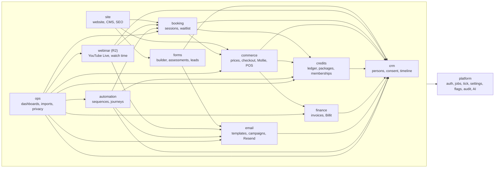

# BEAM platform plan

Start here. This file is the entry point of the plan in `docs/plan/`. It says what we build, how the files fit together, what ships when, how big it is, what can go wrong, and how the build starts.

## The platform in one paragraph

BEAM is the operating platform of the BEAM Vitality Center (Vibrant Lifestyle Collective BV). It replaces SimplyBook, Mailchimp, Typeform and ScoreApp, WebinarGeek and WordPress, takes over in-centre sales from Lightspeed, and keeps Billit for invoices and Peppol. It is one Next.js 16 app (`apps/web`) with three audiences: the public website, the customer portal (an installable PWA) and the staff back-office. It runs on Vercel in Frankfurt with Postgres on Neon, Drizzle ORM and a pnpm and Turborepo monorepo. One central `persons` record holds every customer. Bookings, packages and credits, payments, invoices, forms, email, automations, dashboards and webinars all read and write that record. Every side effect runs through one Postgres job table. Every provider (Mollie, Resend, Billit, YouTube, Meta, Google Ads, Anthropic, Slack) sits behind an interface with a fake adapter, so the whole platform runs end to end without credentials. Twelve modules, three languages (`nl-BE`, `fr-BE`, `en`), single tenant, owned by BEAM. SideStream builds it with parallel AI coding agents: V1 in weeks 1 to 6, go-live in week 8, Releases 2 to 4 in weeks 9 to 14.

## The 12 modules and their main dependencies

An arrow means "calls or reads". Every module also depends on `platform` (auth, jobs, settings, flags, audit, files, AI gateway); that is drawn once, from the group. Cross-module calls go only through `apps/web/modules/<m>/api.ts` (signatures in `02-data-model.md` section 6). `crm` is the hub: it owns `persons`, consent and suppressions.

## How to read the plan

Read in this order. When two files disagree, the earlier one in the authority chain wins: `00-decisions.md`, then `01-architecture.md`, then `02-data-model.md`, then `build-packages.json`, then `03-build-order.md`, then the module specs.

| File | What it is |
| --- | --- |
| `00-decisions.md` | The fixed stack and build rules: Next.js 16, Neon, Drizzle, Vercel, Mollie, Resend, Billit, Auth.js, PGlite tests. |
| `01-architecture.md` | The authoritative architecture: layout, domain model, jobs and tick, auth, i18n, money, automation engine, integrations, environments, security, top risks. |
| `02-data-model.md` | Every table, column, view, enum, event kind, audit action, job kind, permission, setting, flag and cross-module `api.ts` signature. |
| `03-build-order.md` | The 24 waves explained: build rules, dependency graph, critical path, mapping to the proposal weeks, checkpoints, schedule risks. |
| `04-build-session.md` | The orchestrator runbook: pre-flight, dependency catalog, Wave 0 in detail, the agent prompt, the wave loop, the gate, seed data, definition of done. |
| `05-coverage.md` | Coverage matrix: every blueprint section, the seven scenarios, every acceptance test and every proposal promise, mapped to a package and a test. |
| `conventions.md` | Long reference behind the root `CONVENTIONS.md`: naming, idempotency keys, module file set, registries, forward-call stubs, frozen files, import boundaries. |
| `build-packages.json` | The machine plan the orchestrator executes: 123 packages with wave, release, dependencies, owned files, interfaces, tests and estimates. |
| `modules/platform.md` | Users, roles, auth, jobs, tick, settings, flags, audit, files, webhooks, AI gateway, System page, acceptance packages. |
| `modules/crm.md` | Persons, merge, sensitive fields, consent, suppressions, timeline, tags, segments, tasks, companies; R3 B2B pipeline and unified inbox. |
| `modules/booking.md` | Session templates, sessions, capacity, bookings, cancellation, attendance, waitlist and claim links; R2 lead-priority windows and tickets. |
| `modules/commerce.md` | Products, price versions, promotions, checkout, orders, payments, refunds, mandates, vouchers, POS; R2 abandoned checkout. |
| `modules/credits.md` | Credit grants, the append-only ledger, allocation, expiry, sharing, memberships and renewals; R3 referrals and partners. |
| `modules/finance.md` | Invoices, credit notes, numbering, PDF, Billit sync, accountant exports; R3 finance dashboard and deferred revenue. |
| `modules/forms.md` | Form and assessment builder, versions, logic, scoring, result pages, sensitive routing, lead capture with UTM. |
| `modules/email.md` | Template registry, block editor, transactional email, campaigns, chunked sending, Resend events, unsubscribe; R4 AI drafts. |
| `modules/automation.md` | Definitions, groups, versions, enrolments, runs, the evaluator, seeded sequences; R2 conflict rules; R4 visual builder. |
| `modules/ops.md` | Action and management dashboards, person stats, retention lists, imports, exports, privacy requests; R3 ads; R4 NL questions. |
| `modules/site.md` | Public website pages and versions, Claude-assisted editing, SEO, redirects, cookie consent, WordPress migration. |
| `modules/webinar.md` | R2 native webinars on YouTube Live: registration, access links, player, watch segments, polls, CTAs, chat, reports. |
| `_cross-module-decisions.md` | Record of the final decisions (D1 to D69) that settled conflicts between modules; already applied to the specs. |
| `_reconcile-conflicts.md` | Record of the conflicts left after the spec reviews; each is settled in `_cross-module-decisions.md`. |
| `_review-cross-module-items.md` | Record of what each spec review asked other modules to change. |
| `_apply-problems.md` | Record of the points spec owners could not settle alone, with the integrator's decision. |
| `_candidates/arch-{a,b,c}.md` | The three architecture candidates that were scored; `01-architecture.md` section 0 says what was kept. |
| `../../scripts/plan/validate-build-packages.mjs` | The mechanical plan check. Run it after any change to the JSON, a spec's section 12 or `03-build-order.md`. |

The files starting with `_` are history. Read them only to learn why a decision was made.

## Release map

Releases 2 to 4 are built right after V1 (waves 12 to 23) and stay dark behind their `ff_<module>_<name>` flags until their release weeks. "Later" items have no package and no wave.

| Release | Weeks | Waves | Packages | Headline features |
| --- | --- | --- | --- | --- |
| **V1**, core operating platform | 1 to 6 (MVP week 3, go-live week 8) | 0 to 11 | 80 | Central customer record and timeline; consent per purpose; segments with exclusions; NL, FR and EN everywhere; day and night booking with capacity; waitlist with expiring claim links; packages, credits and memberships; prices and promotions; Mollie payments and front-desk POS; customer portal; form and assessment builder; lead capture with UTM; transactional email, campaigns and sequences; preference centre; action dashboard; tasks; roles, permissions and audit log; invoices with Billit sync; data migration; privacy export and erasure |
| **R2**, commercial engine | 9 and 10 | 12 to 18 | 17 | Native webinars (live, replay, on demand, simulive) with polls, CTAs, chat and watch time; lead-priority waitlist for Lead Magnet events; ticket types; B2C pipeline; retention engine; automation conflict rules; abandoned checkout recovery; no-show and cancellation reports; guest and package-sharing controls |
| **R3**, sales and marketing intelligence | 11 and 12 | 19 to 21 | 15 | B2B CRM and pipeline; campaign and form attribution; Meta and Google Ads dashboards; marketing dashboards; unified inbox (email, forms, Instagram, Messenger); referral and partner management with partner sign-in; management and finance dashboards with deferred revenue |
| **R4**, AI and admin flexibility | 13 and 14 | 22 and 23 | 11 | Natural-language questions over the read-only `ai` schema; AI-drafted campaigns and customer-service replies; weekly management summary; custom dashboards; visual workflow builder; Claude translations; churn and repurchase indicators |
| Later | when BEAM decides | none | 0 | Automated B2B prospecting, voice AI, predictive analytics, native mobile app, gamification. Specified, not built |

## The numbers

| What | Count | Split |
| --- | --- | --- |
| Modules | 12 | platform, crm, booking, commerce, credits, finance, forms, email, automation, ops, site, webinar |
| Tables | 141 | V1 112, R2 11, R3 12, R4 6 (`02-data-model.md` section 1.1) |
| Views | 65 `v_` views, plus 14 views in the R4 `ai` schema | `v_` views: V1 45, R2 6, R3 12, R4 2; `ai` schema: 12 by ops, 2 by forms (section 2.0) |
| Job kinds | 129 | V1 97, R2 14, R3 12, R4 6 (section 5.2) |
| Activity event kinds | 137 | section 4 |
| Permissions | 42 | section 5.3; no other permission exists |
| Settings keys | 23 | section 5.4 |
| Feature flags | 11 | section 5.5 |
| Build packages | 123 | V1 80, R2 17, R3 15, R4 11 |
| Waves | 24 (0 to 23) | V1 0 to 11, R2 12 to 18, R3 19 to 21, R4 22 and 23 |
| Estimated agent-minutes | 8,970 (about 150 agent-hours) | V1 6,180, R2 1,335, R3 825, R4 630 |
| Wall clock at 6 agents, gates included | about 58 hours | V1 32, R2 16, R3 6, R4 4 |
| Playwright checkpoints | 7 | after waves 3, 7, 9, 11, 18, 21 and 23 |

## Top 10 risks

Picked from the product risks in `01-architecture.md` section 12 and the schedule risks in `03-build-order.md` section 8. Both full tables stay authoritative.

| # | Risk | Main mitigation |
| --- | --- | --- |
| 1 | The foundation (waves 0 to 3) is late or wrong, and nothing else can start | Foundation runs alone; frozen files; wave 3 checkpoint must be green before wave 4 |
| 2 | Parallel agents collide on schema, registries or shared files | One owner per file, checked by the validator and `CODEOWNERS`; generated registries; one migration per wave by the orchestrator |
| 3 | Duplicate side effects from webhook retries, overlapping ticks or double submits | Unique `webhook_events` key, unique `jobs.idempotency_key`, `FOR UPDATE SKIP LOCKED`, `orders.client_key`, a double-run test for every job |
| 4 | Credit balances drift from bookings | Append-only `credit_entries` ledger, balances as views, consume entry in the booking transaction, nightly `ledger.reconcile` |
| 5 | Marketing email continues after an unsubscribe or a re-import | Append-only `suppressions` written only by `crm.addSuppression`; checked at enrolment, step, chunk and send; "suppression survives import" is an acceptance test |
| 6 | Sensitive data (health, sleep, stress) leaks through exports, segments, AI or logs | Encrypted storage, one audited reader, allow-lists for AI and segments, read-only `ai` schema, Sentry scrubbing, penetration test before go-live |
| 7 | A waitlist race gives one seat to two people | Claim and expiry lock the session row; unique (session_id, person_id); `confirmed` entries are untouchable by the expiry job |
| 8 | A seam fails at a checkpoint (checkout to credits to booking, order to invoice to Billit, form to automation to email) | PGlite seam suites in every gate; platform-P12, P13 and P14 seam tests; fix packages own one module |
| 9 | Real providers behave differently from the fakes, or BEAM's accounts arrive late | Every call is a retried job; fakes built from recorded payloads; staging on test-mode keys from week 3, five weeks before go-live |
| 10 | Data migration brings duplicates, missing consents or odd exports, and go-live slips | Import order suppressions, persons by `lower(email)`, consents, balances; dry runs in weeks 4 and 5 (ops-P4); cut-over checklist on `/admin/imports/cutover` |

## How to start the build

The build is run by an orchestrator session that follows `04-build-session.md` exactly. In short:

1. Run the pre-flight of `04-build-session.md` section 1.2: plan frozen, environment sane, coverage matrix present, `node scripts/plan/validate-build-packages.mjs` green.
2. Run the W0-0 orchestrator step (section 3.1): workspace packages, the full dependency catalog (section 2), root files and secrets in `.env.local`.
3. Run the wave loop (section 5) for waves 0 to 23 of `build-packages.json`: launch at most 6 coding agents per round with the prompt template of section 4, merge in list order, generate the wave migration, run the gate, run Playwright at the checkpoint waves, commit and push.
4. Seed `beam_dev` with the demo data (section 6) before each checkpoint.
5. Stop when the definition of done in section 7 is met. Section 7.2 lists what needs real credentials and a human.

Build progress lives in `docs/build/state.json` and `docs/build/wave-log.md`, owned by the orchestrator. On 2026-11-03 W0-0 and wave 0 (`platform-P1`) were merged and wave 1 (`platform-P2`, `platform-P3`, `platform-P4`) was running.

## Consistency pass

Done on 2026-11-03, while wave 1 was running. Module ids, package ids, table names, view names, job kinds, permission strings, feature flags and release labels were checked across every plan file with scripts against the catalogues of `02-data-model.md` (sections 1.1, 2.0, 4, 5.2, 5.3, 5.5) and against `build-packages.json`. What matched needed no change: all 12 module ids, every `<module>-P<n>` id (each names a JSON package or one of the three split parents), every table, every job kind in the module job tables, every permission in permission columns and `requirePermission` calls, and the release labels V1, R2, R3 and R4 (no other label is used).

Fixed:

1. **Package count and effort.** `03-build-order.md`, `04-build-session.md` section 7.1 and `05-coverage.md` row 1 said 122 packages and about 8,900 agent-minutes. The JSON has 123 packages (`platform-P14` was added for R3 seam tests) and 8,970 minutes. All three now say 123 and 8,970, with the split per release.
2. **New-package note.** `03-build-order.md` section 1 named two new packages; it now names three (`platform-P12`, `platform-P13`, `platform-P14`).
3. **Wave 21 goal.** The wave 21 goal in `build-packages.json` did not mention `platform-P14`. It now does, matching `03-build-order.md`.
4. **Module release labels.** The module table in `01-architecture.md` section 1 gave each module fewer releases than its packages have (for example `credits` "V1" while credits-P8 to P10 are R2 to R4; `platform` "V1" while P9, P10, P13 and P14 are later). Each row now lists exactly the releases of its packages in the JSON.
5. **Wrong file owner.** `site-P8` (wave 15) owned `apps/web/modules/webinar/api.ts`. No cross-module decision allows it, and `site.md` only imports `WebinarSignup` from that file, which `webinar-P3` (wave 14, a dependency of site-P8) already exports. The entry was removed from site-P8's `owns`. The validator's only warning is gone.
6. **Forms views missing from the view index.** `v_form_kpis_daily` and `v_form_campaign_attribution` (R3, forms-P9) and the two R4 `ai` views of forms-P10 were not in `02-data-model.md` section 2.0. They are now listed.
7. **`ai` view names.** forms named its R4 views `ai.v_ai_form_funnel_daily` and `ai.v_ai_form_outcomes`. Every other view in the `ai` schema has no `v_` prefix (`ai.bookings`, `ai.revenue`, `ai.webinar_performance_daily`). Decision: `ai` views carry no prefix. They are now `ai.form_funnel_daily` and `ai.form_outcomes` in `forms.md` and `build-packages.json`.
8. **Stale view name in commerce.** `commerce.md` said refunds feed booking's `v_booking_outcomes`, a view booking explicitly does not create. It now says refunds feed ops' `v_revenue_daily` and cancellations are reported by ops' `v_no_show_report`.
9. **Example that names no real view.** `conventions.md` used `v_credit_balances` as its naming example. No such view exists, so the example is now the real `v_person_credits`.

Checked and left as is, because each is already a recorded decision: the mentions of `v_capacity_utilisation`, `v_booking_outcomes`, `v_finance_credit_movements`, `ff_ops_custom_dashboards` and `ff_automation_builder` all say that name does not exist; the audit actions `automations.exit_person` and `automations.pause` appear only to say they do not exist (cross-module D60).

For the orchestrator: `docs/build/ownership.json` still says 122 packages and includes site-P8's old `owns` entry. That file is outside the plan. Regenerate it from `build-packages.json` with `scripts/build/ownership.mjs` before wave 15.

`node scripts/plan/validate-build-packages.mjs` after these fixes: `123 packages, 24 waves`, `OK, 0 warning(s)`.
